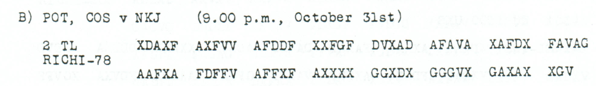

# Falkenhausen followup: a surviving second-part ending

**Reading layers:** [Raw output · Edited output · Readable German · Conditional interpretation](../../docs/reading-conventions.md). In decoded streams, `?` marks one unresolved position; `X` and numeral/letter labels remain literal.

[Case index](../README.md) · [ADFGVX Cipher](../../README.md)

## p86 B2

**Status:** 39/39 native raw positions fixed; 0 coordinate substitutions and 0 source-mask fills. No frame change.

**Source and dates:** Page heading: 31st OCTOBER, 1918; B) POT, COS v NKJ (9.00 p.m., October 31st); 2 TL RICHI-78.



**Raw output:**

```text
FOLGENBALMOEGLIHSTXFALKENHAUSENX8274X18
```

**Edited output — identical to raw output:**

```text
FOLGENBALMOEGLIHSTXFALKENHAUSENX8274X18
```

**Readable German — the same candidate labels with spacing and punctuation:**

> Folgen BAL MOEGLIHST. Falkenhausen. 8274 / 18.

**Meaning:** The surviving ending appears to promise that something will follow as soon as possible, with Falkenhausen and reference 8274/18. The subject of folgen is not present in this part. The literal defective words BAL and MOEGLIHST are preserved; the interpretation as bald moeglichst is not an additional cryptographic recovery.

**Conditional interpretation and source details:** All 78 received coordinates decode directly. The first part has not been identified here. No missing D or C is inserted to normalize BAL MOEGLIHST, and no link to the neighboring food dispatch is asserted.

### Explicit source changes

No source-coordinate substitution or source-mask fill is used.

### Reproducibility and attribution

The [input](../../experiments/oct31_armistice_and_followup/inputs.json) binds each literal source to exact PDF crops. The [certificate](../../experiments/oct31_armistice_and_followup/certificates.json) contains the raw paired-coordinate domains, each source change and the forward checks. The [verifier](../../experiments/oct31_armistice_and_followup/verify.py) checks the unchanged published keys and the live German quotations, retaining all numerical and letter labels.

Source edition and verification: icekylinx and GPT-6 Astra Pro (2026). Childs supplies the historical collection; published reconstruction and key provenance credit Lasry, Niebel, Kopal and Wacker. Earlier repository OCR and body readings are retained in the [attribution record](../../experiments/oct31_armistice_and_followup/prior_candidates.json). No first-decipherment priority is claimed.
