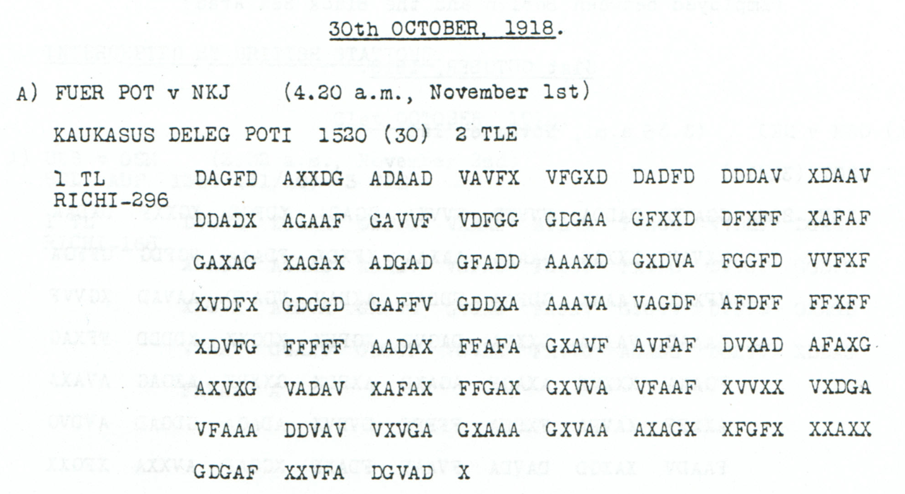

# Food dispatch from Sevastopol to the Caucasus delegation

[Case index](../README.md) · [ADFGVX Cipher](../../README.md) · [Reading conventions](../../docs/reading-conventions.md)

## p85 A1

**Status:** 148/148 native raw positions fixed; 0 coordinate substitutions and 0 source-mask fills. No frame or key change.

**Source and dates:** Page heading: 30th OCTOBER, 1918; A) FUER POT v NKJ (4.20 a.m., November 1st); KAUKASUS DELEG POTI 1530 (30) 2 TLE; 1 TL RICHI-296.



<details>
<summary>Raw decoded text</summary>

**Raw output:**

```text
NACHSCHUBSTELLESEWASTOPOLSANDTE27X10X18ANKAUKASUSDELEGXFOLGXMENGENABX16400KGZUCKER16300KGHARTFUTTER24200KGKARTOFFELN4900KGHIRSE8700KGFRISCHESGEMUESE
```

</details>

**Readable German — the same candidate labels with spacing and punctuation:**

> Nachschubstelle Sewastopol sandte 27 / 10 / 18 an Kaukasusdeleg. folg. Mengen ab: 16400 kg Zucker, 16300 kg Hartfutter, 24200 kg Kartoffeln, 4900 kg Hirse, 8700 kg frisches Gemuese.

**Meaning:** The supply office at Sevastopol reports sending the listed quantities to the Caucasus delegation on the date written 27/10/18. The surviving first part names sugar, hard feed, potatoes, millet and fresh vegetables. This is a dispatch report, not proof of arrival. No total cargo beyond this surviving part is asserted.

**Conditional interpretation and source details:** The enlarged source reads GDGAA: source index 61 is a visible D with a closed curved right stroke. An initial low-resolution C transcription is resolved by the larger crop and is not a historical ciphertext repair. All 296 coordinates and all 148 plaintext positions are directly observed and decode without changes. Every numeral is determined by the unchanged published key. The 27/10/18 body date, 30 October page heading and 1 November reception header remain separate. This is explicitly part 1 of two; no second-part linkage is assumed.

### Quantities retained from the raw stream

| Commodity | Literal quantity |
|---|---:|
| Sugar | 16400 kg |
| Hard feed | 16300 kg |
| Potatoes | 24200 kg |
| Millet | 4900 kg |
| Fresh vegetables | 8700 kg |

The [enlarged GDGAA group](../../experiments/oct30_oil_and_supply_records/sources/p85_A1_GDGAA.png) resolves the initial low-resolution uncertainty: the second glyph is D. No source coordinate or quantity is changed.

### Reproducibility and attribution

The [input](../../experiments/oct30_oil_and_supply_records/inputs.json) binds the complete literal rows to exact PDF crops. The [certificate](../../experiments/oct30_oil_and_supply_records/certificates.json) records every coordinate pair and the sensitivity branch. The [verifier](../../experiments/oct30_oil_and_supply_records/verify.py) checks the published Oct28–31 key, live German quotations, source-image hashes and optional PDF pixel regeneration.

Source edition and verification: icekylinx and GPT-6 Astra Pro (2026). Childs supplies the historical collection; the published reconstruction and key provenance credit Lasry, Niebel, Kopal and Wacker. The [attribution record](../../experiments/oct30_oil_and_supply_records/prior_candidates.json) retains earlier OCR and the already reviewed p84 source.
