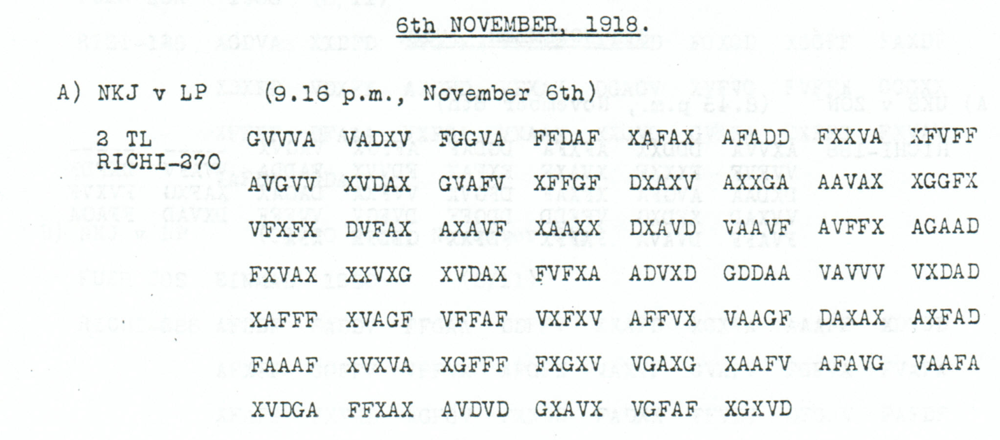

<a id="silk-resale-continuation-confirmed-by-a-third-source"></a>

# Silk bought in the Caucasus: resell when transport is uncertain

Silk and related material bought in the Caucasus should be resold locally where removal cannot be guaranteed. Comparison of independent receptions restores the full continuation of this order to dispose of goods whose transport has become uncertain.

**Complete edition by printed page:** [p. 144](../pages/144.md)

<!-- CASE-EDITION:START -->
<details>
<summary>Full source edition and evidence</summary>


[Case index](../README.md) · [Reading conventions](../../docs/reading-conventions.md)

Buying the material did not ensure that it could be brought away. This
6 November continuation directs local resale where transport cannot be
assured. The preceding part, preserved in [p136 B1 and the associated p152
case](../p152.md), identifies the purchases as silk, silk yarn, waste and
`Strusen` in the Caucasus. The order’s commercial subject comes from that
longer witness; p144’s surviving second part begins in the middle of its
transport clause.

**Source edition and comparison:** icekylinx and GPT-6 Astra Pro.
The published **Nov4–6** key is unchanged.

## p144 A2

The quotation begins after the preceding part’s `DEREN ABTRANSPORT`.
It preserves all labels in this continuation, including the Mercator and
War Office raw-materials closing and the reference 138.

**Readable German — the same candidate labels with spacing and punctuation:**

> Nicht unbedingt sichergestellt, ist nach Moeglichkeit dort wieder verkauft werden. Mercator, Kriegsamt, Kriegsrohstoffabteilung. R. 138, Strich, elf, KRA.

**Meaning:** Where removal cannot be guaranteed, arrange for the material
to be resold locally if possible. The order shows procurement giving way
to disposal when transport is insecure. It records an instruction, not
proof that the goods were sold or that their value was recovered.

This reception independently fixes the whole continuation except for one
source error in `GESTELPT`. Changing it to `GESTELLT` is supported by the
older native continuation witnesses. Across p144 and p152, every position
in the 135-label proposal has an unedited paired-coordinate witness.

**Source and dates:** printed heading `6th NOVEMBER, 1918`;
`A) NKJ v LP (9.16 p.m., November 6th); 2 TL RICHI-270`.

<details>
<summary>Native p144 source and exact reading streams</summary>



The source prints the advertised 270 coordinates, giving 135 raw labels
with no unresolved position. The proposal changes one observed coordinate;
there is no mask fill, source exclusion, added slot or key change.

**Raw output:**

```text
NICHTUNBEDINGTSICHERGESTELPTXISTNACHMOEGLICHKEITDORTWIEDERVERKAUFTWERDENXMERCATORKRIEGSAMTKRIEGSROHSTOFFABTEILUNGXRX138XSTRICHXELFXKRAX
```

**Edited output — counted proposal:**

```text
NICHTUNBEDINGTSICHERGESTELLTXISTNACHMOEGLICHKEITDORTWIEDERVERKAUFTWERDENXMERCATORKRIEGSAMTKRIEGSROHSTOFFABTEILUNGXRX138XSTRICHXELFXKRAX
```

</details>

### Explicit source changes

| Source index, zero-based | Printed | Proposed | Cost |
|---:|---|---|---|
| 146 | `D` | `A` | One observed-coordinate substitution: `GESTELPT` → `GESTELLT` |

The full group `XAFFF` at source 160–164 also confirms the missing F in
p136’s short `XAFF` group. It establishes the full group and coordinate
value, while the identical Fs prevent identification of which occurrence
was historically omitted. p136’s supplied F remains separately charged;
it is not treated as an originally observed coordinate in that copy.

### Reproducibility and attribution

The [inputs](../../experiments/nov6_resale_and_air_reconnaissance/inputs.json)
retain the literal rows and exact source crops. The [certificate](../../experiments/nov6_resale_and_air_reconnaissance/certificates.json)
and [verifier](../../experiments/nov6_resale_and_air_reconnaissance/verify.py)
reproduce the domains, single repair, physical comparisons and forward checks.

Childs supplies the historical source; Lasry, Niebel, Kopal and Wacker retain
published reconstruction and key credit. Earlier repository OCR and the
p136/p152 continuation analysis remain in the [attribution record](../../experiments/nov6_resale_and_air_reconnaissance/prior_candidates.json).
The present contribution is this independently inspected third witness and
its exact relation to the preceding source editions.

</details>
<!-- CASE-EDITION:END -->
