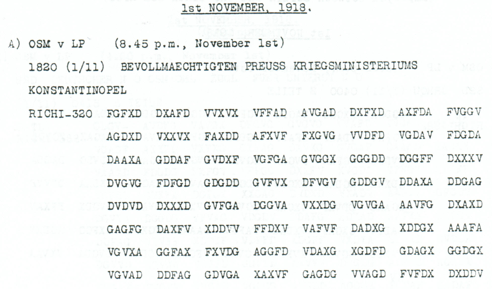

# A complete ZITAG stop order with reporting instruction and literal footer

**Reading layers:** [Raw output · Edited output · Readable German · Conditional interpretation](../../docs/reading-conventions.md). In decoded streams, `?` marks one unresolved position; `X` and numeral/letter labels remain literal.

[Case index](../README.md) · [ADFGVX Cipher](../../README.md)

## p96 A

**Status:** 160/160 native raw positions fixed; 0 coordinate substitutions and 0 source-mask fills. No frame change.

**Source and dates:** Page heading: 1st NOVEMBER, 1918; A) OSM v LP (8.45 p.m., November 1st); 1820 (1/11) BEVOLLMAECHTIGTEN PREUSS KRIEGSMINISTERIUMS KONSTANTINOPEL; RICHI-320.



**Raw output:**

```text
FUERXZITAGXOHNENUMMERNICHTSWEITERKAUFENUNDNICHTSWEITERVERLADENXALLESMOEGLICHSTSICHERNXZITAGXXVERANLASSTESANXKXMXDRAHTENXQXMXALLQXKRXDEPXNOX2439STRICH18XGXANCHXX
```

**Edited output — identical to raw output:**

```text
FUERXZITAGXOHNENUMMERNICHTSWEITERKAUFENUNDNICHTSWEITERVERLADENXALLESMOEGLICHSTSICHERNXZITAGXXVERANLASSTESANXKXMXDRAHTENXQXMXALLQXKRXDEPXNOX2439STRICH18XGXANCHXX
```

**Readable German — the same candidate labels with spacing and punctuation:**

> Fuer ZITAG, ohne Nummer: nichts weiter kaufen und nichts weiter verladen, alles moeglichst sichern. ZITAG. Veranlasstes an K. M. drahten. Q. M. ALLQ. KR. DEP. No. 2439 Strich 18, G. ANCH.

**Meaning:** The message instructs ZITAG to stop further purchases and loading, secure everything as far as possible, and telegraph the action taken to K.M. Its longer closing includes the literal office-like field Q M ALLQ KR DEP and reference 2439 STRICH 18 G ANCH. Those fields are preserved without silently normalizing Q to K or ALLQ to ALLG.

**Conditional interpretation and source details:** All 320 received coordinates and 160 plaintext positions decode directly. The procurement-stop body was already read from shorter p102/p103 witnesses; this newly reviewed physical record supplies a complete longer native text, including the reporting instruction. The certificate compares the nonseparator body labels with the earlier composite candidate while preserving different X separators and different transposition lengths.

### Explicit source changes

No source-coordinate substitution or source-mask fill is used.

The [shorter ZITAG witnesses](../finance/zitag_purchase_orders.md) already supplied the procurement-stop body. This additional physical record directly retains the longer instruction and closing; the older witnesses are not counted again.

### Reproducibility and attribution

The [input](../../experiments/nov1_nov2_native_dispatches/inputs.json) binds each literal source to exact PDF crops. The [certificate](../../experiments/nov1_nov2_native_dispatches/certificates.json) contains the raw paired-coordinate domains, each source change and the forward checks. The [verifier](../../experiments/nov1_nov2_native_dispatches/verify.py) checks the unchanged published keys and the live German quotations, retaining all numerical and letter labels.

Source edition and verification: icekylinx and GPT-6 Astra Pro (2026). Childs supplies the historical collection; published reconstruction and key provenance credit Lasry, Niebel, Kopal and Wacker. Earlier repository OCR and body readings are retained in the [attribution record](../../experiments/nov1_nov2_native_dispatches/prior_candidates.json). No first-decipherment priority is claimed.
