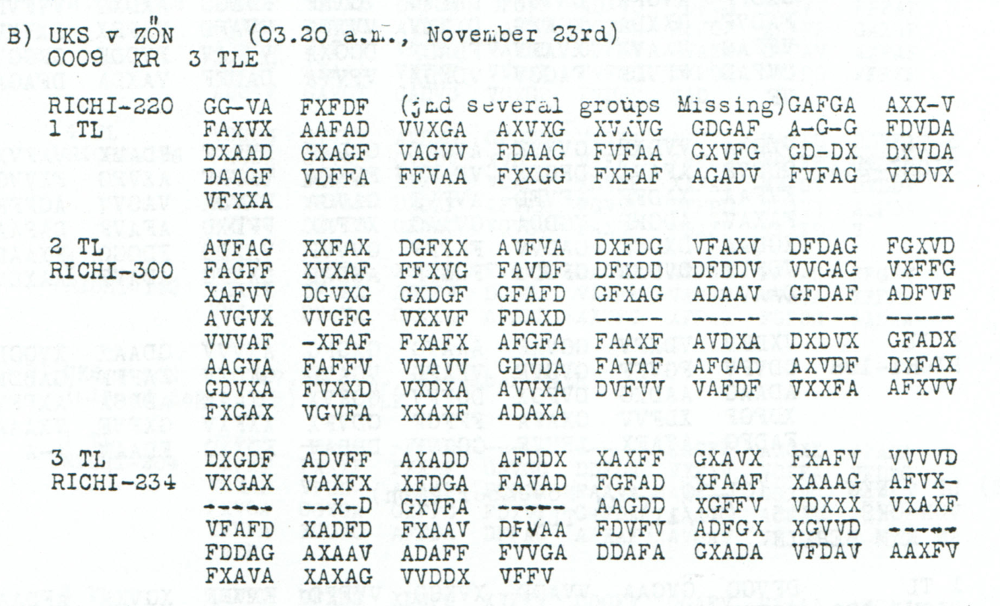
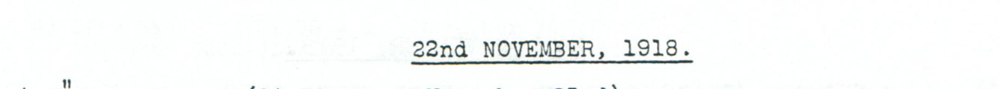

# Divisional areas and staff locations: second part with explicit geographical alternatives

[Case index](../README.md) · [ADFGVX Cipher](../../README.md) · [Reading conventions](../../docs/reading-conventions.md)

## p215 B2

**Status:** 129/150 native raw positions fixed; 0 coordinate substitutions and 13 source-mask fills. No frame change.

**Source and dates:** Page heading: 22nd NOVEMBER, 1918; B) UKS v ZON (03.20 a.m., November 23rd); 0009 KR 3 TLE; 2 TL RICHI-300; the first part separately says several groups are missing.



<details>
<summary>Source and cipher evidence</summary>

**Raw output:**

```text
?YDIXDXRAUM?ZENTES?HOD?EZOEXVASAR?EY4XERREIC?TX?DIVXSTX?UX?ODMEZOE?VA?ARTEL4X?XK?38XOROS?UZ?X2RXDXR?UM?AG4BANHEG4?SXBATTRE4A?DIVXSTX6UX?EZOEKOVACS?AZA
```

**Edited output — counted proposal:**

```text
?YDIXDXRAUMSZENTES?HODMEZOEXVASARHEY4XERREICHTX?DIVXSTX?UXHODMEZOEXVASARTEL4X?XK?38XOROSHUZ?X2RXDXRAUMNAG4BANHEG4ESXBATTRE4A?DIVXSTX6UXMEZOEKOVACSHAZA
```

</details>

**Readable German — the same candidate labels with spacing and punctuation:**

> ?YDI D. Raum Szentes ? Hodmezoe Vasarhey4 erreicht. ? Div. St. ?U Hodmezoe Vasartel4. ? K?38. Oroshuz?. 2R D. Raum Nag4banheg4es. Battre4a ? Div. St. 6U Mezoekovacshaza.

**Meaning:** The stream reports a reached area and then lists areas and divisional staff locations. The proposed fills make SZENTES, HODMEZOE, ERREICHT, RAUM and MEZOEKOVACSHAZA legible. The precise unit designations, the relationship between the listed places and the garbled labels remain uncertain. The separate geographical alternative below proposes place-name spellings at an additional observed-coordinate cost; it is not independent historical confirmation.

**Conditional interpretation and source details:** All 300 printed positions are retained. Four consecutive five-dash groups and the initial dash of -XFAF contribute 21 source masks. The primary reading uses 13 explicitly proposed mask fills and no change to an observed coordinate. Its eight unresolved plaintext positions and the known labels ?YDI D, ? K?38, 2R D, 6U, VASARHEY4, VASARTEL4, OROSHUZ?, NAG4BANHEG4ES and BATTRE4A are retained. In particular, the digit 4 is not silently read as Y. The source defines this as part 2 of 3; no missing first-part groups or third-part length are supplied. Date heading November 22 and reception November 23 remain separate evidence layers.

### Explicit source changes

All indices are zero-based.

| Source index | Printed | Proposed | Cost |
|---:|---|---|---|
| 141 | `-` | `V` | Source-mask fill |
| 142 | `-` | `D` | Source-mask fill |
| 145 | `-` | `A` | Source-mask fill |
| 146 | `-` | `F` | Source-mask fill |
| 148 | `-` | `V` | Source-mask fill |
| 149 | `-` | `V` | Source-mask fill |
| 151 | `-` | `A` | Source-mask fill |
| 152 | `-` | `A` | Source-mask fill |
| 153 | `-` | `F` | Source-mask fill |
| 154 | `-` | `F` | Source-mask fill |
| 156 | `-` | `X` | Source-mask fill |
| 158 | `-` | `F` | Source-mask fill |
| 159 | `-` | `A` | Source-mask fill |

### Optional geographical reading — additional 18 substitutions and 1 fill

The following alternative proposes **HODMEZOE VASARHELY, OROSHAZA, NAGYBANHEGYES and BATTONYA** for the retained garbled names. This is a linguistic/geographical hypothesis, without a parallel copy verifying this message’s intended wording. The complete cost is **18 observed-coordinate substitutions + 14 source-mask fills**, which adds 18 substitutions and one fill to the primary reading. Seven unresolved plaintext positions remain. The unit fields `?YDI D`, `? K?38`, `2R D` and `6U` remain literal; the final `6U` is not silently normalized to a preposition.

<details>
<summary>Proposed text and exact labels</summary>

**Edited output — optional geographical hypothesis:**

```text
?YDIXDXRAUMSZENTES?HODMEZOEXVASARHELYXERREICHTX?DIVXSTX?UXHODMEZOEXVASARHELYX?XK?38XOROSHAZAX2RXDXRAUMNAGYBANHEGYESXBATTONYA?DIVXSTX6UXMEZOEKOVACSHAZA
```

</details>

**Readable German — optional geographical hypothesis:**

> ?YDI D. Raum Szentes ? Hodmezoe Vasarhely erreicht. ? Div. St. ?U Hodmezoe Vasarhely. ? K?38. Oroshaza. 2R D. Raum Nagybanhegyes. Battonya ? Div. St. 6U Mezoekovacshaza.

This alternative makes the proposed place names easier to recognize. It does not establish that all these places had been reached: the explicit ERREICHT clause belongs to the opening area report, while the rest lists areas and staff locations.

**Later shared-key interpretation:** The [Hungarian Y constraint](../../experiments/p215_hungarian_y/README.md), supported by this source and operational p217 A3, separately assigns DD to Y. Under that optional global interpretation, the same geographical word proposal needs **8 observed substitutions and 14 printed-mask fills**: all five geographical Y pairs revert to their original observed DD coordinates. The joint numeral/J/Y layer also changes the leading baseline Y to numeral 1 and leaves other unproved unit labels unresolved. The earlier baseline-square display and its full 18-substitution ledger below remain intact.

**Additional source changes beyond the primary 13 fills:**

| Source index | Printed | Proposed | Cost |
|---:|---|---|---|
| 20 | `D` | `F` | Observed-coordinate substitution |
| 23 | `D` | `A` | Observed-coordinate substitution |
| 60 | `D` | `A` | Observed-coordinate substitution |
| 78 | `F` | `A` | Observed-coordinate substitution |
| 89 | `G` | `A` | Observed-coordinate substitution |
| 92 | `D` | `A` | Observed-coordinate substitution |
| 119 | `F` | `X` | Observed-coordinate substitution |
| 139 | `D` | `F` | Observed-coordinate substitution |
| 161 | `V` | `D` | Observed-coordinate substitution |
| 180 | `F` | `G` | Observed-coordinate substitution |
| 187 | `D` | `F` | Observed-coordinate substitution |
| 213 | `V` | `X` | Observed-coordinate substitution |
| 216 | `D` | `F` | Observed-coordinate substitution |
| 235 | `D` | `A` | Observed-coordinate substitution |
| 240 | `G` | `A` | Observed-coordinate substitution |
| 252 | `D` | `F` | Observed-coordinate substitution |
| 268 | `D` | `F` | Observed-coordinate substitution |
| 296 | `D` | `A` | Observed-coordinate substitution |
| 144 | `-` | `X` | Source-mask fill |

The extra fill at source 144 proposes the final A in OROSHAZA; its other coordinate at source 240 must also change G to A. The raw domain of this plaintext position excludes A, so that name cannot be obtained by a free source-mask fill.

**Separate contextual record:** [p217 A2](p217_A.md) directly decodes `OROSHAZA` in a later report without coordinate repairs. That occurrence supports recognizing the geographical name; it does not establish that the two reports refer to the same unit, the same position or the same event. It does not reduce any of the p215 edits above or verify the other proposed place names. The baseline unit label `2RXD` remains literal here; the separate numeral interpretation discussed in that older case is not imported into this edition.



### Reproducibility and attribution

The [input](../../experiments/southern_hungary_positions_part2/inputs.json) binds each literal source to exact PDF crops. The [certificate](../../experiments/southern_hungary_positions_part2/certificates.json) contains the raw paired-coordinate domains, each source change and the forward checks. The [verifier](../../experiments/southern_hungary_positions_part2/verify.py) checks the unchanged published keys and the live German quotations, retaining all numerical and letter labels.

Source edition and verification: icekylinx and GPT-6 Astra Pro (2026). Childs supplies the historical collection; published reconstruction and key provenance credit Lasry, Niebel, Kopal and Wacker. Earlier repository OCR and body readings are retained in the [attribution record](../../experiments/southern_hungary_positions_part2/prior_candidates.json).

The [first-part train-departure fragment](p215_train_departure_fragment.md) now has a separate conditional partial word edition. Its missing groups, both source-glyph alternatives and unresolved fields remain explicit; this second part supplies context rather than a matching plaintext copy.
