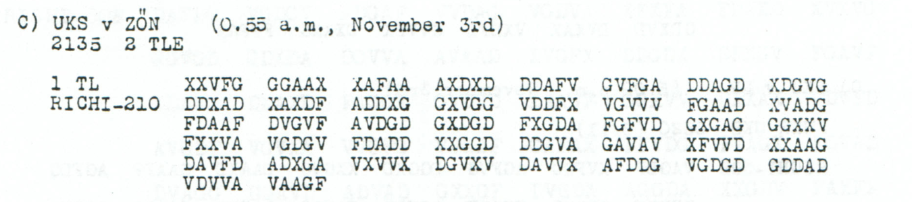
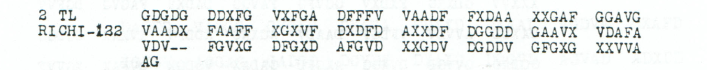

# Two-part march notice and officer dispatch: a priced editorial reading

[Case index](../README.md) · [ADFGVX Cipher](../../README.md) · [Reading conventions](../../docs/reading-conventions.md)

## p109 C1

**Status:** 105/105 native raw positions fixed; 14 coordinate substitutions and 0 source-mask fills. No frame change.

**Source and dates:** Page heading: 3rd NOVEMBER, 1918; C) UKS v ZON (0.55 a.m., November 3rd); 2135 2 TLE; 1 TL RICHI-210.



<details>
<summary>Source and cipher evidence</summary>

**Raw output:**

```text
IXPXMXZU1163EPB41NUERJEHSAUFAOLE8STRECKENSUEDUNGARVSUNTERBROCHEVXARMMETRITT4X11XFUSSM4RSCHNACHNORUOSTEC4N
```

**Edited output — counted proposal:**

```text
IXPXMXZU1163EPB41NVERKEHRAUFALLENSTRECKENSUEDUNGARNSUNTERBROCHENXARMEETRITT4X11XFUSSMARSCHNACHNORDOSTENAN
```

</details>

**Readable German — the same candidate labels with spacing and punctuation:**

> I. P. M. ZU1163EPB41N. Verkehr auf allen Strecken Suedungarns unterbrochen. Armee tritt 4 / 11 Fussmarsch nach Nordosten an.

**Meaning:** The linguistic proposal says that traffic on all routes in southern Hungary is interrupted and that the army begins a foot march toward the northeast on the date label 4/11. The opening I P M ZU1163EPB41N remains opaque. This is an edited reading of the printed garbles, not a new independent witness to the intended words.

**Conditional interpretation and source details:** The native 210-coordinate frame fixes all 105 raw positions, but the body contains repeated garbles. The readable proposal costs 14 observed-coordinate substitutions; many are printed D changed to proposed G. The full ledger below preserves every one. The opening IXPXMXZU1163EPB41N is unchanged, including every letter and numeral. Word-internal raw 8 and 4 labels are changed only through priced source-coordinate substitutions; the date 4/11 is untouched. No source mask, frame change, key adjustment or independent parallel is used. Re-encryption proves the exact proposed transformation, not a unique historical reading.

### Explicit source changes

All indices are zero-based.

| Source index | Printed | Proposed | Cost |
|---:|---|---|---|
| 2 | `V` | `A` | Observed-coordinate substitution |
| 21 | `D` | `G` | Observed-coordinate substitution |
| 31 | `D` | `G` | Observed-coordinate substitution |
| 37 | `G` | `F` | Observed-coordinate substitution |
| 46 | `A` | `G` | Observed-coordinate substitution |
| 74 | `D` | `G` | Observed-coordinate substitution |
| 77 | `A` | `G` | Observed-coordinate substitution |
| 90 | `A` | `D` | Observed-coordinate substitution |
| 99 | `D` | `G` | Observed-coordinate substitution |
| 124 | `A` | `V` | Observed-coordinate substitution |
| 127 | `D` | `G` | Observed-coordinate substitution |
| 139 | `D` | `G` | Observed-coordinate substitution |
| 154 | `D` | `G` | Observed-coordinate substitution |
| 180 | `D` | `G` | Observed-coordinate substitution |

## p109 C2

**Status:** 59/61 native raw positions fixed; 2 coordinate substitutions and 2 source-mask fills. No frame change.

**Source and dates:** Same C header and page as p109 C1; 2 TL RICHI-122.



<details>
<summary>Source and cipher evidence</summary>

**Raw output:**

```text
GENERAL?TABSOFFZX?MFLUGZEUGWIRDEN0SANRTXXAXOXKX11XEINSX4X7023
```

**Edited output — counted proposal:**

```text
GENERALSTABSOFFZXIMFLUGZEUGWIRDENTSANDTXXAXOXKX11XEINSX4X7023
```

</details>

**Readable German — the same candidate labels with spacing and punctuation:**

> Generalstabsoffz. im Flugzeug wird entsandt. A. O. K. 11. Eins 4. 7023.

**Meaning:** The second part says a General Staff officer will be dispatched by aircraft. The closing retains A O K 11, EINS4 and 7023 as transmitted labels. This announces a future dispatch and does not establish that the flight took place.

**Conditional interpretation and source details:** The two dashes in VDV-- remain two source slots. Filling them supplies the missing S of GENERALSTABSOFFZ and I of IM. Two observed-coordinate substitutions separately propose ENTSANDT for EN0SANRT. The raw 0 inside that word is changed through the explicit coordinate ledger; the footer 4 and 7023 are not relabeled or normalized to a presumed staff designation.

### Explicit source changes

All indices are zero-based.

| Source index | Printed | Proposed | Cost |
|---:|---|---|---|
| 55 | `D` | `G` | Observed-coordinate substitution |
| 119 | `A` | `X` | Observed-coordinate substitution |
| 83 | `-` | `V` | Source-mask fill |
| 84 | `-` | `A` | Source-mask fill |

### Reproducibility and attribution

The [input](../../experiments/radio_relay_and_march_notice/inputs.json) binds each literal source to exact PDF crops. The [certificate](../../experiments/radio_relay_and_march_notice/certificates.json) contains the raw paired-coordinate domains, each source change and the forward checks. The [verifier](../../experiments/radio_relay_and_march_notice/verify.py) checks the unchanged published keys and the live German quotations, retaining all numerical and letter labels.

Source edition and verification: icekylinx and GPT-6 Astra Pro (2026). Childs supplies the historical collection; published reconstruction and key provenance credit Lasry, Niebel, Kopal and Wacker. Earlier repository OCR and body readings are retained in the [attribution record](../../experiments/radio_relay_and_march_notice/prior_candidates.json).
