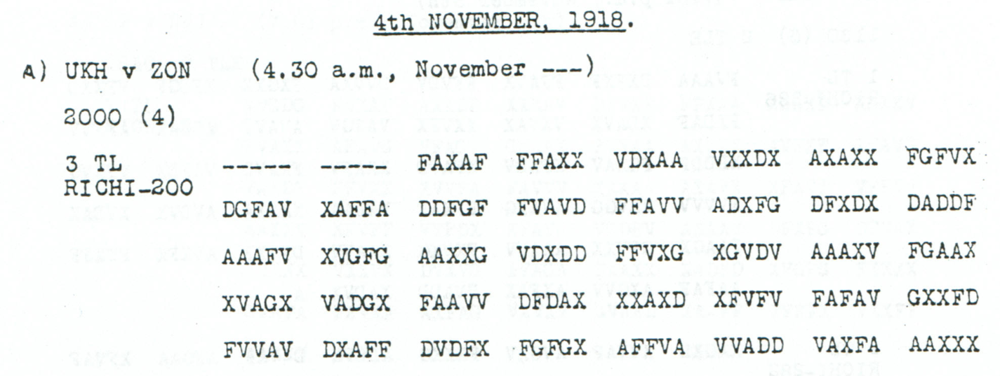

# March report and aerial reconnaissance with unresolved unit and place

**Reading layers:** [Raw output · Edited output · Readable German · Conditional interpretation](../../docs/reading-conventions.md). In decoded streams, `?` marks one unresolved position; `X` and numeral/letter labels remain literal.

[Case index](../README.md) · [ADFGVX Cipher](../../README.md)

## p127 A3

**Status:** 90/100 native raw positions fixed; 2 observed-coordinate substitutions and 6 source-mask fills in the proposal. No frame change. Key: Nov4-6.

**Source and dates:** Page heading: 4th NOVEMBER, 1918; A) UKH v ZON (4.30 a.m., November---); 2000 (4); 3 TL RICHI-200.



**Raw output:**

```text
211?IVDXMARS?HIERCBI?9X11XINR?UMUMTIT?LCXAXHXQ?X5X11XN?GQBECSER?KXXLUFT?UFKLAERU?ZNICHTSWESENTLICHES
```

**Edited output — counted proposal:**

```text
211?IVDXMARSCHIERTBIS9X11XINRAUMUMTITELCXAXHXQ?X5X11XN?GQBECSER?KXXLUFTAUFKLAERUNGNICHTSWESENTLICHES
```

**Readable German — the same candidate labels with spacing and punctuation:**

> 211?IVD marschiert bis 9 / 11 in Raum um TITELC. A. H. Q? 5 / 11 N?GQBECSER?K. Luftaufklaerung nichts Wesentliches.

**Meaning:** The proposal reports a march by the unresolved unit label 211?IVD into the area around literal TITELC by 9 / 11. An A H Q? / 5 / 11 / N?GQBECSER?K clause follows. The aerial reconnaissance clause reports nothing substantial. No place, unit or missing interception day is silently supplied.

**Conditional interpretation and source details:** The two five-dash groups occupy ten explicit source slots. The proposal fills six of them and changes two observed coordinates. Four plaintext positions remain unknown: one in the unit, one in Q?, and two in N?GQBECSER?K. TITELC remains literal, including its final C. The source omits the interception day; the plaintext date-like labels do not supply it.

### Explicit source changes

All indices are zero-based. Printed masks retain their original slots.

| Source index | Printed | Proposed | Cost |
|---:|---|---|---|
| 108 | `D` | `A` | Observed-coordinate substitution |
| 150 | `F` | `V` | Observed-coordinate substitution |
| 1 | `-` | `X` | Source-mask fill |
| 2 | `-` | `G` | Source-mask fill |
| 3 | `-` | `V` | Source-mask fill |
| 4 | `-` | `A` | Source-mask fill |
| 8 | `-` | `F` | Source-mask fill |
| 9 | `-` | `X` | Source-mask fill |

### Reproducibility and attribution

The [input](../../experiments/early_radio_and_leave_records/inputs.json) binds each literal source to exact PDF crops. The [certificate](../../experiments/early_radio_and_leave_records/certificates.json) records each raw paired-coordinate domain and every proposed source change. The [verifier](../../experiments/early_radio_and_leave_records/verify.py) checks the live German quotation against the same candidate labels, preserving every digit and unknown position.

This source edition is by icekylinx and GPT-6 Astra Pro (2026). Childs supplies the historical collection. The published reconstruction and unchanged key provenance credit Lasry, Niebel, Kopal and Wacker, with Lasry's published period-key list. Earlier repository OCR input is frozen in the [attribution record](../../experiments/early_radio_and_leave_records/prior_candidates.json); no first-decipherment priority is claimed.
