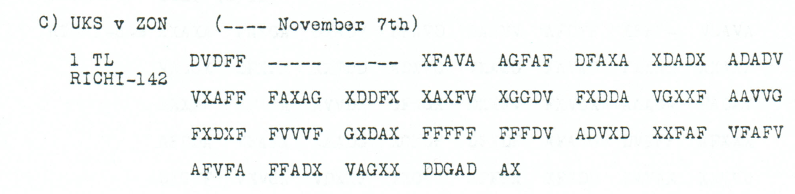

# Ferries and horse loading at Kladovo

[Case index](../README.md) · [ADFGVX Cipher](../../README.md) · [Reading conventions](../../docs/reading-conventions.md)

## Completed reading

The aerial-reconnaissance message dated 5 November reports ferries and the
loading of horses near **Kladovo**. The place identification completes the
earlier `KIAD?VO` fragment; a separator fill gives a **71/71-position
conditional reading**. The heading's literal `M5` is retained.

**Readable German — completed conditional proposal with the Kladovo identification:**

> O. K. M5. Lufterkundung 5 / 11. Bei Kladovo Faehren, Verladung von Pferden erkannt.

The National Library of Serbia catalogues an **1893 General Staff map of the
Kingdom of Serbia, sheet K 2, Кладово**, published by the General Staff's
Geographical Department in Belgrade at 1:75,000 (COBISS 129724684).
This independently attests the place name *Kladovo* before the war.
[Historical map record](https://digitalna.nb.rs/view/URN:NB:RS:SD_571C5F8EA57C630BE1A06E28BA3ECF0E?virtuelne=NBS/Karte/srbija).

The name requires one additional source correction and one dash fill. The
remaining dash supplies X before `BEI`. Against the original source, the
complete proposal costs **six observed-coordinate substitutions and ten
printed-mask fills** under the same key and 142-slot frame.

| Additional operation | Effect |
|---|---|
| Source 104 V → A | I → L in KLADOVO |
| Source 11 dash → A | O in KLADOVO; the surviving pair allows `036OQY` |
| Source 10 dash → F | Separator X before BEI; the surviving pair allows `0578CX` |

<details>
<summary>Completed exact stream</summary>

**Edited output — completed conditional proposal:**

```text
OXKXM5XLUFTERKUNDUNG5X11XXBEIKLADOVOFAEHRENXVERLADUNGVONPFERDENERKANNTX
```

</details>

[Completion and independent re-encryption](../../experiments/nov6_danube_completion/README.md).

## p144 C1

<details>
<summary>Source, earlier partial readings and repair account</summary>


**Status:** 71 native plaintext positions, 10 unresolved in raw output; 5 observed-coordinate substitutions and 8 source-mask fills in the proposal. No source position, frame length, key or numerical label is silently changed.

**Source and dates:** Page heading: 6th NOVEMBER, 1918; C) UKS v ZON (---- November 7th); 1 TL RICHI-142.



<details>
<summary>Source and cipher evidence</summary>

**Raw output:**

```text
OXKXM5XL?FTERKUN?UNG5X11X?BEIKIAD?VOFAEHRE?XVE?PMD?NGV?4PFE?DEN?TKANNTX
```

**Edited output — counted proposal:**

```text
OXKXM5XLUFTERKUNDUNG5X11X?BEIKIAD?VOFAEHRENXVERLADUNGVONPFERDENERKANNTX
```

</details>

**Readable German — the same candidate labels with spacing and punctuation:**

> O. K. M5. Lufterkundung 5 / 11. ? Bei KIAD?VO Faehren, Verladung von Pferden erkannt.

**Meaning:** The proposed reading reports aerial reconnaissance dated 5/11: ferries and loading of horses were observed near the unresolved place written KIAD?VO. The leading unresolved position and designation M5 remain literal; no definite modern place or unit is assigned.

**Conditional interpretation and evidence:** The readable proposal uses five observed-coordinate substitutions and eight source-mask fills. It leaves one position before `BEI` and one inside `KIAD?VO` unknown. The tempting place expansion is not adopted. `M5`, the date labels `5/11`, and the initial `O K` remain literal. The number-like raw garble in `V?4` is changed to the ordinary word `VON` only through the explicitly priced proposal; there is no substitution-square relabeling.

### Explicit source changes

All indices are zero-based. Unknown slots retain their position.

| Source index | Printed | Proposed | Cost |
|---:|---|---|---|
| 50 | `X` | `V` | Observed-coordinate substitution |
| 72 | `X` | `V` | Observed-coordinate substitution |
| 106 | `D` | `A` | Observed-coordinate substitution |
| 107 | `V` | `X` | Observed-coordinate substitution |
| 108 | `X` | `V` | Observed-coordinate substitution |
| 5 | `-` | `V` | Source-mask fill |
| 6 | `-` | `A` | Source-mask fill |
| 7 | `-` | `F` | Source-mask fill |
| 8 | `-` | `D` | Source-mask fill |
| 9 | `-` | `F` | Source-mask fill |
| 12 | `-` | `X` | Source-mask fill |
| 13 | `-` | `V` | Source-mask fill |
| 14 | `-` | `V` | Source-mask fill |

### Reproducibility and attribution

The [input](../../experiments/nov6_resale_and_air_reconnaissance/inputs.json) binds the literal transcription to exact PDF crops. The [certificate](../../experiments/nov6_resale_and_air_reconnaissance/certificates.json) gives the raw paired-coordinate domains, every source change, and the forward checks. The [verifier](../../experiments/nov6_resale_and_air_reconnaissance/verify.py) reproduces them without changing the published Nov4–6 key.

This edition is by icekylinx and GPT-6 Astra Pro (2026). Childs supplies the historical source; Lasry, Niebel, Kopal and Wacker supply the published reconstruction and key provenance. Earlier repository OCR and the p136/p152 continuation analysis are retained in the [attribution record](../../experiments/nov6_resale_and_air_reconnaissance/prior_candidates.json).

</details>
