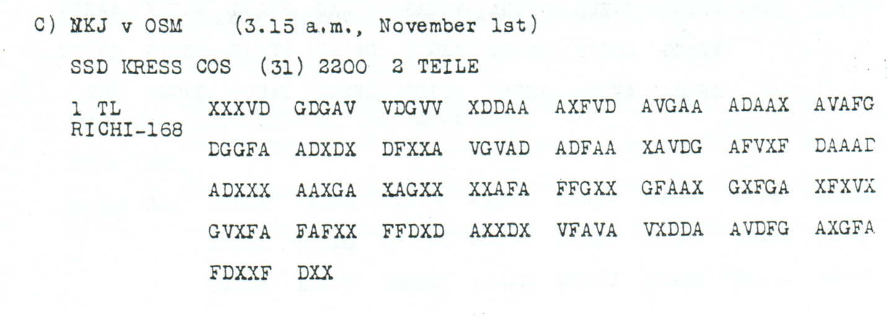

# A telegram reports the Turkish armistice, with terms still unknown

[Case index](../README.md) · [ADFGVX Cipher](../../README.md) · [Reading conventions](../../docs/reading-conventions.md)

## p86 C1

**Status:** 84/84 native raw positions fixed; 1 coordinate substitution and 0 source-mask fills. No frame change.

**Source and dates:** Page heading: 31st OCTOBER, 1918; C) NKJ v OSM (3.15 a.m., November 1st); SSD KRESS COS (31) 2200 2 TEILE; 1 TL RICHI-168.



<details>
<summary>Source and cipher evidence</summary>

**Raw output:**

```text
WAFFENSTILLSTANDHEUTEEINUHRNACHMVONTUERKEIABGESCHLOSSENXBEDINGUNGENNOCHNICHTBEKANZTX
```

**Edited output — counted proposal:**

```text
WAFFENSTILLSTANDHEUTEEINUHRNACHMVONTUERKEIABGESCHLOSSENXBEDINGUNGENNOCHNICHTBEKANNTX
```

</details>

**Readable German — the same candidate labels with spacing and punctuation:**

> Waffenstillstand heute ein Uhr nachm. von Tuerkei abgeschlossen. Bedingungen noch nicht bekannt.

**Meaning:** The message reports that Turkey concluded an armistice today at one o'clock in the afternoon and says its terms are not yet known. This is the content of the intercepted report; it does not independently establish the historically effective time. The page is headed 31 October, and reception is recorded on 1 November.

**Conditional interpretation and source details:** The only proposal repairs BEKANZT to BEKANNT through one observed-coordinate substitution. HEUTE, EIN UHR and NACHM are direct raw wording. The source labels this part 1 of two; no missing continuation is supplied.

### Explicit source changes

All indices are zero-based.

| Source index | Printed | Proposed | Cost |
|---:|---|---|---|
| 55 | `V` | `X` | Observed-coordinate substitution |

### Reproducibility and attribution

The [input](../../experiments/oct31_armistice_and_followup/inputs.json) binds each literal source to exact PDF crops. The [certificate](../../experiments/oct31_armistice_and_followup/certificates.json) contains the raw paired-coordinate domains, each source change and the forward checks. The [verifier](../../experiments/oct31_armistice_and_followup/verify.py) checks the unchanged published keys and the live German quotations, retaining all numerical and letter labels.

Source edition and verification: icekylinx and GPT-6 Astra Pro (2026). Childs supplies the historical collection; published reconstruction and key provenance credit Lasry, Niebel, Kopal and Wacker. Earlier repository OCR and body readings are retained in the [attribution record](../../experiments/oct31_armistice_and_followup/prior_candidates.json).
