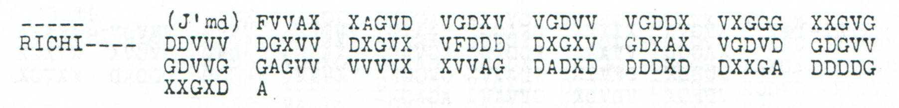

# p163 A16 — Conditional infrastructure clause in a jammed continuation

[Catalogue](../README.md) · [Reading conventions](../../docs/reading-conventions.md)

**Source review and conditional reconstruction: icekylinx and GPT-6 Astra Pro.**
The unnumbered fragment between parts 15 and 17 permits a partial clause about
the destruction of railways, roads and telephone lines. Its **121 received
coordinates remain unchanged**. The proposed 59-character clause depends on
an inferred missing prefix and supplies 65 absent coordinates; it is a
conditional partial reading, not a complete message or a recovered frame length.

## p163 A16

**Readable German — conditional clause in the 286-slot model; the first omission remains unread:**

> […] Wegen Zerstoerung von Eisenbahnen, Strassen und Telephonleitungen …

The following part's earlier edited opening is “erfolgt noch Befehl,” giving
the possible sense: further orders will follow concerning the destruction of
these facilities. This is an order about a future decision, not evidence that
all the listed facilities were destroyed. The continuation is separately
priced: A17 natively reads `ERFOGGTNOCHBEFEHL`, and the prior edition changes
source coordinate 172 from `G` to `D` to obtain `ERFOLGTNOCHBEFEHL`.
Its `NOCHBEFEHL` portion is entirely observed without changes. None of that
inherited repair is counted as a new A16 correction.

<details>
<summary>Raw decoded text</summary>

**Raw output — conditional 286-slot frame with 165 added leading unknown coordinates; unchanged Nov7–9 partial key; 0/143 fixed positions:**

```text
???????????????????????????????????????????????????????????????????????????????????????????????????????????????????????????????????????????????
```

</details>

The received source constrains one half of many letter pairs, even though it
does not fully determine a single plaintext position in this model. The
certificate retains every half-coordinate domain and its received-source owner.

<details>
<summary>Proposed text and exact labels</summary>

**Edited output — proposed clause at positions 84–142; zero observed substitutions, zero printed-mask fills and 65 added-slot fills; 59/143 assigned positions:**

```text
????????????????????????????????????????????????????????????????????????????????????WEGENZERSTOERUNGVONEISENBAHNENXSTRASSENUNDTELEPHONLEITUNGEN
```

</details>

The first **84 plaintext positions** remain unresolved, including the optional
numbered heading. Of the 165 inferred missing coordinates, 100 remain
unassigned in this primary edited stream. No observed coordinate is deleted,
reordered or altered, and none of the 165 added slots is described as a printed
dash. The original only says `J'md` and gives no numerical loss count.

## Exact support and absent letters

The 59-position proposal contains **53 observed half-coordinates**, all retained,
and **65 supplied absent halves**. Fifty-three proposed positions retain one
observed half each; the remaining six have neither half observed. Their
zero-based plaintext indices and proposed letters are **92 S, 102 N, 112 E,
122 N, 132 O and 142 N**. These six letters are contextual supplies, not
independently recovered characters.

| Proposed segment | Plaintext positions, inclusive | Observed halves retained | Wholly unobserved positions |
|---|---:|---:|---:|
| `WEGEN` | 84–88 | 5 | 0 |
| `ZERSTOERUNG` | 89–99 | 10 | 1 |
| `VON` | 100–102 | 2 | 1 |
| `EISENBAHNEN` | 103–113 | 10 | 1 |
| `X` | 114 | 1 | 0 |
| `STRASSEN` | 115–122 | 7 | 1 |
| `UND` | 123–125 | 3 | 0 |
| `TELEPHONLEITUNGEN` | 126–142 | 15 | 2 |

The separate proposal `8X` at 82–83 adds two assigned positions and three
added-slot fills, bringing the optional layer to 61/143. The `8` is wholly
unobserved. Numbered headings 7 and 9 in the neighboring parts motivate it;
they do not turn it into a cipher-only numeral recovery. It is omitted from
the primary edited output above.

## Two indistinguishable frame models

The source retains no part number or transmitted length. `A16` is the local
positional label used by the corpus census, based on its location between
printed parts 15 and 17. It is not transcribed from the fragment's header.

| Conditional frame | Added leading unknown coordinates | Ending proposal | Observed changes | Added-slot fills for the clause |
|---|---:|---|---:|---:|
| 286 slots / 143 positions | 165 | `WEGEN…TELEPHONLEITUNGEN` | 0 | 65 |
| 284 slots / 142 positions | 163 | `WEGEN…TELEPHONLEITUNGX` | 0 | 63 |

The two models give **identical native coordinate pairs and identical
received-source ownership at all first 142 plaintext positions**. The
286-slot model adds one wholly unobserved final position. Thus the received
ciphertext cannot distinguish these two lengths. Plural wording is a contextual
choice, not a proof of 286 slots. The shorter model retains the singular noun
and final proposed `X` separator as an explicit alternative.

The proposed connector `UND` also has equal-price alternatives `MIT` and `WIE`
at 123–125. The certificate prices them separately. Their arithmetic
compatibility does not establish equally suitable historical meanings.
No full text is asserted for the unknown opening or for the remainder of
point 7 from the previous part.

## Source and independent checks

<details>
<summary>Literal source transcription</summary>

**Source transcription — all 121 received coordinates in printed order; no added prefix is included here:**

```text
FVVAX XAGVD VGDXV VGDVV VGDDX VXGGG XXGVG
DDVVV DGXVV DXGVX VFDDD DXGXV GDXAX VGDVD GDGVV
GDVVG GAGVV VVVVX XVVAG DADXD DDDXD DXXGA DDDDG
XXGXD A
```

</details>

The page labels this fragment `J'md` and `RICHI----`. Its first surviving row
has seven five-coordinate groups; two full rows and the final six coordinates
follow. Treating the jamming mark as missing material before this suffix is an
explicit model. Group alignment can motivate candidate lengths, but cannot
supply a vanished header or prove how many groups were lost.



The [focused package](../../experiments/p163_infrastructure_clause/README.md)
rebuilds the source map, both frame models, exact repair prices, unfilled domains,
connector alternatives and optional heading. Independent column arithmetic and
full round trips check both injective assignments of the key's unresolved
`5`/`6` cells. Witness-only fills of other missing coordinates do not enter the
published partial reading. Native messages provide separate vocabulary witnesses
for several component words; they are not copies of this clause.

[Inputs and source identity](../../experiments/p163_infrastructure_clause/inputs.json)
· [Per-position certificate](../../experiments/p163_infrastructure_clause/certificates.json)
· [Earlier parts and separately priced A17](p163_A.md)
· [Original PDF, printed p163 / PDF p166](https://drive.google.com/file/d/1_JiNMck7eUvdrOTrH7fsj1Yh44t-VSC6/view).

**Reproduction:**

```sh
python experiments/p163_infrastructure_clause/verify.py --verify
```

The period key and earlier cryptanalytic work retain the credit to George Lasry,
Ingo Niebel, Nils Kopal and Arno Wacker. The earlier source transcription is
preserved exactly. The new conditional clause, independent audit and source
review are by **icekylinx and GPT-6 Astra Pro**.
