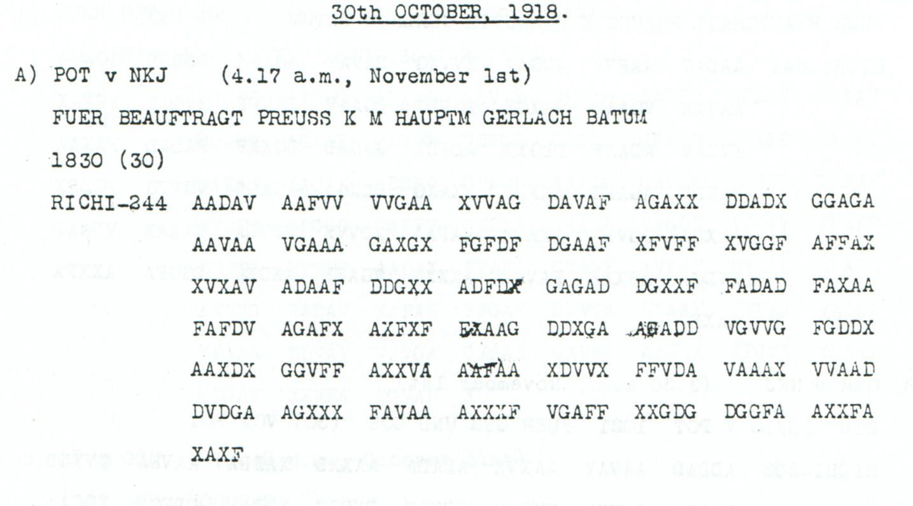
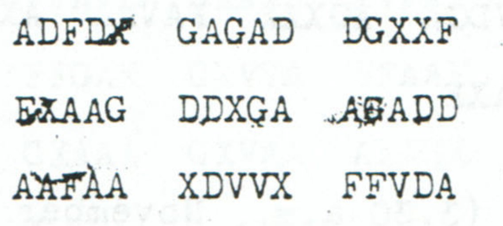

# Gerlach oil-release inquiry: the overprinted parallel

Telegraph whether Izzet Pasha's renewed order to release the oil has been successful. The text asks for a result; it does not establish that the oil was released.

**Complete edition by printed page:** [p. 83](../pages/083.md)

<!-- CASE-EDITION:START -->
<details>
<summary>Full source edition and evidence</summary>


[Case index](../README.md) · [ADFGVX Cipher](../../README.md) · [Reading conventions](../../docs/reading-conventions.md)

## p83 A

**Status:** 122/122 native raw positions fixed; 0 coordinate substitutions and 0 source-mask fills. No frame or key change.

**Source and dates:** Page heading: 30th OCTOBER, 1918; A) POT v NKJ (4.17 a.m., November 1st); FUER BEAUFTRAGT PREUSS K M HAUPTM GERLACH BATUM; 1830 (30); RICHI-244.



<details>
<summary>Raw decoded text</summary>

**Raw output — declared visual readings of the five overprints:**

```text
DRAHTETOBERNEUTERBEFEHLIZZETPASCHAXIZZETPASCHAZURFREIGABEDEROELEERFOLGGEHABTHATXXKRIEGSAMTKRIEGSROHSTOFFABTLGXNRX0ROEMX1XX
```

</details>

**Readable German — the same candidate labels with spacing and punctuation:**

> Drahtet, ob erneuter Befehl Izzet Pascha, Izzet Pascha, zur Freigabe der Oele Erfolg gehabt hat. Kriegsamt, Kriegsrohstoffabtlg. Nr. 0, roem. 1.

**Meaning:** Telegraph whether Izzet Pasha's renewed order to release the oil has been successful. The text asks for a result; it does not establish that the oil was released. The clear routing is for Hauptm. Gerlach at Batum, with the Prussian War Ministry designation. Both occurrences of Izzet Pascha and the unexplained footer 0 ROEM 1 remain literal.

**Conditional interpretation and source details:** Five positions carry visible overprinting: source 99, 136, 146, 176 and 177. Their declared surviving glyph readings are X, X, G, A and F. With these readings the 244-coordinate stream is identical to the independently reviewed p84 A source, and all 122 plaintext positions decode without a cryptographic edit. The certificate also retains a conservative five-mask sensitivity branch: 117/122 raw positions, then five explicitly counted fills supplied by the independent p84 witness. The zero-edit result is tied to the stated visual transcription; it does not describe the overprints as pristine. The clear p83 header gives 1830 (30), where the corresponding p84 time is partly illegible.

### Conservative overprint sensitivity

<details>
<summary>Raw decoded text</summary>

**Raw output — mask all five overprinted positions instead of reading the surviving glyphs:**

```text
DRA?TETOBERN?U?ERBEFEHLIZZETPASCHAXIZZET?ASCHAZURFREIGABEDEROELEERFOLGGEHABTHATXXKRIEGSAMTKRIEGSROHSTOFF?BTLGXNRX0ROEMX1XX
```

</details>

That stricter branch fixes 117 of 122 positions. Filling source 99→X, 136→X, 146→G, 176→A and 177→F restores the same full reading with five counted fills and no observed-coordinate substitution. Each value is independently present in the clear [p84 witness](../../experiments/oct30_oil_and_supply_records/sources/p84_A_witness.png).



The [earlier p84 case](p84_AB.md) remains the previously documented body reading. The new contribution is the additional p83 physical witness, its clear 1830 header, and the explicit sensitivity accounting.

### Reproducibility and attribution

The [input](../../experiments/oct30_oil_and_supply_records/inputs.json) binds the complete literal rows to exact PDF crops. The [certificate](../../experiments/oct30_oil_and_supply_records/certificates.json) records every coordinate pair and the sensitivity branch. The [verifier](../../experiments/oct30_oil_and_supply_records/verify.py) checks the published Oct28–31 key, live German quotations, source-image hashes and optional PDF pixel regeneration.

Source edition and verification: icekylinx and GPT-6 Astra Pro (2026). Childs supplies the historical collection; the published reconstruction and key provenance credit Lasry, Niebel, Kopal and Wacker. The [attribution record](../../experiments/oct30_oil_and_supply_records/prior_candidates.json) retains earlier OCR and the already reviewed p84 source.

</details>
<!-- CASE-EDITION:END -->
