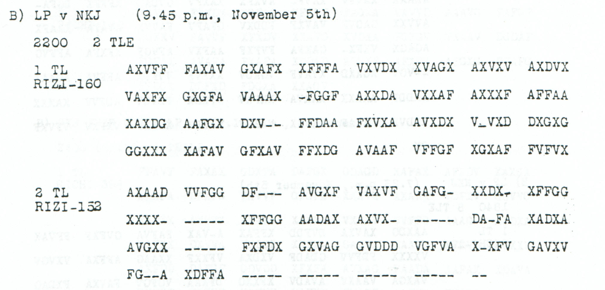

# p127 B2 — Heavily erased second part from NKJ

This source remains OPEN. Its ciphertext and reception details are preserved, but no readable body has been established.

**Complete edition by printed page:** [p. 127](../pages/127.md)

<!-- CASE-EDITION:START -->
<details>
<summary>Full source edition and evidence</summary>


[Source index](../pages/README.md) · [OPEN sources](README.md) · [Reading conventions](../../docs/reading-conventions.md)

**State: OPEN.** Source transcription and review: **icekylinx and GPT-6 Astra Pro**.

The second part remains unread. All 152 printed slots are transcribed, but 48 are erasures, leaving only 104 observed coordinates. Its preceding first part is separately catalogued; its reading does not by itself restore the missing coordinates here.

## Source



<details>
<summary>Source and cipher evidence</summary>

**Source transcription — clear header, spacing normalized from the source:**

```text
B) LP v NKJ (9.45 p.m., November 5th)
2200   2 TLE
2 TL
RIZI-152
```

**Source transcription — literal ciphertext, printed row and group boundaries retained:**

```text
AXAAD VVFGG DF--- AVGXF VAXVF GAFG- XXDX- XFFGG
XXXX- ----- XFFGG AADAX AXVX- ----- DA-FA XADXA
AVGXX ----- FXFDX GXVAG GVDDD VGFVA X-XFV GAVXV
FG--A XDFFA ----- ----- ----- ----- --
```

</details>

| Evidence | Count |
|---|---:|
| Received source slots | 152 |
| Observed ADFGVX coordinates | 104 |
| Printed erasure slots | 48 |
| Advertised part length | 152 |

## Boundaries and uncertainty

The page heading says `4th NOVEMBER, 1918`, while the reception header says
November 5th. Both dates are preserved. `2 TL` identifies this physical body
as part two of the printed two-part transmission.

The repeated group `XFFGG` occurs twice, at zero-based source indices 35–39
and 50–54. Both occurrences remain in place. Repetition alone does not
establish a copying error or justify deleting one. The final row ends with
22 consecutive printed dashes, including a final two-dash group.

The [first part, p127 B1](../radio/nov4_personnel_transmission_notice.md#p127-b1),
contains personnel and radio-transmission wording. That context is a
research lead, not a plaintext crib licensed by the second part’s source.

## Research leads

- Compare the confirmed first-part key and header with the second part while keeping the conflicting printed dates visible.
- Seek an independently received copy that can constrain the 48 erased coordinates, especially the long final gap.
- Examine the two `XFFGG` groups and the surrounding observed coordinates before proposing duplication or a relocated erasure run. Score competing geometries against controls; sparse-coordinate fluency alone is weak evidence.

These are research directions, not accepted decipherments. A failed search
under one key or loss model does not exclude other source-supported models.

## Evidence and reproduction

The [machine-readable source record](../../experiments/open_source_records/inputs.json)
retains the original audit metadata, exact source rows, annotation positions
and crop recipe. The [source-only verifier](../../experiments/open_source_records/verify.py)
checks the case transcription, literal digest, native counts and crop pixels;
it produces no plaintext certificate. The [21-source audit](../../docs/source-gap-audit.md)
records the earlier boundary review.

```sh
python experiments/open_source_records/verify.py
python experiments/open_source_records/verify.py --pdf /path/to/childs.pdf
```

Source: J. Rives Childs, *General Solution of the ADFGVX Cipher System*,
printed p127, PDF p130 in the
[scanned volume](https://drive.google.com/file/d/1_JiNMck7eUvdrOTrH7fsj1Yh44t-VSC6/view).
The optional PDF check verifies the original file and reproduces the published crop.

</details>
<!-- CASE-EDITION:END -->
