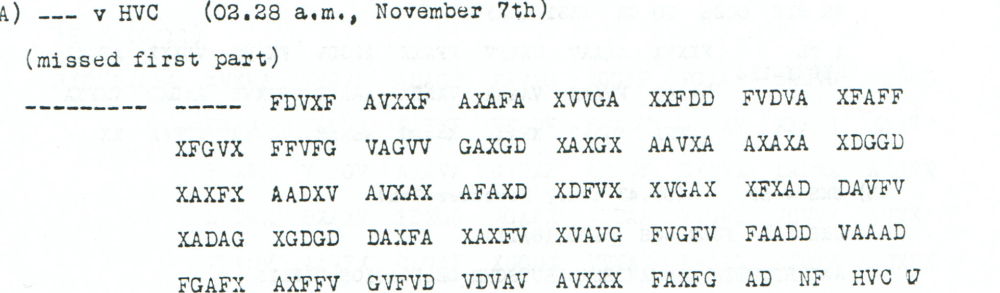

# p145 A — HVC fragment with its first part missing

This source remains OPEN. Its ciphertext and reception details are preserved, but no readable body has been established.

**Complete edition by printed page:** [p. 145](../pages/145.md)

<!-- CASE-EDITION:START -->
<details>
<summary>Full source edition and evidence</summary>


[Source index](../pages/README.md) · [OPEN sources](README.md) · [Reading conventions](../../docs/reading-conventions.md)

**State: OPEN.** Source transcription and review: **icekylinx and GPT-6 Astra Pro**.

This surviving fragment remains unread. The source says “missed first part” and gives no transmitted length. Its 192 received slots therefore cannot be assumed to be the complete transposition frame.

## Source



<details>
<summary>Source and cipher evidence</summary>

**Source transcription — clear header, spacing normalized from the source:**

```text
A) --- v HVC (02.28 a.m., November 7th)
(missed first part)
```

**Source transcription — literal ciphertext, printed row and group boundaries retained:**

```text
----- FDVXF AVXXF AXAFA XVVGA XXFDD FVDVA XFAFF
XFGVX FFVFG VAGVV GAXGD XAXGX AAVXA AXAXA XDGGD
XAXFX AADXV AVXAX AFAXD XDFVX XVGAX XFXAD DAVFV
XADAG XGDGD DAXFA XAXFV XVAVG FVGFV FAADD VAAAD
FGAFX AXFFV GVFVD VDVAV AVXXX FAXFG AD
```

</details>

| Evidence | Count |
|---|---:|
| Received source slots | 192 |
| Observed ADFGVX coordinates | 187 |
| Printed erasure slots | 5 |
| Advertised part length | Not printed |

## Boundaries and uncertainty

The page heading is `6th NOVEMBER, 1918`; the reception header says
November 7th at 02.28 a.m. Neither date is silently corrected.

The nine-dash mark in the left margin occupies the message-designator
column. It is metadata, not an extra nine cipher slots. The first cipher
group is the separate five-dash run in the body column. Those five erasures
and all 187 observed coordinates are retained. The final `AD` is a two-symbol
cipher group; the following `NF HVC U` is clear metadata outside the body.

“Missed first part” does not give a number of missing coordinates or prove
that this fragment is the suffix of one longer encrypted block. A model
that adds a prefix must state its length and source map explicitly.

## Research leads

- Compare the reception date with the `Nov4-6` and `Nov7-9` period keys without assuming that the page heading establishes the key.
- Look for another reception or part label carrying the HVC route and the same observed suffix; an independently printed copy would constrain frame length more strongly than language scoring.
- Test complete-fragment and missing-prefix models separately. Keep the five printed erasures distinct from any unprinted coordinates introduced by a hypothesis.

These are research directions, not accepted decipherments. A failed search
under one key or loss model does not exclude other source-supported models.

## Evidence and reproduction

The [machine-readable source record](../../experiments/open_source_records/inputs.json)
retains the original audit metadata, exact source rows, annotation positions
and crop recipe. The [source-only verifier](../../experiments/open_source_records/verify.py)
checks the case transcription, literal digest, native counts and crop pixels;
it produces no plaintext certificate. The [21-source audit](../../docs/source-gap-audit.md)
records the earlier boundary review.

```sh
python experiments/open_source_records/verify.py
python experiments/open_source_records/verify.py --pdf /path/to/childs.pdf
```

Source: J. Rives Childs, *General Solution of the ADFGVX Cipher System*,
printed p145, PDF p148 in the
[scanned volume](https://drive.google.com/file/d/1_JiNMck7eUvdrOTrH7fsj1Yh44t-VSC6/view).
The optional PDF check verifies the original file and reproduces the published crop.

</details>
<!-- CASE-EDITION:END -->
