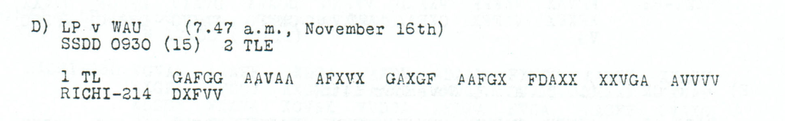

# p194 D1 — Short first-part fragment from WAU

[Source index](../pages/README.md) · [OPEN sources](README.md) · [Reading conventions](../../docs/reading-conventions.md)

**State: OPEN.** Source transcription and review: **icekylinx and GPT-6 Astra Pro**.

Only 45 observed coordinates survive for a first part advertised as `RICHI-214`. No body reading is accepted. The numerical shortfall is visible source evidence; the absent coordinates are not printed erasures.

## Source



<details>
<summary>Source and cipher evidence</summary>

**Source transcription — clear header, spacing normalized from the source:**

```text
D) LP v WAU (7.47 a.m., November 16th)
SSDD 0930 (15)   2 TLE
1 TL
RICHI-214
```

**Source transcription — literal ciphertext, printed row and group boundaries retained:**

```text
GAFGG AAVAA AFXVX GAXGF AAFGX FDAXX XXVGA AVVVV
DXFVV
```

</details>

| Evidence | Count |
|---|---:|
| Received source slots | 45 |
| Observed ADFGVX coordinates | 45 |
| Printed erasure slots | 0 |
| Advertised part length | 214 |

## Boundaries and uncertainty

The reception header says November 16th at 7.47 a.m.; the origin line
contains `0930 (15)`. The distinct origin and reception dates are retained.
`1 TL` and `2 TLE` identify a first part within a two-part transmission.

The received body consists of nine full five-coordinate groups, with
`DXFVV` on the second line. There are no printed mask slots. If the advertised
214-coordinate length describes this part, **169 coordinates are absent
from the surviving source**. No guessed tail is appended to the literal
transcription, and 214 is not used as a settled decryption frame.

A short transmitted prefix, a partial copy and a misrecorded length remain
different possibilities. The source alone does not identify the missing
portion or the encrypted subject.

## Research leads

- Search the WAU/LP route and origin line `SSDD 0930 (15)` for another reception, allowing the printed transmission and reception dates to differ.
- Compare the `Nov13-15a`, `Nov13-15b` and `Nov16-18` keys as dated leads. A key choice must be supported by coordinates rather than selected solely from the reception date.
- For any advertised-length model, retain all 45 observed coordinates and report the placement and number of all added unknowns. Short coherent word fits must be checked against equally sparse controls.

These are research directions, not accepted decipherments. A failed search
under one key or loss model does not exclude other source-supported models.

## Evidence and reproduction

The [machine-readable source record](../../experiments/open_source_records/inputs.json)
retains the original audit metadata, exact source rows, annotation positions
and crop recipe. The [source-only verifier](../../experiments/open_source_records/verify.py)
checks the case transcription, literal digest, native counts and crop pixels;
it produces no plaintext certificate. The [21-source audit](../../docs/source-gap-audit.md)
records the earlier boundary review.

```sh
python experiments/open_source_records/verify.py
python experiments/open_source_records/verify.py --pdf /path/to/childs.pdf
```

Source: J. Rives Childs, *General Solution of the ADFGVX Cipher System*,
printed p194, PDF p197 in the
[scanned volume](https://drive.google.com/file/d/1_JiNMck7eUvdrOTrH7fsj1Yh44t-VSC6/view).
The optional PDF check verifies the original file and reproduces the published crop.
