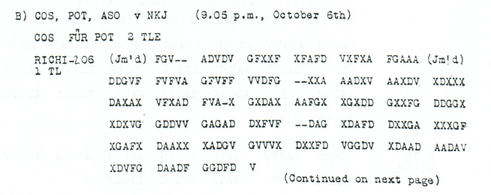

# p70 B1 — Jammed first part routed through NKJ

This source remains OPEN. Its ciphertext and reception details are preserved, but no readable body has been established.

**Complete edition by printed page:** [p. 70](../pages/070.md)

<!-- CASE-EDITION:START -->
<details>
<summary>Full source edition and evidence</summary>


[Source index](../pages/README.md) · [OPEN sources](README.md) · [Reading conventions](../../docs/reading-conventions.md)

**State: OPEN.** Source transcription and review: **icekylinx and GPT-6 Astra Pro**.

The body remains unread. Its received length agrees with the printed `RICHI-206`, but two jamming annotations and seven printed erasures leave the integrity of the transmission uncertain. The routing line is clear metadata; it does not identify the subject of the encrypted body.

## Source



<details>
<summary>Source and cipher evidence</summary>

**Source transcription — clear header, spacing normalized from the source:**

```text
B) COS, POT, ASO v NKJ (9.05 p.m., October 6th)
COS FÜR POT 2 TLE
RICHI-206
1 TL
```

**Source transcription — literal ciphertext, printed row and group boundaries retained:**

```text
FGV-- ADVDV GFXXF XFAFD VXFXA FGAAA
DDGVF FVFVA GFVFF VVDFG --XXA AADXV AAXDV XDXXX
DAXAX VFXAD FVA-X GXDAX AAFGX XGXDD GXXFG DDGGX
XDXVG GDDVV GAGAD DXFVF --DAG XDAFD DXXGA XXXGF
XGAFX DAAXX XADGV GVVVX DXXFD VGGDV XDAAD AADAV
XDVFG DAADF GGDFD V
```

</details>

| Evidence | Count |
|---|---:|
| Received source slots | 206 |
| Observed ADFGVX coordinates | 199 |
| Printed erasure slots | 7 |
| Advertised part length | 206 |

## Boundaries and uncertainty

The annotation `(Jm’d)` precedes the first group. A second, irregularly
punctuated `(Jm!d)` appears after the sixth group, at received boundary 30.
Neither annotation is a cipher coordinate. The final single `V` is retained.
The seven printed dashes occupy source indices 3, 4, 50, 51, 83, 130 and 131
(zero-based).

The page says “Continued on next page.” The source review found no matching
second part with this header on p71; its A header begins a separately
identified two-part transmission. The [p71 readings](../pages/050-074/README.md#p71)
therefore supply nearby traffic context, not permission to concatenate
ciphertexts.

## Research leads

- Test whether the interruption after 30 coordinates marks a restart, repetition or loss boundary while preserving every received coordinate and charging any exclusion separately.
- Seek a second reception using the routing line, origin date and `RICHI-206`; a similar subject or adjacent page is insufficient to establish a copy.
- Treat the published `Oct4-6` key as a dated lead. A fluent fragment under a changed frame or another key requires independent coordinate support and matched controls.

These are research directions, not accepted decipherments. A failed search
under one key or loss model does not exclude other source-supported models.

## Evidence and reproduction

The [machine-readable source record](../../experiments/open_source_records/inputs.json)
retains the original audit metadata, exact source rows, annotation positions
and crop recipe. The [source-only verifier](../../experiments/open_source_records/verify.py)
checks the case transcription, literal digest, native counts and crop pixels;
it produces no plaintext certificate. The [21-source audit](../../docs/source-gap-audit.md)
records the earlier boundary review.

```sh
python experiments/open_source_records/verify.py
python experiments/open_source_records/verify.py --pdf /path/to/childs.pdf
```

Source: J. Rives Childs, *General Solution of the ADFGVX Cipher System*,
printed p70, PDF p73 in the
[scanned volume](https://drive.google.com/file/d/1_JiNMck7eUvdrOTrH7fsj1Yh44t-VSC6/view).
The optional PDF check verifies the original file and reproduces the published crop.

</details>
<!-- CASE-EDITION:END -->
