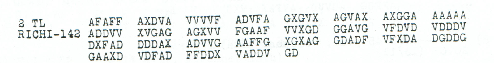

# p187b — Teleprinter failure and written reporting

**Reading layers:** [Raw output · Edited output · Readable German · Conditional interpretation](../docs/reading-conventions.md). In decoded streams, `?` marks one unresolved position; `X` and numeral/letter labels remain literal.

[Case index](README.md) · [ADFGVX Cipher](../README.md)

**Status:** Earlier joint key recovery verified; a single adjacent-coordinate swap explains two prior editorial word corrections. The incomplete ending remains unresolved. **Key:** `CHI-Nov13`.

**Earliest credited record:** [George Lasry, 2017-05-03, comment 50](https://scienceblogs.de/klausis-krypto-kolumne/2017/02/23/the-top-50-unsolved-encrypted-messages-46-unsolved-adfgvx-cryptograms-from-world-war-1/?all=1#comment-878059). **Current source and arithmetic review:** icekylinx and GPT-6 Astra Pro, 2 November 2026.

Norbert proposed the shared-key attack in comment 49; George Lasry recovered the key in comment 50; Norbert refined the labels in comment 53.

## Most likely reading

**Readable German — earlier word normalization explained by the separately costed swap:**

> Soweit Fernschreiber-Verbdg. [nicht arbeitet], Rest schriftlich. `NACHCHEF?X??????`.

**Meaning:** Where the teleprinter connection is not working, provide the remainder in writing. The closing designation or reference beginning `NACHCHEF` remains incomplete.

**Notes:** `Verbdg.` abbreviates “connection.” Norbert normalized the raw `NITHT ARBEICET` to `NICHT ARBEITET` in 2017. The new coordinate audit below explains both changes with one adjacent swap. The seven unresolved ending positions are retained in full; no digit assignments are inferred from their administrative appearance. This continues the communications instruction in [p187](p187.md).

The literal closing field `NACHCHEF?X??????` retains all seven unresolved
positions and its known `X`. It is shown in full rather than using a display
omission for the last six positions. The bracketed words retain Norbert's
earlier normalization and the separately stated swap model below.

## Recomputed reading

Variant `audited_CHI_direct`: No received-coordinate edits; only directly attested substitution cells are used.

**Raw output — recomputed direct CHI reading; attested cells only:**

```text
SOWEITFERNSCHREIBERVERBDGNITHTARBEICETXRESTSCHRIFTLICHXNACHCHEF?X??????
```

## Conditional adjacent-swap repair

The printed 26th group is **`VDFAD`**. Swapping its last two coordinates gives
**`VDFDA`** and restores both previously proposed words:



**Edited output — conditional adjacent-coordinate swap; unresolved ending retained:**

```text
SOWEITFERNSCHREIBERVERBDGNICHTARBEITETXRESTSCHRIFTLICHXNACHCHEF?X??????
```

Only received indices **128 and 129** change (`AD` → `DA`, zero-based).
All other **140 coordinates**, the coordinate counts, key and square remain
unchanged. These map to plaintext position 27 (`T` → `C`) and 35 (`C` → `T`).
The reading still has **64/71 fixed positions**; this repair resolves two
word garbles, not the unknown ending.

The [exhaustive adjacent-swap audit](../experiments/p187b_adjacent_swap/README.md)
checks all 141 such operations and finds exactly this one for the stated
partial reading. The historical cause of the reversal is unknown. The raw
source remains unaltered, and Norbert retains credit for the normalized words.

## Review

- Norbert first proposed the shared-key attack in comment 49 on 2017-04-30; George Lasry recovered the key in comment 50 on 2017-05-03; Norbert refined symbol labels in comment 53 the same day.
- The two received texts contain 354 coordinates, 177 plaintext slots. The initial combined publication has 173 plaintext positions and incorrectly describes 356 coordinates; four ending slots are not covered by that published string.
- Fourteen square cells remain unassigned. In particular j/x labels were suggested to be digits, not proved to be 0/01.

## Earlier published readings

**Initial substitution labels — [George Lasry, 2017-05-03, comment 50](https://scienceblogs.de/klausis-krypto-kolumne/2017/02/23/the-top-50-unsolved-encrypted-messages-46-unsolved-adfgvx-cryptograms-from-world-war-1/?all=1#comment-878059).**

**Earlier attributed reading:**

```text
SOWEITFERNSCHREIBERVERBDMNITHTARBEICETKRESTSCHRIFTLICHKNACHCHEFJKJX
```

**Refined partial substitution labels — [Norbert, 2017-05-03, comment 53](https://scienceblogs.de/klausis-krypto-kolumne/2017/02/23/the-top-50-unsolved-encrypted-messages-46-unsolved-adfgvx-cryptograms-from-world-war-1/?all=1#comment-878079).**

**Earlier attributed reading:**

```text
SOWEITFERNSCHREIBERVERBDGNITHTARBEICETXRESTSCHRIFTLICHXNACHCHEF?X??
```

**Editorial normalization — [Norbert, 2017-05-03, comment 53](https://scienceblogs.de/klausis-krypto-kolumne/2017/02/23/the-top-50-unsolved-encrypted-messages-46-unsolved-adfgvx-cryptograms-from-world-war-1/?all=1#comment-878079).**

**Earlier attributed reading:**

```text
SOWEITFERNSCHREIBERVERBDGNICHTARBEITETXRESTSCHRIFTLICHXNACHCHEF?X??
```

Published length 67; model length 71.

## Verified variants

| Variant | Fixed / total positions | Unpaired suffix | Ordinary re-encryption |
|---|---:|---|---|
| `audited_CHI_direct` | 64 / 71 | — | Partial |

Source strings, edit positions, plaintext domains and attribution are retained in [the prior-reading certificate](../data/prior_readings.json). Re-encryption checks the stated reconstruction, including any conjectural repairs.

The [p186 source and suffix audit](../experiments/source_followup/README.md#p186-the-ending-cannot-be-copied-unchanged) retains two questionable glyphs as unknown. All nine one-character deletions from its longer suffix still fail to match this suffix under injective square completion; its numeral `1` cannot simply be transferred here.
