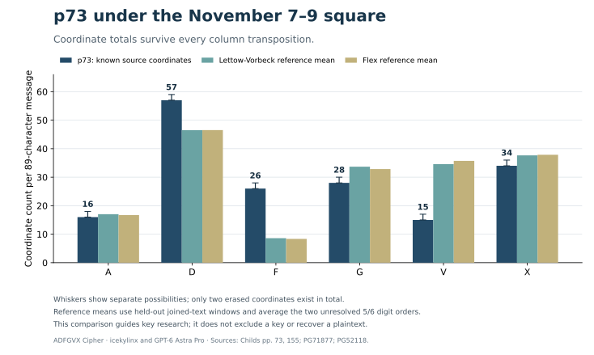

# p73 — Open message for General von Kress

**Reading layers:** [Raw output · Edited output · Readable German · Conditional interpretation](../docs/reading-conventions.md). In decoded streams, `?` marks one unresolved position; `X` and numeral/letter labels remain literal.

[All cases](README.md) · [ADFGVX Cipher](../README.md)

**Status:** No accepted plaintext. **Current source and attack review:** icekylinx and GPT-6 Astra Pro. Original challenge: [Lasry–Schmeh](https://scienceblogs.de/klausis-krypto-kolumne/unsolved-adfxvx-messages-from-world-war-i/).

## Most likely reading

No defensible plaintext has yet been identified. The source and the best tested hypotheses are recorded below; no language-ranked diagnostic is promoted to a historical reading.

| Source fact | Value |
|---|---|
| Printed page / PDF page | 73 / 76 |
| Section | A |
| Received slots | 178 |
| Valid coordinates / uncertain slots | 176 / 2 |
| Header | `POT v NKJ (2.33 a.m., November 8th); FUR COS GENERAL VON KRESS 0911 (26); RICHI-178` |

## Literal ciphertext

```text
D--FX GDVDX DGGAA AGFFD DVDXF XFGGD DAVGD DDADG DGFGG DDVVD
XDGDA FDDXG XXDGX AVDXX DDGAD DFGFA GVDXV FDXFD DFDDD FXDFG
XFXVF DDDXX DXGDA GXFDG DDVFX GAXDF VFDVD XVXDF XDDXF DFVDG
FDGDA DGDGX XFGXF AAAXX XDXAG VXD
```

The [catalog](../data/messages.json) retains the literal source, conservative analysis layer, and earlier online transcription separately. Headers follow `recipient v sender`.

## Source context

The page heading says **October 26**, the clear header contains `0911 (26)`, and the interception line says **November 8 at 02:33**. Norbert raised the conflict in 2017; Lasry left it unresolved. Neither date is silently corrected.

The [p155 companion](context/p155.md) has the same `POT v NKJ` route onward to General von Kress, was intercepted five minutes earlier, and explicitly carries origin day 7. Its readable shipping message is independently corroborated in Hopman's diary. Reception proximity does not prove a shared encryption date or key.

The bounded original-book search found no additional clearly dated October 25–27 ciphertext or period key. The [source-context record](../data/reviews/p73_source_context.json) documents the inspected pages, earlier observations, delayed-telegram context, and unretrieved archive leads.

A further [primary-source check](../experiments/p73_primary_followup/README.md)
inspected the accessible late-period Kress memoir, the October/November tail of
Lepsius's 1919 diplomatic edition, and the institutional Kress-name retrieval
in the Hopman edition. No matching incoming radiogram was found in those
bounded scopes. The superficially matching October 26 / November 8 dates in
the memoir's editorial introduction refer to **1917**, so they add no evidence
for p73's 1918 calendar or encryption date.

The [archival access follow-up](../experiments/p73_primary_followup/ARCHIVE_ACCESS.md)
confirms that the official inventory lists RZ 201 as digitized and gives
concrete catalogue searches for the older file-number leads. No individual
record or telegram image was retrieved; those leads remain uninspected.

## A clue independent of column order



The [coordinate-count analysis](../experiments/open_targets/P73_HISTOGRAM.md)
tests a property that every column transposition preserves. Under the published
Nov7–9 square, all **26 observed F coordinates** must belong to `CJMOQZ` or
digits. Even the most favorable fill of the two erasures is farther from the
reference mean than every tested 89-character window in two independent war
books, under joined-text and sentence-separator conventions. The readable
p155 A1 companion lies within the observed range for those conventions.

The opposite side of the histogram gives another exact constraint. The 15
observed `V` coordinates plus two erasures imply

\[
n_D+n_E+n_H+n_K+n_Q+n_T+n_U+2n_X\leq17,
\]

where `n` counts plaintext characters. Thus at most eight `X` characters can
occur. A candidate containing five `X` separators could contain at most seven
of `DEHKQTU` combined. This provides a direct check on future proposed cribs,
independent of column order and the unresolved 5/6 assignment.

This supports lowering the priority of Nov7–9 square reuse under ordinary
German prose assumptions. It does **not** exclude the key or choose between
the conflicting dates. The report preserves both possible 5/6 assignments,
all count completions, and a word-separator convention that fails the historical
control. Atypical digits, names, abbreviations or code groups remain possible.

## Attack status

No accepted plaintext. Known-key, transcription-geometry, and component searches remain bounded hypotheses. The [experiment index](../experiments/README.md) separates completed coverage and calibration failures from exclusion claims. A longer companion under the original key remains the most useful missing evidence.

A [direct source-similarity search](../experiments/source_similarity/README.md)
over 788 OCR blocks retrieves established parallels as controls. The leading
p73 candidate, p105 C1, was checked against the page image and supplies only
a short local resemblance, not another transmission of this message.
