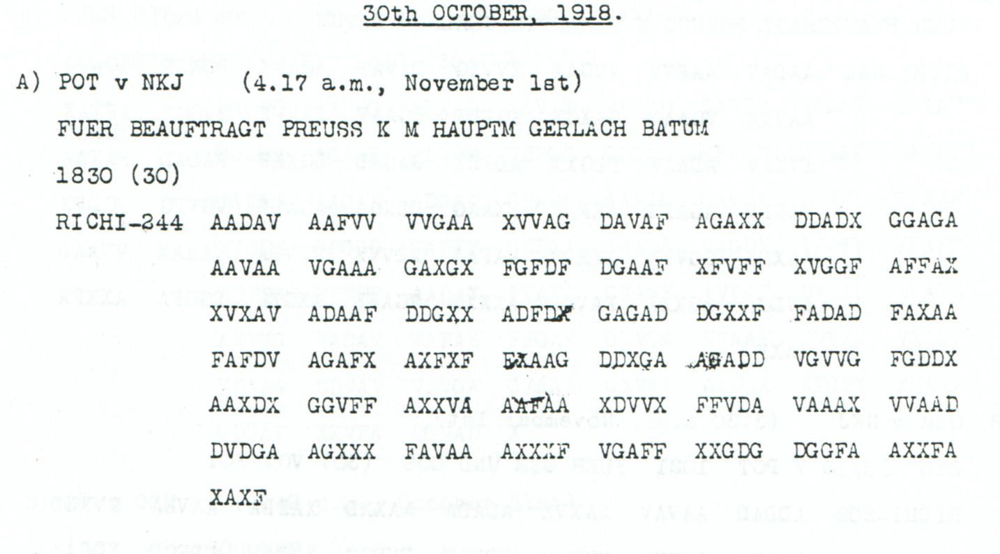
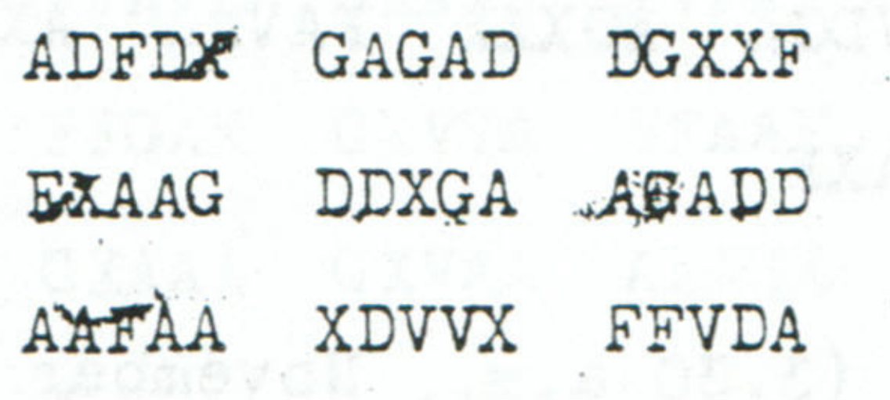

# Childs p. 83 — readings and source edition

<!-- Generated by python -m adfgvx.page_editions; edit data/source_editions.json. -->

[Page ranges](README.md) · [By subject](../../topics/README.md) · [Historical research](../../docs/historical-studies/README.md) · [Reading conventions](../../docs/reading-conventions.md) · [← p. 82](082.md) · [p. 84 →](084.md)

German readings, English interpretations and source explanations for the **2 ciphertexts** on this printed page.

| Source | State | Subject |
|---|---|---|
| [p83 A](#source-p83-a) | READING | Gerlach oil-release inquiry: the overprinted parallel |
| [p83 B](#source-p83-b) | READING | Dissolution of unnamed formations and return of remaining personnel to home replacement units |


<a id="edition-cases-naval-gerlach-oil-release-query"></a>

## p83 A — Gerlach oil-release inquiry: the overprinted parallel

<a id="edition-cases-naval-gerlach-oil-release-query-gerlach-oil-release-inquiry-the-overprinted-parallel"></a>


<a id="source-p83-a"></a>
<a id="edition-cases-naval-gerlach-oil-release-query-p83-a"></a>

### p83 A

**Status:** 122/122 native raw positions fixed; 0 coordinate substitutions and 0 source-mask fills. No frame or key change.

**Source and dates:** Page heading: 30th OCTOBER, 1918; A) POT v NKJ (4.17 a.m., November 1st); FUER BEAUFTRAGT PREUSS K M HAUPTM GERLACH BATUM; 1830 (30); RICHI-244.



<details>
<summary>Raw decoded text</summary>

**Raw output — declared visual readings of the five overprints:**

```text
DRAHTETOBERNEUTERBEFEHLIZZETPASCHAXIZZETPASCHAZURFREIGABEDEROELEERFOLGGEHABTHATXXKRIEGSAMTKRIEGSROHSTOFFABTLGXNRX0ROEMX1XX
```

</details>

**Readable German — the same candidate labels with spacing and punctuation:**

> Drahtet, ob erneuter Befehl Izzet Pascha, Izzet Pascha, zur Freigabe der Oele Erfolg gehabt hat. Kriegsamt, Kriegsrohstoffabtlg. Nr. 0, roem. 1.

**Meaning:** Telegraph whether Izzet Pasha's renewed order to release the oil has been successful. The text asks for a result; it does not establish that the oil was released. The clear routing is for Hauptm. Gerlach at Batum, with the Prussian War Ministry designation. Both occurrences of Izzet Pascha and the unexplained footer 0 ROEM 1 remain literal.

**Conditional interpretation and source details:** Five positions carry visible overprinting: source 99, 136, 146, 176 and 177. Their declared surviving glyph readings are X, X, G, A and F. With these readings the 244-coordinate stream is identical to the independently reviewed p84 A source, and all 122 plaintext positions decode without a cryptographic edit. The certificate also retains a conservative five-mask sensitivity branch: 117/122 raw positions, then five explicitly counted fills supplied by the independent p84 witness. The zero-edit result is tied to the stated visual transcription; it does not describe the overprints as pristine. The clear p83 header gives 1830 (30), where the corresponding p84 time is partly illegible.

<a id="edition-cases-naval-gerlach-oil-release-query-conservative-overprint-sensitivity"></a>

#### Conservative overprint sensitivity

<details>
<summary>Raw decoded text</summary>

**Raw output — mask all five overprinted positions instead of reading the surviving glyphs:**

```text
DRA?TETOBERN?U?ERBEFEHLIZZETPASCHAXIZZET?ASCHAZURFREIGABEDEROELEERFOLGGEHABTHATXXKRIEGSAMTKRIEGSROHSTOFF?BTLGXNRX0ROEMX1XX
```

</details>

That stricter branch fixes 117 of 122 positions. Filling source 99→X, 136→X, 146→G, 176→A and 177→F restores the same full reading with five counted fills and no observed-coordinate substitution. Each value is independently present in the clear [p84 witness](../../experiments/oct30_oil_and_supply_records/sources/p84_A_witness.png).



The [earlier p84 case](084.md#edition-cases-naval-p84-ab) remains the previously documented body reading. The new contribution is the additional p83 physical witness, its clear 1830 header, and the explicit sensitivity accounting.

<a id="edition-cases-naval-gerlach-oil-release-query-reproducibility-and-attribution"></a>

#### Reproducibility and attribution

The [input](../../experiments/oct30_oil_and_supply_records/inputs.json) binds the complete literal rows to exact PDF crops. The [certificate](../../experiments/oct30_oil_and_supply_records/certificates.json) records every coordinate pair and the sensitivity branch. The [verifier](../../experiments/oct30_oil_and_supply_records/verify.py) checks the published Oct28–31 key, live German quotations, source-image hashes and optional PDF pixel regeneration.

Source edition and verification: icekylinx and GPT-6 Astra Pro (2026). Childs supplies the historical collection; the published reconstruction and key provenance credit Lasry, Niebel, Kopal and Wacker. The [attribution record](../../experiments/oct30_oil_and_supply_records/prior_candidates.json) retains earlier OCR and the already reviewed p84 source.

<a id="source-p83-b"></a>
<a id="edition-cases-military-formation-dissolution"></a>

## p83 B — Dissolution of unnamed formations and return of remaining personnel to home replacement units

**Edition context:** p83 B — dissolution of formations and return of personnel.

<a id="edition-cases-military-formation-dissolution-p83-b--dissolution-of-formations-and-return-of-personnel"></a>


**Status:** Complete direct source reading, with no coordinate repairs. This page prints the second part of a message. Subsequent review of an exact p79 second-part witness supplies its first-part context; see the linked source edition below.

Source edition and reproducible verification: **icekylinx and GPT-6 Astra Pro**. The unchanged **Oct28–31** period key is credited to Lasry, Niebel, Kopal and Wacker. An earlier unreviewed OCR-derived reading already contained this body and was included in the frozen p73 retrieval corpus; this edition resolves its three OCR erasures from the visible printed coordinates. It does not claim first decipherment.

<a id="edition-cases-military-formation-dissolution-source-and-scope"></a>

### Source and scope

Childs, printed page 83 / PDF page 86, labels the item `B) OSM v LP (4.09 p.m., October 30th)`, `2 TL`, `RICHI-336`. The source contains exactly 336 valid coordinates, giving 168 fixed plaintext positions under the published key. The source crop and all manual rows are in [the input record](../../experiments/formation_dissolution/inputs.json).

The p83 page itself contains no first part. Subsequent source review identified [p79 A1/A2](079.md#edition-cases-military-palestine-medical-dissolution): A2 repeats all 336 coordinates of this second part, while A1 names the medical formations lost in Palestine apart from their remaining personnel. The complete first-part text, literal unit labels and source-header differences are preserved in that edition. This supplies the previously missing antecedent without changing the p83 source or repair count. `K.M.` remains an unexpanded abbreviation.

<a id="edition-cases-military-formation-dissolution-literal-plaintext"></a>

### Literal plaintext

<details>
<summary>Raw decoded text</summary>

**Raw output:**

```text
BEIMXKXMXISTBEANTRAGTSIEFUERAUFGELOESTZUERKLAERENXXNOCHVORHANDENESPERSONALDIESERFORMATIONENISTZUDENHEIMISCHENERSATZTRUPPENTEILENINMARSCHZUSETZENXOHLXRMX1XCXNRX103577XOP
```

</details>

**Readable German:**

> Beim K.M. ist beantragt, sie fuer aufgeloest zu erklaeren. Noch vorhandenes Personal dieser Formationen ist zu den heimischen Ersatztruppenteilen in Marsch zu setzen. OHL. RM 1 C Nr103577 Op.

The telegram says a request has been made to declare the formations dissolved, and orders their remaining personnel to proceed to replacement units at home. The closing reference is retained as printed-key labels, without a new numerical interpretation.

<a id="edition-cases-military-formation-dissolution-verification-and-limits"></a>

### Verification and limits

The literal source, analysis frame and re-encrypted reading all have336 coordinates. There are **zero substitutions, source erasures, fills, additions, deletions or reorders**. All 168 positions are fixed under the unchanged published key.

[The certificate](../../experiments/formation_dissolution/certificates.json) records source-coordinate pairs, the complete digit/J/Q/Y inventory and a round trip. The verifier can regenerate the delivered source crop from the pinned full PDF. The bounded prior-publication check found no explicit discussion of this particular body in the author paper or cached complete2017 article comments; that check is not a universal priority search.

Run instructions and source provenance are in [the experiment README](../../experiments/formation_dissolution/README.md).
