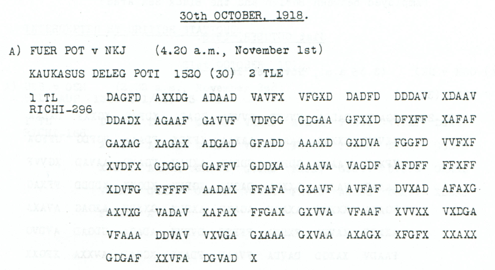

# Childs p85 — readings and source edition

<a id="childs-p-85--readings-and-source-edition"></a>

<!-- Generated by python -m adfgvx.page_editions; edit data/source_editions.json. -->

[Page ranges](README.md) · [By subject](../../topics/README.md) · [Historical research](../../docs/historical-studies/README.md) · [Reading conventions](../../docs/reading-conventions.md) · [← p84](084.md) · [p86 →](086.md)

German readings, English interpretations and source explanations for the **2 ciphertexts** on this printed page.

| Source | State | Subject |
| --- | --- | --- |
| [p85 A1](#source-p85-a1) | READING | Food dispatch from Sevastopol to the Caucasus delegation |
| [p85 B](#source-p85-b) | READING | Telephone censorship through Budapest |


<a id="edition-cases-caucasus-sevastopol-supply-dispatch"></a>

## p85 A1 — Food dispatch from Sevastopol to the Caucasus delegation

<a id="edition-cases-caucasus-sevastopol-supply-dispatch-food-dispatch-from-sevastopol-to-the-caucasus-delegation"></a>


<a id="source-p85-a1"></a>
<a id="edition-cases-caucasus-sevastopol-supply-dispatch-p85-a1"></a>

### p85 A1

**Status:** 148/148 native raw positions fixed; 0 coordinate substitutions and 0 source-mask fills. No frame or key change.

**Source and dates:** Page heading: 30th OCTOBER, 1918; A) FUER POT v NKJ (4.20 a.m., November 1st); KAUKASUS DELEG POTI 1530 (30) 2 TLE; 1 TL RICHI-296.



<details>
<summary>Raw decoded text</summary>

**Raw output:**

```text
NACHSCHUBSTELLESEWASTOPOLSANDTE27X10X18ANKAUKASUSDELEGXFOLGXMENGENABX16400KGZUCKER16300KGHARTFUTTER24200KGKARTOFFELN4900KGHIRSE8700KGFRISCHESGEMUESE
```

</details>

**Readable German — the same candidate labels with spacing and punctuation:**

> Nachschubstelle Sewastopol sandte 27 / 10 / 18 an Kaukasusdeleg. folg. Mengen ab: 16400 kg Zucker, 16300 kg Hartfutter, 24200 kg Kartoffeln, 4900 kg Hirse, 8700 kg frisches Gemuese.

**Meaning:** The supply office at Sevastopol reports sending the listed quantities to the Caucasus delegation on the date written 27/10/18. The surviving first part names sugar, hard feed, potatoes, millet and fresh vegetables. This is a dispatch report, not proof of arrival. No total cargo beyond this surviving part is asserted.

**Conditional interpretation and source details:** The enlarged source reads GDGAA: source index 61 is a visible D with a closed curved right stroke. An initial low-resolution C transcription is resolved by the larger crop and is not a historical ciphertext repair. All 296 coordinates and all 148 plaintext positions are directly observed and decode without changes. Every numeral is determined by the unchanged published key. The 27/10/18 body date, 30 October page heading and 1 November reception header remain separate. This is explicitly part 1 of two; no second-part linkage is assumed.

<a id="edition-cases-caucasus-sevastopol-supply-dispatch-quantities-retained-from-the-raw-stream"></a>

#### Quantities retained from the raw stream

| Commodity | Literal quantity |
| --- | ---: |
| Sugar | 16400 kg |
| Hard feed | 16300 kg |
| Potatoes | 24200 kg |
| Millet | 4900 kg |
| Fresh vegetables | 8700 kg |

The [enlarged GDGAA group](../../experiments/oct30_oil_and_supply_records/sources/p85_A1_GDGAA.png) resolves the initial low-resolution uncertainty: the second glyph is D. No source coordinate or quantity is changed.

<a id="edition-cases-caucasus-sevastopol-supply-dispatch-reproducibility-and-attribution"></a>

#### Reproducibility and attribution

The [input](../../experiments/oct30_oil_and_supply_records/inputs.json) binds the complete literal rows to exact PDF crops. The [certificate](../../experiments/oct30_oil_and_supply_records/certificates.json) records every coordinate pair and the sensitivity branch. The [verifier](../../experiments/oct30_oil_and_supply_records/verify.py) checks the published Oct28–31 key, live German quotations, source-image hashes and optional PDF pixel regeneration.

Source edition and verification: icekylinx and GPT-6 Astra Pro (2026). Childs supplies the historical collection; the published reconstruction and key provenance credit Lasry, Niebel, Kopal and Wacker. The [attribution record](../../experiments/oct30_oil_and_supply_records/prior_candidates.json) retains earlier OCR and the already reviewed p84 source.

<a id="source-p85-b"></a>
<a id="edition-cases-radio-p85-b"></a>

## p85 B — Telephone censorship through Budapest

**Edition context:** p85 B — Telephone censorship through Budapest.

<a id="edition-cases-radio-p85-b-p85-b--telephone-censorship-through-budapest"></a>


[Source image](../../sources/excerpts/other_p85_B.png)

**Status:** A source-reviewed supplementary message. The unchanged published
`Oct28-31` key fixes **all 99 raw plaintext positions** in the 198-coordinate
source. The likely wording below corrects two raw characters and one spelling
omission; those changes are distinguished from the direct decryption.

<a id="edition-cases-radio-p85-b-most-likely-reading"></a>

### Most likely reading

**Readable German:**

> Fernsprechverbindung ueber [Budapest] unterli[e]gt ungarischer Censur.
> Verbindung daher nur mit [Funkspruch] moeglich.

**Meaning:** The telephone connection through Budapest is subject to Hungarian
censorship. Communication is therefore possible only by radio message.

The brackets mark editorial repairs. `BUD9PEST` most likely means Budapest,
and `FUPKSPRUCH` most likely means *Funkspruch*. Both replacements have an exact
coordinate audit below. The inserted `e` in *unterliegt* repairs the raw
`UNTERLIGT`; it is a spelling restoration, not an additional decrypted letter.
`Censur` is retained as the source's spelling. Spacing and punctuation are
editorial; the single `X` separates the two clauses.

<a id="edition-cases-radio-p85-b-what-the-source-actually-yields"></a>

### What the source actually yields

<details>
<summary>Raw decoded text</summary>

**Raw output:**

```text
FERNSPRECHVERBINDUNGUEBERBUD9PESTUNTERLIGTUNGARISCHERCENSURXVERBINDUNGDAHERNURMITFUPKSPRUCHMOEGLICH
```

</details>

All coordinates are legible and valid. This complete raw string re-encrypts
to the unchanged source. A same-length candidate correcting Budapest and
Funkspruch, while retaining `UNTERLIGT`, requires exactly these two changes:

| Source index, zero based | Printed | Proposed | Reading affected |
| ---: | :---: | :---: | --- |
| 53 | G | X | `FUPKSPRUCH` → `FUNKSPRUCH` |
| 168 | A | V | `BUD9PEST` → `BUDAPEST` |

The other **196 coordinates remain unchanged**. No coordinate is inserted,
deleted or supplied from an erasure, and no square cell is changed. This
same-length certificate does not include the extra editorial `e` in
*unterliegt*.

<a id="edition-cases-radio-p85-b-source-and-verification"></a>

### Source and verification

Printed p85 / PDF page 88, section B. The page heading is **30 October 1918**;
the reception header is `LP v OSM (9.42 p.m., October 31st)`, followed by
`(30) ZU 1500 UKS; RICHI-198`. These distinct dates are preserved.

The [source record](../../experiments/corpus_readings/selected_sources.json)
contains the literal grouped transcript. The
[coordinate certificate](../../experiments/corpus_readings/certificates.json)
records every plaintext position, its two source coordinates, the unchanged
key and the complete repair map.

```sh
python3 experiments/corpus_readings/verify.py --verify
```

**Credit:** George Lasry's published period key and its historical sources are
retained in [the key register](../../data/keys.json). Source inspection,
verification and this annotated reading are by **icekylinx and GPT-6 Astra Pro**.
No first-decipherment priority is claimed for this supplementary message.
