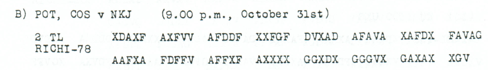
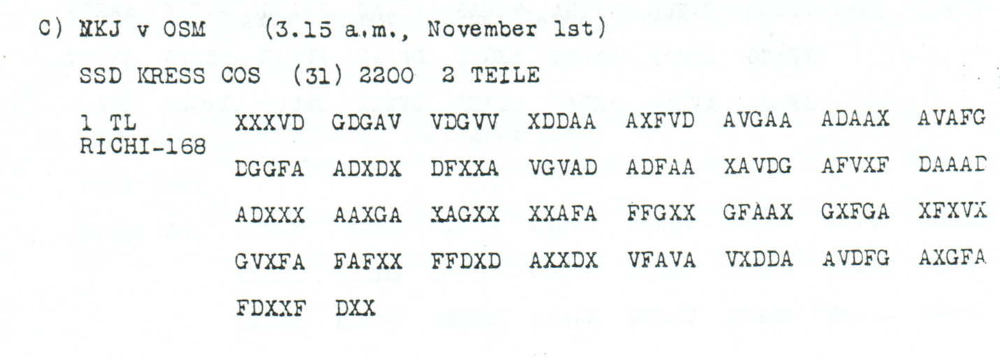

# Childs p86 — readings and source edition

<a id="childs-p-86--readings-and-source-edition"></a>

<!-- Generated by python -m adfgvx.page_editions; edit data/source_editions.json. -->

[Page ranges](README.md) · [By subject](../../topics/README.md) · [Historical research](../../docs/historical-studies/README.md) · [Reading conventions](../../docs/reading-conventions.md) · [← p85](085.md) · [p87 →](087.md)

German readings, English interpretations and source explanations for the **3 ciphertexts** on this printed page.

| Source | State | Subject |
| --- | --- | --- |
| [p86 A](#source-p86-a) | READING | Inventory query for German MG08 with tripod mounts; asks quantity and caliber |
| [p86 B2](#source-p86-b2) | READING | Falkenhausen followup: a surviving second-part ending |
| [p86 C1](#source-p86-c1) | READING | A telegram reports the Turkish armistice, with terms still unknown |

<a id="source-p86-a"></a>
<a id="edition-cases-military-mg08-inventory"></a>

## p86 A — Inventory query for German MG08 with tripod mounts; asks quantity and caliber

**Edition context:** Inventory query for German MG08 machine guns.

<a id="edition-cases-military-mg08-inventory-inventory-query-for-german-mg08-machine-guns"></a>


**Source edition and verification: icekylinx and GPT-6 Astra Pro.**

Childs p86 A asks how many German `MG08` with tripod mounts are available
in the recipient's area and what caliber they have. It is a request for an
inventory, not a report giving the number available. The source's address,
office and reference fields remain literal.

<a id="edition-cases-military-mg08-inventory-source-and-reading"></a>

### Source and reading

The primary source is J. Rives Childs, *General Solution of the ADFGVX Cipher
System*, [printed p86, PDF page 89](https://drive.google.com/file/d/1_JiNMck7eUvdrOTrH7fsj1Yh44t-VSC6/view).
The [source crop](../../experiments/inventory_and_medical_return/sources/childs_p86_A.png)
is under an 31 October heading:

<details>
<summary>Literal source transcription</summary>

**Source transcription — clear header and/or literal source record:**

```text
A) OSM v NKJ (3.35 a.m., November 1st)
1207 (31/10)
RICHI-298
```

</details>

All 298 printed coordinates are valid and give 149 fixed labels under the
unchanged published `Oct28-31` key:

<details>
<summary>Raw decoded text</summary>

**Raw output:**

```text
MGKOMMANDEUROSMANHGRXOSTXWIEVIELDEUTSCHEMG08MITDREIFUSSLAFETTEIMDORTIGEXBER4ICHVORHANDENXWELCHESKALIBERHABENSIEXOSMAN19ABTLGXGRXHXQUXNO835C120X10X18X
```

</details>

Two known-coordinate substitutions repair ordinary words:

<details>
<summary>Proposed text and exact labels</summary>

**Edited output:**

```text
MGKOMMANDEUROSMANHGRXOSTXWIEVIELDEUTSCHEMG08MITDREIFUSSLAFETTEIMDORTIGENBEREICHVORHANDENXWELCHESKALIBERHABENSIEXOSMAN19ABTLGXGRXHXQUXNO835C120X10X18X
```

</details>

Readable core, preserving the telegram's abbreviated grammar:

**Readable German:**

> Wie viel deutsche MG08 mit Dreifußlafette im dortigen Bereich
> vorhanden? Welches Kaliber haben sie?

The address field `MGKOMMANDEUROSMANHGRXOST` is not expanded into an
identified individual or a formally established command title. The closing
also remains unexpanded:

<details>
<summary>Raw decoded text</summary>

**Raw output — unchanged closing-field excerpt:**

```text
OSMAN19ABTLGXGRXHXQUXNO835C120X10X18X
```

</details>

In particular, the **08** in `MG08`, the **19** in `OSMAN19`, and the complete
reference `NO835C120X10X18` are unchanged published-square labels. No unit,
office or date reassignment is inferred from a plausible reading.

<a id="edition-cases-military-mg08-inventory-exact-costs"></a>

### Exact costs

| Source index, zero-based | Printed group / position, one-based | Change | Effect |
| ---: | --- | --- | --- |
| 223 | 45 / 4 | `V` → `F` | `BER4ICH` → `BEREICH` |
| 289 | 58 / 5 | `A` → `X` | `DORTIGEX` → `DORTIGEN` |

The raw `4` inside `BER4ICH` remains visible in the original string and
numerical ledger. Its local word repair does not reassign the square's
digit `4`. There are no source erasures, inserted coordinates, deletions or
square changes. The complete 298-coordinate repaired witness is retained
in the [certificate](../../experiments/inventory_and_medical_return/certificates.json).

```sh
python experiments/inventory_and_medical_return/verify.py --verify
```

The [inputs](../../experiments/inventory_and_medical_return/inputs.json)
preserve the manual rows, source images and key provenance. The period key
is prior work by **George Lasry, Ingo Niebel, Nils Kopal and Arno Wacker**,
[DOI 10.1080/01611194.2016.1169461](https://doi.org/10.1080/01611194.2016.1169461),
also reproduced in Lasry's 2017 key comment. Earlier unreviewed OCR candidates
existed. The bounded author-paper review does not establish universal
first-decipherment priority; this source edition does not supply an answer
to the inventory question it recovers.


<a id="edition-cases-caucasus-falkenhausen-followup-fragment"></a>

## p86 B2 — Falkenhausen followup: a surviving second-part ending

<a id="edition-cases-caucasus-falkenhausen-followup-fragment-falkenhausen-followup-a-surviving-second-part-ending"></a>


<a id="source-p86-b2"></a>
<a id="edition-cases-caucasus-falkenhausen-followup-fragment-p86-b2"></a>

### p86 B2

**Status:** 39/39 native raw positions fixed; 0 coordinate substitutions and 0 source-mask fills. No frame change.

**Source and dates:** Page heading: 31st OCTOBER, 1918; B) POT, COS v NKJ (9.00 p.m., October 31st); 2 TL RICHI-78.



<details>
<summary>Raw decoded text</summary>

**Raw output:**

```text
FOLGENBALMOEGLIHSTXFALKENHAUSENX8274X18
```

</details>

**Readable German — the same candidate labels with spacing and punctuation:**

> Folgen BAL MOEGLIHST. Falkenhausen. 8274 / 18.

**Meaning:** The surviving ending appears to promise that something will follow as soon as possible, with Falkenhausen and reference 8274/18. The subject of folgen is not present in this part. The literal defective words BAL and MOEGLIHST are preserved; the interpretation as bald moeglichst is not an additional cryptographic recovery.

**Conditional interpretation and source details:** All 78 received coordinates decode directly. The first part has not been identified here. No missing D or C is inserted to normalize BAL MOEGLIHST, and no link to the neighboring food dispatch is asserted.

<a id="edition-cases-caucasus-falkenhausen-followup-fragment-explicit-source-changes"></a>

#### Explicit source changes

No source-coordinate substitution or source-mask fill is used.

<a id="edition-cases-caucasus-falkenhausen-followup-fragment-reproducibility-and-attribution"></a>

#### Reproducibility and attribution

The [input](../../experiments/oct31_armistice_and_followup/inputs.json) binds each literal source to exact PDF crops. The [certificate](../../experiments/oct31_armistice_and_followup/certificates.json) contains the raw paired-coordinate domains, each source change and the forward checks. The [verifier](../../experiments/oct31_armistice_and_followup/verify.py) checks the unchanged published keys and the live German quotations, retaining all numerical and letter labels.

Source edition and verification: icekylinx and GPT-6 Astra Pro (2026). Childs supplies the historical collection; published reconstruction and key provenance credit Lasry, Niebel, Kopal and Wacker. Earlier repository OCR and body readings are retained in the [attribution record](../../experiments/oct31_armistice_and_followup/prior_candidates.json).


<a id="edition-cases-military-oct31-turkish-armistice-notice"></a>

## p86 C1 — A telegram reports the Turkish armistice, with terms still unknown

<a id="edition-cases-military-oct31-turkish-armistice-notice-a-telegram-reports-the-turkish-armistice-with-terms-still-unknown"></a>


<a id="source-p86-c1"></a>
<a id="edition-cases-military-oct31-turkish-armistice-notice-p86-c1"></a>

### p86 C1

**Status:** 84/84 native raw positions fixed; 1 coordinate substitution and 0 source-mask fills. No frame change.

**Source and dates:** Page heading: 31st OCTOBER, 1918; C) NKJ v OSM (3.15 a.m., November 1st); SSD KRESS COS (31) 2200 2 TEILE; 1 TL RICHI-168.



<details>
<summary>Source and cipher evidence</summary>

**Raw output:**

```text
WAFFENSTILLSTANDHEUTEEINUHRNACHMVONTUERKEIABGESCHLOSSENXBEDINGUNGENNOCHNICHTBEKANZTX
```

**Edited output — counted proposal:**

```text
WAFFENSTILLSTANDHEUTEEINUHRNACHMVONTUERKEIABGESCHLOSSENXBEDINGUNGENNOCHNICHTBEKANNTX
```

</details>

**Readable German — the same candidate labels with spacing and punctuation:**

> Waffenstillstand heute ein Uhr nachm. von Tuerkei abgeschlossen. Bedingungen noch nicht bekannt.

**Meaning:** The message reports that Turkey concluded an armistice today at one o'clock in the afternoon and says its terms are not yet known. This is the content of the intercepted report; it does not independently establish the historically effective time. The page is headed 31 October, and reception is recorded on 1 November.

**Conditional interpretation and source details:** The only proposal repairs BEKANZT to BEKANNT through one observed-coordinate substitution. HEUTE, EIN UHR and NACHM are direct raw wording. The source labels this part 1 of two; no missing continuation is supplied.

<a id="edition-cases-military-oct31-turkish-armistice-notice-explicit-source-changes"></a>

#### Explicit source changes

All indices are zero-based.

| Source index | Printed | Proposed | Cost |
| ---: | --- | --- | --- |
| 55 | `V` | `X` | Observed-coordinate substitution |

<a id="edition-cases-military-oct31-turkish-armistice-notice-reproducibility-and-attribution"></a>

#### Reproducibility and attribution

The [input](../../experiments/oct31_armistice_and_followup/inputs.json) binds each literal source to exact PDF crops. The [certificate](../../experiments/oct31_armistice_and_followup/certificates.json) contains the raw paired-coordinate domains, each source change and the forward checks. The [verifier](../../experiments/oct31_armistice_and_followup/verify.py) checks the unchanged published keys and the live German quotations, retaining all numerical and letter labels.

Source edition and verification: icekylinx and GPT-6 Astra Pro (2026). Childs supplies the historical collection; published reconstruction and key provenance credit Lasry, Niebel, Kopal and Wacker. Earlier repository OCR and body readings are retained in the [attribution record](../../experiments/oct31_armistice_and_followup/prior_candidates.json).
