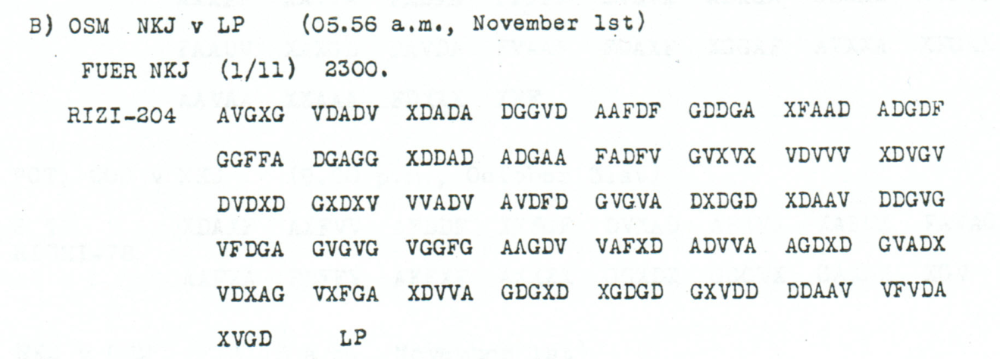

# Childs p. 88 — readings and source edition

<!-- Generated by python -m adfgvx.page_editions; edit data/source_editions.json. -->

[Page ranges](README.md) · [By subject](../../topics/README.md) · [Historical research](../../docs/historical-studies/README.md) · [Reading conventions](../../docs/reading-conventions.md) · [← p. 87](087.md) · [p. 89 →](089.md)

German readings, English interpretations and source explanations for the **4 ciphertexts** on this printed page.

| Source | State | Subject |
|---|---|---|
| [p88 A1](#source-p88-a1) | PARTIAL | Caucasus delegation and 800-watt transmitter transport to Berlin |
| [p88 A2](#source-p88-a2) | READING | General von Kress and 1500-watt tube transmitter |
| [p88 B](#source-p88-b) | READING | Expected heavier traffic: direct UKS connection or OSM relay |
| [p88 C1](#source-p88-c1) | READING | Evacuation destinations: Siegfried to Konstanza and other traffic to Odessa |


<a id="edition-cases-caucasus-caucasus-radio-transmitters"></a>

## p88 A1, p88 A2 — Caucasus delegation and radio transmitters at Tiflis

<a id="edition-cases-caucasus-caucasus-radio-transmitters-caucasus-delegation-and-radio-transmitters-at-tiflis"></a>


**Source edition and verification: icekylinx and GPT-6 Astra Pro.**

Childs p88 A1/A2, PDF p91, form the two-part message headed
`NKJ v LP (05.56 a.m., November 2nd)` and
`FUER COS SSD BLITZ GR H Q 1330 (1.11) 2 TEILE`. Both parts use the
unchanged published **Nov1–3** key. The message discusses tube radio
transmitters at Tiflis and General von Kress. It does not establish that
the proposed transport actually took place.

<a id="source-p88-a1"></a>
<a id="edition-cases-caucasus-caucasus-radio-transmitters-p88-a1"></a>

### p88 A1

The [first-part crop](../../experiments/caucasus_radio_transmitters/sources/p88_A1.png)
contains **172 visible slots**, matching `1 TL RICHI-172`. Source slot
**57** contains a printed **Q** in `DVQXX`. It is masked as one invalid
coordinate, with no change to the frame.

<details>
<summary>Raw decoded text</summary>

**Raw output — native 172-coordinate frame:**

```text
DTSCHEKAUKASDELEGAXER?TTETRANSPORRTX800WATTROEHRENSENDTIFLISZURTAFUNKBERLINVERANLASSEN
```

</details>

**Readable German — spacing and punctuation, with the malformed words retained:**

> Dtsche. Kaukas. Delega. ER?TTE TRANSPORRT, 800 Watt Röhrensend.
> Tiflis zur TAFUNK Berlin veranlassen.

The verb-like field is incomplete. The message nevertheless preserves
`800 WATT ROEHRENSEND`, `TIFLIS`, `BERLIN` and `VERANLASSEN` directly.
**ZURTAFUNK** is displayed as “zur TAFUNK”; no institutional expansion of
TAFUNK is claimed.

The unknown plaintext position **21** has domain **248CIM**, not every
letter. Supplying an apparently obvious B would also require a change to
its other, observed coordinate. More broadly, normalizing the whole field
to `ERBITTETRANSPORT` requires **20 observed-coordinate substitutions plus
one fill** in this native frame. That expensive editorial possibility is
certified separately and **not adopted**. The main reading retains
**85 / 86 fixed positions**, including the doubled R in `TRANSPORRT`.

<a id="source-p88-a2"></a>
<a id="edition-cases-caucasus-caucasus-radio-transmitters-p88-a2"></a>

### p88 A2

The [second-part crop](../../experiments/caucasus_radio_transmitters/sources/p88_A2.png)
contains **134 visible slots**, matching `2 TL RICHI-134`. Source **53**
is a [y-like non-coordinate glyph](../../experiments/caucasus_radio_transmitters/sources/p88_A2_y_glyph.png),
recorded as Y in the literal transcript and masked without deleting it.

<details>
<summary>Source and cipher evidence</summary>

**Raw output — native 134-coordinate typed frame:**

```text
UOBER1500WETTDOEHRENSENDVERFUEGTG?NERALVONKRESSXNACHCHEFRM4BX49523X
```

**Edited output — three observed-coordinate substitutions and one invalid-glyph fill:**

```text
UEBER1500WATTROEHRENSENDVERFUEGTGENERALVONKRESSXNACHCHEFRM4BX49523X
```

</details>

The changes are source **22 A→V**, **37 G→D**, **107 V→X**, and the
fill **53 Y→V**. The first three repair `UOBER`, `DOEHREN` and `WETT`;
the fill supplies E in `GENERAL`. The edited stream fixes **67 / 67
positions** and re-encrypts exactly.

**Readable German — spacing, punctuation and umlauts:**

> Über 1500 Watt Röhrensend. verfügt General von Kress.
> Nach Chef RM. 4. B. 49523.

The power, name and reference retain their literal values. No independent
biographical identity or expansion of the reference is inferred.

<a id="edition-cases-caucasus-caucasus-radio-transmitters-conditional-interpretation-and-the-supralinear-source-layer"></a>

### Conditional interpretation and the supralinear source layer

The scan contains [four marks above typed coordinates](../../experiments/caucasus_radio_transmitters/sources/p88_A2_annotations.png).
Their author, date and purpose are unknown. Interpreting each as a
replacement of the aligned typed glyph gives the following independently
reproducible effects; all indices are zero-based.

| Source slot | Typed → aligned mark | Plaintext effect when applied alone |
|---|---|---|
| 107 | V → X | Position 10: `WETT` → `WATT` |
| 115 | G → F | Position 23: `SEND` → `SEN0` |
| 116 | F → A | Position 32: `G?NERAL` → `0?NERAL` |
| 119 | X → V | Position 61: `49523` → `M9523` |

<details>
<summary>Raw decoded text</summary>

**Raw output — all four aligned replacements, with the same native frame:**

```text
UOBER1500WATTDOEHRENSEN0VERFUEGT0?NERALVONKRESSXNACHCHEFRM4BXM9523X
```

</details>

The certificate retains **all 16 combinations** of these four source
choices. The primary edited candidate uses only the first annotation;
the other three effects are kept as source evidence rather than silently
accepted or suppressed. They are variants of the same physical A2
record, not extra recovered messages. No numerical relabeling follows.

Across both parts there are **306 visible slots**, **304 valid source
coordinates**, and **153 plaintext positions**. The typed layer fixes
**151 / 153** positions; the conservative edited layer fixes **152 / 153**.
The summary counts only three observed substitutions and one fill, with
one invalid source glyph still unresolved. It excludes the expensive A1
normalization and the alternative annotation layers. Six full A1
completion witnesses demonstrate the remaining ambiguity without naming
one as the historical text.

Both bodies already appeared in earlier unreviewed repository candidates.
Published key credit and the bounded prior-paper/comment check are kept
explicitly; this edition makes no historical first-solution claim. See
[inputs](../../experiments/caucasus_radio_transmitters/inputs.json),
[certificates](../../experiments/caucasus_radio_transmitters/certificates.json)
and [verification instructions](../../experiments/caucasus_radio_transmitters/README.md).


<a id="edition-cases-radio-uks-direct-or-osm-relay"></a>

## p88 B — Expected heavier traffic: direct UKS connection or OSM relay

<a id="edition-cases-radio-uks-direct-or-osm-relay-expected-heavier-traffic-direct-uks-connection-or-osm-relay"></a>


<a id="source-p88-b"></a>
<a id="edition-cases-radio-uks-direct-or-osm-relay-p88-b"></a>

### p88 B

**Status:** 102/102 native raw positions fixed; 0 coordinate substitutions and 0 source-mask fills. No frame change.

**Source and dates:** Page heading: 1st NOVEMBER, 1918; B) OSM NKJ v LP (05.56 a.m., November 1st); FUER NKJ (1/11) 2300; RIZI-204; separate LP after the final ciphertext group.



<details>
<summary>Raw decoded text</summary>

**Raw output:**

```text
FUERXUKSXGROESSERERXVERKEHRXZUXERWARTENXHABENXSIEXSICHEREXVERBINDUNGMITXUKSXODERXMUSSXOSMXVERMITTELNXX
```

</details>

**Readable German — the same candidate labels with spacing and punctuation:**

> Fuer UKS. Groesserer Verkehr zu erwarten. Haben Sie sichere Verbindung mit UKS, oder muss OSM vermitteln?

**Meaning:** Heavier traffic is expected. The sender asks whether a reliable direct connection to UKS exists or whether OSM must relay it. The question does not establish that either link is functioning.

**Conditional interpretation and source details:** All 204 coordinate positions and 102 plaintext labels are directly observed. The separate LP following the final XVGD is retained as a visible source footer outside the advertised 204-coordinate body; it is not deleted from an encrypted stream. The question mark ending the German quotation is editorial punctuation, not an unresolved plaintext position.

<a id="edition-cases-radio-uks-direct-or-osm-relay-explicit-source-changes"></a>

#### Explicit source changes

No source-coordinate substitution or source-mask fill is used.

<a id="edition-cases-radio-uks-direct-or-osm-relay-reproducibility-and-attribution"></a>

#### Reproducibility and attribution

The [input](../../experiments/radio_relay_and_march_notice/inputs.json) binds each literal source to exact PDF crops. The [certificate](../../experiments/radio_relay_and_march_notice/certificates.json) contains the raw paired-coordinate domains, each source change and the forward checks. The [verifier](../../experiments/radio_relay_and_march_notice/verify.py) checks the unchanged published keys and the live German quotations, retaining all numerical and letter labels.

Source edition and verification: icekylinx and GPT-6 Astra Pro (2026). Childs supplies the historical collection; published reconstruction and key provenance credit Lasry, Niebel, Kopal and Wacker. Earlier repository OCR and body readings are retained in the [attribution record](../../experiments/radio_relay_and_march_notice/prior_candidates.json).


<a id="edition-cases-military-black-sea-evacuation-routes"></a>

## p88 C1 — Evacuation destinations: Siegfried to Konstanza and other traffic to Odessa

**Edition context:** Black Sea evacuation routes, the Braila prohibition and onward rail movement.

**Related source pages:** [p89 A3](089.md#source-p89-a3), [p89 A4](089.md#source-p89-a4), [p90 A5](090.md#source-p90-a5).

<a id="edition-cases-military-black-sea-evacuation-routes-black-sea-evacuation-routes-the-braila-prohibition-and-onward-rail-movement"></a>


**New source editions and verification: icekylinx and GPT-6 Astra Pro.**
**Existing part2 body: Ayush Agarwal (@AyushAg1002), 2026-10-28.**

Childs pp88–90, PDF pp91–93, preserve a source-labeled five-part order.
The repeated header is `OSM de LP (01.18 p.m., November 1st)`, followed
by `SSD BVG KOSPOLI (1/11) 1400 5 TEILE`. The explicit sequence is
**p88 C1, p89 A2, p89 A3, p89 A4, p90 A5**. The source time fields
remain unchanged. All parts use the published **Nov1–3** key.

This edition adds **four physical records**. The already reviewed p89 A2
is included only as credited context. A3 contains a source-declared loss
of 20 groups, so its restored prefix is presented with its full missing
coordinate cost and its unresolved tail.

<a id="source-p88-c1"></a>
<a id="edition-cases-military-black-sea-evacuation-routes-p88-c1"></a>

### p88 C1

The [first-part crop](../../experiments/black_sea_evacuation_routes/sources/p88_C1.png)
contains **298 valid coordinates**, matching `1 TL RICHI-298`.

<details>
<summary>Source and cipher evidence</summary>

**Raw output — native 298-coordinate frame:**

```text
ERSTENSXZUXFECHXRMX2XGROSSXBXFRX50749XXFUERABSCHUBGELTENFOLGENREZIELEDOPPELPUNKTXSIEGFRIEDXNACHXKONSTANZAXALLESUEBRIGEXODESSAXUNDFALLSDIESESNICHTMEHR
```

**Edited output — one observed-coordinate substitution, with no fills:**

```text
ERSTENSXZUXFECHXRMX2XGROSSXBXFRX50749XXFUERABSCHUBGELTENFOLGENDEZIELEDOPPELPUNKTXSIEGFRIEDXNACHXKONSTANZAXALLESUEBRIGEXODESSAXUNDFALLSDIESESNICHTMEHR
```

</details>

**Readable German — spacing and punctuation; the clause continues into part 2:**

> Erstens. Zu FECH RM. 2. Gross B. FR. 50749. Für Abschub gelten
> folgende Ziele, Doppelpunkt: Siegfried nach Konstanza, alles übrige
> Odessa, und falls dieses nicht mehr ...

Source **288 D→G** changes `FOLGENRE` to `FOLGENDE`. The name
`SIEGFRIED` remains a literal source name, without a new identification
of a particular vessel or formation.

<a id="edition-cases-military-black-sea-evacuation-routes-existing-p89-a2--earlier-credited-context"></a>

### Existing p89 A2 — earlier credited context

This part's body is credited to **Ayush Agarwal**, and its prior
[conservative source edition](089.md#edition-cases-supplementary-p89-a2) is unchanged.
It has **290 source slots**, **145 plaintext positions**, and
**142 fixed positions** in that conservative layer. It is **not** one
of the four new records or part of their totals.

<details>
<summary>Raw decoded text</summary>

**Raw output — existing credited conservative source reading, unchanged:**

```text
AUFNAHMEFAEHIGXNIKOLAJEWXAUFWUNSCHXEZXKIEWXBESTIMMTXHPTMXJOELXVXOXFECHXODESSAX?ELCHES?HI?FEETWAXWEGENXEISENBAHNLAGEXNACHXNIKOLAJEWXZUGEHENHABENXX
```

</details>

This continues the Odessa capacity clause and gives Nikolajew as another
destination, naming Hptm. Joel and railway-related routing from Odessa.
The three uncertainties and source-glyph qualifications remain exactly as
in the earlier edition; the assembly does not silently fill them.

<a id="edition-cases-military-black-sea-evacuation-routes-conditional-interpretation-and-unresolved-space"></a>

### Conditional interpretation and unresolved space

The four newly edited records comprise **1,314 visible source slots**,
**1,313 valid observed coordinates** and **707 modeled plaintext positions**.
Including the current A3 continuation, their proposed readings use **eight
observed substitutions**, **one printed-dash fill** and **95 fills of
explicitly lost coordinates**. The earlier Ayush part 2 remains outside
these totals. A3 is the only part of this new group with a source-declared
large loss; three of its plaintext positions remain unresolved in the
current conditional reading.

The complete order distinguishes the route of evacuation, onward movement
by whole trains, and destinations for different groups. Its next part
specifies Berlin for civilians and requires an enquiry about destinations
for formed troop units. Those source-numbered adjacent clauses give the
A3 continuation a useful context without supplying its missing characters.
The order records intended movements; it does not establish that the
steamers turned back or that the personnel reached the stated destinations.

The [original source inputs](../../experiments/black_sea_evacuation_routes/inputs.json),
[baseline certificates](../../experiments/black_sea_evacuation_routes/certificates.json),
[credited part 2 snapshot](../../experiments/black_sea_evacuation_routes/existing_part2.json)
and [reproduction instructions](../../experiments/black_sea_evacuation_routes/README.md)
retain the source, loss placement and earlier editorial operations.
The [current A3 package](../../experiments/p89_destination_continuation/README.md)
adds the exact continuation, independent word witnesses, historical source
and bounded retrieval checks.


<details>
<summary>Comparative source sections from other printed pages</summary>

<a id="edition-cases-military-black-sea-evacuation-routes-p89-a3"></a>

### p89 A3

**Readable German — current conditional proposal; each ? is one unresolved position:**

> Zweitens. Nach Braila geht nichts. Dorthin unterwegs befindliche
> Dampfer abdrehen. Drittens. Weiterleitung in geschlossenen Zügen.
> Ziel für MILI? DIENSTELLEN: Ers. Batl. 2 Garderegts. z. F?sz? Berlin.

**English meaning:** Nothing is to go to Braila, and steamers already on
that route are to turn back. Onward transport is to use whole trains.
The conditional continuation names a destination for apparently military
offices, followed by a replacement-battalion designation and Berlin.
The last clause still has three unresolved labels.

The new reading supplies ten positions beyond the
[guard-battalion extension](../../experiments/p89_guard_battalion_extension/README.md),
reaching **176/179 fixed positions under the conditional model**. All ten
new assignments have one observed coordinate half and require only the
missing half to be filled. Their complete cost and independent witnesses
are in the [destination continuation](../../experiments/p89_destination_continuation/README.md).

The proposed spelling `DIENSTELLEN` is deliberately retained. The normal
word `DIENSTSTELLEN` is thirteen characters long, while this target span
has eleven. The hypothesis is an omitted `ST` within `STST`. A separate
raw message, **p78 A2**, supplies `DIENSTSTELLEN` with all 26 coordinate
halves observed; the target spelling agrees with its own **16 observed
halves**. This is a constrained textual proposal, not the recovery of the
two additional letters or a change to the source frame.

A contemporary [1918 Berlin directory](../../experiments/p89_destination_continuation/HISTORY.md)
lists **2. Garderegiment zu Fuß** in Berlin. It supports the proposed unit
name and city, but does not determine the replacement battalion's November
location or any missing cipher labels. The T in `BATL` remains wholly
absent, and the numeral 2 is supported by one observed half.

The [third-part crop](../../experiments/black_sea_evacuation_routes/sources/p89_A3.png)
prints `3 TL RICHI-358` and **`(missed 20 groups)`** after five
40-coordinate rows. There are **258 visible slots**, including one
printed dash. Inserting **100 unknown coordinate slots at source
boundary 200** gives the source-declared 358-coordinate frame. The page
supplies the gap's size and placement.

<details>
<summary>Source, exact candidate and cumulative repair account</summary>

**Raw output — source-declared frame with 100 missing coordinates:**

```text
???ITE??NA???BR?I?A???HTN??HT???O??H?N???ERL??SB???ND?I?H???MPF??AB???HE?X?D???TEN??WE???RL?I?U???NGE??HL???EN?N?U???NXZ???F???MI?I?D???STE???N???SX?A?L???GAR???E???XZ?F?SZ??ERL??
```

**Edited output — current conditional proposal in that same frame:**

```text
ZWEITENSNACHXBRAILAXGEHTNICHTSXDORTHINUNTERWEGSBEFINDLICHEDAMPFERABDREHENXXDRITTENSXWEITERLEITUNGINGESCHLOSSENENZUEGENXZIELFUERMILI?DIENSTELLENXERSXBATLX2XGARDEREGTSXZXF?SZ?BERLIN
```

All prices are cumulative. A fixed position can be an editorially supplied
letter, separator or numeral under the indicated layer.

| Layer | Fixed positions | Observed substitutions | Printed-dash fills | Lost-coordinate fills |
|---|---:|---:|---:|---:|
| Raw source-declared frame | 81/179 | 0 | 0 | 0 |
| Original prefix | 151/179 | 1 | 1 | 69 |
| Guard designation and Berlin | 166/179 | 1 | 1 | 85 |
| Current destination proposal | **176/179** | **1** | **1** | **95** |

The inherited observed substitution is **source 243 A→G**, giving the W
in `UNTERWEGS`. The printed dash at **source 242** is filled with A.
The subsequent layers add no observed substitutions or printed-mask fills.
All machine indices are zero-based.

</details>

The remaining plaintext positions are **131**, **169** and **172**. The
first two have both coordinates missing. Position 172, immediately before
`BERLIN`, has the pair `X?` and admits only **1, 3, 4, 6, A or Y** under
the published key. Reading it as a separator X would require another
observed-coordinate substitution. The five remaining coordinate masks
permit exactly **6^5 = 7,776** complete strings under this candidate model;
this count does not select the historical wording.

<a id="edition-cases-military-black-sea-evacuation-routes-p89-a4"></a>

### p89 A4

The [fourth-part crop](../../experiments/black_sea_evacuation_routes/sources/p89_A4.png)
has **360 valid coordinates**, matching `4 TL RICHI-360`. Detail
crops confirm the G in `GVGAG` and the X in `XDXFX`, which can look
misleading at lower resolution; neither requires an editorial source edit.

<details>
<summary>Source and cipher evidence</summary>

**Raw output — native 360-coordinate frame:**

```text
XIVILPERSONENBERLINXZIELFUERGESCHLOSSENETRUPPENTEILEHIER7RFRAGENXXVIERTENSXUMUNTERBRINGUNGUNDWEITERLEITUNGSICHERZUSTELLENXSORGTXSXMXSTXFUERMOEQLICHSTFRUEHZEITIQEUNDGENAUEVORMELDUNG
```

**Edited output — four observed-coordinate substitutions, with no fills:**

```text
ZIVILPERSONENBERLINXZIELFUERGESCHLOSSENETRUPPENTEILEHIERERFRAGENXXVIERTENSXUMUNTERBRINGUNGUNDWEITERLEITUNGSICHERZUSTELLENXSORGTXSXMXSTXFUERMOEGLICHSTFRUEHZEITIGEUNDGENAUEVORMELDUNG
```

</details>

**Readable German — spacing and punctuation:**

> Zivilpersonen Berlin. Ziel für geschlossene Truppenteile hier
> erfragen. Viertens. Um Unterbringung und Weiterleitung sicherzustellen,
> sorgt S. M. St. für möglichst frühzeitige und genaue Vormeldung.

The first raw X is repaired to the Z of `ZIVILPERSONEN`; it is not
automatically treated as a separator. The raw 7 in `HIER7RFRAGEN`
is another explicitly priced word repair. The key and all numerical
reference fields remain unchanged.

<a id="edition-cases-military-black-sea-evacuation-routes-p90-a5"></a>

### p90 A5

The [fifth-part crop](../../experiments/black_sea_evacuation_routes/sources/p90_A5.png)
contains **398 valid coordinates**, matching `5 TL RICHI-398`.

<details>
<summary>Source and cipher evidence</summary>

**Raw output — native 398-coordinate frame:**

```text
ANEMPFANGSSTELLENINXUKRAINEXGLEICHESANXETRAXOSTXSUEDOSTXBVGXKOSPOLIXEZXKI7WXSXMXSTXDTSCHXSTABXSXAXBERLINXNATEKOXNACHRXRXMXAXADMIRALSTABXSEEKRIEGSLEITUNGXFELDEISENBAHNCHEFXRMX2XQROSSXBXFRX52751X31X10X
```

**Edited output — two observed-coordinate substitutions, with no fills:**

```text
ANEMPFANGSSTELLENINXUKRAINEXGLEICHESANXETRAXOSTXSUEDOSTXBVGXKOSPOLIXEZXKIEWXSXMXSTXDTSCHXSTABXSXAXBERLINXNATEKOXNACHRXRXMXAXADMIRALSTABXSEEKRIEGSLEITUNGXFELDEISENBAHNCHEFXRMX2XGROSSXBXFRX52751X31X10X
```

</details>

**Readable German — spacing and punctuation, keeping abbreviations literal:**

> An Empfangsstellen in Ukraine. Gleiches an Etra Ost, Südost, BVG
> Kospoli, Ez. Kiew, S. M. St., Dtsch. Stab, S. A. Berlin, Nateko,
> Nachr. R. M. A., Admiralstab, Seekriegsleitung, Feldeisenbahnchef.
> RM. 2. Gross B. FR. 52751. 31.10.

The source continues with the following **printed cleartext**, which
is outside the encrypted body and all plaintext-position counts.

<details>
<summary>Literal source transcription</summary>

**Source transcription — printed cleartext outside the encrypted body:**

```text
BITTE JETZT NUR QUITTUNG FALLS FUNKSPRUECHE VORLIEGEN
SENDEN SIE DIESE VON 1830 BIS 20,25 H v OSM v LP UM
```

</details>

</details>
