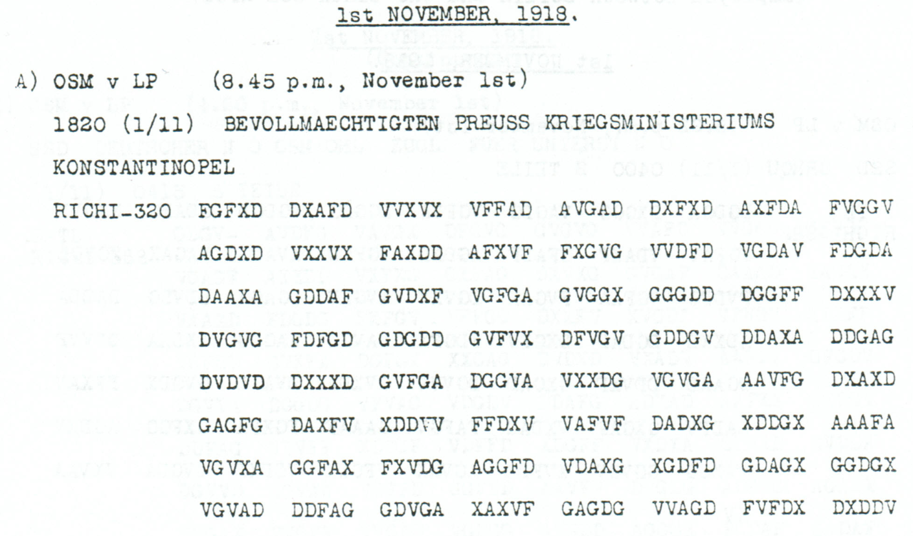

# Childs p. 96 — readings and source edition

<!-- Generated by python -m adfgvx.page_editions; edit data/source_editions.json. -->

[Page ranges](README.md) · [By subject](../../topics/README.md) · [Historical research](../../docs/historical-studies/README.md) · [Reading conventions](../../docs/reading-conventions.md) · [← p. 95](095.md) · [p. 97 →](097.md)

German readings, English interpretations and source explanations for the **2 ciphertexts** on this printed page.

| Source | State | Subject |
|---|---|---|
| [p96 A](#source-p96-a) | READING | A complete ZITAG stop order with reporting instruction and literal footer |
| [p96 B](#source-p96-b) | PARTIAL | Entry permission for Filittis and family |


<a id="edition-cases-finance-zitag-full-stop-order"></a>

## p96 A — A complete ZITAG stop order with reporting instruction and literal footer

<a id="edition-cases-finance-zitag-full-stop-order-a-complete-zitag-stop-order-with-reporting-instruction-and-literal-footer"></a>


<a id="source-p96-a"></a>
<a id="edition-cases-finance-zitag-full-stop-order-p96-a"></a>

### p96 A

**Status:** 160/160 native raw positions fixed; 0 coordinate substitutions and 0 source-mask fills. No frame change.

**Source and dates:** Page heading: 1st NOVEMBER, 1918; A) OSM v LP (8.45 p.m., November 1st); 1820 (1/11) BEVOLLMAECHTIGTEN PREUSS KRIEGSMINISTERIUMS KONSTANTINOPEL; RICHI-320.



<details>
<summary>Raw decoded text</summary>

**Raw output:**

```text
FUERXZITAGXOHNENUMMERNICHTSWEITERKAUFENUNDNICHTSWEITERVERLADENXALLESMOEGLICHSTSICHERNXZITAGXXVERANLASSTESANXKXMXDRAHTENXQXMXALLQXKRXDEPXNOX2439STRICH18XGXANCHXX
```

</details>

**Readable German — the same candidate labels with spacing and punctuation:**

> Fuer ZITAG, ohne Nummer: nichts weiter kaufen und nichts weiter verladen, alles moeglichst sichern. ZITAG. Veranlasstes an K. M. drahten. Q. M. ALLQ. KR. DEP. No. 2439 Strich 18, G. ANCH.

**Meaning:** The message instructs ZITAG to stop further purchases and loading, secure everything as far as possible, and telegraph the action taken to K.M. Its longer closing includes the literal office-like field Q M ALLQ KR DEP and reference 2439 STRICH 18 G ANCH. Those fields are preserved without silently normalizing Q to K or ALLQ to ALLG.

**Conditional interpretation and source details:** All 320 received coordinates and 160 plaintext positions decode directly. The procurement-stop body was already read from shorter p102/p103 witnesses; this newly reviewed physical record supplies a complete longer native text, including the reporting instruction. The certificate compares the nonseparator body labels with the earlier composite candidate while preserving different X separators and different transposition lengths.

<a id="edition-cases-finance-zitag-full-stop-order-explicit-source-changes"></a>

#### Explicit source changes

No source-coordinate substitution or source-mask fill is used.

The [shorter ZITAG witnesses](102.md#edition-cases-finance-zitag-purchase-orders) already supplied the procurement-stop body. This additional physical record directly retains the longer instruction and closing; the older witnesses are not counted again.

<a id="edition-cases-finance-zitag-full-stop-order-reproducibility-and-attribution"></a>

#### Reproducibility and attribution

The [input](../../experiments/nov1_nov2_native_dispatches/inputs.json) binds each literal source to exact PDF crops. The [certificate](../../experiments/nov1_nov2_native_dispatches/certificates.json) contains the raw paired-coordinate domains, each source change and the forward checks. The [verifier](../../experiments/nov1_nov2_native_dispatches/verify.py) checks the unchanged published keys and the live German quotations, retaining all numerical and letter labels.

Source edition and verification: icekylinx and GPT-6 Astra Pro (2026). Childs supplies the historical collection; published reconstruction and key provenance credit Lasry, Niebel, Kopal and Wacker. Earlier repository OCR and body readings are retained in the [attribution record](../../experiments/nov1_nov2_native_dispatches/prior_candidates.json).

<a id="source-p96-b"></a>
<a id="edition-cases-people-p96-b"></a>

## p96 B — Entry permission for Filittis and family

**Edition context:** p96 B — Entry permission for Filittis and family.

<a id="edition-cases-people-p96-b-p96-b--entry-permission-for-filittis-and-family"></a>


[Source image](../../sources/excerpts/other_p96_B.png)

**Status:** A source-reviewed supplementary message. The unchanged published
`Nov1-3` key fixes **180 of 181 raw plaintext positions**. One invalid printed
coordinate remains an erasure. The most likely place-name requires that fill
and one further change to a valid coordinate.

<a id="edition-cases-people-p96-b-most-likely-reading"></a>

### Most likely reading

**Readable German:**

> Nr. 605. Auf Telegramm Nr. 536. Rheinbaben an Horstmann:
> Nach Mitteilung Passzentrale stellvertretenden Generalstabes ist nunmehr
> Einreise Filittis mit Familie aus [Kopenhagen] genehmigt. Auswaertig.

**Meaning:** Message 605, replying to telegram 536: Rheinbaben informs Horstmann
that, according to the passport office of the deputy General Staff, entry for
Filittis and his family from Copenhagen has now been approved. The closing
`AUSWAERTIG` identifies the message with foreign-affairs business; the decoded
text does not spell out a longer institutional title.

The personal names and the numbers **605** and **536** are directly decoded.
This case does not identify which individuals the surnames designate or add a
destination that is absent from the body. The cleartext address is the
political section in Bucharest. The German wording retains the telegram's
omitted articles; spacing and punctuation are editorial.

<a id="edition-cases-people-p96-b-the-place-name-and-its-exact-uncertainty"></a>

### The place-name and its exact uncertainty

The unchanged source yields:

<details>
<summary>Raw decoded text</summary>

**Raw output:**

```text
NRX605XAUFTELEGRAMMNRX536XRHEINBABENXANXHORSTMANNXNACHMITTEILUNGPASSZENTRALESTELLVERTRETENDENGENERALSTABESISTNUNMEHREINREISEXFILITTISXMITFAMILIEAUSXKOPENH?HENXGENEHMIGTXAUSWAERTIGXX
```

</details>

The group **`ACVGD`** visibly contains `C`, which is outside the ADFGVX
coordinate alphabet. The literal source retains that `C`; the analytical
transcript represents it as `?`. The likely `KOPENHAGEN` is therefore an
editorial reading of `KOPENH?HEN`, with the following exact cost:

| Source index, zero based | Printed | Proposed | Type |
| ---: | :---: | :---: | --- |
| 226 | C | G | Supply one invalid-coordinate erasure. |
| 340 | V | F | Replace one valid printed coordinate. |

The candidate re-encrypts exactly to this reconstruction, with **360 valid
source coordinates unchanged**. No coordinate is inserted or deleted and no
key cell is reassigned. Copenhagen is strongly suggested by the word shape
and the resulting sentence, but the two repaired letters are not reported as
unchanged-source recoveries.

<a id="edition-cases-people-p96-b-source-and-verification"></a>

### Source and verification

Printed p96 / PDF p99, section B, headed **1 November 1918**:
`UKS v LP (8.11 p.m., November 1st); 1800 (1/11) POLITISCHE ABTL BUKAREST;
RICHI-362`.

The [literal source record](../../experiments/corpus_readings/selected_sources.json)
and [coordinate certificate](../../experiments/corpus_readings/certificates.json)
preserve the invalid glyph, all 181 position maps, the complete published key
and the proposed place-name's substitutions.

```sh
python3 experiments/corpus_readings/verify.py --verify
```

**Credit:** George Lasry's published period key and its historical sources are
retained in [the key register](../../data/keys.json). Source inspection,
verification and this annotated reading are by **icekylinx and GPT-6 Astra Pro**.
No first-decipherment priority is claimed for this supplementary message.
