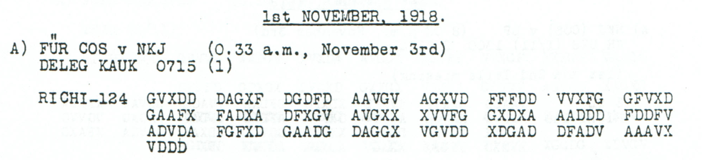
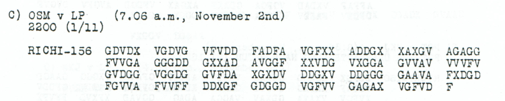

# Childs p. 103 — readings and source edition

<!-- Generated by python -m adfgvx.page_editions; edit data/source_editions.json. -->

[Page ranges](README.md) · [By subject](../../topics/README.md) · [Historical research](../../docs/historical-studies/README.md) · [Reading conventions](../../docs/reading-conventions.md) · [← p. 102](102.md) · [p. 104 →](104.md)

German readings, English interpretations and source explanations for the **5 ciphertexts** on this printed page.

| Source | State | Subject |
|---|---|---|
| [p103 A](#source-p103-a) | READING | No substitute for the Catholic divisional chaplain |
| [p103 B1](#source-p103-b1) | READING | Procurement request and already-paid consignments |
| [p103 B2](#source-p103-b2) | READING | Cancel other contracts and request Westernhagen return |
| [p103 C](#source-p103-c) | READING | Conditional consent to send a transmitter to Bucharest |
| [p103 D](#source-p103-d) | READING | ZITAG instruction to stop buying and loading |


<a id="edition-cases-people-catholic-division-chaplain-substitute"></a>

## p103 A — No substitute for the Catholic divisional chaplain

<a id="edition-cases-people-catholic-division-chaplain-substitute-no-substitute-for-the-catholic-divisional-chaplain"></a>


<a id="source-p103-a"></a>
<a id="edition-cases-people-catholic-division-chaplain-substitute-p103-a"></a>

### p103 A

**Status:** 62/62 native raw positions fixed; 2 coordinate substitutions and 0 source-mask fills. No frame change.

**Source and dates:** Page heading: 1st NOVEMBER, 1918; A) FUER COS v NKJ (0.33 a.m., November 3rd); DELEG KAUK 0715 (1); RICHI-124.



<details>
<summary>Source and cipher evidence</summary>

**Raw output:**

```text
VERTRETUNGDORTXKATHXDIVXPFARRPRSNICHTMOEGLICKXOKMXRM2CNR38029X
```

**Edited output — counted proposal:**

```text
VERTRETUNGDORTXKATHXDIVXPFARRERSNICHTMOEGLICHXOKMXRM2CNR38029X
```

</details>

**Readable German — the same candidate labels with spacing and punctuation:**

> Vertretung dort kath. Div. Pfarrers nicht moeglich. OKM. RM2C Nr. 38029.

**Meaning:** The proposed wording says that providing a substitute or cover for the Catholic divisional chaplain there is not possible. It retains the literal OKM and RM2C designation and reference 38029; it does not name a chaplain or explain the reason.

**Conditional interpretation and source details:** Two observed-coordinate substitutions propose PFARRERS for PFARRPRS and MOEGLICH for MOEGLICK. All 62 raw positions are already fixed, and no source mask or frame change is used. RM2C and 38029 are preserved.

<a id="edition-cases-people-catholic-division-chaplain-substitute-explicit-source-changes"></a>

#### Explicit source changes

All indices are zero-based.

| Source index | Printed | Proposed | Cost |
|---:|---|---|---|
| 22 | `X` | `G` | Observed-coordinate substitution |
| 63 | `V` | `F` | Observed-coordinate substitution |

<a id="edition-cases-people-catholic-division-chaplain-substitute-reproducibility-and-attribution"></a>

#### Reproducibility and attribution

The [input](../../experiments/nov1_nov2_native_dispatches/inputs.json) binds each literal source to exact PDF crops. The [certificate](../../experiments/nov1_nov2_native_dispatches/certificates.json) contains the raw paired-coordinate domains, each source change and the forward checks. The [verifier](../../experiments/nov1_nov2_native_dispatches/verify.py) checks the unchanged published keys and the live German quotations, retaining all numerical and letter labels.

Source edition and verification: icekylinx and GPT-6 Astra Pro (2026). Childs supplies the historical collection; published reconstruction and key provenance credit Lasry, Niebel, Kopal and Wacker. Earlier repository OCR and body readings are retained in the [attribution record](../../experiments/nov1_nov2_native_dispatches/prior_candidates.json).


<a id="edition-cases-finance-zitag-purchase-orders"></a>

## p103 B1, p103 B2, p103 D — ZITAG stop-orders and cancellation of procurement contracts

**Related source pages:** [p102 A](102.md#source-p102-a), [p106 B](106.md#source-p106-b).

<a id="edition-cases-finance-zitag-purchase-orders-zitag-stop-orders-and-cancellation-of-procurement-contracts"></a>


**Source:** J. Rives Childs, *General Solution of the ADFGVX Cipher System*,
printed pp102, 103 and 106, PDF pp105, 106 and 109. **Edition:** icekylinx
and GPT-6 Astra Pro. The [experiment](../../experiments/zitag_purchase_orders/README.md)
contains the exact crops, literal coordinates, key provenance and repair
certificates.

Three 180-coordinate messages are almost identical copies of a short
stop-order. A separate two-part message on p103 deals with a request for
rubles, permits loading already paid consignments, orders cancellation
of other contracts and asks again for Westernhagen's prompt return.
The two orders have different scopes and are not merged into one text.

All five records use the unchanged published Nov1–3 square and ranks.
There are no geometry changes or newly assigned key cells.

<a id="source-p103-d"></a>
<a id="edition-cases-finance-zitag-purchase-orders-p103-d"></a>

### p103 D

Header: `OSM v LP (7.08 a.m., November 2nd); 2210 (1/11)`, with the same
War Ministry representative addressee. The source prints the different
forms `VFFAX` and `FDGAG`; neither is silently changed in the transcript.
Its raw **90-character** reading is:

<details>
<summary>Raw decoded text</summary>

**Raw output:**

```text
FUERXZITAGXOENENUMMERNICHTSWEITERKAUFENUNDNICHTSWEITERVERLADENALLESMOEGLICHSTSICHERNXZITAG
```

</details>

Only **source index 162 G→F** is changed for the common candidate,
repairing `OENE` to `OHNE`. Both other copies witness that coordinate.

<a id="source-p103-b1"></a>
<a id="edition-cases-finance-zitag-purchase-orders-p103-b1"></a>

### p103 B1

This separate message has header `FÜR COS v NKJ (0.43 a.m., November 3rd)`
and `HPTM WESTGRNHAGEN ODER KARL MÜLLER DTSCH WIRTSCHAFTS ABTLG;
1845 (1) 2 TLE`. B1 advertises and prints **274 coordinates**. Its last
group is the observed four-letter `DXGV`; the five-slot OCR version
previously spoiled its frame.

The source-aligned raw reading is:

<details>
<summary>Raw decoded text</summary>

**Raw output:**

```text
DEUTSCHKAUFDRAHTETNRX5XXBEXTAETIQEN4TEWEGRXINDEDENBESCHAFBUNG6MILLIONENRUBE1ERSUCHGXXERLEDIGTDURCHUNSERTELEGRXNRX3XDASSNUR5EREITSBEZAHLTE
```

</details>

The explicit ordinary-word candidate is:

<details>
<summary>Proposed text and exact labels</summary>

**Edited output:**

```text
DEUTSCHKAUFDRAHTETNRX5XXBESTAETIGENXTELEGRXINDENENBESCHAFFUNG6MILLIONENRUBELERSUCHTXXERLEDIGTDURCHUNSERTELEGRXNRX3XDASSNURBEREITSBEZAHLTE
```

</details>

It costs **10 observed-coordinate substitutions** and no fills. Its nine
changed plaintext positions are all listed in the certificate, including
the inconvenient raw digits within damaged words. `TELEGR` remains an
abbreviation. No absent preposition, article or additional word is
inserted to regularize the syntax.

The separate fields `NR X 5`, `6 MILLIONEN` and `NR X 3` are unchanged,
with complete observed pairs. They are retained as raw square labels;
the edition does not infer a new numerical map from a plausible amount.

<a id="source-p103-b2"></a>
<a id="edition-cases-finance-zitag-purchase-orders-p103-b2"></a>

### p103 B2

The second part advertises and prints **254 slots**. The first group is
`GG-VF`, source group `FCXGD` contains an invalid `C`, and a later group is
`AVG-G`. The raw text is:

<details>
<summary>Raw decoded text</summary>

**Raw output:**

```text
PARTIENVERLADENWERDENSOL?ENXSTORNIERETSAEMTLXA?DEREKONTRAKTE?EGENALLGEMEINERLAGEXERSUCHENWESTERNHAGENNOCHMALSSOFORTIGERUECKKEHR
```

</details>

The candidate fills those three printed erasures and changes no observed
coordinate:

<details>
<summary>Proposed text and exact labels</summary>

**Edited output:**

```text
PARTIENVERLADENWERDENSOLLENXSTORNIERETSAEMTLXANDEREKONTRAKTEWEGENALLGEMEINERLAGEXERSUCHENWESTERNHAGENNOCHMALSSOFORTIGERUECKKEHR
```

</details>

Continuing B1 with editorial spacing:

**Readable German — continuation excerpt; the preceding words are outside this display:**

> … dass nur bereits bezahlte Partien verladen werden sollen. Stornieret sämtl. andere Kontrakte wegen allgemeiner Lage. Ersuchen Westernhagen nochmals sofortige Rückkehr.

The received form `STORNIERET` and the telegraphic wording of the final
request are preserved. `WESTERNHAGEN` is complete in the uncorrected
plaintext. The heading's different `WESTGRNHAGEN` form is kept literally,
and no particular person is identified from the name alone.

The final `SOFORTIGERUECKKEHR` is spaced as **sofortige Rückkehr**. No extra
`R` or connecting preposition is supplied to regularize the telegram's
grammar. The leading ellipsis marks words before this continuation excerpt,
not an unresolved plaintext position.

<a id="edition-cases-finance-zitag-purchase-orders-scope-and-attribution"></a>

### Scope and attribution

The short copies and B2 were already present as readable but unreviewed
repository screen candidates. B1 had a degraded candidate under the
wrong OCR length. Their prior bodies are frozen in the inputs file.
The source edition adds precise transcription, frame correction,
cross-copy evidence and reversible edits. A bounded check of the paper,
dissertation chapter and cached 55-comment thread located no explicit
discussion of these bodies; that does not establish first decipherment.

Together the five records contain **1,068 source slots**, **1,065 valid
coordinates** and **534 plaintext positions**. The raw models fix 531
positions; the explicit candidates fix all 534. Total cost is 14 observed
coordinate substitutions plus three printed-erasure fills. These are
edition coverage figures, not a count of newly solved cryptographic
symbols. Neither the stop-order nor the cancellation request proves
that the requested action was carried out.

```bash
python experiments/zitag_purchase_orders/verify.py --verify
python experiments/zitag_purchase_orders/verify.py --verify --pdf /path/to/childs.pdf
```


<details>
<summary>Comparative source sections from other printed pages</summary>

<a id="edition-cases-finance-zitag-purchase-orders-p102-a"></a>

### p102 A

The source heading is 1 November 1918; the receipt header says November 2
without a time. It addresses the Prussian War Ministry representative
at Constantinople. All **180 coordinates** are observed. The raw reading is:

<details>
<summary>Raw decoded text</summary>

**Raw output:**

```text
FUERXZITAGVOHNENUMMERNICHTSWEITERKAUFENUNDNICHTSWEITERVERLADENALLESMOEGLICHSTSIVHERNXZITAG
```

</details>

The common readable candidate replaces source coordinates **29 G→X**
and **55 G→D**. Both replacements are observed in the other copies.

<a id="edition-cases-finance-zitag-purchase-orders-p106-b"></a>

### p106 B

Header: `NKJ v LP (8.11 p.m., November 2nd); 1/11 2210`, again with the
same addressee. The printed group `XGGGG` has five characters; the earlier
OCR form `XXGGGG` was not an actual extra source coordinate. The raw body is:

<details>
<summary>Raw decoded text</summary>

**Raw output:**

```text
FUERXZITAGVOHNENUMMERNICHTSWEITERKAUFENUNDNICHTSWEITERVERLADENALLESMOEGLICHSTSICHERNXZITAG
```

</details>

The common candidate changes only **source index 29 G→X**, witnessed by
p103 D. The three literal copies differ at exactly three source positions:

| Source index | p102 A | p103 D | p106 B | Candidate |
|---:|---|---|---|---|
| 29 | G | X | G | X |
| 55 | G | D | D | D |
| 162 | F | G | F | F |

The candidate is:

<details>
<summary>Proposed text and exact labels</summary>

**Edited output:**

```text
FUERXZITAGXOHNENUMMERNICHTSWEITERKAUFENUNDNICHTSWEITERVERLADENALLESMOEGLICHSTSICHERNXZITAG
```

</details>

**Readable German:**

> Für Zitag. Ohne Nummer. Nichts weiter kaufen und nichts weiter verladen. Alles möglichst sichern. Zitag.

Every candidate coordinate has an observed witness. This supports a
common original but does not prove which printed version is closest to
the transmission. In particular, the `X` at index 29 is a minority
reading selected for its ordinary wording, not by majority vote.

The [complete p96 A source edition](096.md#edition-cases-finance-zitag-full-stop-order) independently
gives the same 87 nonseparator labels as this common stop-order body
without any source edit, and continues with a reporting instruction and
closing fields. Its 320-coordinate frame and separator placement differ
from these 180-coordinate copies, so this is plaintext-label corroboration,
not another vote at their source-coordinate indices.

</details>


<a id="edition-cases-radio-bucharest-transmitter-consent"></a>

## p103 C — Conditional consent to send a transmitter to Bucharest

<a id="edition-cases-radio-bucharest-transmitter-consent-conditional-consent-to-send-a-transmitter-to-bucharest"></a>


<a id="source-p103-c"></a>
<a id="edition-cases-radio-bucharest-transmitter-consent-p103-c"></a>

### p103 C

**Status:** 78/78 native raw positions fixed; 0 coordinate substitutions and 0 source-mask fills. No frame change.

**Source and dates:** Page heading: 1st NOVEMBER, 1918; C) OSM v LP (7.06 a.m., November 2nd); 2200 (1/11); RICHI-156.



<details>
<summary>Raw decoded text</summary>

**Raw output:**

```text
FUNKAOSMXMITENTSENDGX10TKSENDERSNACHBUKARESTWENNTRANSPMOEGLEINVERSTXNACHCHEF4B
```

</details>

**Readable German — the same candidate labels with spacing and punctuation:**

> Funka OSM. Mit Entsendg. 10TK Senders nach Bukarest, wenn Transp. moegl., einverst. Nachchef 4B.

**Meaning:** The sender agrees to dispatch the device written 10TK SENDER to Bucharest if transport is possible. OSM and Nachchef 4B remain literal routing and signature labels. No conversion of 10TK into a power rating is made, and this consent does not establish that the transmitter was shipped.

**Conditional interpretation and source details:** All 156 source coordinates and 78 plaintext positions are direct. Enlarged source groups are GGGDD and AVGGF, both with clear G glyphs; low-resolution C readings are resolved visual uncertainties, not printed erasures or historical edits. The technical label 10TK is kept exactly.

<a id="edition-cases-radio-bucharest-transmitter-consent-explicit-source-changes"></a>

#### Explicit source changes

No source-coordinate substitution or source-mask fill is used.

<a id="edition-cases-radio-bucharest-transmitter-consent-reproducibility-and-attribution"></a>

#### Reproducibility and attribution

The [input](../../experiments/nov1_nov2_native_dispatches/inputs.json) binds each literal source to exact PDF crops. The [certificate](../../experiments/nov1_nov2_native_dispatches/certificates.json) contains the raw paired-coordinate domains, each source change and the forward checks. The [verifier](../../experiments/nov1_nov2_native_dispatches/verify.py) checks the unchanged published keys and the live German quotations, retaining all numerical and letter labels.

Source edition and verification: icekylinx and GPT-6 Astra Pro (2026). Childs supplies the historical collection; published reconstruction and key provenance credit Lasry, Niebel, Kopal and Wacker. Earlier repository OCR and body readings are retained in the [attribution record](../../experiments/nov1_nov2_native_dispatches/prior_candidates.json).
