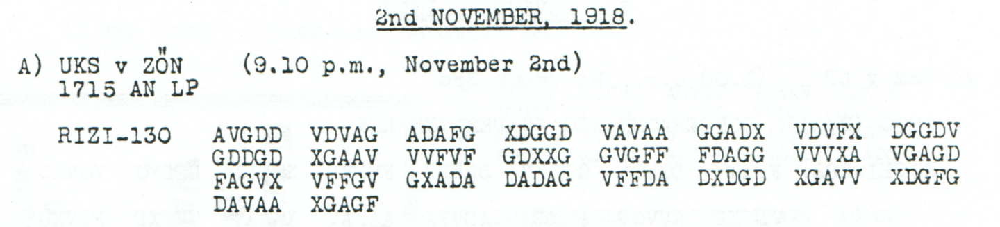

# Childs p. 107 — readings and source edition

<!-- Generated by python -m adfgvx.page_editions; edit the canonical case editions. -->

[All source pages](README.md) · [Historical research](../../docs/historical-studies/README.md) · [Reading conventions](../../docs/reading-conventions.md) · [← p. 106](106.md) · [p. 108 →](108.md)

German readings, English interpretations and source explanations for the **5 ciphertexts** on this printed page.

| Source | State | Subject | Views |
|---|---|---|---|
| <a id="source-p107-a"></a>p107 A | READING | Ringbahn call arrangement: 0345 after the other station's traffic | [Reading](#edition-cases-radio-ringbahn-0345-calls-p107-a) · [Case](../radio/ringbahn_0345_calls.md) |
| <a id="source-p107-b1"></a>p107 B1 | READING | Railway-transport instruction mentioning Laz Zug 42 from Chemnitz | [Reading](#edition-cases-military-chemnitz-verbetz-trains-p107-b1) · [Case](../military/chemnitz_verbetz_trains.md) |
| <a id="source-p107-b2"></a>p107 B2 | PARTIAL | Laz Zug 34 to literal VERBETZ; unresolved command reference | [Reading](#edition-cases-military-chemnitz-verbetz-trains-p107-b2) · [Case](../military/chemnitz_verbetz_trains.md) |
| <a id="source-p107-c"></a>p107 C | READING | Question whether dragoman Schaefer should return as leave ends | [Reading](#edition-cases-people-schaefer-return-inquiry-p107-c) · [Case](../people/schaefer_return_inquiry.md) |
| <a id="source-p107-d"></a>p107 D | READING | Acknowledgment of operational telegrams | [Reading](#edition-cases-supplementary-p107-d) · [Case](../supplementary/p107_D.md) |

<a id="edition-cases-radio-ringbahn-0345-calls"></a>

## Ringbahn call arrangement: 0345 after the other station's traffic

**Sources on this page:** p107 A. [Concise case study](../radio/ringbahn_0345_calls.md).

<a id="edition-cases-radio-ringbahn-0345-calls-ringbahn-call-arrangement-0345-after-the-other-stations-traffic"></a>


<a id="edition-cases-radio-ringbahn-0345-calls-p107-a"></a>

### p107 A

**Status:** 65/65 native raw positions fixed; 1 coordinate substitution and 0 source-mask fills. No frame change.

**Source and dates:** Page heading: 2nd NOVEMBER, 1918; A) UKS v ZON (9.10 p.m., November 2nd); 1715 AN LP; RIZI-130.



<details>
<summary>Source and cipher evidence</summary>

**Raw output:**

```text
WIRXRUFENXSIEXJEDEXRIN7BAHNPERIODEX0345NACHIHREMVERKEHRXWELLE1200
```

**Edited output — counted proposal:**

```text
WIRXRUFENXSIEXJEDEXRINGBAHNPERIODEX0345NACHIHREMVERKEHRXWELLE1200
```

</details>

**Readable German — the same candidate labels with spacing and punctuation:**

> Wir rufen Sie jede Ringbahnperiode 0345 nach Ihrem Verkehr, Welle 1200.

**Meaning:** The sender announces calls in each Ringbahn period, with the time label 0345 after the recipient's traffic and wavelength 1200. The single word proposal changes RIN7BAHN to RINGBAHN through a counted source-coordinate substitution. It leaves 0345 and 1200 unchanged.

**Conditional interpretation and source details:** The source has exactly the advertised 130 coordinates. One coordinate substitution repairs the ordinary Ringbahn word; the published square and every other label remain unchanged. No unit is added to WELLE 1200.

<a id="edition-cases-radio-ringbahn-0345-calls-explicit-source-changes"></a>

#### Explicit source changes

All indices are zero-based.

| Source index | Printed | Proposed | Cost |
|---:|---|---|---|
| 36 | `G` | `F` | Observed-coordinate substitution |

<a id="edition-cases-radio-ringbahn-0345-calls-reproducibility-and-attribution"></a>

#### Reproducibility and attribution

The [input](../../experiments/nov1_nov2_native_dispatches/inputs.json) binds each literal source to exact PDF crops. The [certificate](../../experiments/nov1_nov2_native_dispatches/certificates.json) contains the raw paired-coordinate domains, each source change and the forward checks. The [verifier](../../experiments/nov1_nov2_native_dispatches/verify.py) checks the unchanged published keys and the live German quotations, retaining all numerical and letter labels.

Source edition and verification: icekylinx and GPT-6 Astra Pro (2026). Childs supplies the historical collection; published reconstruction and key provenance credit Lasry, Niebel, Kopal and Wacker. Earlier repository OCR and body readings are retained in the [attribution record](../../experiments/nov1_nov2_native_dispatches/prior_candidates.json).

<a id="edition-cases-military-chemnitz-verbetz-trains"></a>

## Railway message: Laz. Zug 42 from Chemnitz and Zug 34 to VERBETZ

**Sources on this page:** p107 B1, p107 B2. [Concise case study](../military/chemnitz_verbetz_trains.md).

<a id="edition-cases-military-chemnitz-verbetz-trains-railway-message-laz-zug-42-from-chemnitz-and-zug-34-to-verbetz"></a>


**Source edition and verification: icekylinx and GPT-6 Astra Pro.**

Childs p107 B1/B2, PDF p110, form the two-part message headed
`UKS v ZÖN (4.48 a.m., November 3rd)` and
`VEVE 1905 (2) AN LP 2 TLE`. The consecutive labels and repeated railway
subject support the assembly. Both use the unchanged published
**Nov1–3** key.

<a id="edition-cases-military-chemnitz-verbetz-trains-p107-b1"></a>

### p107 B1

The [source crop](../../experiments/p107_railway_and_dragoman/sources/p107_B.png)
contains **164 valid coordinates**, matching `1 TL RICHI-164`.
The earlier OCR omitted the final **FDGD** row and masked source **152 D**.
Restoring those visible glyphs recovers the native frame; the exact old
OCR is retained in a [frozen snapshot](../../experiments/p107_railway_and_dragoman/ocr_snapshot.json).

<details>
<summary>Source and cipher evidence</summary>

**Raw output — native 164-coordinate frame:**

```text
EISMNBAHNTRANB6ORTABTLGXSXOXPFESSXGXHX1XQXXBEILINIEN1DTXGXLAZXZUGX42XVONXCHEMNITZX
```

**Edited output — five observed-coordinate substitutions, with no fills:**

```text
EISENBAHNTRANSPORTABTLGXSXOXPFESSXGXHX1XQXXBEILINIENKDTXGXLAZXZUGX42XVONXCHEMNITZX
```

</details>

The changes are source **43 D→G**, **44 G→D**, **62 X→V**, **66 X→V** and
**160 F→V**. The last is a genuine proposed source change within the
restored final row; it is counted separately from correcting the OCR.
The candidate repairs the railway-transport wording and `LINIEN1DT`;
the opaque **PFESS** and **G H 1 Q** fields remain unchanged.

**Readable German — spacing and punctuation, keeping abbreviations and opaque fields literal:**

> Eisenbahntransportabtlg. S. O. PFESS. G. H. 1. Q. Bei Linienkdt.
> G. Laz. Zug 42 von Chemnitz.

The routing abbreviations, including **G** before **LAZ**, are not
expanded. This part fixes **82 / 82 positions**; its complete edited
candidate re-encrypts exactly.

<a id="edition-cases-military-chemnitz-verbetz-trains-p107-b2"></a>

### p107 B2

The same crop has **110 visible slots** for `2 TL RICHI-110`, including
the printed dash in **DGFG-** at source index **39**.

<details>
<summary>Source and cipher evidence</summary>

**Raw output — native 110-coordinate frame:**

```text
WAZXZUGX34XNACHXVERBETZXA5ROLIENLASSENXX?BAXAEK11X10502
```

**Edited output — three observed-coordinate substitutions, with no fills:**

```text
LAZXZUGX34XNACHXVERBETZXABROLLENLASSENXX?BAXAEK11X10502
```

</details>

The changes are source **12 G→A**, **21 D→F** and **54 X→V**. The printed
dash remains unresolved. No character in the closing is supplied merely
to produce a familiar command abbreviation.

**Readable German — spacing and punctuation:**

> Laz. Zug 34 nach VERBETZ abrollen lassen. ?BA. AEK11. 10502.

**VERBETZ** is the literal decoded destination; no independent location
identification or spelling correction is imposed. The dispatch wording
is an instruction, not proof that either train moved.

<a id="edition-cases-military-chemnitz-verbetz-trains-conditional-interpretation-and-remaining-ambiguity"></a>

### Conditional interpretation and remaining ambiguity

The candidate for B2 fixes **54 / 55 positions**. Its unknown position
**40** has pair **?V**, source indices **39** and **67**, and domain
**3BFKQS**. All six possible complete ciphertexts and plaintexts are
retained as exact re-encryption witnesses; none is selected as the
historical closing.

Across these two records there are **274 visible slots**, **273 valid
coordinates** and **136 / 137 fixed plaintext positions**. The main
edition uses **eight observed-coordinate substitutions and no fills**,
with no frame, length or key change. Local changes to `TRANB6ORT`,
`LINIEN1DT` and `A5ROLIEN` do not establish global numeral mappings.

The package retains earlier unread OCR frames and candidate readings,
along with the published key's provenance. It makes no historical
first-solution claim. See [inputs](../../experiments/p107_railway_and_dragoman/inputs.json),
[certificates](../../experiments/p107_railway_and_dragoman/certificates.json)
and [reproduction instructions](../../experiments/p107_railway_and_dragoman/README.md).

<a id="edition-cases-people-schaefer-return-inquiry"></a>

## Braila inquiry about dragoman Schaefer's return from leave

**Sources on this page:** p107 C. [Concise case study](../people/schaefer_return_inquiry.md).

<a id="edition-cases-people-schaefer-return-inquiry-braila-inquiry-about-dragoman-schaefers-return-from-leave"></a>


**Source edition and verification: icekylinx and GPT-6 Astra Pro.**

<a id="edition-cases-people-schaefer-return-inquiry-p107-c"></a>

### p107 C

Childs p107 C, PDF p110, is a separate message headed
`UKS v LP (3.04 a.m., November 3rd)` and `SS 2025 (2/11)`.
The [source crop](../../experiments/p107_railway_and_dragoman/sources/p107_C.png)
contains **348 source slots**, matching `RICHI-348`: **347 unambiguous
coordinates and one damaged or overstruck glyph** at source index 45.
It uses the unchanged published **Nov1–3** key.
Source and plaintext indices below are zero-based; printed rows and groups
are counted from one.

<details>
<summary>Source and cipher evidence</summary>

**Raw output — native 348-coordinate frame:**

```text
GEHEIMRATENDERHEIDENBRAILAXXISTRUECKKEHRDRAGOMANSXSCHAEFERXDESSENURLAUBBALDABLAEUFTSO?ERNUEBERHAUPTAUSFUEHRBARJETZTERWUENSCHTUNDZWECKMAESSIGDRAHTBERIC1TXXAUSWAERTCGESXA2TX1XB
```

**Edited output — three observed-coordinate substitutions and one damaged-glyph fill:**

```text
GEHEIMRATENDERHEIDENBRAILAXXISTRUECKKEHRDRAGOMANSXSCHAEFERXDESSENURLAUBBALDABLAEUFTSOFERNUEBERHAUPTAUSFUEHRBARJETZTERWUENSCHTUNDZWECKMAESSIGDRAHTBERICHTXXAUSWAERTIGESXAMTX1XB
```

</details>

The observed-coordinate changes are source **182 F→V**, **253 X→V** and
**292 D→A**, repairing `DRAHTBERIC1T` and `AUSWAERTCGES A2T`.
The separate fill **45 ?→V** supplies F in `SO?ERN`. The conservative raw
layer fixes **173/174 positions**; the unchanged edited candidate fixes
**174/174** and re-encrypts exactly. There are still **four coordinate
operations**. Reclassifying the damaged glyph does not reduce the total
repair count or add a newly observed plaintext letter.

**Readable German — spacing, punctuation and umlauts; the opaque address remains unexpanded:**

> GEHEIMRATENDERHEIDEN, Braila. Ist Rückkehr Dragomans Schaefer, dessen
> Urlaub bald abläuft, sofern überhaupt ausführbar, jetzt erwünscht und
> zweckmäßig? Drahtbericht. Auswärtiges Amt. 1. B.

The question explicitly retains both conditions: whether return is
feasible at all, and whether it is now desired and expedient. It requests
a telegraphic report; it does not establish a completed return or replace
the question with a return order.

<a id="edition-cases-people-schaefer-return-inquiry-conditional-interpretation-and-source-qualifications"></a>

### Conditional interpretation and source qualifications

<a id="edition-cases-people-schaefer-return-inquiry-source-45-preserve-the-damaged-glyph"></a>

#### Source 45: preserve the damaged glyph

The first glyph of the second row's second group is conservatively recorded
as **`?XGFF`**. The [detail crop](../../experiments/p107_railway_and_dragoman/sources/p107_C_source45.png)
comes directly from PDF page 110, rectangle `[188,551,227,568]`, rendered
at scale 16. Its upper strokes look V-like, while lower feet suggest an
overprint or damage; it differs from the adjacent clear X and nearby clear
V. Visual review does not establish an unconditional X or V. The `?`
records this uncertainty in one existing source slot, without adding a gap.

That slot supplies the second coordinate of plaintext position **85**.
The conservative pair **`A?`** permits **`9FILOU`**. The main reading selects
F by filling the glyph with V; the source does not independently fix F.
The certificate retains two explicit, separately identified glyph assumptions:

| Source handling | Fixed raw positions | Plaintext 85 | Changes from that stated branch to the unchanged main candidate |
|---|---:|:---:|---|
| Conservative `?` | 173/174 | `?` | 3 observed substitutions and 1 damaged-glyph fill |
| Assume X | 174/174 | `9` | 3 observed substitutions and 1 replacement of the assumed X |
| Assume V | 174/174 | `F` | 3 observed substitutions; V has already been assumed |

The two fully assigned branches are **hypotheses about the same glyph**,
not independent observations, parallel copies or additional records. Their
branch-relative costs do not replace the primary three-substitution,
one-fill account. The former definite-X transcription is retained through
the X branch, including its `SO9ERN` output.

The frozen earlier OCR already marked this slot `?` and produced `SO?ERN`.
It is an earlier transcription of this same source, not independent evidence
for a different transmission. The new image review restores the conservative
uncertainty instead of claiming a new decipherment.

<a id="edition-cases-people-schaefer-return-inquiry-preserved-labels-and-a-separate-clear-glyph"></a>

#### Preserved labels and a separate clear glyph

The continuous address **GEHEIMRATENDERHEIDENBRAILA** and surname string
**SCHAEFER** remain as decoded. The displayed boundary before Braila does
not establish a particular person's identity, nor does it normalize the
opaque address into an assumed historical name. The final **1 B** labels
remain literal.

The [detail crop](../../experiments/p107_railway_and_dragoman/sources/p107_C_VDVGV.png)
shows G at source **133** in **VDVGV**. A preliminary C reading from the
small full-page image was rejected before publication; no extra erasure
or fill is introduced at that position. This clear-G check is separate from
the damaged source 45 and the three observed-coordinate substitutions above.

The earlier unreviewed repository candidate already contained this body.
The source edition adds exact transcription, repair accounting and
re-encryption, with published key credit retained. It makes no historical
first-solution claim. See the [inputs](../../experiments/p107_railway_and_dragoman/inputs.json),
[certificates](../../experiments/p107_railway_and_dragoman/certificates.json)
and [reproduction instructions](../../experiments/p107_railway_and_dragoman/README.md).

<a id="edition-cases-supplementary-p107-d"></a>

## p107_D — supplementary source review

**Sources on this page:** p107 D. [Concise case study](../supplementary/p107_D.md).

<a id="edition-cases-supplementary-p107-d-p107_d--supplementary-source-review"></a>


**Original reading:** [Ayush Agarwal (@AyushAg1002), 2026-10-28](https://github.com/dbourdeau/cyphersolver/issues/181). **Current image and arithmetic review:** icekylinx and GPT-6 Astra Pro, 2 November 2026.

This record belongs to the wider Childs corpus and is outside the original 22-entry challenge.

Acknowledgment of operational telegrams, including numbered references, from Mackensen's headquarters to Supreme Army Command. The exact raw numbers and garbles remain visible.

<a id="edition-cases-supplementary-p107-d-most-likely-reading"></a>

### Most likely reading

**Readable German — earlier credited partial interpretation:**

> O.H.L., Op. Zu dort 1a104660 […] [Drahtungen] 1a11118 geh. Op. und 1a1?127 geh. Op. erhalten. O.K.M. 1a?116OO6.

**Meaning:** An acknowledgment of operational telegrams, with their reference numbers, addressed to Supreme Army Command and signed by Mackensen's headquarters.

**Notes:** The garbled reference strings remain literal; apparent `O` letters are not silently converted to zeroes. `[Drahtungen]` is a readable interpretation of the damaged telegram wording. Two parenthesized source coordinates admit different conservative treatments, shown below. Original reading: **Ayush Agarwal**; our contribution is the later source and arithmetic review.

<a id="edition-cases-supplementary-p107-d-conservative-source-reading"></a>

### Conservative source reading

86 fixed positions in 88 plaintext positions. Uncertain source annotations remain explicit.

<details>
<summary>Raw decoded text</summary>

**Raw output:**

```text
OHLXOPXZUDORT1A104660QEHOPDRAGTUNGEN1A11118GEHXOPXUND1A1?127GEHXOPXERHALTENXOKM1A?116OO6
```

</details>

<a id="edition-cases-supplementary-p107-d-review"></a>

### Review

- The scan contains 176 alphabetic coordinates when parentheses are treated as annotations. Its two parenthesized X letters are preserved literally and also evaluated as unknown in a separate conservative variant.
- The issue describes 179 received symbols, but that count does not describe the literal alphabetic source layer.
- The issue repair changes source XGA(X)D to XGA--: it masks a parenthesized X and also a clearly printed D. This is not identical to the primary-source transcript.

<a id="edition-cases-supplementary-p107-d-literal-annotated-source-hypothesis"></a>

### Literal annotated-source hypothesis

This version treats the parenthesized coordinates as received letters. It is preserved alongside the more conservative interpretation.

<details>
<summary>Raw decoded text</summary>

**Raw output — alternate interpretation treating the parenthesized coordinates as received:**

```text
OHLXOPXZUDORT1A104660QEHOPDRAGTUNGEN1A11118GEHXOPXUND1A16127GEHXOPXERHALTENXOKM1A1116OO6
```

</details>

<a id="edition-cases-supplementary-p107-d-earlier-published-reading"></a>

### Earlier published reading

<details>
<summary>Earlier attributed reading</summary>

**Earlier attributed reading:**

```text
OHLXOPXZUDORT1A104660QEHOPDRAGTUNGEN1A11118GEHXOPXUND1A1?127GEHXOP?ERHALTENXOKM1A1116OO6
```

</details>

The published reconstruction is reproduced exactly. Its source differences are listed below; reproducing it does not authenticate its conjectural repairs.

| Source index (zero based) | Literal source | Published layer |
|---:|---|---|
| 43 | `X` | `?` |
| 44 | `D` | `?` |

[Source image](../../sources/excerpts/childs_p107_supplementary.png) · [Full certificate and attribution](../../data/supplementary_readings.json).

The first publication of these particular body readings is credited as reported by the contributor. Earlier wartime or unpublished decipherment has not been excluded.
