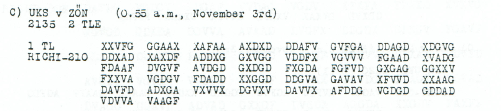
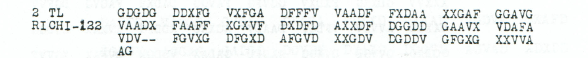

# Childs p109 — readings and source edition

<a id="childs-p-109--readings-and-source-edition"></a>

<!-- Generated by python -m adfgvx.page_editions; edit data/source_editions.json. -->

[Page ranges](README.md) · [By subject](../../topics/README.md) · [Historical research](../../docs/historical-studies/README.md) · [Reading conventions](../../docs/reading-conventions.md) · [← p108](108.md) · [p110 →](110.md)

German readings, English interpretations and source explanations for the **6 ciphertexts** on this printed page.

| Source | State | Subject |
| --- | --- | --- |
| [p109 A2](#source-p109-a2) | READING | Bucharest dispatch inquiry and power-source specifications |
| [p109 A3](#source-p109-a3) | READING | Direct query for a motor about 50 PS, 220 V direct-current dynamo and 25 kW rating |
| [p109 B](#source-p109-b) | PARTIAL | Evening enemy-division report toward Belgrade |
| [p109 C1](#source-p109-c1) | READING | Two-part march notice and officer dispatch: a priced editorial reading |
| [p109 C2](#source-p109-c2) | READING | General Staff officer to be dispatched by air; literal closing EINS4 and 7023 |
| [p109](#source-p109) | READING | Evening report; likely Sava crossing |


<a id="edition-cases-radio-nov3-bucharest-power-source-query"></a>

<a id="p109-a2-p109-a3--bucharest-dispatch-enquiry-and-power-source-specifications"></a>

## Bucharest dispatch enquiry and power-source specifications

**Sources on this page:** p109 A2, p109 A3.

<a id="edition-cases-radio-nov3-bucharest-power-source-query-bucharest-dispatch-enquiry-and-power-source-specifications"></a>


**Reviewed source crops:** [p109_A2.png](../../experiments/nov3_bucharest_power_source/sources/p109_A2.png) · [p109_A3.png](../../experiments/nov3_bucharest_power_source/sources/p109_A3.png). [File and pixel verification](../../sources/reviewed-crops.md#verify).
<a id="source-p109-a2"></a>
<a id="edition-cases-radio-nov3-bucharest-power-source-query-p109-a2"></a>

### p109 A2

**Status:** 81/81 native raw positions fixed; 4 coordinate substitutions and 0 source-mask fills. No frame change.

**Source and dates:** Page heading: 3rd NOVEMBER, 1918; A) UKS v OSM (2.09 a.m., November 3rd); VE; 2 TL RICHI-162.

[Source p109 A2 — source-PDF reference](../../experiments/nov3_bucharest_power_source/inputs.json)

<details>
<summary>Source and cipher evidence</summary>

**Raw output:**

```text
GLEICSTVOMOHNEKRAFTQELLEVEDSANDBERBITXBEINACHRCEFANGEFRAGTOBBUKARESTSENDENSOLLENX
```

**Edited output — counted proposal:**

```text
GLEICSTROMOHNEKRAFTQELLEVERSANDBEREITXBEINACHRCEFANGEFRAGTOBBUKARESTSENDENSOLLENX
```

</details>

**Readable German — the same candidate labels with spacing and punctuation:**

> Gleicstrom ohne Kraftqelle versandbereit. Bei Nachrcef angefragt, ob Bukarest senden sollen.

**Meaning:** The fragment reports readiness for dispatch without a power source and says that the office represented by NACHRCEF was asked whether the item should be sent to Bucharest. It does not confirm that dispatch took place. The exact item is not identified by this surviving part alone.

**Conditional interpretation and source details:** All 162 original coordinates are present, including the final VA omitted by the earlier OCR block. Four observed-coordinate substitutions propose GLEICSTROM, VERSAND and BEREIT for GLEICSTVOM, VEDSAND and BERBIT. The residual forms GLEICSTROM, KRAFTQELLE and NACHRCEF are retained exactly: no missing H or U is added to produce fluent modern spellings. This is the source-defined second part; the first part is outside this edition. The following third part supplies a direct power-source query but does not establish that equipment was obtained or transported.

<a id="edition-cases-radio-nov3-bucharest-power-source-query-explicit-source-changes"></a>

#### Explicit source changes

All indices are zero-based.

| Source index | Printed | Proposed | Cost |
| ---: | --- | --- | --- |
| 3 | `G` | `V` | Observed-coordinate substitution |
| 10 | `G` | `D` | Observed-coordinate substitution |
| 105 | `V` | `G` | Observed-coordinate substitution |
| 110 | `G` | `A` | Observed-coordinate substitution |

<a id="source-p109-a3"></a>
<a id="edition-cases-radio-nov3-bucharest-power-source-query-p109-a3"></a>

### p109 A3

**Status:** 114/114 native raw positions fixed; 0 coordinate substitutions and 0 source-mask fills. No frame change.

**Source and dates:** Same A heading and reception as p109 A2; 3 TL RICHI-228.

[Source p109 A3 — source-PDF reference](../../experiments/nov3_bucharest_power_source/inputs.json)

<details>
<summary>Raw decoded text</summary>

**Raw output:**

```text
ISTKRAFTQELLEMOTORETWA50PSMIT220VOLTGLEICHSTRDYNAMO25KWDORTBESCHAFFBARODERTRIEBWXKRAFTANLAGEVERWENDBARXFUNKANTWORT
```

</details>

**Readable German — the same candidate labels with spacing and punctuation:**

> Ist Kraftqelle, Motor etwa 50 PS mit 220 Volt Gleichstr. Dynamo 25 KW, dort beschaffbar oder Triebw. Kraftanlage verwendbar; Funkantwort.

**Meaning:** Asks whether a power source—a motor of about 50 PS with a 220-volt direct-current dynamo rated 25 kW—can be procured there, or whether the power installation denoted TRIEBW can be used. Requests a radio reply. The message asks about availability and does not establish that the equipment exists there or was sent.

**Conditional interpretation and source details:** All 228 observed coordinates yield 114 fixed plaintext positions without any substitution, fill, deletion or insertion. The quantities 50PS, 220VOLT and 25KW are direct raw labels. The source final group is FXX, whereas earlier OCR had FAX. KRAFTQELLE remains the literal spelling; GLEICHSTR and TRIEBW remain abbreviations, and TRIEBW is not expanded into a particular vehicle or plant type. The semicolon before FUNKANTWORT is editorial punctuation only.

<a id="edition-cases-radio-nov3-bucharest-power-source-query-explicit-source-changes-1"></a>

#### Explicit source changes

No source-coordinate substitution or source-mask fill is used.

<a id="edition-cases-radio-nov3-bucharest-power-source-query-reproducibility-and-attribution"></a>

#### Reproducibility and attribution

The [input](../../experiments/nov3_bucharest_power_source/inputs.json) binds each literal source to exact PDF crops. The [certificate](../../experiments/nov3_bucharest_power_source/certificates.json) contains the raw paired-coordinate domains, each source change and the forward checks. The [verifier](../../experiments/nov3_bucharest_power_source/verify.py) checks the unchanged published keys and the live German quotations, retaining all numerical and letter labels.

Source edition and verification: icekylinx and GPT-6 Astra Pro (2026). Childs supplies the historical collection; published reconstruction and key provenance credit Lasry, Niebel, Kopal and Wacker. Earlier repository OCR and body readings are retained in the [attribution record](../../experiments/nov3_bucharest_power_source/prior_candidates.json).

<a id="source-p109-b"></a>
<a id="source-p109"></a>
<a id="edition-cases-p109"></a>

<a id="p109-b-p109--p109--evening-report-and-the-sava-crossing"></a>

## p109 — Evening report and the Sava crossing

**Sources on this page:** p109 B, p109.

<a id="edition-cases-p109-p109--evening-report-and-the-sava-crossing"></a>


**Status:** Earlier damaged body reviewed against a newly transcribed same-page near-parallel. **Key:** `Nov1-3`.

**Earliest credited record:** [Norbert, 2017-03-01, comment 18](https://scienceblogs.de/klausis-krypto-kolumne/2017/02/23/the-top-50-unsolved-encrypted-messages-46-unsolved-adfgvx-cryptograms-from-world-war-1/?all=1#comment-852658). **Current source and arithmetic review:** icekylinx and GPT-6 Astra Pro, 2 November 2026.

<a id="edition-cases-p109-most-likely-reading"></a>

### Most likely reading

**Readable German — earlier credited reconstruction and later source comparison:**

> O.K.M. [Abendmeldung]. [Save/Sava]: [Uebergang letzter Teile beendet].
> [1 weitere fdl. Div.] im Marsch [auf Belgrad erkannt]. Sonst keine
> [Ereignisse]. `ASOXK511`.

**Meaning:** An evening report: the last elements have completed the Sava crossing; one further enemy division has been observed marching toward Belgrade. No other events are reported. The closing reference remains damaged. This is the most likely interpretation of two imperfect witnesses, not an unedited decipherment of either one.

**Notes:** The neighboring [p109 B source](../../sources/excerpts/childs_p109_B.png) independently supplies `SAV?`, a damaged `UEBERGANG`, and the exact ending `ERKANNT`. It supports reading `BELGRAD ERKANNT`, rather than the earlier segmentation `BELGRADER KAVV`. The compact proposal has the same 124 positions as the target's earlier repair, retaining the source-like spelling `ABENDMELUNG` and the uninterpreted closing characters. Baertl's `UNTERBRINGUNG` version is six letters longer.

The literal closing `ASOXK511` is retained from the target's recomputed
earlier reading and its compact proposal. Its labels, including `511`,
remain uninterpreted. The different closing of the neighboring B witness
is shown separately below and does not resolve this reference.

<a id="edition-cases-p109-the-neighboring-witness"></a>

### The neighboring witness

Section B has 248 slots, six of them erased. It decrypts directly under `Nov1-3` to:

<details>
<summary>Raw decoded text</summary>

**Raw output:**

```text
OX?XMXABENDM?LUNGXSAV?5UEB0RG4V?LA5ZTERXALLEBEENDETXHNEITAREFDLXD?VXIMEARSCHAUFBML7RADERKANNTXSONSTKEIVMEREIGNIXSE?XAXOXKX16
```

</details>

It agrees with the earlier reconstructed target D at **200 known coordinates** and disagrees at **42**. The two printed timestamps and different endings remain unresolved. The [source-parallel certificate](../../data/certificates/p109_parallel.json) preserves both witnesses and their independent transcription review.

The retained compact proposal using `SAVA` needs 23 further coordinate changes relative to each witness. Under the explicitly conditional common-plaintext model, 42 total disagreements are unavoidable; that proposal has 46, with its four extra disagreements confined to three plaintext positions. This quantifies the remaining editorial choice instead of treating fluent German as source evidence. The [editorial certificate](../../data/certificates/editorial_readings.json) maps every change through the earlier target repair.

The source comparison and revised interpretation are by **icekylinx and GPT-6 Astra Pro**; Norbert retains the original target-reading credit.

<a id="edition-cases-p109-exact-search-over-the-competing-readings"></a>

### Exact search over the competing readings

The [multi-witness decoder](../../experiments/parallel_decoder/README.md) jointly
scores German language and the exact coordinate disagreement with B and the
explicitly repaired D. It uses no proposed phrase as a crib. Dynamic
programming finds the exact ten best strings under each stated objective and
edit budget; the full minimum-cost model alone contains **2^42** possible
plaintexts.

All 28 first-ranked results, spanning two language objectives, seven budgets
and full-message/body-only scopes, share:

<details>
<summary>Search diagnostic</summary>

**Search diagnostic — shared segment of ranked candidates; not an accepted recovery:**

```text
XIMMARSCHAUFBELGRADERKANNTXSONSTKEINEEREIGNISSE
```

</details>

Within those 47 positions, 33 are already unique in the minimum-cost source
domains and 14 are selected among competing letters. This agreement supports
the reading but does not turn the 14 choices into received evidence. The two
language objectives share a corpus, so their agreement is a sensitivity check.

| Unresolved editorial choice | Exact source constraint |
| --- | --- |
| `SAVE` or `SAVA` | Equal combined cost. `SAVE` preserves every known B coordinate in the word; `SAVA` spends one change in B and one fewer in D. The final vowel remains unsettled. |
| `UEBERGANG` | Requires two changes above the local minimum; selected by mixed four-/six-gram scoring once that budget is available. |
| `TEILE` | Requires one change above the local minimum. It is a grammatical interpretation, but no reported top-ten language result selects it. |
| Numeral, unit and closing reference | Remain editorial or unresolved. Language scores do not establish their identities. |

The historical spelling *Save* also occurs in the Austrian State Archives'
[catalogue of a 26 October 1918 crossing order](https://www.archivinformationssystem.at/detail.aspx?ID=7182872).
The order's image was not inspected; this is nomenclature context only. The
decoder retains its garbled optima and all coordinate changes, including cases
where a larger budget damages an otherwise plausible abbreviation.

<a id="edition-cases-p109-recomputed-reading"></a>

### Recomputed reading

Variant `norbert18`; the reading is conditional on its recorded repairs.

<details>
<summary>Recomputed earlier reading</summary>

**Recomputed prior reading — under the recorded variant and repairs:**

```text
OXKXMXABECDPELUNGXS4V4XUMBJRGA8GLETZTEVTVILEBEEVUETX1WEITEDEFDUXNIV5IMMARSCH4UFBELGRADERKAVV2XSONSTKEINEEDMILNISSEXXASOXK511
```

</details>

<a id="edition-cases-p109-review"></a>

### Review

The published raw decipherment is reproduced after its explicitly recorded edits. Residual garbles remain in the text; editorial normalization is listed separately.

<a id="edition-cases-p109-earlier-published-readings"></a>

### Earlier published readings

**Raw decryption — [Norbert, 2017-03-01, comment 18](https://scienceblogs.de/klausis-krypto-kolumne/2017/02/23/the-top-50-unsolved-encrypted-messages-46-unsolved-adfgvx-cryptograms-from-world-war-1/?all=1#comment-852658).**

Same text as the recomputed reading above.

**Editorial completion — [Max Baertl, 2017-03-11, comment 39](https://scienceblogs.de/klausis-krypto-kolumne/2017/02/23/the-top-50-unsolved-encrypted-messages-46-unsolved-adfgvx-cryptograms-from-world-war-1/?all=1#comment-858010).**

<details>
<summary>Earlier attributed reading</summary>

**Earlier attributed reading:**

```text
OXKXMXABENDMELDUNGXS4V4XUNTERBRINGUNGLETZTERTEILEBEENDETX1WEITERERDUXDIV5IMMARSCHAUFBELGRADERKAVVX2XSONSTKEINEEREIGNISSEXXASOXK511
```

</details>

Published length 130; model length 124.

<a id="edition-cases-p109-verified-variants"></a>

### Verified variants

| Variant | Fixed / total positions | Unpaired suffix | Ordinary re-encryption |
| --- | ---: | --- | --- |
| `norbert18` | 124 / 124 | — | Yes |

Source strings, edit positions, plaintext domains and attribution are retained in [the prior-reading certificate](../../data/prior_readings.json). Re-encryption checks the stated reconstruction, including any conjectural repairs.

A separate [literal duplicate-pair alternative](../../experiments/p109_optional_duplicate_pair/README.md) removes one printed `XXAXA DDVVV` copy from D, retains all other coordinates unchanged, and compares every ten-exclusion source description with B. It records 204 known agreements and 38 disagreements, both complete-copy maps, all tied full/body minima, a geometry-conditioned `SAVE` preference supported by the native p99 spelling, and a separately priced complete reading. The older edition above, its `SAVA` alternative and the different literal closings remain preserved.


<a id="edition-cases-military-nov3-northeast-foot-march"></a>

<a id="p109-c1-p109-c2--two-part-march-notice-and-officer-dispatch-a-priced-editorial-reading"></a>

## Two-part march notice and officer dispatch: a priced editorial reading

**Sources on this page:** p109 C1, p109 C2.

<a id="edition-cases-military-nov3-northeast-foot-march-two-part-march-notice-and-officer-dispatch-a-priced-editorial-reading"></a>


<a id="source-p109-c1"></a>
<a id="edition-cases-military-nov3-northeast-foot-march-p109-c1"></a>

### p109 C1

**Status:** 105/105 native raw positions fixed; 14 coordinate substitutions and 0 source-mask fills. No frame change.

**Source and dates:** Page heading: 3rd NOVEMBER, 1918; C) UKS v ZON (0.55 a.m., November 3rd); 2135 2 TLE; 1 TL RICHI-210.



<details>
<summary>Source and cipher evidence</summary>

**Raw output:**

```text
IXPXMXZU1163EPB41NUERJEHSAUFAOLE8STRECKENSUEDUNGARVSUNTERBROCHEVXARMMETRITT4X11XFUSSM4RSCHNACHNORUOSTEC4N
```

**Edited output — counted proposal:**

```text
IXPXMXZU1163EPB41NVERKEHRAUFALLENSTRECKENSUEDUNGARNSUNTERBROCHENXARMEETRITT4X11XFUSSMARSCHNACHNORDOSTENAN
```

</details>

**Readable German — the same candidate labels with spacing and punctuation:**

> I. P. M. ZU1163EPB41N. Verkehr auf allen Strecken Suedungarns unterbrochen. Armee tritt 4 / 11 Fussmarsch nach Nordosten an.

**Meaning:** The linguistic proposal says that traffic on all routes in southern Hungary is interrupted and that the army begins a foot march toward the northeast on the date label 4/11. The opening I P M ZU1163EPB41N remains opaque. This is an edited reading of the printed garbles, not a new independent witness to the intended words.

**Conditional interpretation and source details:** The native 210-coordinate frame fixes all 105 raw positions, but the body contains repeated garbles. The readable proposal costs 14 observed-coordinate substitutions; many are printed D changed to proposed G. The full ledger below preserves every one. The opening IXPXMXZU1163EPB41N is unchanged, including every letter and numeral. Word-internal raw 8 and 4 labels are changed only through priced source-coordinate substitutions; the date 4/11 is untouched. No source mask, frame change, key adjustment or independent parallel is used. Re-encryption proves the exact proposed transformation, not a unique historical reading.

<a id="edition-cases-military-nov3-northeast-foot-march-explicit-source-changes"></a>

#### Explicit source changes

All indices are zero-based.

| Source index | Printed | Proposed | Cost |
| ---: | --- | --- | --- |
| 2 | `V` | `A` | Observed-coordinate substitution |
| 21 | `D` | `G` | Observed-coordinate substitution |
| 31 | `D` | `G` | Observed-coordinate substitution |
| 37 | `G` | `F` | Observed-coordinate substitution |
| 46 | `A` | `G` | Observed-coordinate substitution |
| 74 | `D` | `G` | Observed-coordinate substitution |
| 77 | `A` | `G` | Observed-coordinate substitution |
| 90 | `A` | `D` | Observed-coordinate substitution |
| 99 | `D` | `G` | Observed-coordinate substitution |
| 124 | `A` | `V` | Observed-coordinate substitution |
| 127 | `D` | `G` | Observed-coordinate substitution |
| 139 | `D` | `G` | Observed-coordinate substitution |
| 154 | `D` | `G` | Observed-coordinate substitution |
| 180 | `D` | `G` | Observed-coordinate substitution |

<a id="source-p109-c2"></a>
<a id="edition-cases-military-nov3-northeast-foot-march-p109-c2"></a>

### p109 C2

**Status:** 59/61 native raw positions fixed; 2 coordinate substitutions and 2 source-mask fills. No frame change.

**Source and dates:** Same C header and page as p109 C1; 2 TL RICHI-122.



<details>
<summary>Source and cipher evidence</summary>

**Raw output:**

```text
GENERAL?TABSOFFZX?MFLUGZEUGWIRDEN0SANRTXXAXOXKX11XEINSX4X7023
```

**Edited output — counted proposal:**

```text
GENERALSTABSOFFZXIMFLUGZEUGWIRDENTSANDTXXAXOXKX11XEINSX4X7023
```

</details>

**Readable German — the same candidate labels with spacing and punctuation:**

> Generalstabsoffz. im Flugzeug wird entsandt. A. O. K. 11. Eins 4. 7023.

**Meaning:** The second part says a General Staff officer will be dispatched by aircraft. The closing retains A O K 11, EINS4 and 7023 as transmitted labels. This announces a future dispatch and does not establish that the flight took place.

**Conditional interpretation and source details:** The two dashes in VDV-- remain two source slots. Filling them supplies the missing S of GENERALSTABSOFFZ and I of IM. Two observed-coordinate substitutions separately propose ENTSANDT for EN0SANRT. The raw 0 inside that word is changed through the explicit coordinate ledger; the footer 4 and 7023 are not relabeled or normalized to a presumed staff designation.

<a id="edition-cases-military-nov3-northeast-foot-march-explicit-source-changes-1"></a>

#### Explicit source changes

All indices are zero-based.

| Source index | Printed | Proposed | Cost |
| ---: | --- | --- | --- |
| 55 | `D` | `G` | Observed-coordinate substitution |
| 119 | `A` | `X` | Observed-coordinate substitution |
| 83 | `-` | `V` | Source-mask fill |
| 84 | `-` | `A` | Source-mask fill |

<a id="edition-cases-military-nov3-northeast-foot-march-reproducibility-and-attribution"></a>

#### Reproducibility and attribution

The [input](../../experiments/radio_relay_and_march_notice/inputs.json) binds each literal source to exact PDF crops. The [certificate](../../experiments/radio_relay_and_march_notice/certificates.json) contains the raw paired-coordinate domains, each source change and the forward checks. The [verifier](../../experiments/radio_relay_and_march_notice/verify.py) checks the unchanged published keys and the live German quotations, retaining all numerical and letter labels.

Source edition and verification: icekylinx and GPT-6 Astra Pro (2026). Childs supplies the historical collection; published reconstruction and key provenance credit Lasry, Niebel, Kopal and Wacker. Earlier repository OCR and body readings are retained in the [attribution record](../../experiments/radio_relay_and_march_notice/prior_candidates.json).
