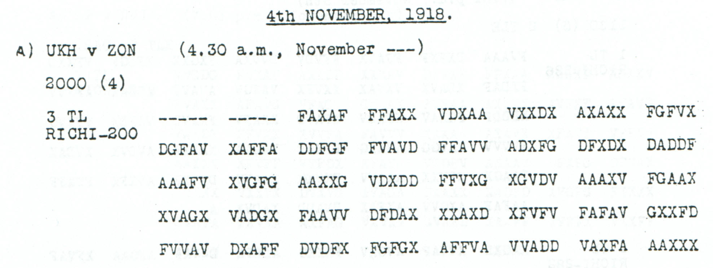
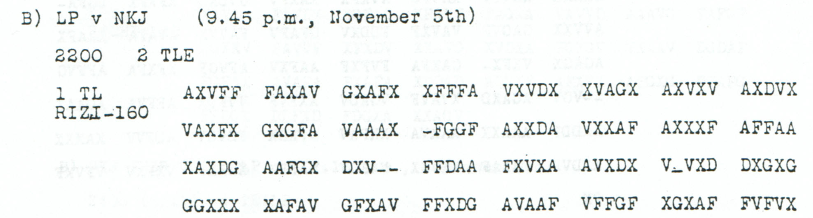
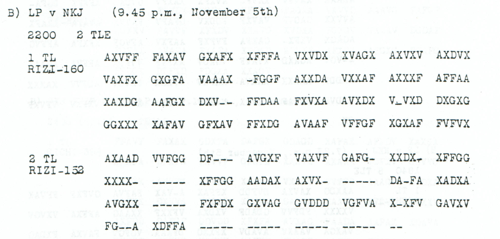

# Childs p. 127 — readings and source edition

<!-- Generated by python -m adfgvx.page_editions; edit the canonical case editions. -->

[All source pages](README.md) · [Historical research](../../docs/historical-studies/README.md) · [Reading conventions](../../docs/reading-conventions.md) · [← p. 126](126.md) · [p. 128 →](128.md)

German readings, English interpretations and source explanations for the **3 ciphertexts** on this printed page.

| Source | State | Subject | Views |
|---|---|---|---|
| <a id="source-p127-a3"></a>p127 A3 | CONDITIONAL | March and aerial reconnaissance report | [Reading](#edition-cases-military-nov4-march-air-reconnaissance-p127-a3) · [Case](../military/nov4_march_air_reconnaissance.md) |
| <a id="source-p127-b1"></a>p127 B1 | PARTIAL | Existing personnel and agreed radio transmissions | [Reading](#edition-cases-radio-nov4-personnel-transmission-notice-p127-b1) · [Case](../radio/nov4_personnel_transmission_notice.md) |
| <a id="source-p127-b2"></a>p127 B2 | OPEN | Heavily erased second part from NKJ | [Reading](#edition-cases-open-p127-b2) · [Case](../open/p127_B2.md) |

<a id="edition-cases-military-nov4-march-air-reconnaissance"></a>

## March and aerial reconnaissance report

**Sources on this page:** p127 A3. [Concise case study](../military/nov4_march_air_reconnaissance.md).

<a id="edition-cases-military-nov4-march-air-reconnaissance-march-and-aerial-reconnaissance-report"></a>


<a id="edition-cases-military-nov4-march-air-reconnaissance-p127-a3"></a>

### p127 A3

**Readable German — conditional place completion; two fields unresolved:**

> 211?IVD marschiert bis 9 / 11 in Raum um TITELC. A. H. Q? 5 / 11 NAGQBECSEREK. Luftaufklaerung nichts Wesentliches.

The report places the unresolved unit `211?IVD` in the area of `TITELC` by `9 / 11`. An `A. H. Q?` field gives `5 / 11` and the conditionally completed `NAGQBECSEREK`. The final clause reports no substantial aerial-reconnaissance findings.

**Reading:** 90/100 positions are fixed by the original coordinates. The proposal reaches **98/100**, using two observed-coordinate substitutions and eight printed-mask fills under the unchanged Nov4–6 key. The unit and `Q?` fields remain unresolved.

<a id="edition-cases-military-nov4-march-air-reconnaissance-two-letters-from-a-related-station-report"></a>

#### Two letters from a related station report

The [p120 C setup notice](../radio/nov4_eilvese_and_setup.md#p120-c) contains the fully observed place string `NAGQBESCEREK`. Both sources name **ZON** as sender and give the origin day as **4**: `2000 (4)` here and `2332 (4)` in p120 C. Their shared `NAGQBE` opening and `EREK` ending support two missing letters in this report.

| Source or layer | Place field |
| --- | --- |
| p120 C, native reading | `NAGQBESCEREK` |
| p127 A3, native reading | `N?GQBECSER?K` |
| p127 A3, conditional completion | `NAGQBECSEREK` |

The two new letters cost **two mask fills and no further observed substitution**. `A` belongs to the surviving `V?` domain `8ABGIR`; `E` belongs to the `?A` domain `1EJORT`. The comparison selects them as a place-name hypothesis. Each source retains its own observed `CS` or `SC` sequence and its literal `Q`.

<details>
<summary>Original source, exact readings and coordinate account</summary>

**Source:** printed p127, heading *4th NOVEMBER, 1918*. Receipt: `A) UKH v ZON (4.30 a.m., November---)`; origin: `2000 (4)`; part label: `3 TL RICHI-200`. The interception day is absent.



**Raw output — native 200-coordinate frame:**

```text
211?IVDXMARS?HIERCBI?9X11XINR?UMUMTIT?LCXAXHXQ?X5X11XN?GQBECSER?KXXLUFT?UFKLAERU?ZNICHTSWESENTLICHES
```

**Edited output — two observed substitutions and eight printed-mask fills:**

```text
211?IVDXMARSCHIERTBIS9X11XINRAUMUMTITELCXAXHXQ?X5X11XNAGQBECSEREKXXLUFTAUFKLAERUNGNICHTSWESENTLICHES
```

The earlier 96-position proposal filled six of the ten leading dashes. The present extension fills source slots 6 and 7, yielding `A` at plaintext 54 and `E` at 63. The earlier proposal and its exact additional cost remain in the input record. All indices below are zero-based.

| Source index | Printed | Proposed | Cost |
| ---: | --- | --- | --- |
| 108 | `D` | `A` | Observed-coordinate substitution |
| 150 | `F` | `V` | Observed-coordinate substitution |
| 1 | `-` | `X` | Source-mask fill |
| 2 | `-` | `G` | Source-mask fill |
| 3 | `-` | `V` | Source-mask fill |
| 4 | `-` | `A` | Source-mask fill |
| 6 | `-` | `F` | New place-field fill |
| 7 | `-` | `F` | New place-field fill |
| 8 | `-` | `F` | Source-mask fill |
| 9 | `-` | `X` | Source-mask fill |

`TITELC`, including its final `C`, is unchanged. The two remaining dashes supply the unknowns in `211?IVD` and `Q?`.

</details>

<a id="edition-cases-military-nov4-march-air-reconnaissance-evidence-and-attribution"></a>

#### Evidence and attribution

The [input and place-comparison record](../../experiments/early_radio_and_leave_records/inputs.json) preserves both proposals and binds the independent p120 C source. The [certificate](../../experiments/early_radio_and_leave_records/certificates.json) traces each shared donor letter to two observed coordinates and records the target's half-coordinate domains. The [verifier](../../experiments/early_radio_and_leave_records/verify.py) recomputes the readings, exact costs and displayed German.

Source edition and place comparison: **icekylinx and GPT-6 Astra Pro (2026)**. Childs supplies the historical collection. The unchanged published key is credited to Lasry, Niebel, Kopal and Wacker, with Lasry's published period-key list. Earlier repository OCR remains in the [attribution record](../../experiments/early_radio_and_leave_records/prior_candidates.json).

<a id="edition-cases-radio-nov4-personnel-transmission-notice"></a>

## Existing personnel and agreed radio transmissions

**Sources on this page:** p127 B1. [Concise case study](../radio/nov4_personnel_transmission_notice.md).

<a id="edition-cases-radio-nov4-personnel-transmission-notice-existing-personnel-and-agreed-radio-transmissions"></a>


<a id="edition-cases-radio-nov4-personnel-transmission-notice-p127-b1"></a>

### p127 B1

**Status:** 76/80 native raw positions fixed; 1 observed-coordinate substitution and 3 source-mask fills in the proposal. No frame change. Key: Nov4-6.

**Source and dates:** Page heading: 4th NOVEMBER, 1918; B) LP v NKJ (9.45 p.m., November 5th); 2200 2 TLE; 1 TL RIZI-160.



<details>
<summary>Source and cipher evidence</summary>

**Raw output:**

```text
?I?RNOCHALTESPERSONAFXWIRSENDENWIEVERABREDETXWENNNICTMEHRDANNISTOS?AUSGESCHIE?EN
```

**Edited output — counted proposal:**

```text
HIERNOCHALTESPERSONALXWIRSENDENWIEVERABREDETXWENNNICTMEHRDANNISTOS?AUSGESCHIEDEN
```

</details>

**Readable German — the same candidate labels with spacing and punctuation:**

> Hier noch altes Personal. Wir senden wie verabredet. Wenn NICT mehr, dann ist OS? ausgeschieden.

**Meaning:** The sender says the previous personnel are still present and transmissions continue as agreed. The final sentence contains the literal defect NICT and an unresolved OS? label. If NICT is intended as NICHT, it conditionally links ceased transmissions with the departure of OS?; that missing H is not inserted into the cryptographic reading.

**Conditional interpretation and source details:** The first source group is AXVFF; ALTES is already present in the complete raw reading. The later group VFFGF contains a clear F, not an out-of-alphabet T; neither visual correction is a historical ciphertext edit. The proposal changes one observed coordinate and fills three printed masks. The fourth mask leaves OS? unresolved. NICT is retained without adding H. Only the first of two announced parts is included.

<a id="edition-cases-radio-nov4-personnel-transmission-notice-explicit-source-changes"></a>

#### Explicit source changes

All indices are zero-based. Printed masks retain their original slots.

| Source index | Printed | Proposed | Cost |
|---:|---|---|---|
| 2 | `V` | `X` | Observed-coordinate substitution |
| 55 | `-` | `A` | Source-mask fill |
| 93 | `-` | `D` | Source-mask fill |
| 94 | `-` | `A` | Source-mask fill |

<a id="edition-cases-radio-nov4-personnel-transmission-notice-optional-osm-field-completion"></a>

#### Optional OSM field completion

The unresolved position 66 has domain `4CMNST`, from `X?` at source 44 and
111. Reading the station call sign **OSM** fills the remaining printed mask
111 with **F**, giving `XF=M`. This adds one source-mask fill, with no new
observed-coordinate change: the optional total is **one substitution and
four printed-mask fills**, fixing 80/80 positions under the same native frame.

<details>
<summary>Proposed text and exact labels</summary>

**Edited output — optional OSM identification, one mask fill beyond the preceding proposal:**

```text
HIERNOCHALTESPERSONALXWIRSENDENWIEVERABREDETXWENNNICTMEHRDANNISTOSMAUSGESCHIEDEN
```

</details>

**Readable German — same optional labels, retaining NICT:**

> Hier noch altes Personal. Wir senden wie verabredet. Wenn NICT mehr, dann ist OSM ausgeschieden.

This is a conditional identification, supported by the separate
[OSM/OUI staff query](../radio/p137_station_staff_query.md) and an independent diary
notice. The [published 2016 study, section 6.5](https://www.apprendre-en-ligne.net/crypto/bibliotheque/PDF/adfgvx.pdf)
identifies OSM with Osmanie. In his entry headed **5 November**, Albert Hopman records at
`11h 30m N` the notice “FT-Station Osmanie von uns aufgegeben”.
[Original diary image, Baumgart edition (1971), p636 / scan646](https://api.digitale-sammlungen.de/iiif/image/v2/bsb00042051_00646/full/1800,/0/default.jpg).
The notice does not quote this telegram. The source's 4 November page heading,
5 November receipt and undated `2200` field remain distinct; no reply relation
or clock reconciliation is asserted. The second announced part remains unread.

[Exact optional-field witness and documentary metadata](../../experiments/early_radio_and_leave_records/osmanie_field_certificate.json)
· [Optional-field verifier](../../experiments/early_radio_and_leave_records/verify_osmanie.py).

<a id="edition-cases-radio-nov4-personnel-transmission-notice-reproducibility-and-attribution"></a>

#### Reproducibility and attribution

The [input](../../experiments/early_radio_and_leave_records/inputs.json) binds each literal source to exact PDF crops. The [certificate](../../experiments/early_radio_and_leave_records/certificates.json) records each raw paired-coordinate domain and every proposed source change. The [verifier](../../experiments/early_radio_and_leave_records/verify.py) checks the live German quotation against the same candidate labels, preserving every digit and unknown position.

This source edition is by icekylinx and GPT-6 Astra Pro (2026). Childs supplies the historical collection. The published reconstruction and unchanged key provenance credit Lasry, Niebel, Kopal and Wacker, with Lasry's published period-key list. Earlier repository OCR input is frozen in the [attribution record](../../experiments/early_radio_and_leave_records/prior_candidates.json).

<a id="edition-cases-open-p127-b2"></a>

## p127 B2 — Heavily erased second part from NKJ

**Sources on this page:** p127 B2. [Concise case study](../open/p127_B2.md).

<a id="edition-cases-open-p127-b2-p127-b2--heavily-erased-second-part-from-nkj"></a>


**State: OPEN.** Source transcription and review: **icekylinx and GPT-6 Astra Pro**.

The second part remains unread. All 152 printed slots are transcribed, but 48 are erasures, leaving only 104 observed coordinates. Its preceding first part is separately catalogued; its reading does not by itself restore the missing coordinates here.

<a id="edition-cases-open-p127-b2-source"></a>

### Source



<details>
<summary>Source and cipher evidence</summary>

**Source transcription — clear header, spacing normalized from the source:**

```text
B) LP v NKJ (9.45 p.m., November 5th)
2200   2 TLE
2 TL
RIZI-152
```

**Source transcription — literal ciphertext, printed row and group boundaries retained:**

```text
AXAAD VVFGG DF--- AVGXF VAXVF GAFG- XXDX- XFFGG
XXXX- ----- XFFGG AADAX AXVX- ----- DA-FA XADXA
AVGXX ----- FXFDX GXVAG GVDDD VGFVA X-XFV GAVXV
FG--A XDFFA ----- ----- ----- ----- --
```

</details>

| Evidence | Count |
|---|---:|
| Received source slots | 152 |
| Observed ADFGVX coordinates | 104 |
| Printed erasure slots | 48 |
| Advertised part length | 152 |

<a id="edition-cases-open-p127-b2-boundaries-and-uncertainty"></a>

### Boundaries and uncertainty

The page heading says `4th NOVEMBER, 1918`, while the reception header says
November 5th. Both dates are preserved. `2 TL` identifies this physical body
as part two of the printed two-part transmission.

The repeated group `XFFGG` occurs twice, at zero-based source indices 35–39
and 50–54. Both occurrences remain in place. Repetition alone does not
establish a copying error or justify deleting one. The final row ends with
22 consecutive printed dashes, including a final two-dash group.

The [first part, p127 B1](#edition-cases-radio-nov4-personnel-transmission-notice-p127-b1),
contains personnel and radio-transmission wording. That context is a
research lead, not a plaintext crib licensed by the second part’s source.

<a id="edition-cases-open-p127-b2-research-leads"></a>

### Research leads

- Compare the confirmed first-part key and header with the second part while keeping the conflicting printed dates visible.
- Seek an independently received copy that can constrain the 48 erased coordinates, especially the long final gap.
- Examine the two `XFFGG` groups and the surrounding observed coordinates before proposing duplication or a relocated erasure run. Score competing geometries against controls; sparse-coordinate fluency alone is weak evidence.

These are research directions, not accepted decipherments. A failed search
under one key or loss model does not exclude other source-supported models.

<a id="edition-cases-open-p127-b2-evidence-and-reproduction"></a>

### Evidence and reproduction

The [machine-readable source record](../../experiments/open_source_records/inputs.json)
retains the original audit metadata, exact source rows, annotation positions
and crop recipe. The [source-only verifier](../../experiments/open_source_records/verify.py)
checks the case transcription, literal digest, native counts and crop pixels;
it produces no plaintext certificate. The [21-source audit](../../docs/source-gap-audit.md)
records the earlier boundary review.

```sh
python experiments/open_source_records/verify.py
python experiments/open_source_records/verify.py --pdf /path/to/childs.pdf
```

Source: J. Rives Childs, *General Solution of the ADFGVX Cipher System*,
printed p127, PDF p130 in the
[scanned volume](https://drive.google.com/file/d/1_JiNMck7eUvdrOTrH7fsj1Yh44t-VSC6/view).
The optional PDF check verifies the original file and reproduces the published crop.
