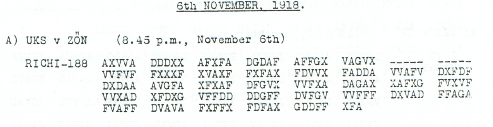

# Childs p. 143 — readings and source edition

<!-- Generated by python -m adfgvx.page_editions; edit data/source_editions.json. -->

[Page ranges](README.md) · [By subject](../../topics/README.md) · [Historical research](../../docs/historical-studies/README.md) · [Reading conventions](../../docs/reading-conventions.md) · [← p. 142](142.md) · [p. 144 →](144.md)

German readings, English interpretations and source explanations for the **1 ciphertext** on this printed page.

| Source | State | Subject |
|---|---|---|
| [p143 A](#source-p143-a) | CONDITIONAL | Evening Danube report: Alpenkorps near Ujvidek and the Slankamen crossing |


<a id="edition-cases-military-nov6-evening-danube-report"></a>

## p143 A — Evening Danube report: Alpenkorps near Ujvidek and the Slankamen crossing

**Edition context:** Evening Danube report at Ujvidek and Slankamen.

<a id="edition-cases-military-nov6-evening-danube-report-evening-danube-report-at-ujvidek-and-slankamen"></a>


<a id="source-p143-a"></a>
<a id="edition-cases-military-nov6-evening-danube-report-completed-reading"></a>

### Completed reading

The 6 November evening report places the Alpenkorps northwest of Ujvidek
and describes a Danube crossing near Slankamen and Ujvidek. Completing the
address as **OKM** fills the last position in the earlier geographical
proposal, giving a **94/94-position conditional reading**.

**Readable German — completed conditional proposal, retaining the literal 217I field:**

> Fuer OKM. Abendmeldung. Alpenkorps nordwestl. Ujvidek. 217I beim Donauuebergang bei Slankamen, Ujvidek.

The O comes from filling printed dash 33 with G; its surviving half-pair
allows `1EJORT`, so the command abbreviation supplies the choice. This adds
one fill to the existing name proposal and no further observed-coordinate
change. The complete account is **four substitutions and ten printed-mask
fills**. The transmitted `217I` remains as written.

The address formula is independently attested in the native `OXKXM` opening
of [p124 A3](124.md#edition-cases-military-hungarian-armistice-instructions-p124-a3) and the `FUEROKM`
phrase in [p226 A2](226.md#edition-cases-radio-radio-traffic-transfer-fragment). These
separate messages support the abbreviation used in the completion.

<details>
<summary>Completed exact stream</summary>

**Edited output — completed conditional proposal:**

```text
FUERXOKMXABENDMELDUNGXALPENKORPSNORDWESTLXUJVIDEKX217IXBEIMDONAUUEBERGANGBEIXSLANKAMENXUJVIDEK
```

</details>

[Completion and independent re-encryption](../../experiments/nov6_danube_completion/README.md).

<a id="edition-cases-military-nov6-evening-danube-report-p143-a"></a>

### p143 A

<details>
<summary>Source, earlier partial readings and repair account</summary>


**Status:** 84/94 native raw positions fixed; 3 coordinate substitutions and 4 source-mask fills. No frame or key change.

**Source and dates:** Page heading: 6th NOVEMBER, 1918; A) UKS v ZON (8.45 p.m., November 6th); RICHI-188.



<details>
<summary>Source and cipher evidence</summary>

**Raw output:**

```text
FUERX?KMXABEN?MELDUNGX?LPENZOR?SNORDWES?LXUJVID?KX217IXD?IMDONAUUEBERG?NGBEIXS?ANKAMENX?JVIDEK
```

**Edited output — primary counted proposal:**

```text
FUERX?KMXABENDMELDUNGX?LPENZOR?SNORDWESTLXUJVID?KX217IXBEIMDONAUUEBERGANGBEIXS?ANKAMENX?JVIDEK
```

</details>

**Readable German — the same candidate labels with spacing and punctuation:**

> Fuer ?KM. Abendmeldung. ?LPENZOR?S nordwestl. UJVID?K. 217I beim Donauuebergang bei S?ANKAMEN, ?JVIDEK.

**Meaning:** The proposed ordinary-word reading is an evening report: the label ?LPENZOR?S is northwest of UJVID?K, and the literal unit-like field 217I is at a Danube crossing near the place sequence S?ANKAMEN / ?JVIDEK. These opaque labels and the six unknown positions remain visible. The punctuation is editorial and does not establish a particular route or exact formation.

**Conditional interpretation and source details:** Ten printed dashes remain ten coordinate slots. The primary proposal repairs only ABENDMELDUNG, NORDWESTL, BEIM and DONAUUEBERGANG through three observed-coordinate substitutions and four mask fills. It leaves the command, formation and geographical fields unresolved. In particular, 217I is not silently expanded or changed to a numbered division. The separate name proposal below costs one additional observed-coordinate substitution and five additional fills.

<a id="edition-cases-military-nov6-evening-danube-report-explicit-source-changes"></a>

#### Explicit source changes

All indices are zero-based.

| Source index | Printed | Proposed | Cost |
|---:|---|---|---|
| 61 | `D` | `V` | Observed-coordinate substitution |
| 95 | `D` | `A` | Observed-coordinate substitution |
| 139 | `F` | `G` | Observed-coordinate substitution |
| 30 | `-` | `V` | Source-mask fill |
| 34 | `-` | `F` | Source-mask fill |
| 37 | `-` | `X` | Source-mask fill |
| 39 | `-` | `F` | Source-mask fill |

<a id="edition-cases-military-nov6-evening-danube-report-separate-geographical-and-formation-name-proposal"></a>

#### Separate geographical and formation-name proposal

**Conditional interpretation — an additional lexical proposal, not included in the primary totals:**

The readable name proposal is compatible with the damaged labels, including the two occurrences of Ujvidek. It requires one additional observed-coordinate substitution and five additional mask fills. Its full source cost is four substitutions plus nine fills; one command-label position remains unknown. No independent copy of this report is claimed to supply these names.

<details>
<summary>Proposed text and exact labels</summary>

**Edited output — optional name proposal:**

```text
FUERX?KMXABENDMELDUNGXALPENKORPSNORDWESTLXUJVIDEKX217IXBEIMDONAUUEBERGANGBEIXSLANKAMENXUJVIDEK
```

</details>

**Readable German — optional name proposal:**

> Fuer ?KM. Abendmeldung. Alpenkorps nordwestl. Ujvidek. 217I beim Donauuebergang bei Slankamen, Ujvidek.

| Additional source index | Primary coordinate | Optional coordinate | Cost |
|---:|---|---|---|
| 25 | `V` | `F` | Additional observed-coordinate substitution |
| 31 | `?` | `X` | Additional source-mask fill |
| 32 | `?` | `D` | Additional source-mask fill |
| 35 | `?` | `V` | Additional source-mask fill |
| 36 | `?` | `X` | Additional source-mask fill |
| 38 | `?` | `A` | Additional source-mask fill |

The literal field `217I` is retained in both quotations; neither version inserts `D`, assigns a division or changes a number.

<a id="edition-cases-military-nov6-evening-danube-report-reproducibility-and-attribution"></a>

#### Reproducibility and attribution

The [input](../../experiments/nov6_evening_and_embassy_records/inputs.json) binds literal source rows to exact PDF crops. The [certificate](../../experiments/nov6_evening_and_embassy_records/certificates.json) records raw paired-coordinate domains, all proposed changes and the separately priced optional reading. The [verifier](../../experiments/nov6_evening_and_embassy_records/verify.py) checks the unchanged Nov4–6 key and all live German quotations, including every unknown position and digit.

Source edition and verification: icekylinx and GPT-6 Astra Pro (2026). Childs supplies the historical collection; published reconstruction and key provenance credit Lasry, Niebel, Kopal and Wacker. Earlier repository OCR input is frozen in the [attribution record](../../experiments/nov6_evening_and_embassy_records/prior_candidates.json).

</details>
