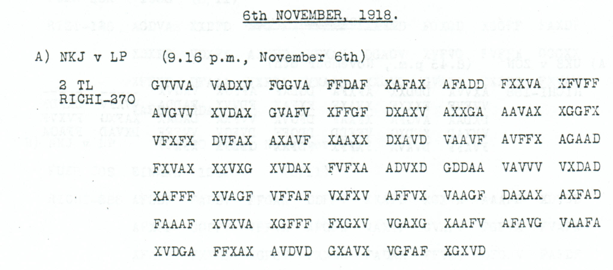
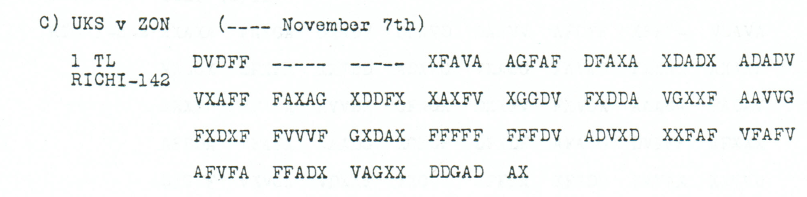

# Childs p. 144 — readings and source edition

<!-- Generated by python -m adfgvx.page_editions; edit the canonical case editions. -->

[All source pages](README.md) · [Historical research](../../docs/historical-studies/README.md) · [Reading conventions](../../docs/reading-conventions.md) · [← p. 143](143.md) · [p. 145 →](145.md)

German readings, English interpretations and source explanations for the **3 ciphertexts** on this printed page.

| Source | State | Subject | Views |
|---|---|---|---|
| <a id="source-p144-a2"></a>p144 A2 | READING | Local silk resale continuation corroborates the p136/p152 witnesses | [Reading](#edition-cases-finance-nov6-silk-resale-continuation-p144-a2) · [Case](../finance/nov6_silk_resale_continuation.md) |
| <a id="source-p144-b"></a>p144 B | PARTIAL | Troop crossing in boats and a no-further-events ending; opening and place unresolved | [Reading](#edition-cases-military-nov6-boat-crossing-fragment-p144-b) · [Case](../military/nov6_boat_crossing_fragment.md) |
| <a id="source-p144-c1"></a>p144 C1 | CONDITIONAL | Aerial reconnaissance: ferries and horse loading at Kladovo | [Reading](#edition-cases-military-nov6-horse-loading-reconnaissance-completed-reading) · [Case](../military/nov6_horse_loading_reconnaissance.md) |

<a id="edition-cases-finance-nov6-silk-resale-continuation"></a>

## Silk bought in the Caucasus: resell when transport is uncertain

**Sources on this page:** p144 A2. [Concise case study](../finance/nov6_silk_resale_continuation.md).

<a id="edition-cases-finance-nov6-silk-resale-continuation-silk-bought-in-the-caucasus-resell-when-transport-is-uncertain"></a>

<a id="edition-cases-finance-nov6-silk-resale-continuation-silk-resale-continuation-confirmed-by-a-third-source"></a>


Buying the material did not ensure that it could be brought away. This
6 November continuation directs local resale where transport cannot be
assured. The preceding part, preserved in [p136 B1 and the associated p152
case](../p152.md), identifies the purchases as silk, silk yarn, waste and
`Strusen` in the Caucasus. The order’s commercial subject comes from that
longer witness; p144’s surviving second part begins in the middle of its
transport clause.

**Source edition and comparison:** icekylinx and GPT-6 Astra Pro.
The published **Nov4–6** key is unchanged.

<a id="edition-cases-finance-nov6-silk-resale-continuation-p144-a2"></a>

### p144 A2

The quotation begins after the preceding part’s `DEREN ABTRANSPORT`.
It preserves all labels in this continuation, including the Mercator and
War Office raw-materials closing and the reference 138.

**Readable German — the same candidate labels with spacing and punctuation:**

> Nicht unbedingt sichergestellt, ist nach Moeglichkeit dort wieder verkauft werden. Mercator, Kriegsamt, Kriegsrohstoffabteilung. R. 138, Strich, elf, KRA.

**Meaning:** Where removal cannot be guaranteed, arrange for the material
to be resold locally if possible. The order shows procurement giving way
to disposal when transport is insecure. It records an instruction, not
proof that the goods were sold or that their value was recovered.

This reception independently fixes the whole continuation except for one
source error in `GESTELPT`. Changing it to `GESTELLT` is supported by the
older native continuation witnesses. Across p144 and p152, every position
in the 135-label proposal has an unedited paired-coordinate witness.

**Source and dates:** printed heading `6th NOVEMBER, 1918`;
`A) NKJ v LP (9.16 p.m., November 6th); 2 TL RICHI-270`.

<details>
<summary>Native p144 source and exact reading streams</summary>



The source prints the advertised 270 coordinates, giving 135 raw labels
with no unresolved position. The proposal changes one observed coordinate;
there is no mask fill, source exclusion, added slot or key change.

**Raw output:**

```text
NICHTUNBEDINGTSICHERGESTELPTXISTNACHMOEGLICHKEITDORTWIEDERVERKAUFTWERDENXMERCATORKRIEGSAMTKRIEGSROHSTOFFABTEILUNGXRX138XSTRICHXELFXKRAX
```

**Edited output — counted proposal:**

```text
NICHTUNBEDINGTSICHERGESTELLTXISTNACHMOEGLICHKEITDORTWIEDERVERKAUFTWERDENXMERCATORKRIEGSAMTKRIEGSROHSTOFFABTEILUNGXRX138XSTRICHXELFXKRAX
```

</details>

<a id="edition-cases-finance-nov6-silk-resale-continuation-explicit-source-changes"></a>

#### Explicit source changes

| Source index, zero-based | Printed | Proposed | Cost |
|---:|---|---|---|
| 146 | `D` | `A` | One observed-coordinate substitution: `GESTELPT` → `GESTELLT` |

The full group `XAFFF` at source 160–164 also confirms the missing F in
p136’s short `XAFF` group. It establishes the full group and coordinate
value, while the identical Fs prevent identification of which occurrence
was historically omitted. p136’s supplied F remains separately charged;
it is not treated as an originally observed coordinate in that copy.

<a id="edition-cases-finance-nov6-silk-resale-continuation-reproducibility-and-attribution"></a>

#### Reproducibility and attribution

The [inputs](../../experiments/nov6_resale_and_air_reconnaissance/inputs.json)
retain the literal rows and exact source crops. The [certificate](../../experiments/nov6_resale_and_air_reconnaissance/certificates.json)
and [verifier](../../experiments/nov6_resale_and_air_reconnaissance/verify.py)
reproduce the domains, single repair, physical comparisons and forward checks.

Childs supplies the historical source; Lasry, Niebel, Kopal and Wacker retain
published reconstruction and key credit. Earlier repository OCR and the
p136/p152 continuation analysis remain in the [attribution record](../../experiments/nov6_resale_and_air_reconnaissance/prior_candidates.json).
The present contribution is this independently inspected third witness and
its exact relation to the preceding source editions.

<a id="edition-cases-military-nov6-boat-crossing-fragment"></a>

## Troop crossing in boats: a fragmentary November 6 report

**Sources on this page:** p144 B. [Concise case study](../military/nov6_boat_crossing_fragment.md).

<a id="edition-cases-military-nov6-boat-crossing-fragment-troop-crossing-in-boats-a-fragmentary-november-6-report"></a>


**Source review and edition: icekylinx and GPT-6 Astra Pro.**

The 192-slot section B on Childs p144 supports a short passage concerning troops crossing in boats and a routine no-further-events ending. Its opening, one intervening token and the location remain garbled. The edition retains those labels and gives a limited ordinary-word proposal with its exact source cost.


**Reviewed source crops:** [p144_reviewed.png](../../experiments/nov6_boat_crossing_fragment/sources/p144_reviewed.png). [File and pixel verification](../../sources/reviewed-crops.md#verify).
<a id="edition-cases-military-nov6-boat-crossing-fragment-source-and-scope"></a>

### Source and scope

[Childs source](https://drive.google.com/file/d/1_JiNMck7eUvdrOTrH7fsj1Yh44t-VSC6/view) · [Reviewed source excerpt — source-PDF reference](../../experiments/nov6_boat_crossing_fragment/inputs.json) · [Literal inputs](../../experiments/nov6_boat_crossing_fragment/inputs.json) · [Position and repair certificates](../../experiments/nov6_boat_crossing_fragment/certificates.json)

The published `Nov4-6` key is unchanged. [Earlier OCR evidence](../../experiments/nov6_boat_crossing_fragment/ocr_snapshot.json) and its [recomputed decode](../../experiments/nov6_boat_crossing_fragment/prior_candidates.json) are retained. This edition adds checked framing, explicit reading limits and a readable display; it makes no first-public-decipherment claim.

| Record | Source slots | Fixed raw positions | Observed substitutions | Source-mask fills |
| --- | ---: | ---: | ---: | ---: |
| [p144 B](#edition-cases-military-nov6-boat-crossing-fragment-p144-b) | 192 | 93 / 96 | 5 | 2 |

<a id="edition-cases-military-nov6-boat-crossing-fragment-p144-b"></a>

### p144 B

**Source transcription — header:** `B) UKS v ZON (---- November 7th); RICHI-192; page heading 6th NOVEMBER, 1918`

<details>
<summary>Source and cipher evidence</summary>

**Raw output — every native source slot in printed order:**

```text
SOCSTDENVU4RONEE4HEXXLUHLEGKU?GXUEBERSETZECVONTRUPPEIXINBOOJENBEIBRFIRBD9SONSTNI?HTS?ESENELICWES
```

**Edited output — 5 observed-coordinate substitutions and 2 source-mask fills; no insertion, deletion or reordering:**

```text
SOCSTDENVU4RONEE4HEXXLUHLEGKU?GXUEBERSETZENVONTRUPPENXINBOOTENBEIBRFIRBD9SONSTNICHTSWESENTLICHES
```

</details>

**Readable German — the same nonseparator labels as the edited output:**

> SOCSTDENVU4RONEE4HE. LUHLEGKU?G. Uebersetzen von Truppen in Booten bei BRFIRBD9. Sonst nichts Wesentliches.

**Meaning:** The ordinary-word proposal describes troops crossing in boats and ends with nothing further of significance. The preceding 19-label field, the LUHLEGKU?G token and the place-like BRFIRBD9 remain uninterpreted; no particular river, town, formation or successful crossing is independently established.

<a id="edition-cases-military-nov6-boat-crossing-fragment-editorial-limits"></a>

#### Editorial limits

- The proposal repairs only five ordinary-word labels and fills two source-mask coordinates; the exact coordinate cost is listed in the certificate. No source position or key cell is changed without pricing.
- The opening, the apparent reconnaissance token and the place-like string remain exactly as decoded. Their appearance in the readable display does not turn them into accepted German words.
- The date heading and November 7 intercept header are both retained. The adjacent p144 C1 aerial report is a separate physical record; thematic proximity does not join their plaintexts.
- The literal 4 and 9 labels in the opaque fields are retained. They are not relabeled as letters, separators or historical numbers to make an assumed geographical interpretation fit.

<a id="edition-cases-military-nov6-boat-crossing-fragment-exact-repair-account"></a>

#### Exact repair account

The five observed-coordinate changes repair `UEBERSETZEC` to `UEBERSETZEN`, `TRUPPEI` to `TRUPPEN`, `BOOJEN` to `BOOTEN`, and two letters in `?ESENELICWES` to `WESENTLICHES`. Two separate mask fills supply the `C` in `NI?HTS` and the initial `W` of the last word. The remaining `?` in `LUHLEGKU?G` is kept.

| Source index, zero-based | Printed | Proposed | Cost |
| ---: | --- | --- | --- |
| 17 | `D` | `X` | Observed-coordinate substitution |
| 66 | `F` | `X` | Observed-coordinate substitution |
| 72 | `D` | `X` | Observed-coordinate substitution |
| 78 | `F` | `G` | Observed-coordinate substitution |
| 85 | `V` | `X` | Observed-coordinate substitution |
| 65 | `-` | `D` | Source-mask fill |
| 190 | `-` | `A` | Source-mask fill |

The resulting proposal fixes **95 / 96** positions. Fixed labels in an opaque string are not the same as understood words. The primary reading adopts neither an expansion of the first line nor a particular town. A separately priced opening hypothesis follows below. The nearby [aerial-reconnaissance record](#edition-cases-military-nov6-horse-loading-reconnaissance) remains separate.

<a id="edition-cases-military-nov6-boat-crossing-fragment-an-independently-attested-closing-formula"></a>

#### An independently attested closing formula

The unedited [p127 A3 aerial-reconnaissance report](../military/nov4_march_air_reconnaissance.md)
contains the exact phrase **NICHTSWESENTLICHES** in fixed raw output.
The verifier independently decodes that source and maps its letters against
the proposed ending here. This supports the ending as a formula actually
present elsewhere in the collection; it does not identify these reports as
copies or as descriptions of the same event. It supplies no evidence for
the optional opening below.

<a id="edition-cases-military-nov6-boat-crossing-fragment-optional-reading-of-the-opening-outside-the-primary-totals"></a>

#### Optional reading of the opening, outside the primary totals

**Conditional interpretation — a separately priced lexical hypothesis:**

The nineteen-position opening could be read as **SONST DONAUFRONT RUHE**.
This is an ordinary-language proposal, not a reading independently supplied
by another copy. It changes seven output labels at **eight additional
observed-coordinate substitutions**. The full optional candidate therefore
costs **13 observed substitutions and the same 2 source-mask fills**, with
no frame or key change. It remains outside the primary totals.

<details>
<summary>Proposed text and exact labels</summary>

**Edited output — optional opening proposal; 13 observed substitutions, 2 source-mask fills; 95/96 fixed positions:**

```text
SONSTDONAUFRONTRUHEXXLUHLEGKU?GXUEBERSETZENVONTRUPPENXINBOOTENBEIBRFIRBD9SONSTNICHTSWESENTLICHES
```

</details>

**Readable German — optional opening, with the remaining opaque fields unchanged:**

> Sonst Donaufront Ruhe. LUHLEGKU?G. Uebersetzen von Truppen in Booten bei BRFIRBD9. Sonst nichts Wesentliches.

The additional source changes are **11 F→V, 46 F→V, 68 G→F, 92 F→X,
114 D→X, 148 X→A, 159 F→G and 182 X→D**. These are changes to observed
coordinates, not newly resolved square cells. Both raw 4 labels in the
opening are affected only within this explicit proposal; the primary raw
and edited streams retain them.

**Meaning — conditional on the optional opening:** The first clause would
say that the Danube front is otherwise quiet. This does not identify the
place-like BRFIRBD9, restore LUHLEGKU?G, link the adjacent reconnaissance
telegram into this one, or establish the military events as historical
facts. The exact cost makes this possible interpretation reviewable without
promoting it to the primary reading.

<a id="edition-cases-military-nov6-boat-crossing-fragment-reproduction-and-credit"></a>

### Reproduction and credit

Run `python experiments/nov6_boat_crossing_fragment/verify.py --verify`. Add `--pdf /path/to/adfgvx-childs.pdf` to check the original PDF and the exact rendered pixels of the preserved source excerpt.

The verifier reconstructs source-coordinate pairs, checks raw domains, replays all priced changes, verifies the readable display without dropping unresolved labels, and checks a global completion witness where required. Such a completion is mechanical evidence, not a historical guess.

Published period keys: George Lasry, Ingo Niebel, Nils Kopal and Arno Wacker (2016), and George Lasry (2017 key list). Earlier repository OCR and unchanged-key outputs are retained separately. Source review and explicit editorial work: icekylinx and GPT-6 Astra Pro.

<a id="edition-cases-military-nov6-horse-loading-reconnaissance"></a>

## Ferries and horse loading at Kladovo

**Sources on this page:** p144 C1. [Concise case study](../military/nov6_horse_loading_reconnaissance.md).

<a id="edition-cases-military-nov6-horse-loading-reconnaissance-ferries-and-horse-loading-at-kladovo"></a>


<a id="edition-cases-military-nov6-horse-loading-reconnaissance-completed-reading"></a>

### Completed reading

The aerial-reconnaissance message dated 5 November reports ferries and the
loading of horses near **Kladovo**. The place identification completes the
earlier `KIAD?VO` fragment; a separator fill gives a **71/71-position
conditional reading**. The heading's literal `M5` is retained.

**Readable German — completed conditional proposal with the Kladovo identification:**

> O. K. M5. Lufterkundung 5 / 11. Bei Kladovo Faehren, Verladung von Pferden erkannt.

The National Library of Serbia catalogues an **1893 General Staff map of the
Kingdom of Serbia, sheet K 2, Кладово**, published by the General Staff's
Geographical Department in Belgrade at 1:75,000 (COBISS 129724684).
This independently attests the place name *Kladovo* before the war.
[Historical map record](https://digitalna.nb.rs/view/URN:NB:RS:SD_571C5F8EA57C630BE1A06E28BA3ECF0E?virtuelne=NBS/Karte/srbija).

The name requires one additional source correction and one dash fill. The
remaining dash supplies X before `BEI`. Against the original source, the
complete proposal costs **six observed-coordinate substitutions and ten
printed-mask fills** under the same key and 142-slot frame.

| Additional operation | Effect |
|---|---|
| Source 104 V → A | I → L in KLADOVO |
| Source 11 dash → A | O in KLADOVO; the surviving pair allows `036OQY` |
| Source 10 dash → F | Separator X before BEI; the surviving pair allows `0578CX` |

<details>
<summary>Completed exact stream</summary>

**Edited output — completed conditional proposal:**

```text
OXKXM5XLUFTERKUNDUNG5X11XXBEIKLADOVOFAEHRENXVERLADUNGVONPFERDENERKANNTX
```

</details>

[Completion and independent re-encryption](../../experiments/nov6_danube_completion/README.md).

<a id="edition-cases-military-nov6-horse-loading-reconnaissance-p144-c1"></a>

### p144 C1

<details>
<summary>Source, earlier partial readings and repair account</summary>


**Status:** 71 native plaintext positions, 10 unresolved in raw output; 5 observed-coordinate substitutions and 8 source-mask fills in the proposal. No source position, frame length, key or numerical label is silently changed.

**Source and dates:** Page heading: 6th NOVEMBER, 1918; C) UKS v ZON (---- November 7th); 1 TL RICHI-142.



<details>
<summary>Source and cipher evidence</summary>

**Raw output:**

```text
OXKXM5XL?FTERKUN?UNG5X11X?BEIKIAD?VOFAEHRE?XVE?PMD?NGV?4PFE?DEN?TKANNTX
```

**Edited output — counted proposal:**

```text
OXKXM5XLUFTERKUNDUNG5X11X?BEIKIAD?VOFAEHRENXVERLADUNGVONPFERDENERKANNTX
```

</details>

**Readable German — the same candidate labels with spacing and punctuation:**

> O. K. M5. Lufterkundung 5 / 11. ? Bei KIAD?VO Faehren, Verladung von Pferden erkannt.

**Meaning:** The proposed reading reports aerial reconnaissance dated 5/11: ferries and loading of horses were observed near the unresolved place written KIAD?VO. The leading unresolved position and designation M5 remain literal; no definite modern place or unit is assigned.

**Conditional interpretation and evidence:** The readable proposal uses five observed-coordinate substitutions and eight source-mask fills. It leaves one position before `BEI` and one inside `KIAD?VO` unknown. The tempting place expansion is not adopted. `M5`, the date labels `5/11`, and the initial `O K` remain literal. The number-like raw garble in `V?4` is changed to the ordinary word `VON` only through the explicitly priced proposal; there is no substitution-square relabeling.

<a id="edition-cases-military-nov6-horse-loading-reconnaissance-explicit-source-changes"></a>

#### Explicit source changes

All indices are zero-based. Unknown slots retain their position.

| Source index | Printed | Proposed | Cost |
|---:|---|---|---|
| 50 | `X` | `V` | Observed-coordinate substitution |
| 72 | `X` | `V` | Observed-coordinate substitution |
| 106 | `D` | `A` | Observed-coordinate substitution |
| 107 | `V` | `X` | Observed-coordinate substitution |
| 108 | `X` | `V` | Observed-coordinate substitution |
| 5 | `-` | `V` | Source-mask fill |
| 6 | `-` | `A` | Source-mask fill |
| 7 | `-` | `F` | Source-mask fill |
| 8 | `-` | `D` | Source-mask fill |
| 9 | `-` | `F` | Source-mask fill |
| 12 | `-` | `X` | Source-mask fill |
| 13 | `-` | `V` | Source-mask fill |
| 14 | `-` | `V` | Source-mask fill |

<a id="edition-cases-military-nov6-horse-loading-reconnaissance-reproducibility-and-attribution"></a>

#### Reproducibility and attribution

The [input](../../experiments/nov6_resale_and_air_reconnaissance/inputs.json) binds the literal transcription to exact PDF crops. The [certificate](../../experiments/nov6_resale_and_air_reconnaissance/certificates.json) gives the raw paired-coordinate domains, every source change, and the forward checks. The [verifier](../../experiments/nov6_resale_and_air_reconnaissance/verify.py) reproduces them without changing the published Nov4–6 key.

This edition is by icekylinx and GPT-6 Astra Pro (2026). Childs supplies the historical source; Lasry, Niebel, Kopal and Wacker supply the published reconstruction and key provenance. Earlier repository OCR and the p136/p152 continuation analysis are retained in the [attribution record](../../experiments/nov6_resale_and_air_reconnaissance/prior_candidates.json).

</details>
