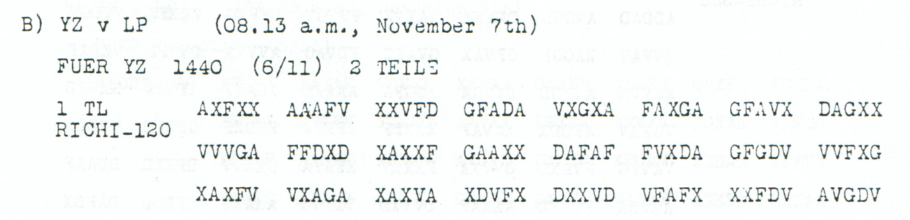
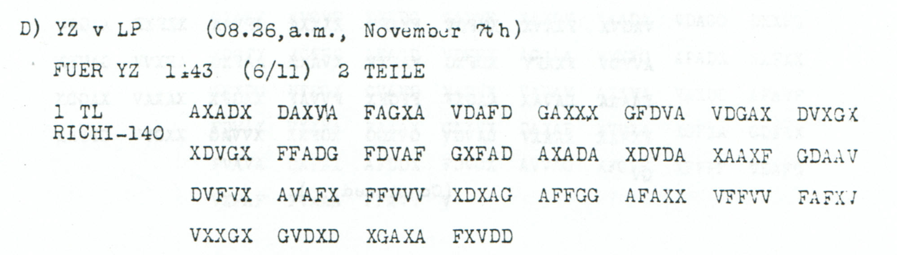

# Childs p. 147 — readings and source edition

<!-- Generated by python -m adfgvx.page_editions; edit data/source_editions.json. -->

[Page ranges](README.md) · [By subject](../../topics/README.md) · [Historical research](../../docs/historical-studies/README.md) · [Reading conventions](../../docs/reading-conventions.md) · [← p. 146](146.md) · [p. 148 →](148.md)

German readings, English interpretations and source explanations for the **4 ciphertexts** on this printed page.

| Source | State | Subject |
|---|---|---|
| [p147 A](#source-p147-a) | READING | Try to sell the motorboat designated ROEM Q5 |
| [p147 B1](#source-p147-b1) | READING | German Embassy address and Auswaertig signature label |
| [p147 C1](#source-p147-c1) | READING | German Embassy at Pera and Stumm signature |
| [p147 D1](#source-p147-d1) | READING | Pera embassy address for Monsignore Dolci, reference 1882 |


<a id="edition-cases-naval-motorboat-sale-attempt"></a>

## p147 A — Try to sell the motorboat designated ROEM Q5

**Edition context:** Constantinople: instruction to attempt a motorboat sale.

<a id="edition-cases-naval-motorboat-sale-attempt-constantinople-instruction-to-attempt-a-motorboat-sale"></a>


**Source edition and verification: icekylinx and GPT-6 Astra Pro.**

<a id="source-p147-a"></a>
<a id="edition-cases-naval-motorboat-sale-attempt-p147-a"></a>

### p147 A

Childs p147, PDF p150; [source crop](../../experiments/nov4_radio_and_departure_queries/sources/p147_A.png). Key: unchanged published **Nov4–6**.

<details>
<summary>Source and cipher evidence</summary>

**Source transcription — literal received header:**

```text
6th NOVEMBER, 1918.
A) YZ v LP (08.10 a.m., November 7th)
1637 (6/11)
RICHI-254
```

**Raw output — native 254-slot frame; 127/127 fixed positions:**

```text
BEVOLLMAECHTIGTERSCHIFFAHRTSBEBUFTRAGTERXKONSTANTINOPELXXBOOTXROEMXQ5XUNTERALLENUMSTAENDENZUVERKAUFENSUCHENXMOTORBOOTVORPSX6235
```

**Edited output — 2 observed-coordinate substitutions and 0 source-mask fills; 127/127 fixed positions:**

```text
BEVOLLMAECHTIGTERSCHIFFAHRTSBEAUFTRAGTERXKONSTANTINOPELXXBOOTXROEMXQ5XUNTERALLENUMSTAENDENZUVERKAUFENSUCHENXMOTORBOOTKORPSX6235
```

</details>

Observed source changes, with zero-based indices: **47 G→F**, **177 G→F**.

The full edited stream re-encrypts under its stated frame and listed changes.

**Readable German — complete edited stream, with spacing and punctuation only:**

> Bevollmaechtigter Schiffahrtsbeauftragter Konstantinopel. Boot ROEM Q5 unter allen Umstaenden zu verkaufen suchen. Motorbootkorps 6235.

**Meaning:** The instruction asks the shipping representative in Constantinople to try to sell the boat designated by the literal ROEM Q5 under all circumstances. The Motorbootkorps reference is 6235. A sale is requested, not reported as completed.

<a id="edition-cases-naval-motorboat-sale-attempt-source-specific-boat-identifier"></a>

### Source-specific boat identifier

The native source has **254 valid coordinates**, matching `RICHI-254`. Two local word repairs supply `BEAUFTRAGTER` and `MOTORBOOTKORPS`. The label following `ROEM` is **Q5**, not the earlier OCR candidate 35. This edition does not replace Q with 3, identify a specific vessel, or infer that the requested sale took place. The separate reference 6235 also remains literal.

<a id="edition-cases-naval-motorboat-sale-attempt-attribution-and-evidence"></a>

### Attribution and evidence

Earlier unreviewed repository candidates already suggested these bodies. This edition checks the primary images, preserves conflicting source labels and publishes every frame operation, coordinate substitution and fill. Prior published key recovery keeps its original credit; no first-solution priority is claimed.

[Inputs](../../experiments/nov4_radio_and_departure_queries/inputs.json), [certificates](../../experiments/nov4_radio_and_departure_queries/certificates.json), [earlier candidates](../../experiments/nov4_radio_and_departure_queries/prior_candidates.json) and [reproduction](../../experiments/nov4_radio_and_departure_queries/README.md) provide complete source and positional evidence.


<a id="edition-cases-radio-nov6-embassy-foreign-signature"></a>

## p147 B1 — German Embassy address and Auswaertig signature label

<a id="edition-cases-radio-nov6-embassy-foreign-signature-german-embassy-address-and-auswaertig-signature-label"></a>


<a id="source-p147-b1"></a>
<a id="edition-cases-radio-nov6-embassy-foreign-signature-p147-b1"></a>

### p147 B1

**Status:** 60/60 native raw positions fixed; 1 coordinate substitution and 0 source-mask fills. No frame or key change.

**Source and dates:** Page heading: 6th NOVEMBER, 1918; B) YZ v LP (08.13 a.m., November 7th); FUER YZ 1440 (6/11) 2 TEILE; 1 TL RICHI-120.



<details>
<summary>Source and cipher evidence</summary>

**Raw output:**

```text
ANDEUTSCHEBOTSCHAFTXKONSTANTINOPEIXXUNTERSCHRIFTXAUSWAERTIGX
```

**Edited output — primary counted proposal:**

```text
ANDEUTSCHEBOTSCHAFTXKONSTANTINOPELXXUNTERSCHRIFTXAUSWAERTIGX
```

</details>

**Readable German — the same candidate labels with spacing and punctuation:**

> An deutsche Botschaft Konstantinopel. Unterschrift Auswaertig.

**Meaning:** The first of two announced parts gives an address to the German Embassy in Constantinople and an Unterschrift field reading Auswaertig. The proposal repairs the final city-name letter only. The next part and any substantive message body are not supplied here.

**Conditional interpretation and source details:** The native stream reads KONSTANTINOPEI. Changing source 116 V→A proposes KONSTANTINOPEL at a cost of one observed-coordinate substitution. All other words and the complete 120-slot frame remain unchanged. Auswaertig is not expanded by adding Amt.

<a id="edition-cases-radio-nov6-embassy-foreign-signature-explicit-source-changes"></a>

#### Explicit source changes

All indices are zero-based.

| Source index | Printed | Proposed | Cost |
|---:|---|---|---|
| 116 | `V` | `A` | Observed-coordinate substitution |

<a id="edition-cases-radio-nov6-embassy-foreign-signature-reproducibility-and-attribution"></a>

#### Reproducibility and attribution

The [input](../../experiments/nov6_evening_and_embassy_records/inputs.json) binds literal source rows to exact PDF crops. The [certificate](../../experiments/nov6_evening_and_embassy_records/certificates.json) records raw paired-coordinate domains, all proposed changes and the separately priced optional reading. The [verifier](../../experiments/nov6_evening_and_embassy_records/verify.py) checks the unchanged Nov4–6 key and all live German quotations, including every unknown position and digit.

Source edition and verification: icekylinx and GPT-6 Astra Pro (2026). Childs supplies the historical collection; published reconstruction and key provenance credit Lasry, Niebel, Kopal and Wacker. Earlier repository OCR input is frozen in the [attribution record](../../experiments/nov6_evening_and_embassy_records/prior_candidates.json).

<a id="source-p147-c1"></a>
<a id="edition-cases-radio-constantinople-address-parts"></a>

## p147 C1 — German Embassy at Pera and Stumm signature

**Edition context:** Constantinople addresses, signatures and receipt instructions.

**Related source pages:** [p148 B1](148.md#source-p148-b1), [p156 C1](156.md#source-p156-c1).

<a id="edition-cases-radio-constantinople-address-parts-constantinople-addresses-signatures-and-receipt-instructions"></a>


**Status:** Three visible first parts, containing addresses, signatures and receipt instructions. Their headings announce two or three parts, but no missing continuation payload is claimed recovered here.

Source edition and verification: **icekylinx and GPT-6 Astra Pro**. The published Nov4–6 and Nov7–9 keys are credited to Lasry, Niebel, Kopal and Wacker and remain unchanged. Earlier unreviewed p147 C/p156 C address-and-signature readings are retained in the prior-work record; those fragments are not presented as newly discovered full message bodies.

<a id="edition-cases-radio-constantinople-address-parts-p147-c1--german-embassy-at-pera-and-stumm-signature"></a>

### p147 C1 — German Embassy at Pera and Stumm signature

<details>
<summary>Raw decoded text</summary>

**Raw output:**

```text
ANXDEUTSCHEBOTSCHAFTXPERAXXUNTERSCHRIFTXXSTUMMXX
```

</details>

<a id="edition-cases-radio-constantinople-address-parts-what-the-visible-parts-say"></a>

### What the visible parts say

- **p147 C1:** To the German Embassy at Pera, with signature `STUMM`. The heading gives `YZ v LP`,08.19 a.m. on 7 November, `FUER YZ1450 (6/11) 2 TEILE`, and `1 TL RICHI-96`.
- **p148 B1:** To the Military Mission at `COSPOLI`, with reference labels, a signature for both parts `I.A. GROENER`, and an instruction for receipt to be acknowledged by an officer. The heading gives 08.40 a.m. on 7 November, `FUER YZ1135 (6/11) 3 TEILE`, and `1 TL RICHI-328`.
- **p156 C1:** German charge d'affaires at Constantinople, with raw signature `BUSSCHS`. The heading gives 06.03 a.m. on 8 November, `FUER YZ2030 (7/11) 2 TLE`, and `1 TL RICHI-102`.

`BUSSCHS` is not silently respelled or expanded to a named historical person. All numerical references remain the published-key labels. The source scan supplies only the first parts represented in this edition.

<a id="edition-cases-radio-constantinople-address-parts-counts-and-source-readings"></a>

### Counts and source readings

| Record | Source slots | Raw fixed positions | Edited fixed positions | Observed-coordinate substitutions | Source fills |
|---|---:|---:|---:|---:|---:|
|p147_C1|96|48/48|48/48|0|0|
|p148_B1|328|163/164|163/164|2|0|
|p156_C1|102|51/51|51/51|0|0|

The physical-record total is **526 coordinate slots / 263 plaintext positions**. Raw fixed positions total 262; the edited layer fixes 262.

<a id="edition-cases-radio-constantinople-address-parts-the-p148-source-annotation-and-invalid-glyph"></a>

### The p148 source annotation and invalid glyph

The source visibly places an X above the F at coordinate 37. Applying that annotation produces the T in `ERBETEN`. The edition counts it as **one observed-coordinate substitution**, not zero-cost transcription. A separate ordinary-word repair changes `BEIUETLE` to `BEIDETLE` at coordinate 122; that also costs one observed substitution.

Coordinate 49 is printed as an L-shaped glyph outside the ADFGVX alphabet. It remains a source mask. The affected plaintext position 95 has exact domain **9EKVXZ**, so the reference is retained as `GEHXPX?ZUSXOP`. The edition does not infer a desired coordinate from that unclear field.

p147 C1 and p156 C1 need no source edits. None of these records has a coordinate insertion, deletion, reordering or key change, and none establishes the substance of its unlinked continuation parts.

<a id="edition-cases-radio-constantinople-address-parts-evidence-and-reproduction"></a>

### Evidence and reproduction

[The input record](../../experiments/constantinople_address_parts/inputs.json) preserves all manual rows, literal irregular glyphs, source headers and crop-rendering metadata. [The certificate](../../experiments/constantinople_address_parts/certificates.json) retains all coordinate changes, masks, symbol domains, digit/J/Q/Y labels and round trips. Global witnesses demonstrate consistency only; they do not recover a unique original.

[The README](../../experiments/constantinople_address_parts/README.md) provides portable verifier commands, including exact source-crop pixel regeneration from the pinned full scan. Prior candidates and specific earlier source editions are distinguished; the bounded literature check is not a universal priority claim.


<details>
<summary>Comparative source sections from other printed pages</summary>

<a id="edition-cases-radio-constantinople-address-parts-p148-b1--military-mission-routing-groener-signature-and-officer-receipt-acknowledgement"></a>

### p148 B1 — Military Mission routing, Groener signature and officer receipt acknowledgement

<details>
<summary>Source and cipher evidence</summary>

**Raw output:**

```text
ANXMILXMISSIONCOSPOLIXZUXRMX2XDXNRX755XXUNTERSCHRIFTFUERBEIUETLEXXIXAXGROENERXBXRM811193XGEHXPX?ZUSXOPXFUERXKOSPOLIXDOPPELPUNKTXEMPFANGSBESTAETIGUNGDURCHOFFZERBEEEN
```

**Edited output:**

```text
ANXMILXMISSIONCOSPOLIXZUXRMX2XDXNRX755XXUNTERSCHRIFTFUERBEIDETLEXXIXAXGROENERXBXRM811193XGEHXPX?ZUSXOPXFUERXKOSPOLIXDOPPELPUNKTXEMPFANGSBESTAETIGUNGDURCHOFFZERBETEN
```

</details>

<a id="edition-cases-radio-constantinople-address-parts-p156-c1--german-charge-daffaires-at-constantinople-and-raw-busschs-signature"></a>

### p156 C1 — German charge d’affaires at Constantinople and raw BUSSCHS signature

<details>
<summary>Raw decoded text</summary>

**Raw output:**

```text
DEUTSCHERGESCHAEFTSTRAEGERKONSTANTINOPELXXBUSSCHSXX
```

</details>

</details>


<a id="edition-cases-radio-nov6-embassy-dolci-address"></a>

## p147 D1 — Pera embassy address for Monsignore Dolci, reference 1882

<a id="edition-cases-radio-nov6-embassy-dolci-address-pera-embassy-address-for-monsignore-dolci-reference-1882"></a>


<a id="source-p147-d1"></a>
<a id="edition-cases-radio-nov6-embassy-dolci-address-p147-d1"></a>

### p147 D1

**Status:** 69/70 native raw positions fixed; 3 coordinate substitutions and 1 source-mask fill. No frame or key change.

**Source and dates:** Page heading: 6th NOVEMBER, 1918; D) YZ v LP (08.26 a.m., November 7th); FUER YZ 1[unclear]43 (6/11) 2 TEILE; 1 TL RICHI-140.



<details>
<summary>Source and cipher evidence</summary>

**Raw output:**

```text
DEUTSCHEBO1SCHAFTXPERAXNRX1882X?UERMONSIGNOREXDOLCIXUNTERSCHRIVTXSTUMM
```

**Edited output — primary counted proposal:**

```text
DEUTSCHEBOTSCHAFTXPERAXNRX1882XFUERMONSIGNOREXDOLCIXUNTERSCHRIFTXSTUMM
```

</details>

**Readable German — the same candidate labels with spacing and punctuation:**

> Deutsche Botschaft Pera. Nr. 1882. Fuer Monsignore Dolci. Unterschrift Stumm.

**Meaning:** The surviving first part gives the German Embassy at Pera, reference 1882, for the person named Monsignore Dolci, with a Stumm signature field. Neither name is identified beyond the literal text. The reading does not supply a second part or infer its substantive instructions.

**Conditional interpretation and source details:** The final glyph of the printed group FAFXJ at source 119 is J-like and outside the coordinate alphabet; that one position is masked. Filling it with V supplies the missing F in FUER. Three observed-coordinate substitutions separately repair BO1SCHAFT and UNTERSCHRIVT. The raw 1 inside BO1SCHAFT is not a numerical label silently relabeled: its change to T is paid for through actual source-coordinate substitutions. Reference1882 is untouched. The clear header time has an uncertain interior mark and is not normalized.

<a id="edition-cases-radio-nov6-embassy-dolci-address-explicit-source-changes"></a>

#### Explicit source changes

All indices are zero-based.

| Source index | Printed | Proposed | Cost |
|---:|---|---|---|
| 90 | `F` | `A` | Observed-coordinate substitution |
| 108 | `A` | `X` | Observed-coordinate substitution |
| 131 | `G` | `V` | Observed-coordinate substitution |
| 119 | `J` | `V` | Source-mask fill |

<a id="edition-cases-radio-nov6-embassy-dolci-address-reproducibility-and-attribution"></a>

#### Reproducibility and attribution

The [input](../../experiments/nov6_evening_and_embassy_records/inputs.json) binds literal source rows to exact PDF crops. The [certificate](../../experiments/nov6_evening_and_embassy_records/certificates.json) records raw paired-coordinate domains, all proposed changes and the separately priced optional reading. The [verifier](../../experiments/nov6_evening_and_embassy_records/verify.py) checks the unchanged Nov4–6 key and all live German quotations, including every unknown position and digit.

Source edition and verification: icekylinx and GPT-6 Astra Pro (2026). Childs supplies the historical collection; published reconstruction and key provenance credit Lasry, Niebel, Kopal and Wacker. Earlier repository OCR input is frozen in the [attribution record](../../experiments/nov6_evening_and_embassy_records/prior_candidates.json).
