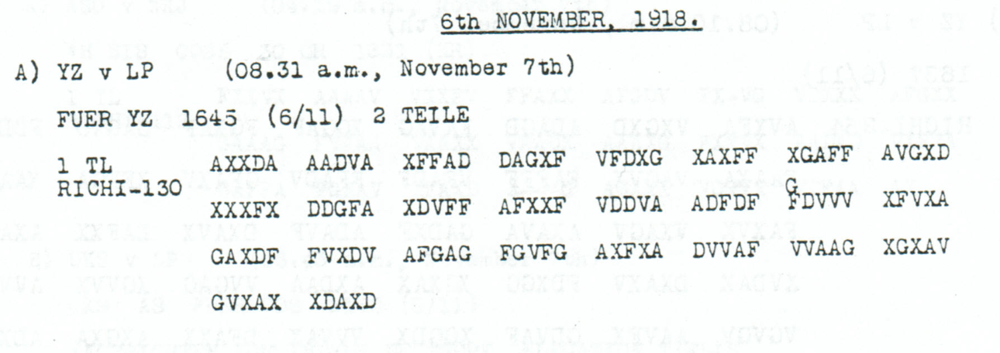

# Childs p148 — readings and source edition

<a id="childs-p-148--readings-and-source-edition"></a>

<!-- Generated by python -m adfgvx.page_editions; edit data/source_editions.json. -->

[Page ranges](README.md) · [By subject](../../topics/README.md) · [Historical research](../../docs/historical-studies/README.md) · [Reading conventions](../../docs/reading-conventions.md) · [← p147](147.md) · [p149 →](149.md)

German readings, English interpretations and source explanations for the **3 ciphertexts** on this printed page.

| Source | State | Subject |
| --- | --- | --- |
| [p148 A1](#source-p148-a1) | READING | German embassy address and abbreviated signature label, reference RM3D8956 |
| [p148 B1](#source-p148-b1) | PARTIAL | Military Mission routing, Groener signature and officer receipt acknowledgment |
| [p148 C1](#source-p148-c1) | READING | Osthoff's posting cancellation, clearer repeat |


<a id="edition-cases-radio-nov6-embassy-reference-8956"></a>

## p148 A1 — German embassy address and abbreviated signature label, reference RM3D8956

<a id="edition-cases-radio-nov6-embassy-reference-8956-german-embassy-address-and-abbreviated-signature-label-reference-rm3d8956"></a>


<a id="source-p148-a1"></a>
<a id="edition-cases-radio-nov6-embassy-reference-8956-p148-a1"></a>

### p148 A1

**Status:** 65/65 native raw positions fixed; 5 coordinate substitutions and 0 source-mask fills. No frame change.

**Source and dates:** Page heading: 6th NOVEMBER, 1918; A) YZ v LP (08.31 a.m., November 7th); FUER YZ 1645 (6/11) 2 TEILE; 1 TL RICHI-130.



<details>
<summary>Source and cipher evidence</summary>

**Raw output:**

```text
DEUTSCHEBETSCHAFTXKONSTANTINOPEFXD4TERSC1RXAUSWAERTIGXRMX3XDX8956
```

**Edited output — counted proposal:**

```text
DEUTSCHEBOTSCHAFTXKONSTANTINOPELXUNTERSCHRXAUSWAERTIGXRMX3XDX8956
```

</details>

**Readable German — the same candidate labels with spacing and punctuation:**

> Deutsche Botschaft, Konstantinopel. Unterschr. Auswaertig. RM. 3. D. 8956.

**Meaning:** The first part addresses the German embassy in Constantinople and includes the abbreviated signature label UNTERSCHR followed by AUSWAERTIG. The closing retains RM, 3, D and 8956. This address and signature fragment does not establish the content of the second part, which is outside this edition.

**Conditional interpretation and source details:** The source has 130 coordinate slots and all 65 raw plaintext positions are fixed. The earlier OCR input has only 120 positions because it omits two complete five-coordinate groups, VDDVA and FDVVV. The baseline transcribes the printed F at source index 70; a G annotation stands directly above it. Adopting that annotated correction is explicitly charged as one of the five substitutions, and its isolated effect is shown below. The other four substitutions are linguistic proposals; no extra coordinate, source-mask fill or key change is used. The raw word-internal digits in D4TERSC1R are changed only by the explicit coordinate ledger. RM3D8956 is retained exactly. UNTERSCHR is not expanded by adding IFT, and AUSWAERTIG is not expanded by adding AMT.

<a id="edition-cases-radio-nov6-embassy-reference-8956-explicit-source-changes"></a>

#### Explicit source changes

All indices are zero-based.

| Source index | Printed | Proposed | Cost |
| ---: | --- | --- | --- |
| 11 | `F` | `V` | Observed-coordinate substitution |
| 35 | `A` | `G` | Observed-coordinate substitution |
| 70 | `F` | `G` | Observed-coordinate substitution |
| 73 | `V` | `X` | Observed-coordinate substitution |
| 111 | `V` | `X` | Observed-coordinate substitution |

<a id="edition-cases-radio-nov6-embassy-reference-8956-source-annotation-considered-on-its-own"></a>

#### Source annotation considered on its own

The above-line **G** at source index 70 is retained separately from the printed baseline **F**. Applying only this visible annotation costs one observed-coordinate substitution. It changes **BETSCHAFT** to **BOTSCHAFT**, while the other garbles remain:

<details>
<summary>Proposed text and exact labels</summary>

**Edited output — annotation-only branch, applying just source 70 F→G:**

```text
DEUTSCHEBOTSCHAFTXKONSTANTINOPEFXD4TERSC1RXAUSWAERTIGXRMX3XDX8956
```

</details>

The complete reading above costs five substitutions in total: this annotated F→G correction plus four further linguistic proposals. The 130-slot source frame is already present in the scan; restoring the two groups omitted by OCR does not insert anything into the original ciphertext.

<a id="edition-cases-radio-nov6-embassy-reference-8956-reproducibility-and-attribution"></a>

#### Reproducibility and attribution

The [input](../../experiments/nov6_embassy_8956_annotation/inputs.json) binds each literal source to exact PDF crops. The [certificate](../../experiments/nov6_embassy_8956_annotation/certificates.json) contains the raw paired-coordinate domains, each source change and the forward checks. The [verifier](../../experiments/nov6_embassy_8956_annotation/verify.py) checks the unchanged published keys and the live German quotations, retaining all numerical and letter labels.

Source edition and verification: icekylinx and GPT-6 Astra Pro (2026). Childs supplies the historical collection; published reconstruction and key provenance credit Lasry, Niebel, Kopal and Wacker. Earlier repository OCR and body readings are retained in the [attribution record](../../experiments/nov6_embassy_8956_annotation/prior_candidates.json).

<a id="source-p148-b1"></a>
<a id="edition-cases-radio-constantinople-address-parts"></a>

## p148 B1 — Military Mission routing, Groener signature and officer receipt acknowledgment

**Edition context:** Constantinople addresses, signatures and receipt instructions.

**Related source pages:** [p147 C1](147.md#source-p147-c1), [p156 C1](156.md#source-p156-c1).

<a id="edition-cases-radio-constantinople-address-parts-constantinople-addresses-signatures-and-receipt-instructions"></a>


**Status:** Three visible first parts, containing addresses, signatures and receipt instructions. Their headings announce two or three parts, but no missing continuation payload is claimed recovered here.

Source edition and verification: **icekylinx and GPT-6 Astra Pro**. The published Nov4–6 and Nov7–9 keys are credited to Lasry, Niebel, Kopal and Wacker and remain unchanged. Earlier unreviewed p147 C/p156 C address-and-signature readings are retained in the prior-work record; those fragments are not presented as newly discovered full message bodies.

<a id="edition-cases-radio-constantinople-address-parts-p148-b1--military-mission-routing-groener-signature-and-officer-receipt-acknowledgement"></a>

### p148 B1 — Military Mission routing, Groener signature and officer receipt acknowledgement

<details>
<summary>Source and cipher evidence</summary>

**Raw output:**

```text
ANXMILXMISSIONCOSPOLIXZUXRMX2XDXNRX755XXUNTERSCHRIFTFUERBEIUETLEXXIXAXGROENERXBXRM811193XGEHXPX?ZUSXOPXFUERXKOSPOLIXDOPPELPUNKTXEMPFANGSBESTAETIGUNGDURCHOFFZERBEEEN
```

**Edited output:**

```text
ANXMILXMISSIONCOSPOLIXZUXRMX2XDXNRX755XXUNTERSCHRIFTFUERBEIDETLEXXIXAXGROENERXBXRM811193XGEHXPX?ZUSXOPXFUERXKOSPOLIXDOPPELPUNKTXEMPFANGSBESTAETIGUNGDURCHOFFZERBETEN
```

</details>

<a id="edition-cases-radio-constantinople-address-parts-what-the-visible-parts-say"></a>

### What the visible parts say

- **p147 C1:** To the German Embassy at Pera, with signature `STUMM`. The heading gives `YZ v LP`,08.19 a.m. on 7 November, `FUER YZ1450 (6/11) 2 TEILE`, and `1 TL RICHI-96`.
- **p148 B1:** To the Military Mission at `COSPOLI`, with reference labels, a signature for both parts `I.A. GROENER`, and an instruction for receipt to be acknowledged by an officer. The heading gives 08.40 a.m. on 7 November, `FUER YZ1135 (6/11) 3 TEILE`, and `1 TL RICHI-328`.
- **p156 C1:** German charge d'affaires at Constantinople, with raw signature `BUSSCHS`. The heading gives 06.03 a.m. on 8 November, `FUER YZ2030 (7/11) 2 TLE`, and `1 TL RICHI-102`.

`BUSSCHS` is not silently respelled or expanded to a named historical person. All numerical references remain the published-key labels. The source scan supplies only the first parts represented in this edition.

<a id="edition-cases-radio-constantinople-address-parts-counts-and-source-readings"></a>

### Counts and source readings

| Record | Source slots | Raw fixed positions | Edited fixed positions | Observed-coordinate substitutions | Source fills |
| --- | ---: | ---: | ---: | ---: | ---: |
|p147_C1|96|48/48|48/48|0|0|
|p148_B1|328|163/164|163/164|2|0|
|p156_C1|102|51/51|51/51|0|0|

The physical-record total is **526 coordinate slots / 263 plaintext positions**. Raw fixed positions total 262; the edited layer fixes 262.

<a id="edition-cases-radio-constantinople-address-parts-the-p148-source-annotation-and-invalid-glyph"></a>

### The p148 source annotation and invalid glyph

The source visibly places an X above the F at coordinate 37. Applying that annotation produces the T in `ERBETEN`. The edition counts it as **one observed-coordinate substitution**, not zero-cost transcription. A separate ordinary-word repair changes `BEIUETLE` to `BEIDETLE` at coordinate 122; that also costs one observed substitution.

Coordinate 49 is printed as an L-shaped glyph outside the ADFGVX alphabet. It remains a source mask. The affected plaintext position 95 has exact domain **9EKVXZ**, so the reference is retained as `GEHXPX?ZUSXOP`. The edition does not infer a desired coordinate from that unclear field.

p147 C1 and p156 C1 need no source edits. None of these records has a coordinate insertion, deletion, reordering or key change, and none establishes the substance of its unlinked continuation parts.

<a id="edition-cases-radio-constantinople-address-parts-evidence-and-reproduction"></a>

### Evidence and reproduction

[The input record](../../experiments/constantinople_address_parts/inputs.json) preserves all manual rows, literal irregular glyphs, source headers and crop-rendering metadata. [The certificate](../../experiments/constantinople_address_parts/certificates.json) retains all coordinate changes, masks, symbol domains, digit/J/Q/Y labels and round trips. Global witnesses demonstrate consistency only; they do not recover a unique original.

[The README](../../experiments/constantinople_address_parts/README.md) provides portable verifier commands, including exact source-crop pixel regeneration from the pinned full scan. Prior candidates and specific earlier source editions are distinguished; the bounded literature check is not a universal priority claim.


<details>
<summary>Comparative source sections from other printed pages</summary>

<a id="edition-cases-radio-constantinople-address-parts-p147-c1--german-embassy-at-pera-and-stumm-signature"></a>

### p147 C1 — German Embassy at Pera and Stumm signature

<details>
<summary>Raw decoded text</summary>

**Raw output:**

```text
ANXDEUTSCHEBOTSCHAFTXPERAXXUNTERSCHRIFTXXSTUMMXX
```

</details>

<a id="edition-cases-radio-constantinople-address-parts-p156-c1--german-charge-daffaires-at-constantinople-and-raw-busschs-signature"></a>

### p156 C1 — German charge d’affaires at Constantinople and raw BUSSCHS signature

<details>
<summary>Raw decoded text</summary>

**Raw output:**

```text
DEUTSCHERGESCHAEFTSTRAEGERKONSTANTINOPELXXBUSSCHSXX
```

</details>

</details>

<a id="source-p148-c1"></a>
<a id="edition-cases-people-osthoff"></a>

## p148 C1 — Osthoff's posting cancellation, clearer repeat

**Edition context:** Osthoff's posting to Turkey is cancelled.

**Related source pages:** [p138 A1](138.md#source-p138-a1), [p138 A2](138.md#source-p138-a2), [p149 A2](149.md#source-p149-a2).

<a id="edition-cases-people-osthoff-osthoffs-posting-to-turkey-is-cancelled"></a>


[Source audit](../../experiments/corpus_attack/SOURCE_FAMILIES.md)

Four receptions, p138 A1–A2 and p148 C1 / p149 A2, reconstruct the cancellation of Osthoff's posting to Turkey. Under the published **Nov4–6** key, they jointly support all **121 positions** of the first part and **115 of 118** in the second; three word repairs complete the proposed reading.

<a id="edition-cases-people-osthoff-most-likely-reading"></a>

### Most likely reading

**Readable German:**

> Militärmission Konstantinopel. Kommando des Hptms. der Res. Osthoff nach der Türkei und seine Zuteilung zur Militärmission ist aufgehoben. Derselbe ist dem 1. Ers. Batl. Eisenbahn-Regmts. zu überweisen. AKO folgt. Auf Allerhöchsten Befehl: Chef Militärkabinetts, Frhr. Marschall.

**English meaning:** To the Military Mission in Constantinople. Captain of the Reserve Osthoff's posting to Turkey and assignment to the Military Mission have been cancelled. He is to be transferred to the first replacement battalion of the railway regiment. The cabinet order will follow. By supreme command: the Chief of the Military Cabinet, Baron Marschall.

The English expands the military abbreviations *Ers. Batl.* and *AKO*. The cancellation concerns Osthoff's assignment. His full identity and the regiment number remain unestablished.

<a id="edition-cases-people-osthoff-what-the-witnesses-establish"></a>

### What the witnesses establish

| Part | Printed witnesses | Direct source evidence | Remaining editorial work |
| --- | --- | --- | --- |
| 1 | [p138 A1](../../experiments/corpus_attack/sources/childs_p138_A.png), [p148 C1](../../experiments/corpus_attack/sources/childs_p148_C1.png) | p148 fixes 120/121 positions. The other witness supplies the missing `R` in `DERRES`. All 121 candidate positions have complete coordinate-pair support in a witness. | The earlier p138 copy is five coordinates short. A unique best alignment among all 238 insertion positions supplies `XVAXX` before received index 140. Three other known-coordinate disagreements remain. |
| 2 | [p138 A2](../../experiments/corpus_attack/sources/childs_p138_A.png), [p149 A2](../../experiments/corpus_attack/sources/childs_p149_A2.png) | The two copies jointly support 115/118 proposed positions. p149 independently supplies the `N` in `KABINETTS` and the `C` in `HOECHSTEN`. | Both copies contain `UEM`, `ERSBKTL` and `REGM1S`. Reading `DEM`, `ERSBATL` and `REGMTS` requires three changes in p149 and four in the more damaged p138 copy. |

The literal p149 second part is:

<details>
<summary>Raw decoded text</summary>

**Raw output:**

```text
DERSELBEISTUEM1XERSBKTLEISENBAHNREGM1SZUUEBERWEISENAKOFOLGTXAUFALLERHOECHSTENBEFEHLCHEFMILITAERKABINETTSFRHRMARSCHALLX
```

</details>

Two repairs form the adjacent coordinate exchange `VF → FV` at transmitted indices 210–211; the third changes index 31 from `A` to `X`. The [certificate](../../experiments/corpus_attack/source_pair_results.json) records the raw readings, source differences, coordinate maps and repair costs.

<a id="edition-cases-people-osthoff-dates-and-provenance"></a>

### Dates and provenance

The p138 header gives 5 November; the clearer pp148–149 transmission was intercepted on 7 November and includes `0015 (6/11)`. Both parts use the unchanged published **Nov4–6** key. The later interception time therefore does not by itself require a new period key.

The historical records are from J. Rives Childs, *General Solution of the ADFGVX Cipher System*, printed pp138, 148–149 in the [source scan](https://drive.google.com/file/d/1_JiNMck7eUvdrOTrH7fsj1Yh44t-VSC6/view). The period-key work is credited to **George Lasry, Ingo Niebel, Nils Kopal and Arno Wacker**, with the public key also given by George Lasry in the [2017 discussion](https://scienceblogs.de/klausis-krypto-kolumne/2017/02/23/the-top-50-unsolved-encrypted-messages-46-unsolved-adfgvx-cryptograms-from-world-war-1/?all=1).

Source comparison, reconstruction and edition: **icekylinx and GPT-6 Astra Pro**.

<a id="edition-cases-people-osthoff-reproduce"></a>

### Reproduce

```sh
python3 experiments/corpus_attack/build_source_pairs.py --verify
python3 experiments/corpus_attack/verify_source_pairs.py
```

The second implementation independently reconstructs the columns, checks all 238 missing-group positions and re-encrypts the candidate readings. The [full source audit](../../experiments/corpus_attack/SOURCE_FAMILIES.md) retains the exact raw texts and unresolved source disagreements.
