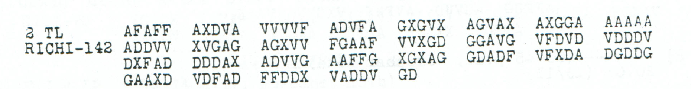

# Childs p. 187 — readings and source edition

<!-- Generated by python -m adfgvx.page_editions; edit the canonical case editions. -->

[All source pages](README.md) · [Historical research](../../docs/historical-studies/README.md) · [Reading conventions](../../docs/reading-conventions.md) · [← p. 186](186.md) · [p. 188 →](188.md)

German readings, English interpretations and source explanations for the **5 ciphertexts** on this printed page.

| Source | State | Subject | Views |
|---|---|---|---|
| <a id="source-p187"></a>p187 | READING | Monitoring Russian and Polish army traffic | [Reading](#edition-cases-p187) · [Case](../p187.md) |
| <a id="source-p187b"></a>p187b | CONDITIONAL | Teleprinter failure and written reporting | [Reading](#edition-cases-p187b) · [Case](../p187b.md) |
| <a id="source-p187-b1"></a>p187 B1 | CONDITIONAL | Third reception of the November Ringbahn-key retention instruction | [Reading](#edition-cases-radio-nov13-ringbahn-retransmission-p187-b1) · [Case](../radio/nov13_ringbahn_retransmission.md) |
| <a id="source-p187-c"></a>p187 C | READING | Connection with Mackensen's army | [Reading](#edition-cases-supplementary-p187-c) · [Case](../supplementary/p187_C.md) |
| <a id="source-p187-d1"></a>p187 D1 | CONDITIONAL | Aircraft connection to Mackensen impossible for technical reasons | [Reading](#edition-cases-radio-p187-d) · [Case](../radio/p187_D.md) |

<a id="edition-cases-p187"></a>

## p187 — Monitoring Russian and Polish army traffic

**Sources on this page:** p187. [Concise case study](../p187.md).

<a id="edition-cases-p187-p187--monitoring-russian-and-polish-army-traffic"></a>


**Status:** Earlier joint key recovery verified; incomplete substitution square and residual garbles preserved. **Key:** `CHI-Nov13`.

**Earliest credited record:** [George Lasry, 2017-05-03, comment 50](https://scienceblogs.de/klausis-krypto-kolumne/2017/02/23/the-top-50-unsolved-encrypted-messages-46-unsolved-adfgvx-cryptograms-from-world-war-1/?all=1#comment-878059). **Current source and arithmetic review:** icekylinx and GPT-6 Astra Pro, 2 November 2026.

Norbert proposed the shared-key attack in comment 49; George Lasry recovered the key in comment 50; Norbert refined the labels in comment 53.

<a id="edition-cases-p187-most-likely-reading"></a>

### Most likely reading

**Readable German — earlier credited word normalization:**

> [Russischen] und poln. Heeresverkehr voll erfassen. Wichtiges, besonders aus poln. Verkehr, ueber O.H.L.-Station verziffert funken.

**Meaning:** Monitor Russian and Polish army communications in full. Radio important material, especially from Polish traffic, in encrypted form via the Supreme Army Command station.

**Notes:** `poln.` means Polish; `O.H.L.` refers to Supreme Army Command. The source-derived first word ends in `T`, so `RUSSISCHEN` is Norbert's one-letter editorial normalization. The rest of this presentation supplies word divisions and punctuation. The order continues in [p187b](#edition-cases-p187b).

<a id="edition-cases-p187-recomputed-reading"></a>

### Recomputed reading

Variant `audited_CHI_direct`: No received-coordinate edits; only directly attested substitution cells are used.

<details>
<summary>Raw decoded text</summary>

**Raw output — recomputed direct CHI reading; attested cells only:**

```text
RUSSISCHETUNDPOLNHEERESVERKEHRVOLLERFASSENXWICHTIGESBESONDERSAUSPOLNVERKEHRUEBEROHLSTATIONVERZIFFERTFUNKEN
```

</details>

<a id="edition-cases-p187-review"></a>

### Review

- Norbert first proposed the shared-key attack in comment 49 on 2017-04-30; George Lasry recovered the key in comment 50 on 2017-05-03; Norbert refined symbol labels in comment 53 the same day.
- The two received texts contain 354 coordinates, 177 plaintext slots. The initial combined publication has 173 plaintext positions and incorrectly describes 356 coordinates; four ending slots are not covered by that published string.
- Fourteen square cells remain unassigned. In particular j/x labels were suggested to be digits, not proved to be 0/01.

<a id="edition-cases-p187-earlier-published-readings"></a>

### Earlier published readings

**Initial substitution labels — [George Lasry, 2017-05-03, comment 50](https://scienceblogs.de/klausis-krypto-kolumne/2017/02/23/the-top-50-unsolved-encrypted-messages-46-unsolved-adfgvx-cryptograms-from-world-war-1/?all=1#comment-878059).**

<details>
<summary>Earlier attributed reading</summary>

**Earlier attributed reading:**

```text
RUSSISCHETUNDPOLNHEERESVERGEHRVOLLERFASSENKWICHTIMESBESONDERSAUSPOLNVERGEHRUEBEROHLSTATIONVERZIFFERTFUNGEN
```

</details>

**Refined partial substitution labels — [Norbert, 2017-05-03, comment 53](https://scienceblogs.de/klausis-krypto-kolumne/2017/02/23/the-top-50-unsolved-encrypted-messages-46-unsolved-adfgvx-cryptograms-from-world-war-1/?all=1#comment-878079).**

Same text as the recomputed reading above.

**Editorial normalization — [Norbert, 2017-05-03, comment 53](https://scienceblogs.de/klausis-krypto-kolumne/2017/02/23/the-top-50-unsolved-encrypted-messages-46-unsolved-adfgvx-cryptograms-from-world-war-1/?all=1#comment-878079).**

<details>
<summary>Earlier attributed reading</summary>

**Earlier attributed reading:**

```text
RUSSISCHENUNDPOLNHEERESVERKEHRVOLLERFASSENXWICHTIGESBESONDERSAUSPOLNVERKEHRUEBEROHLSTATIONVERZIFFERTFUNKEN
```

</details>

Conflicts at 1 plaintext position under the compared variant.

<a id="edition-cases-p187-verified-variants"></a>

### Verified variants

| Variant | Fixed / total positions | Unpaired suffix | Ordinary re-encryption |
|---|---:|---|---|
| `audited_CHI_direct` | 106 / 106 | — | Yes |

Source strings, edit positions, plaintext domains and attribution are retained in [the prior-reading certificate](../../data/prior_readings.json). Re-encryption checks the stated reconstruction, including any conjectural repairs.

<a id="edition-cases-p187b"></a>

## p187b — Teleprinter failure and written reporting

**Sources on this page:** p187b. [Concise case study](../p187b.md).

<a id="edition-cases-p187b-p187b--teleprinter-failure-and-written-reporting"></a>


**Status:** Earlier joint key recovery verified; a single adjacent-coordinate swap explains two prior editorial word corrections. The incomplete ending remains unresolved. **Key:** `CHI-Nov13`.

**Earliest credited record:** [George Lasry, 2017-05-03, comment 50](https://scienceblogs.de/klausis-krypto-kolumne/2017/02/23/the-top-50-unsolved-encrypted-messages-46-unsolved-adfgvx-cryptograms-from-world-war-1/?all=1#comment-878059). **Current source and arithmetic review:** icekylinx and GPT-6 Astra Pro, 2 November 2026.

Norbert proposed the shared-key attack in comment 49; George Lasry recovered the key in comment 50; Norbert refined the labels in comment 53.

<a id="edition-cases-p187b-most-likely-reading"></a>

### Most likely reading

**Readable German — earlier word normalization explained by the separately costed swap:**

> Soweit Fernschreiber-Verbdg. [nicht arbeitet], Rest schriftlich. `NACHCHEF?X??????`.

**Meaning:** Where the teleprinter connection is not working, provide the remainder in writing. The closing designation or reference beginning `NACHCHEF` remains incomplete.

**Notes:** `Verbdg.` abbreviates “connection.” Norbert normalized the raw `NITHT ARBEICET` to `NICHT ARBEITET` in 2017. The new coordinate audit below explains both changes with one adjacent swap. The seven unresolved ending positions are retained in full; no digit assignments are inferred from their administrative appearance. This continues the communications instruction in [p187](#edition-cases-p187).

The literal closing field `NACHCHEF?X??????` retains all seven unresolved
positions and its known `X`. It is shown in full rather than using a display
omission for the last six positions. The bracketed words retain Norbert's
earlier normalization and the separately stated swap model below.

<a id="edition-cases-p187b-recomputed-reading"></a>

### Recomputed reading

Variant `audited_CHI_direct`: No received-coordinate edits; only directly attested substitution cells are used.

<details>
<summary>Raw decoded text</summary>

**Raw output — recomputed direct CHI reading; attested cells only:**

```text
SOWEITFERNSCHREIBERVERBDGNITHTARBEICETXRESTSCHRIFTLICHXNACHCHEF?X??????
```

</details>

<a id="edition-cases-p187b-conditional-adjacent-swap-repair"></a>

### Conditional adjacent-swap repair

The printed 26th group is **`VDFAD`**. Swapping its last two coordinates gives
**`VDFDA`** and restores both previously proposed words:



<details>
<summary>Proposed text and exact labels</summary>

**Edited output — conditional adjacent-coordinate swap; unresolved ending retained:**

```text
SOWEITFERNSCHREIBERVERBDGNICHTARBEITETXRESTSCHRIFTLICHXNACHCHEF?X??????
```

</details>

Only received indices **128 and 129** change (`AD` → `DA`, zero-based).
All other **140 coordinates**, the coordinate counts, key and square remain
unchanged. These map to plaintext position 27 (`T` → `C`) and 35 (`C` → `T`).
The reading still has **64/71 fixed positions**; this repair resolves two
word garbles, not the unknown ending.

The [exhaustive adjacent-swap audit](../../experiments/p187b_adjacent_swap/README.md)
checks all 141 such operations and finds exactly this one for the stated
partial reading. The historical cause of the reversal is unknown. The raw
source remains unaltered, and Norbert retains credit for the normalized words.

<a id="edition-cases-p187b-review"></a>

### Review

- Norbert first proposed the shared-key attack in comment 49 on 2017-04-30; George Lasry recovered the key in comment 50 on 2017-05-03; Norbert refined symbol labels in comment 53 the same day.
- The two received texts contain 354 coordinates, 177 plaintext slots. The initial combined publication has 173 plaintext positions and incorrectly describes 356 coordinates; four ending slots are not covered by that published string.
- Fourteen square cells remain unassigned. In particular j/x labels were suggested to be digits, not proved to be 0/01.

<a id="edition-cases-p187b-earlier-published-readings"></a>

### Earlier published readings

**Initial substitution labels — [George Lasry, 2017-05-03, comment 50](https://scienceblogs.de/klausis-krypto-kolumne/2017/02/23/the-top-50-unsolved-encrypted-messages-46-unsolved-adfgvx-cryptograms-from-world-war-1/?all=1#comment-878059).**

<details>
<summary>Earlier attributed reading</summary>

**Earlier attributed reading:**

```text
SOWEITFERNSCHREIBERVERBDMNITHTARBEICETKRESTSCHRIFTLICHKNACHCHEFJKJX
```

</details>

**Refined partial substitution labels — [Norbert, 2017-05-03, comment 53](https://scienceblogs.de/klausis-krypto-kolumne/2017/02/23/the-top-50-unsolved-encrypted-messages-46-unsolved-adfgvx-cryptograms-from-world-war-1/?all=1#comment-878079).**

<details>
<summary>Earlier attributed reading</summary>

**Earlier attributed reading:**

```text
SOWEITFERNSCHREIBERVERBDGNITHTARBEICETXRESTSCHRIFTLICHXNACHCHEF?X??
```

</details>

**Editorial normalization — [Norbert, 2017-05-03, comment 53](https://scienceblogs.de/klausis-krypto-kolumne/2017/02/23/the-top-50-unsolved-encrypted-messages-46-unsolved-adfgvx-cryptograms-from-world-war-1/?all=1#comment-878079).**

<details>
<summary>Earlier attributed reading</summary>

**Earlier attributed reading:**

```text
SOWEITFERNSCHREIBERVERBDGNICHTARBEITETXRESTSCHRIFTLICHXNACHCHEF?X??
```

</details>

Published length 67; model length 71.

<a id="edition-cases-p187b-verified-variants"></a>

### Verified variants

| Variant | Fixed / total positions | Unpaired suffix | Ordinary re-encryption |
|---|---:|---|---|
| `audited_CHI_direct` | 64 / 71 | — | Partial |

Source strings, edit positions, plaintext domains and attribution are retained in [the prior-reading certificate](../../data/prior_readings.json). Re-encryption checks the stated reconstruction, including any conjectural repairs.

The [p186 source and suffix audit](../../experiments/source_followup/README.md#p186-the-ending-cannot-be-copied-unchanged) retains two questionable glyphs as unknown. All nine one-character deletions from its longer suffix still fail to match this suffix under injective square completion; its numeral `1` cannot simply be transferred here.

<a id="edition-cases-radio-nov13-ringbahn-retransmission"></a>

## p187 B1 — A third reception of the Ringbahn-key instruction

**Sources on this page:** p187 B1. [Concise case study](../radio/nov13_ringbahn_retransmission.md).

<a id="edition-cases-radio-nov13-ringbahn-retransmission-p187-b1--a-third-reception-of-the-ringbahn-key-instruction"></a>


**Source recovery and review: icekylinx and GPT-6 Astra Pro.** The November 13
fragment repeats the November 6 instruction already received on
[p145](../radio/nov6_ringbahn_key_witnesses.md) and · [Reading conventions](../../docs/reading-conventions.md)
[p211](../radio/p211_key_schedule.md). Its header and long literal coordinate
matches establish the copy-family link; the reconstruction below uses their
independently received source coordinates.

<a id="edition-cases-radio-nov13-ringbahn-retransmission-p187-b1"></a>

### p187 B1

**Readable German — source-linked 214-slot reconstruction; ten duplicate-source exclusions, 84 copied slots, five observed substitutions and one printed-mask fill:**

> November-Ringbahnschluessel nicht vernichten. Nachrchef G B848727. Dezember-Ringbahnschluessel tritt vorlaeufig

Do not destroy the November Ringbahn key. The December key provisionally does not enter
force: the clause continues in the separately preserved later parts of the
[p145/p211 message](../radio/nov6_ringbahn_key_witnesses.md). The reference
`B848727` remains literal. The p187 reception itself preserves only this
first-part fragment.

<details>
<summary>Raw decoded text</summary>

**Raw output — conditional 214-slot frame, with all 84 missing coordinates unassigned; 33/107 fixed labels:**

```text
N?V??B??XR???????S?H??E??EL???????R?I??T??9N??H????U?4??8??L2??X????A?E??????B??N????U?S?????IT??O????U?I??
```

</details>

The 140 printed slots contain 139 observed coordinates and one dash. The frame
excludes one copy of each doubled group `AVXVD` and `DXDGA`, retaining 130 source
slots. It adds five prefix slots, five interior slots and 74 jammed tail slots.
Four choices of which identical group occurrence to exclude yield the same
frame and raw output. This is the stated source-copy model; the scan has no
cancellation marks.

Filling only the 84 missing slots from the other receptions raises the fixed
count to **106/107**, before repairing any p187 coordinate. Of these supplied
values, 83 are printed in p145 B1; model slot 46 is the printed `V` in p211 B1.
The latter differs from p145's `A` and supplies the already established `RING`
reading in the December-key clause. The remaining uncertainty is p187's
printed dash, at source 79.

<details>
<summary>Proposed text and exact labels</summary>

**Edited output — same source-linked frame; five observed substitutions and one printed-mask fill; 107/107 fixed labels:**

```text
NOVEMBERXRINGBAHNSCHLUESSELNICHTVERNICHTENXNACHRCHEFXGXB848727XXDEZEMBERXRINGBAHNSCHLUESSELTRITTVORLAEUFIGX
```

</details>

The observed changes are source **26 X→V, 75 X→D, 76 D→A, 77 X→D, 78 V→X**.
The dash at **79** is filled as `V`. All six replacement values have literal
coordinate witnesses in p145 B1. The `FXDFF` group in p187 agrees with p211's raw
copy but disagrees with p145's `FVDFF`; the edition retains that adverse copy
variant and prices the source 26 change explicitly.

<a id="edition-cases-radio-nov13-ringbahn-retransmission-source-and-evidence"></a>

### Source and evidence

Childs, printed p187 / PDF p190, section B1, `RICHI-214`. The header reads
`POT v NKJ (16.30 p.m., November 13th)` and repeats
`SSD 22.30 (6/11) KR DTY von LP 3 TLE`. It requests better group spacing.
The source ends with `Jammed by FL unable to read NKJ`.

<details>
<summary>Literal source transcription</summary>

**Source transcription — all 140 printed slots; the dash is literal:**

```text
ADFAX GGVFX FAFAA AVXVA FXAXV FXDFF XAVVG FGXAV
AAGFA AVFXA AVXVD AVXVD DAGVD FXFAF XDXAV XDXV-
DXDGA DXDGA XXXXF GVGFA AGVAX AXDFA XXAXV GAAXV
DFVVX VGXGV XXVFA AGFXV
```

</details>

[Original source PDF, p190](https://drive.google.com/file/d/1_JiNMck7eUvdrOTrH7fsj1Yh44t-VSC6/view)
· [Reproduction and repair ledger](../../experiments/nov13_ringbahn_retransmission/README.md)
· [Per-position and donor-origin certificate](../../experiments/nov13_ringbahn_retransmission/certificates.json).

The unchanged period key is **Nov4–6**, matching the original transmission date.
The late interception date supplies no reason to substitute the Nov13–15 key.

<a id="edition-cases-radio-nov13-ringbahn-retransmission-attribution"></a>

### Attribution

The earlier complete p145/p211 editions retain their plaintext and key credits.
The period key comes from George Lasry, Ingo Niebel, Nils Kopal and Arno Wacker,
and Lasry's published key list. The present contribution identifies and restores
this separately received fragment, preserves its disagreements, and provides
an exact provenance map for every copied or changed coordinate.

<a id="edition-cases-supplementary-p187-c"></a>

## p187_C — supplementary source review

**Sources on this page:** p187 C. [Concise case study](../supplementary/p187_C.md).

<a id="edition-cases-supplementary-p187-c-p187_c--supplementary-source-review"></a>


**Original reading:** [Ayush Agarwal (@AyushAg1002), 2026-10-28](https://github.com/dbourdeau/cyphersolver/issues/181). **Current image and arithmetic review:** icekylinx and GPT-6 Astra Pro, 2 November 2026.

This record belongs to the wider Childs corpus and is outside the original 22-entry challenge.

A request for an immediate report on the connection with Mackensen's army. The natural reading is clear, but the received text still contains errors and unresolved letters.

<a id="edition-cases-supplementary-p187-c-most-likely-reading"></a>

### Most likely reading

**Readable German — earlier credited body, with later repair accounting:**

> Bitte sofort [Bescheid], ob [Verbindung mit] Armee [Mackensen] einwa[nd]frei.

**Meaning:** Please report immediately whether the connection with Army Mackensen is functioning without problems.

**Notes:** The bracketed readings normalize the raw `BE?CHEID`, `VERPINDUNG MIS`, `MAKENSEN` and `EINWA?DFREI`. They convey the likely instruction while retaining the exact source result below. In particular, the printed `FFXXV` supports the raw `M` in `MIS`; it does not itself correct `MIS` to `MIT`. Original reading: **Ayush Agarwal**; our contribution is the later source and arithmetic review.

<a id="edition-cases-supplementary-p187-c-conservative-source-reading"></a>

### Conservative source reading

65 fixed positions in 67 plaintext positions. Uncertain source annotations remain explicit.

<details>
<summary>Raw decoded text</summary>

**Raw output:**

```text
BITTEXSOFORTXBE?CHEIDXOBXVERPINDUNGXMISXARMEEXMAKENSENXEINWA?DFREIX
```

</details>

<a id="edition-cases-supplementary-p187-c-review"></a>

### Review

- The original section is C, with 134 coordinates and an agreeing RICHI-134 header; p190G is the contributor's typed-log identifier.
- At group 23 the full scan reads FFXXV. The published repaired layer masks its first F as -FXXV. Both layers are kept.
- The issue's 135-symbol source count is not the count of the alphabetic source layer.

<a id="edition-cases-supplementary-p187-c-earlier-published-reading"></a>

### Earlier published reading

<details>
<summary>Earlier attributed reading</summary>

**Earlier attributed reading:**

```text
BITTEXSOFORTXBE?CHEIDXOBXVERPINDUNGX?ISXARMEEXMAKENSENXEINWA?DFREIX
```

</details>

The published reconstruction is reproduced exactly. Its source differences are listed below; reproducing it does not authenticate its conjectural repairs.

| Source index (zero based) | Literal source | Published layer |
|---:|---|---|
| 110 | `F` | `?` |

[Source image](../../sources/excerpts/childs_p187_supplementary.png) · [Full certificate and attribution](../../data/supplementary_readings.json).

The first publication of these particular body readings is credited as reported by the contributor. Earlier wartime or unpublished decipherment has not been excluded.

<a id="edition-cases-supplementary-p187-c-exact-same-length-repair-account"></a>

### Exact same-length repair account

The later [aviation source package](../../experiments/aviation_connection/README.md)
adds an exact cost for the readable instruction. It preserves the earlier
Ayush Agarwal body credit and the already reviewed literal source. Four
known-coordinate substitutions produce the following 67-character edition:

<details>
<summary>Earlier attributed reading</summary>

**Earlier attributed reading — Ayush Agarwal body with the later exact four-edit account:**

```text
BITTEXSOFORTXBESCHEIDXOBXVERBINDUNGXMITXARMEEXMAKENSENXEINWANDFREIX
```

</details>

| Source coordinate, one-based | Literal | Proposed | Consequence |
|---:|---|---|---|
| 62 | X | D | BE?CHEID becomes BESCHEID |
| 86 | A | X | EINWA?DFREI becomes EINWANDFREI |
| 124 | V | F | VERPINDUNG becomes VERBINDUNG |
| 125 | F | V | MIS becomes MIT |

There are no source erasures or inserted coordinates. The two raw question
marks represent unassigned square cells; their coordinates are repaired to
the existing S and N cells, without assigning duplicate letters to the key.
The spelling `MAKENSEN` is retained in this exact-length edition. Full
reencryption reproduces the four-change ciphertext. These costs are the new
audit contribution, not a new discovery of the message's meaning.

The neighboring [p187 D1 aircraft message](../other/p187_D.md) also concerns
Mackensen's connection. The printed times do not establish a chronological
request/reply relationship.

```sh
python experiments/aviation_connection/verify_companion.py --verify
```

<a id="edition-cases-radio-p187-d"></a>

## p187 D1 — Aircraft connection to Mackensen currently impossible

**Sources on this page:** p187 D1. [Concise case study](../radio/p187_D.md).

<a id="edition-cases-radio-p187-d-p187-d1--aircraft-connection-to-mackensen-currently-impossible"></a>


[ADFGVX Cipher](../../README.md) · [All readings](../README.md) · [Source and certificate](../../experiments/aviation_connection/README.md) · [Reading conventions](../../docs/reading-conventions.md)

**Record:** the surviving first part of message D on printed p187,
headed 13 November 1918.
**Result:** a conditional 252-coordinate frame yields a coherent
76-character closing sentence with two changes to received coordinates
and one proposed missing five-coordinate group. Twelve positions in the
opening reference fields remain unresolved.

<a id="edition-cases-radio-p187-d-most-likely-reading"></a>

### Most likely reading

**Readable German — body excerpt under the stated missing-group frame:**

> O.K. Mackensen. [Opening reference fields unresolved.]
> Verbindung mit R- oder G-Flugzeugen z. Zt. aus technischen Gruenden
> unmoeglich.

**Meaning:** A connection using R or G aircraft is currently impossible
for technical reasons. The message does not establish a specific aircraft
model or the purpose of the proposed connection. Its original reference
numbers and continuation have not been supplied.

<a id="edition-cases-radio-p187-d-source-framing-hypothesis"></a>

### Source-framing hypothesis

The [source crop](../../experiments/aviation_connection/sources/childs_p187_D.png)
prints `RICHI-252` but contains 247 ADFGVX coordinates, plus a small
dash-like mark before the full group `GFVVV`. The edition treats that
mark as non-coordinate and inserts a missing group `DDDVV` after the
last printed complete group `DDDAA`, before final `DG`.

This is an explicit reconstruction. Those five coordinates are absent
from the source. Inserting `DDVVD` one coordinate later produces exactly
the same completed ciphertext; the two positions are equivalent aliases.

The framed baseline-key reading is:

<details>
<summary>Raw decoded text</summary>

**Raw output — conditional five-coordinate-loss frame; unassigned square cells retained:**

```text
OXKXMACKENSENXZUXWORTXRMX?XDX?????XUXRMX?XAX?????XVERBINDUNGXMIT?RXODERXGX?LUGZEUGIN?ZXZTXAUSX?ECHNISCHE?XGRUENDENXUEMOEGLICHX
```

</details>

The proposed edition, with only the two known-coordinate repairs, is:

<details>
<summary>Proposed text and exact labels</summary>

**Edited output — same conditional loss frame, with two observed-coordinate repairs:**

```text
OXKXMACKENSENXZUXWORTXRMX?XDX?????XUXRMX?XAX?????XVERBINDUNGXMITXRXODERXGXFLUGZEUGENXZXZTXAUSXTECHNISCHENXGRUENDENXUNMOEGLICHX
```

</details>

| Decision | Exact change |
|---|---|
| Source mark | Exclude the small mark before the complete `GFVVV` group from the coordinate count |
| Missing group | Insert `DDDVV` after 245 received coordinates; the 246-boundary alias yields the same completed stream |
| Known coordinate 25, one-based | `X→V`, changing `UEMOEGLICH` to `UNMOEGLICH` |
| Known coordinate 223, one-based | `A→X`, changing `FLUGZEUGIN` to `FLUGZEUGEN` |

The 126-position frame has 109 raw fixed positions. Completing the
missing group yields 114 fixed positions after the two repairs. The
remaining 12 positions occupy five distinct unassigned square cells,
whose shared unused-symbol pool is `0123456789QY`. No digit assignments
or expansions of the raw `WORT`/`RM` reference wording are proposed.

For the same proposed 76-character suffix, exhaustive comparison of the
248 possible five-loss boundaries gives a minimum of two substitutions
only at the equivalent boundaries above. Keeping the source mark as an
erasure and inserting four coordinates requires at least 28 substitutions
over all 249 boundaries. This comparison supports the stated frame but
does not prove that every other damage model or plaintext is impossible.

<a id="edition-cases-radio-p187-d-separate-conditional-y-inference"></a>

### Separate conditional Y inference

The [Tiflis/pilot-name comparison](../caucasus/tiflis_appointment.md) later supports a
conditional **Nov13–15a DG = Y** assignment. Its use here additionally assumes
that the two differently keyed pilot notices contain the same correctly
copied surname. None of this message's five unresolved reference cells is
DG, so the assignment fixes no digit. It reduces their available labels to
`0123456789Q`, and their coupled possibilities from 95,040 to **55,440**.
The [propagation certificate](../../experiments/contextual_key_constraints/README.md)
checks both source-equivalent gap aliases and constructs a complete square
extension for every allowed field assignment. The baseline reading above
and its original source repairs are unchanged.

<a id="edition-cases-radio-p187-d-source-and-credit"></a>

### Source and credit

Printed p187 / PDF p190: `D) NKJ v LP (03.04 a.m., November 13th);
FUER UKS 20.12 (13/11); 1 TL RICHI-252`, followed by `(Continued)`.
The multipart-total glyph is left unasserted; it is visible in the source
crop. The apparent same-date timing inconsistency is preserved rather
than silently corrected.

The source is J. Rives Childs, *General Solution of the ADFGVX Cipher
System*, in the [public scan](https://drive.google.com/file/d/1_JiNMck7eUvdrOTrH7fsj1Yh44t-VSC6/view).
The published Nov13–15a key keeps its original credit in
[data/keys.json](../../data/keys.json). Source inspection, gap analysis and
this edition are by **icekylinx and GPT-6 Astra Pro**. No first historical
decipherment priority is claimed.

```sh
python experiments/aviation_connection/verify.py --verify
```

The [inputs](../../experiments/aviation_connection/inputs.json) and
[certificate](../../experiments/aviation_connection/certificate.json)
contain literal rows, source hashes, exact edits, every fixed-suffix
geometry comparison, and consistent re-encryption witnesses. The witness
square completions are not accepted historical reference numbers.
