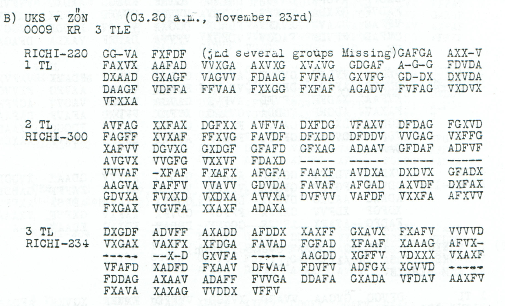
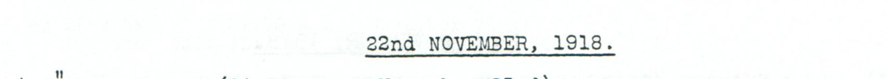

# Childs p. 215 — readings and source edition

<!-- Generated by python -m adfgvx.page_editions; edit data/source_editions.json. -->

[Page ranges](README.md) · [By subject](../../topics/README.md) · [Historical research](../../docs/historical-studies/README.md) · [Reading conventions](../../docs/reading-conventions.md) · [← p. 214](214.md) · [p. 216 →](216.md)

German readings, English interpretations and source explanations for the **5 ciphertexts** on this printed page.

| Source | State | Subject |
|---|---|---|
| [p215 A](#source-p215-a) | CONDITIONAL | Horseshoe and nail consignment from Breslau via Oderberg; Traindepot closing |
| [p215 B1](#source-p215-b1) | CONDITIONAL | Evening-report fragment: further trains departing and proposed Szeged fields |
| [p215 B2](#source-p215-b2) | PARTIAL | Divisional areas and staff locations: second part with explicit geographical alternatives |
| [p215 B3](#source-p215-b3) | CONDITIONAL | Gyula–Sikló–Kisjenő positions and the Ruttka–Teschen departure fragment |
| [p215](#source-p215) | CONDITIONAL | Apparent Entente troop-transport report |

<a id="source-p215-a"></a>
<a id="edition-cases-military-p215-breslau-dispatch"></a>

## p215 A — Horseshoe and nail consignment from Breslau via Oderberg; Traindepot closing

**Edition context:** p215 A — Breslau–Oderberg dispatch fragment.

<a id="edition-cases-military-p215-breslau-dispatch-p215-a--breslauoderberg-dispatch-fragment"></a>


**Recovery and review: icekylinx and GPT-6 Astra Pro, 4 November 2026.**
A conditional relocation of five printed mask slots reveals a dispatch from
Breslau via Oderberg, mentioning wagonloads and accompanying personnel.
The unchanged published November 22–24 key fixes **176/196 raw positions**.
In that raw layer, all **372 observed coordinates remain unchanged and in their original relative order**.
A separately priced word restoration now identifies horseshoes, hoof nails,
screw nails and the closing **Traindepot Breslau**; its primary layer fixes
**192/196 positions**, including still-uninterpreted numerical labels.

<a id="edition-cases-military-p215-breslau-dispatch-most-likely-reading"></a>

### Most likely reading

**Readable German — excerpt from the conditional raw frame; omitted passages remain outside this quotation and J stays a literal square label:**

> […] Breslau ueber Oderberg in J Waggonladungen und J Begleitern […]

The raw passage identifies the route and transport terms. It does not by itself
authenticate the numerical value of either `J`. The displayed raw stream still contains garbles and unknowns. The word layer
below restores the equipment terms and closing, while leaving numerical
uncertainty explicit. No source-mask fill or observed-coordinate substitution
has been made to obtain the raw output.

<a id="edition-cases-military-p215-breslau-dispatch-source-and-conditional-frame"></a>

### Source and conditional frame

The source header is `A) ZON v BSL (04.50 a.m., November 23rd); WORGAG DORT NR C4A6688;1500(11/22);RICHI-392`.
It means BSL to ZON, received at 04:50 on November 23, with the separate
origin field `1500(11/22)`. The unusual `WORGAG` is preserved as printed.

The literal body contains **390 source slots: 372 valid coordinates and
18 printed dashes**, beneath the advertised `RICHI-392`.
All indices below are zero based and ranges are half open.

1. Insert one unknown coordinate before source157, inside `AFFA`, and one
   before source185, inside `VDGA`. These are two additional unknown slots.
2. Move the five existing printed masks at source[198:203] to boundary270
   of the 387-slot stream remaining after their removal. The final mask block
   occupies model[270:275], between the original `VDGFX` and `FDFFA` groups.

This is an explicit analysis-frame repair, not a changed transcription or an
OCR correction. The source prints the all-dash group at the start of its sixth
body row. Every source slot is retained exactly once. Choosing any contiguous
five masks inside source[195:208] gives the same analysis ciphertext, with nine
different mask-identity maps; none is treated as a new message or an additional
reading. Further frame alternatives remain possible.

<details>
<summary>Literal source transcription</summary>

**Source transcription — untouched body:**

```text
FFFDA FXFFF GFVGG XFVVA DDAGX GADGG XDVXF XGAAA
FGVGG AVFXA VAAXD FVXGX FFAGG VAXFF FGAGX FDGAV
AVXDG VDGGG VAXGA AVDFF AXDAX FVFVF XVAAF AFFXG
XVVAD ADGXA XGAVX FXFGG XXAFF DVFGD GFFDG AFFA
XVXVD XADGA FAVAA VDXFG VXDXG VDGA AFGGX GX---
----- ----- GVDAX DAVAF GFXAA AFFAF GVDV- XFVFF
XDXFX VFXDV FFAGG FFVXV XVG-A VXXXF VDGFX FDFFA
GAFDD GXXDF GFGXX GFFDD XXDAV GDXAX XGFAG XDVVG
AVXFA VGVDF -FGAG FAFFF --XVX VXVVF GAFGX DDAXV
ADXDV VXVXG VDDGV GVVXV XVADV FXGGF DA
```

</details>

<a id="edition-cases-military-p215-breslau-dispatch-raw-output-and-evidence"></a>

### Raw output and evidence

<details>
<summary>Raw decoded text</summary>

**Raw output — conditional 392-slot frame, unchanged published key, 176/196 fixed positions, no coordinate substitutions or fills:**

```text
D6EABSENDUNGRUERXYYXAR?PEDRI?GXBE??ETIG?ENXJ??11XPAARHU??ISENUND9K??11111XHUF??EGELUNDSC?RAUBNAEGEL?ST??UTEX?BBRESLAUXUEBERODERBERGINXJXWAGGONLADUNGENUNDXJXBEGLEITERNER6OLGTXN?AINDEPO?XBRESLAT5J85
```

</details>

The [source and frame certificate](../../experiments/p215_breslau_dispatch/certificates.json)
lists all 196 domains, both coordinate origins for every plaintext position,
and a complete re-encryption witness. Its arbitrary fills serve only to verify
the cipher arithmetic and are not asserted as historical text.

The source crop is bound to the original Childs PDF by its page, pixel rectangle
and SHA-256. Independent arithmetic reproduced the complete 225,250-description
whole-group search and its two tied leaders. Two fresh same-shape group-error
controls recovered every one of their 176 fixed positions. Those tests establish
capability within the declared scope, not unique historical geometry.

<a id="edition-cases-military-p215-breslau-dispatch-proposed-words-and-alternative-mask-positions"></a>

### Proposed words and alternative mask positions

<details>
<summary>Proposed text and exact labels</summary>

**Edited output — primary whole-group frame; 6 observed-coordinate substitutions, 14 printed-mask fills and 2 inserted-slot fills; 192/196 fixed positions:**

```text
DIEABSENDUNGFUERXYYXARMEEDRINGXBENOETIGTENXJ??11XPAARHUFEISENUND9K??11111XHUFNAEGELUNDSCHRAUBNAEGELISTHEUTEXABBRESLAUXUEBERODERBERGINXJXWAGGONLADUNGENUNDXJXBEGLEITERNERFOLGTXTRAINDEPOTXBRESLAU5J85
```

</details>

**Readable German — the same primary edited stream with spacing and separator punctuation; numerical labels and unresolved quantity positions remain literal:**

> Die Absendung fuer YY Armee dring. benoetigten J??11 Paar Hufeisen und 9K??11111 Hufnaegel und Schraubnaegel ist heute ab Breslau ueber Oderberg in J Waggonladungen und J Begleitern erfolgt. Traindepot Breslau 5J85.

**Meaning:** A dispatch of urgently needed horseshoes, hoof nails and screw
nails has left Breslau via Oderberg, with wagonloads and accompanying personnel.
The closing is read as Traindepot Breslau. The number of the army, shipment
quantities, wagon and escort counts, and closing identifier are not authenticated
by the baseline numeral labels. `DRING` is retained as an abbreviation; no missing
article is silently inserted into the telegraphic wording.

The primary word proposal changes six clear source coordinates. These are
editorial repairs, not improved OCR:

| Source index | Printed | Proposed |
|---:|:---:|:---:|
| 269 | D | G |
| 270 | G | D |
| 271 | F | G |
| 272 | X | F |
| 316 | V | F |
| 334 | A | V |

Each of its 16 newly filled word positions already has one observed half-coordinate.
There are no wholly unobserved word positions in that gain. The complete ledger
keeps printed-mask fills separate from the two fills in inserted slots.

Moving the same five masks to a coordinate-level boundary inside `VDGFX`
produces two serious alternatives. The selected primary keeps the original
whole-group discovery for continuity; it is neither the highest-scoring nor
the least-edited candidate. The same ordinary-word proposal is tested separately
in each frame:

| Mask destination in shortened frame | Selection basis | Raw fixed | Word fixed | Observed substitutions | Printed-mask fills | Inserted-slot fills |
|---:|---|---:|---:|---:|---:|---:|
| 270, primary | Whole-group discovery; blind rank 23 | 176/196 | 192/196 | 6 | 14 | 2 |
| 268 | Highest blind joint-language score | 176/196 | 193/196 | 4 | 15 | 2 |
| 266 | Fewest substitutions for the proposed words; blind rank 34 | 176/196 | 194/196 | 3 | 16 | 2 |

The 268 model inserts the masks between original source 270 and 271; the 266
model inserts them between original source 268 and 269. The comparison covers
9,700 frames: 25 possible short-group placements and 388 mask destinations.
The word-cost result is conditional on the proposed words, not an independent
plaintext discovery. A language-score optimum is not historical proof.

The three word streams agree at **192/196 positions**. Their differing quantity
fields are deliberately not pooled:

| Destination | Before `PAARHUFEISEN` | Between `UND` and `HUFNAEGEL` |
|---:|---|---|
| 270 | `J??11` | `9K??11111` |
| 268 | `J??11` | `9K?Y11111` |
| 266 | `J?J11` | `9K?Y11111` |

Thus positions 44,45,66,67 remain unresolved in the shared reading; even the
remaining fixed digit labels do not acquire historical values. No registered
square, shared numerical assignment or footer number is changed here.

After the word fills, `AFFFA` permits insertion before source 156,157 or158,
and `VVDGA` permits insertion before 184 or185. Together with nine mask-identity
choices, each word model has 54 equivalent ownership descriptions and one
identical corrected ciphertext. These are explanations of the same evidence,
not 54 independent confirmations. The primary unfilled gap positions 157/185
are a specified analysis choice, not a unique historical inference.

A contemporary institution witness independently supports the closing vocabulary:
[Lublinitzer Kreisblatt, 19 April 1918, printed p. 193, notice 274](https://sbc.org.pl/Content/735084/PDF/iii350718-1918-16-0001.pdf)
mentions the Traindepot of the VI Army Corps in Breslau. Its vehicle-sale notice
is not a copy of this November telegram and proves no shipment, quantity or
sender identity. The [context record](../../experiments/p215_breslau_dispatch/historical_context.json)
preserves the source URL, PDF hash and crop recipes without adding large images.

<a id="edition-cases-military-p215-breslau-dispatch-credit-and-reproduction"></a>

### Credit and reproduction

Childs supplied the historical source; George Lasry and colleagues supplied the
published period key. This source-frame discovery and edition are by
**icekylinx and GPT-6 Astra Pro**. Earlier sources and key credits remain in the
[registered key](../../data/keys.json) and the [recovery package](../../experiments/p215_breslau_dispatch/README.md).

```sh
python experiments/p215_breslau_dispatch/verify.py --verify
python experiments/p215_breslau_dispatch/verify.py --verify --pdf /path/to/childs.pdf
```


<a id="edition-cases-military-p215-train-departure-fragment"></a>

## p215 B1 — Evening-report fragment: further trains departing and proposed Szeged fields

**Edition context:** p215 B1 — Train-departure fragment of an evening report.

<a id="edition-cases-military-p215-train-departure-fragment-p215-b1--train-departure-fragment-of-an-evening-report"></a>


**Partial recovery: icekylinx and GPT-6 Astra Pro.** The source's missing-groups
note and advertised length define a conditional 220-slot frame with **37/110
fixed raw labels**. A limited lexical proposal reaches **77/110**, preserving
all 33 remaining unknowns and changing no observed coordinate.

<a id="source-p215-b1"></a>
<a id="edition-cases-military-p215-train-departure-fragment-p215-b1"></a>

### p215 B1

**Readable German — partial lexical proposal; 3 printed-mask fills and 39 added-slot fills under the declared 220-slot frame:**

> Abendmeldung ?J. G??0?????TE???L?????INU??N?????. Szeged??. Weitere Zuege vom ALPEN???? abgefahren. DIV ST ?U Szeged ???.

The proposed clause concerns further trains departing. `ALPEN????` stays
unfinished; the ending retains `DIV ST ?U`, without expanding its unresolved
label into a preposition. The two `SZEGED` spellings are lexical proposals.
The intervening fields and the literal `J` and `0` retain their source limits.

<details>
<summary>Source and cipher evidence</summary>

**Raw output — 75 added slots and every printed mask unassigned:**

```text
??END??L?????JXG??0?????TE???L?????INU??N?????XSZ??E?????ITE??Z?????OMA????????XAB??F?????XDI????????SZE??D???
```

**Edited output — same conditional frame; zero observed substitutions, 3 printed-mask fills and 39 added-slot fills:**

```text
ABENDMELDUNG?JXG??0?????TE???L?????INU??N?????XSZEGED??WEITEREZUEGEVOMALPEN????XABGEFAHRENXDIVXSTX?UXSZEGED???
```

</details>

The proposed words satisfy every retained half-pair together under one unchanged,
complete Nov22–24 square. Both source-glyph readings below admit the same
partial template and separate complete re-encryption witnesses. A source-compatible
word proposal does not establish unique historical wording.

<a id="edition-cases-military-p215-train-departure-fragment-source-and-frame"></a>

### Source and frame

Childs, printed p215 / PDF p218, B1, `RICHI-220`; `UKS v ZON (03.20 a.m.,
November 23rd)`, `0009 KR 3 TLE`. The page heading is November 22.

[Original PDF](https://drive.google.com/file/d/1_JiNMck7eUvdrOTrH7fsj1Yh44t-VSC6/view)
· [Source edition and verifier](../../experiments/p215_train_departure_fragment/README.md)
· [Per-position certificates](../../experiments/p215_train_departure_fragment/certificates.json).

The source prints **145 slots**, including five dashes, and marks
`(jmd several groups Missing)` after its first ten coordinates. Inserting 75
unknown slots there yields the advertised 220. The model retains every printed
slot, without exclusions or reordering. The verifier separately prices the
proposed opening over 21 nearby even lengths; it does not claim that the
historical length or loss mechanism is unique.

<details>
<summary>Literal source transcription</summary>

**Source transcription — primary X-like glyph layer; coordinate 42 also has an A-like alternative:**

```text
GG-VA FXFDF GAFGA AXX-V
FAXVX AAFAD VVXGA AXVXG XVXVG GDGAF A-G-G FDVDA
DXAAD GXAGF VAGVV FDAAG FVFAA GXVFG GD-DX DXVDA
DAAGF VDFFA FFVAA FXXGG FXFAF AGADV FVFAG VXDVX
VFXXA
```

</details>

At native source index 42 the damaged third glyph in `XVXVG` can also be read
as `A`, giving `XVAVG`. Both layers have 140 valid coordinates and five printed
masks. They differ only in the domain of plaintext position 77, which remains
unresolved in the proposal. Neither variant is selected by language score.

<a id="edition-cases-military-p215-train-departure-fragment-exact-scope"></a>

### Exact scope

| Layer | Fixed positions | Observed substitutions | Printed-mask fills | Added-slot fills |
|---|---:|---:|---:|---:|
| Unfilled conditional frame | 37/110 | 0 | 0 | 0 |
| Partial lexical proposal | 77/110 | 0 | 3 | 39 |

All 110 character domains, both glyph layers, all 33 unresolved positions and
the 38 still-unfilled coordinate slots are retained in the certificates.
`ALPENKORPS`, `ZU` and `IN` are not supplied. The [second part](#edition-cases-military-nov22-divisional-positions-part2)
provides the report's surrounding divisional-position context; it is a separate
source part, rather than an independent copy of these proposed words.

Published key: George Lasry, Ingo Niebel, Nils Kopal and Arno Wacker (2016),
and Lasry's 2017 key list. Earlier repository OCR is preserved in the source
package. Conditional frame, partial lexical recovery and exact coordinate
accounting: **icekylinx and GPT-6 Astra Pro**.


<a id="edition-cases-military-nov22-divisional-positions-part2"></a>

## p215 B2 — Divisional areas and staff locations: second part with explicit geographical alternatives

<a id="edition-cases-military-nov22-divisional-positions-part2-divisional-areas-and-staff-locations-second-part-with-explicit-geographical-alternatives"></a>


<a id="source-p215-b2"></a>
<a id="edition-cases-military-nov22-divisional-positions-part2-p215-b2"></a>

### p215 B2

**Status:** 129/150 native raw positions fixed; 0 coordinate substitutions and 13 source-mask fills. No frame change.

**Source and dates:** Page heading: 22nd NOVEMBER, 1918; B) UKS v ZON (03.20 a.m., November 23rd); 0009 KR 3 TLE; 2 TL RICHI-300; the first part separately says several groups are missing.



<details>
<summary>Source and cipher evidence</summary>

**Raw output:**

```text
?YDIXDXRAUM?ZENTES?HOD?EZOEXVASAR?EY4XERREIC?TX?DIVXSTX?UX?ODMEZOE?VA?ARTEL4X?XK?38XOROS?UZ?X2RXDXR?UM?AG4BANHEG4?SXBATTRE4A?DIVXSTX6UX?EZOEKOVACS?AZA
```

**Edited output — counted proposal:**

```text
?YDIXDXRAUMSZENTES?HODMEZOEXVASARHEY4XERREICHTX?DIVXSTX?UXHODMEZOEXVASARTEL4X?XK?38XOROSHUZ?X2RXDXRAUMNAG4BANHEG4ESXBATTRE4A?DIVXSTX6UXMEZOEKOVACSHAZA
```

</details>

**Readable German — the same candidate labels with spacing and punctuation:**

> ?YDI D. Raum Szentes ? Hodmezoe Vasarhey4 erreicht. ? Div. St. ?U Hodmezoe Vasartel4. ? K?38. Oroshuz?. 2R D. Raum Nag4banheg4es. Battre4a ? Div. St. 6U Mezoekovacshaza.

**Meaning:** The stream reports a reached area and then lists areas and divisional staff locations. The proposed fills make SZENTES, HODMEZOE, ERREICHT, RAUM and MEZOEKOVACSHAZA legible. The precise unit designations, the relationship between the listed places and the garbled labels remain uncertain. The separate geographical alternative below proposes place-name spellings at an additional observed-coordinate cost; it is not independent historical confirmation.

**Conditional interpretation and source details:** All 300 printed positions are retained. Four consecutive five-dash groups and the initial dash of -XFAF contribute 21 source masks. The primary reading uses 13 explicitly proposed mask fills and no change to an observed coordinate. Its eight unresolved plaintext positions and the known labels ?YDI D, ? K?38, 2R D, 6U, VASARHEY4, VASARTEL4, OROSHUZ?, NAG4BANHEG4ES and BATTRE4A are retained. In particular, the digit 4 is not silently read as Y. The source defines this as part 2 of 3; no missing first-part groups or third-part length are supplied. Date heading November 22 and reception November 23 remain separate evidence layers.

<a id="edition-cases-military-nov22-divisional-positions-part2-explicit-source-changes"></a>

#### Explicit source changes

All indices are zero-based.

| Source index | Printed | Proposed | Cost |
|---:|---|---|---|
| 141 | `-` | `V` | Source-mask fill |
| 142 | `-` | `D` | Source-mask fill |
| 145 | `-` | `A` | Source-mask fill |
| 146 | `-` | `F` | Source-mask fill |
| 148 | `-` | `V` | Source-mask fill |
| 149 | `-` | `V` | Source-mask fill |
| 151 | `-` | `A` | Source-mask fill |
| 152 | `-` | `A` | Source-mask fill |
| 153 | `-` | `F` | Source-mask fill |
| 154 | `-` | `F` | Source-mask fill |
| 156 | `-` | `X` | Source-mask fill |
| 158 | `-` | `F` | Source-mask fill |
| 159 | `-` | `A` | Source-mask fill |

<a id="edition-cases-military-nov22-divisional-positions-part2-optional-geographical-reading--additional-18-substitutions-and-1-fill"></a>

#### Optional geographical reading — additional 18 substitutions and 1 fill

The following alternative proposes **HODMEZOE VASARHELY, OROSHAZA, NAGYBANHEGYES and BATTONYA** for the retained garbled names. This is a linguistic/geographical hypothesis, without a parallel copy verifying this message’s intended wording. The complete cost is **18 observed-coordinate substitutions + 14 source-mask fills**, which adds 18 substitutions and one fill to the primary reading. Seven unresolved plaintext positions remain. The unit fields `?YDI D`, `? K?38`, `2R D` and `6U` remain literal; the final `6U` is not silently normalized to a preposition.

<details>
<summary>Proposed text and exact labels</summary>

**Edited output — optional geographical hypothesis:**

```text
?YDIXDXRAUMSZENTES?HODMEZOEXVASARHELYXERREICHTX?DIVXSTX?UXHODMEZOEXVASARHELYX?XK?38XOROSHAZAX2RXDXRAUMNAGYBANHEGYESXBATTONYA?DIVXSTX6UXMEZOEKOVACSHAZA
```

</details>

**Readable German — optional geographical hypothesis:**

> ?YDI D. Raum Szentes ? Hodmezoe Vasarhely erreicht. ? Div. St. ?U Hodmezoe Vasarhely. ? K?38. Oroshaza. 2R D. Raum Nagybanhegyes. Battonya ? Div. St. 6U Mezoekovacshaza.

This alternative makes the proposed place names easier to recognize. It does not establish that all these places had been reached: the explicit ERREICHT clause belongs to the opening area report, while the rest lists areas and staff locations.

**Later shared-key interpretation:** The [Hungarian Y constraint](../../experiments/p215_hungarian_y/README.md), supported by this source and operational p217 A3, separately assigns DD to Y. Under that optional global interpretation, the same geographical word proposal needs **8 observed substitutions and 14 printed-mask fills**: all five geographical Y pairs revert to their original observed DD coordinates. The joint numeral/J/Y layer also changes the leading baseline Y to numeral 1 and leaves other unproved unit labels unresolved. The earlier baseline-square display and its full 18-substitution ledger below remain intact.

**Additional source changes beyond the primary 13 fills:**

| Source index | Printed | Proposed | Cost |
|---:|---|---|---|
| 20 | `D` | `F` | Observed-coordinate substitution |
| 23 | `D` | `A` | Observed-coordinate substitution |
| 60 | `D` | `A` | Observed-coordinate substitution |
| 78 | `F` | `A` | Observed-coordinate substitution |
| 89 | `G` | `A` | Observed-coordinate substitution |
| 92 | `D` | `A` | Observed-coordinate substitution |
| 119 | `F` | `X` | Observed-coordinate substitution |
| 139 | `D` | `F` | Observed-coordinate substitution |
| 161 | `V` | `D` | Observed-coordinate substitution |
| 180 | `F` | `G` | Observed-coordinate substitution |
| 187 | `D` | `F` | Observed-coordinate substitution |
| 213 | `V` | `X` | Observed-coordinate substitution |
| 216 | `D` | `F` | Observed-coordinate substitution |
| 235 | `D` | `A` | Observed-coordinate substitution |
| 240 | `G` | `A` | Observed-coordinate substitution |
| 252 | `D` | `F` | Observed-coordinate substitution |
| 268 | `D` | `F` | Observed-coordinate substitution |
| 296 | `D` | `A` | Observed-coordinate substitution |
| 144 | `-` | `X` | Source-mask fill |

The extra fill at source 144 proposes the final A in OROSHAZA; its other coordinate at source 240 must also change G to A. The raw domain of this plaintext position excludes A, so that name cannot be obtained by a free source-mask fill.

**Separate contextual record:** [p217 A2](217.md#edition-cases-military-p217-a) directly decodes `OROSHAZA` in a later report without coordinate repairs. That occurrence supports recognizing the geographical name; it does not establish that the two reports refer to the same unit, the same position or the same event. It does not reduce any of the p215 edits above or verify the other proposed place names. The baseline unit label `2RXD` remains literal here; the separate numeral interpretation discussed in that older case is not imported into this edition.



<a id="edition-cases-military-nov22-divisional-positions-part2-reproducibility-and-attribution"></a>

#### Reproducibility and attribution

The [input](../../experiments/southern_hungary_positions_part2/inputs.json) binds each literal source to exact PDF crops. The [certificate](../../experiments/southern_hungary_positions_part2/certificates.json) contains the raw paired-coordinate domains, each source change and the forward checks. The [verifier](../../experiments/southern_hungary_positions_part2/verify.py) checks the unchanged published keys and the live German quotations, retaining all numerical and letter labels.

Source edition and verification: icekylinx and GPT-6 Astra Pro (2026). Childs supplies the historical collection; published reconstruction and key provenance credit Lasry, Niebel, Kopal and Wacker. Earlier repository OCR and body readings are retained in the [attribution record](../../experiments/southern_hungary_positions_part2/prior_candidates.json).

The [first-part train-departure fragment](#edition-cases-military-p215-train-departure-fragment) now has a separate conditional partial word edition. Its missing groups, both source-glyph alternatives and unresolved fields remain explicit; this second part supplies context rather than a matching plaintext copy.

<a id="source-p215-b3"></a>
<a id="edition-cases-military-p215-third-positions-fragment"></a>

## p215 B3 — Gyula–Sikló–Kisjenő positions and the Ruttka–Teschen departure fragment

**Edition context:** p215 B3 — Divisional positions and railway fragment.

<a id="edition-cases-military-p215-third-positions-fragment-p215-b3--divisional-positions-and-railway-fragment"></a>


**Recovery and review: icekylinx and GPT-6 Astra Pro, 4 November 2026.**
The third part of the evening report contains geographical and railway
fragments. A conditional 234-slot frame fixes **88/117 raw positions** under
the published November 22–24 key. The separately priced word proposal reaches
**109/117 positions**. Its baseline labels remain visible; the readings
**Gyula** and **Kisjenoe** use the inherited, optional global J/Y assignments.

<a id="edition-cases-military-p215-third-positions-fragment-most-likely-reading"></a>

### Most likely reading

**Readable German — excerpts from the edited stream under the conditional J/Y interpretation; omitted passages remain outside these quotations:**

> […] Raum Gyula, Siklo, Kisjenoe erreicht. […]

> […] Strecke Ruttka–Teschen abgefahren. […]

**Meaning:** The proposed clauses report reaching an area named by Gyula,
Siklo and Kisjenoe, and departure along the Ruttka–Teschen railway section.
The intervening divisional-staff field remains incomplete. The opening unit
identifier, numbers, timing fields and closing are not interpreted here.
The source-directed frame already contains most of the same word traces;
their recovery is not attributed solely to moving printed masks.

<a id="edition-cases-military-p215-third-positions-fragment-source-and-conditional-frames"></a>

### Source and conditional frames

Childs, printed p215 / PDF p218, B3, `3TL RICHI-234`, part of the B report
headed `UKS v ZON`, received on November 23. The [first part](#edition-cases-military-p215-train-departure-fragment)
and [second part](#edition-cases-military-nov22-divisional-positions-part2) are separate parts of
the report, not independent copies of this text.

[Original PDF](https://drive.google.com/file/d/1_JiNMck7eUvdrOTrH7fsj1Yh44t-VSC6/view)
· [Source edition and verifier](../../experiments/p215_third_positions_fragment/README.md)
· [Per-position certificates](../../experiments/p215_third_positions_fragment/certificates.json).

<details>
<summary>Literal source transcription</summary>

**Source transcription — untouched body, including all 19 printed dashes:**

```text
DXGDF ADVFF AXADD AFDDX XAXFF GXAVX FXAFV VVVVD
VXGAX VAXFX XFDGA FAVAD FGFAD XFAAF XAAAG AFVX-
----- --X-D GXVFA ----- AAGDD XGFFV VDXXX VXAXF
VFAFD XADFD FXAAV DFVAA FDVFV ADFGX XGVVD -----
FDDAG AXAAV ADAFF FVVGA DDAFA GXADA VFDAV AAXFV
FXAVA XAXAG VVDDX VFFV
```

</details>

The literal body has **219 source slots: 200 observed coordinates and 19
printed masks**, against the advertised 234. Indices below are zero based;
ranges are half open. Both displayed frames add five unknown coordinates
before source 79 and ten before source 155. The header does not locate these
15 lost coordinates, so this placement remains a hypothesis.

The primary frame additionally relocates the eight existing printed masks
at source[79:87] to boundary 85 of the 226-slot stream left after their removal.
All 219 source slots are retained once, and all 200 observed coordinates keep
their original relative order. This is a stated frame operation, not a new
transcription. The no-relocation alternative retains the original mask order.
Neither word compatibility nor the language score proves the historical
loss mechanism.

<a id="edition-cases-military-p215-third-positions-fragment-raw-output-and-word-proposal"></a>

### Raw output and word proposal

<details>
<summary>Source and cipher evidence</summary>

**Raw output — primary mask-relocation frame, unchanged published key; 88/117 fixed positions, no coordinate substitutions or fills:**

```text
J?QXIDXR?U?G?ULAXSI?L?X?IS9ENO?X?E?EICHTX?I?X?TABAYSOS?M?N9X?CENX?X?XYJ?NSTR?C?ERU?TKAX?E?CHE?XABG?F?HHE?XXAOJY?EINAA
```

**Edited output — primary frame; 2 observed-coordinate substitutions, 14 printed-mask fills and 10 inserted-slot fills; 109/117 fixed positions:**

```text
J?QXIDXRAUMG4ULAXSIKLOXKIS9ENOEXERREICHTXDIVXSTABAYSOS?M?N9X?CENX?X?XYJ?NSTRECKERUTTKAXTESCHENXABGEFAHRENXXAOJY?EINAA
```

</details>

The two observed changes are source 115 `V→F` in `ERREICHT` and source 110
`V→F` in `ABGEFAHREN`. These are proposed source repairs, not source-mask
fills. The gain contains 18 positions with one observed half-coordinate and
**three wholly unobserved letters**: position **82, T** in `RUTTKA`; **93, N**
in `TESCHEN`; and **104, N** in `ABGEFAHREN`. Each of those three uses one
printed-mask fill and one inserted-slot fill. Their compatibility supplies no
independent coordinate evidence for the missing letter.

| Frame and layer | Fixed positions | Observed substitutions | Printed-mask fills | Inserted-slot fills |
|---|---:|---:|---:|---:|
| Primary relocation, raw | 88/117 | 0 | 0 | 0 |
| Primary relocation, words | 109/117 | 2 | 14 | 10 |
| No relocation, words | 108/117 | 3 | 13 | 10 |

The no-relocation proposal retains one additional unresolved closing position
and requires source 87 `X→V` for the initial `T` of `TESCHEN`. Its full stream,
domains and separate re-encryption witness remain in the certificate. The
primary layer leaves eight positions unresolved: 1,54,56,60,65,67,71,111.
An arbitrary complete witness verifies the cipher arithmetic; its residual
fills are not a proposed reading.

<a id="edition-cases-military-p215-third-positions-fragment-conditional-jy-interpretation-and-historical-names"></a>

### Conditional J/Y interpretation and historical names

The [inherited Hungarian-place layer](../../experiments/p215_hungarian_y/README.md)
clears the baseline labels `0123456789JQY` globally, then assigns baseline
`Y→1`, `J→2`, `2→6`, `9→J` and `4→Y`. Thus `G4ULA` becomes `GYULA` and
`KIS9ENOE` becomes `KISJENOE`, with no further source-coordinate changes.
These are shared square-cell hypotheses, not independent local replacements.
The remaining eight cells are globally injective and unassigned; the complete
witness chooses one of 40,320 possible square completions for arithmetic only.

**Conditional interpretation — full primary word stream under that partial global square; new `?` positions also retain unassigned-cell uncertainty:**

```text
2??XIDXRAUMGYULAXSIKLOXKISJENOEXERREICHTXDIVXSTABA1SOS?M?NJX?CENX?X?X12?NSTRECKERUTTKAXTESCHENXABGEFAHRENXXAO21?EINAA
```

The resulting numeral labels are not authenticated unit numbers, train counts,
dates or times. No abbreviation, preposition or footer is supplied from context.

The official [1913 Hungarian gazetteer](https://www.kshkonyvtar.hu/helysegnevtar/1913/helysegnevtar-1913.pdf),
*A Magyar Szent Korona országainak helységnévtára*, independently records
Gyula on printed p138, Sikló and the Kisjenő district heading on p171, and
Kisjenő and Alsósimánd on p172; its alphabetical Alsósimánd entry is on p343.
These entries support historical spellings and administrative context. They
do not establish this telegram's unit, deployment or itinerary.

A contemporary timetable in [*Eperjesi Lapok*, 8 July 1917, PDF p7](https://epa.oszk.hu/05600/05623/00978/pdf/EPA05623_eperjesi_lapok_1917_27.pdf)
lists Ruttka, Zsolna, Teschen and Oderberg consecutively. It supports the
railway vocabulary and place spellings, not a particular November 1918 train
movement or the continuation of that service after the armistice.

<a id="edition-cases-military-p215-third-positions-fragment-separately-priced-alsosimand-proposal"></a>

### Separately priced Alsosimand proposal

The incomplete staff-location field permits the historical name `ALSOSIMAND`,
but doing so costs **two more observed substitutions**: source 191 `F→G`
and source 171 `D→G`, plus one printed-mask fill and one inserted-slot fill.
The gazetteer attests the name; it does not select this proposed repair.

<details>
<summary>Proposed text and exact labels</summary>

**Edited output — optional Alsosimand extension of the primary word layer; totals 4 observed substitutions, 15 printed-mask fills and 11 inserted-slot fills; 111/117 fixed positions:**

```text
J?QXIDXRAUMG4ULAXSIKLOXKIS9ENOEXERREICHTXDIVXSTABALSOSIMANDX?CENX?X?XYJ?NSTRECKERUTTKAXTESCHENXABGEFAHRENXXAOJY?EINAA
```

</details>

**Readable German — excerpt from that optional edited layer; surrounding fields are omitted:**

> […] Div. Stab Alsosimand. […]

This extension is separate from the 109-position proposal. Neither the
unfinished field after the staff location nor the identifier before `STRECKE`
is normalized into a unit, number or grammatical completion.

<a id="edition-cases-military-p215-third-positions-fragment-credit-and-reproduction"></a>

### Credit and reproduction

Historical source: J. Rives Childs. Published period key: George Lasry,
Ingo Niebel, Nils Kopal and Arno Wacker (2016), and Lasry's 2017 key list.
Source-frame review, word pricing and edition: **icekylinx and GPT-6 Astra Pro**.
The recovery package preserves both frame models and complete global witnesses.

**Reproduction command — verifies the source mapping, repair prices and witnesses:**

```sh
python experiments/p215_third_positions_fragment/verify.py --verify
```

<a id="source-p215"></a>
<a id="edition-cases-p215"></a>

## p215 — Apparent Entente troop-transport report

**Edition context:** p215 — Entente fleet report and Corps Kosch interpretation.

<a id="edition-cases-p215-p215--entente-fleet-report-and-corps-kosch-interpretation"></a>


**Status:** Earlier partial reading verified exactly; the conditional closing interpretation identifies Corps Kosch. Shared numeral and letter hypotheses narrow the `?1?6` ending to **56 globally consistent values**, including 42 all-numerical values. The opening remains unresolved. **Key:** `Nov22-24`.

**Earliest credited record:** [Norbert, 2017-03-03, comment 32](https://scienceblogs.de/klausis-krypto-kolumne/2017/02/23/the-top-50-unsolved-encrypted-messages-46-unsolved-adfgvx-cryptograms-from-world-war-1/?all=1#comment-853562). **Current source and arithmetic review:** icekylinx and GPT-6 Astra Pro, 2 November 2026.

<a id="edition-cases-p215-most-likely-partial-interpretation"></a>

### Most likely partial interpretation

**Readable German — earlier partial interpretation under the stated geometry:**

> […] [Kertsch]. Bringt [Ententeflotte] zwo [Divisionen] — [Neuseelaender],
> Engl. u. [Franzo] — mit. [Nur] OHL, [Korps Kosch]. 3Y52.

**Meaning:** The damaged report connects Kerch with an Entente fleet bringing two divisions, described as New Zealanders, English and French. The closing words may restrict circulation to the Supreme Army Command and Corps Kosch. This translates the proposed report; it does not establish that those troops actually arrived or that its nationalities and numbers were accurate. The opening remains unresolved. The closing field has baseline labels `3Y52`; the separate historical numeral hypothesis below gives `?1?6`, without identifying a particular reference number.

**Notes:** Brackets mark interpretations requiring fills or changed known coordinates; all punctuation is editorial. `Franzo` remains an abbreviation. The proposed 92-character segment from `KERTSCH` through the separator after `KOSCH` needs **nine known-coordinate changes and fifteen fills** under Norbert's two-gap geometry. Eight fills concern printed erasures and seven concern the inserted gaps. This is a narrower, explicitly costed proposal, not a repair of the whole message.

<a id="edition-cases-p215-why-corps-kosch-is-the-preferred-closing-interpretation"></a>

#### Why Corps Kosch is the preferred closing interpretation

| Reading of raw `KOR1S??OSCH` | Known-coordinate changes | Erasure fills |
|---|---:|---:|
| `KORPSXKOSCH` | 2 | 2 |
| Earlier `KORPSFRISCH` | 5 | 2 |

The Kosch reading changes original coordinate 22 from `X` to `V` and 193 from
`D` to `X`, then fills two inserted gaps. The proposed separator is outside
the raw letter domain; it is not supplied merely by choosing an erased symbol.
A 29 April 1918 naval directive identifies Kosch as German commander in Crimea,
and Hopman's November diary places him in the same operational setting.
The [coordinate and historical review](../../experiments/p215_context/README.md)
gives the exact maps, primary-document references and remaining limits.

Baertl's earlier full proposal still requires at least **27** changes to known
coordinates, even after optimizing its extra-position deletion and insertion
geometry. The separately retained language-ranked completions are compatible
with the source under their stated model; they do not recover new historical
letters.

<a id="edition-cases-p215-separate-late-key-numeral-interpretation"></a>

### Separate late-key numeral interpretation

The [source-reviewed p217 operational report](217.md#edition-cases-military-p217-a) and contemporary formation evidence support a consistent optional Nov22–24 map: baseline `Y→1`, `J→2`, `2→6`. Applying exactly that map here gives **`?1?6`** at the end, with no change to a received coordinate or to Norbert’s gap geometry. The other unproved digit and rare-letter labels are cleared before this map is applied, preserving a single injective square.

More precisely, the ending is `a1b6`, with different `a` and `b` from `0345789JQY`. All **90** combinations have source-preserving global witnesses. An additional all-numerical-reference assumption leaves **42** candidates, allowing a leading zero. This does not select a serial number or fill any of the 21 unknown coordinates. The [propagation certificate](../../experiments/late_key_interpretation/README.md) retains the original baseline output, the conditional domains and the exact source indices.

**Shared-letter refinement:** The later [J inference](../../experiments/nov22_nikolajew_constraint/README.md) reduces those 90 values to 72. A new [Hungarian place-spelling constraint](../../experiments/p215_hungarian_y/README.md) assigns DD, baseline `4`, to Y: operational p217 A3 has observed `POEST4EN`, and p215 B2 has two observed DD pairs in its inherited `NAG4BANHEG4ES` word proposal. Contemporary directories attest Pöstyén and Nagybánhegyes. The spellings support this shared-cell hypothesis without establishing the reports' historical content.

Combining both letter hypotheses with the numeral layer leaves distinct `a,b` from **`0345789Q`**, hence **56** endings. The all-numerical subset remains **42**; Y alone would give 72. Every ending has a full injective-square witness shared across 26 physical bodies and 61 source/word variants. No observed coordinate changes. The opening's resulting `SYN` and `SY?` fields remain unidentified, and all 21 unknown coordinates remain unfilled. This refinement is by **icekylinx and GPT-6 Astra Pro**.

<a id="edition-cases-p215-recomputed-reading"></a>

### Recomputed reading

Variant `norbert32`: Exact published partial geometry; no inserted coordinate is guessed.

<details>
<summary>Recomputed earlier reading</summary>

**Recomputed prior reading — under the recorded variant and repairs:**

```text
ABSXMI?I5XNA6M?LD?XS4NXS4?XN?R?DAKER?SC?XBRINGTENT?N?EFLHTTEZWO?IVI?IONENX?EUSRELAEND?RXENGLXUXF?ATZ?XMITXN??OHLXKOR1S??OSCHX3Y52
```

</details>

<a id="edition-cases-p215-review"></a>

### Review

- The primary 248-slot transcript has 237 known coordinates and 11 erasures. Two inserted unknown groups increase the geometry to 258 slots.
- The model fixes 109 of 129 plaintext positions and leaves 6^21 compatible completions under the fixed complete square.
- Baertl's 130-position editorial text has the wrong length for this geometry. Even its best single-position deletion contradicts 27 known coordinates at 20 plaintext positions.

<a id="edition-cases-p215-earlier-published-readings"></a>

### Earlier published readings

**Partial raw decryption — [Norbert, 2017-03-03, comment 32](https://scienceblogs.de/klausis-krypto-kolumne/2017/02/23/the-top-50-unsolved-encrypted-messages-46-unsolved-adfgvx-cryptograms-from-world-war-1/?all=1#comment-853562).**

Same text as the recomputed reading above.

**Editorial completion — [Max Baertl, 2017-03-11, comment 39](https://scienceblogs.de/klausis-krypto-kolumne/2017/02/23/the-top-50-unsolved-encrypted-messages-46-unsolved-adfgvx-cryptograms-from-world-war-1/?all=1#comment-858010).**

<details>
<summary>Earlier attributed reading</summary>

**Earlier attributed reading:**

```text
ABSXMIDIV5XEILMELDGX24NX24NXARMADAKERTSCHXBRINGTENTENTEFLOTTEZWODIVISIONENXNEUSEELAENDERXENGLXUXFRANZOXMITXNUROHLXKORPSFRISCHX3Y52
```

</details>

Published length 130; model length 129.

<a id="edition-cases-p215-verified-variants"></a>

### Verified variants

| Variant | Fixed / total positions | Unpaired suffix | Ordinary re-encryption |
|---|---:|---|---|
| `norbert32` | 109 / 129 | — | Partial |

Source strings, edit positions, plaintext domains and attribution are retained in [the prior-reading certificate](../../data/prior_readings.json). Re-encryption checks the stated reconstruction, including any conjectural repairs.

<a id="edition-cases-p215-full-uncertainty-audit"></a>

### Full uncertainty audit

The [p215 constraint certificate](../../data/certificates/p215.json) verifies all 21 unresolved coordinates under the two-group insertion model. It yields exactly **21,936,950,640,377,856** compatible plaintexts. Exhaustively deleting each possible single plaintext position from Baertl's longer wording still requires at least **27 changes to received coordinates**, affecting **20 plaintext positions**. Run `python3 -m adfgvx.constraints215` to reproduce the comparison.

Source: [Childs p215 C](../../sources/excerpts/childs_p215_C.png).

<a id="edition-cases-p215-source-compatible-model-completions"></a>

### Source-compatible model completions

The [exact completion experiment](../../experiments/p215_completion/README.md) retains the ten highest-ranked strings under each of three language objectives. All thirty preserve every one of the 237 known source coordinates under Norbert's two-gap geometry. These are conditional completions, not recovered historical letters; the source still permits 6^21 strings.

The [broader insertion-geometry audit](../../experiments/p215_completion/README.md#broader-audit-of-the-earlier-editorial-text)
shows that the best one-position deletion of Baertl's completion still needs at
least 27 known-coordinate changes even when all ten inserted coordinates may
be placed anywhere. This strengthens the earlier fixed-gap comparison without
accepting a different plaintext or corruption model.
