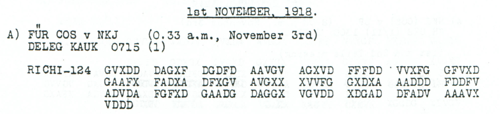

# No substitute for the Catholic divisional chaplain

The proposed wording says that providing a substitute or cover for the Catholic divisional chaplain there is not possible. It retains the literal OKM and RM2C designation and reference 38029; it does not name a chaplain or explain the reason.

**Complete edition by printed page:** [p. 103](../pages/103.md)

<!-- CASE-EDITION:START -->
<details>
<summary>Full source edition and evidence</summary>


[Case index](../README.md) · [ADFGVX Cipher](../../README.md) · [Reading conventions](../../docs/reading-conventions.md)

## p103 A

**Status:** 62/62 native raw positions fixed; 2 coordinate substitutions and 0 source-mask fills. No frame change.

**Source and dates:** Page heading: 1st NOVEMBER, 1918; A) FUER COS v NKJ (0.33 a.m., November 3rd); DELEG KAUK 0715 (1); RICHI-124.



<details>
<summary>Source and cipher evidence</summary>

**Raw output:**

```text
VERTRETUNGDORTXKATHXDIVXPFARRPRSNICHTMOEGLICKXOKMXRM2CNR38029X
```

**Edited output — counted proposal:**

```text
VERTRETUNGDORTXKATHXDIVXPFARRERSNICHTMOEGLICHXOKMXRM2CNR38029X
```

</details>

**Readable German — the same candidate labels with spacing and punctuation:**

> Vertretung dort kath. Div. Pfarrers nicht moeglich. OKM. RM2C Nr. 38029.

**Meaning:** The proposed wording says that providing a substitute or cover for the Catholic divisional chaplain there is not possible. It retains the literal OKM and RM2C designation and reference 38029; it does not name a chaplain or explain the reason.

**Conditional interpretation and source details:** Two observed-coordinate substitutions propose PFARRERS for PFARRPRS and MOEGLICH for MOEGLICK. All 62 raw positions are already fixed, and no source mask or frame change is used. RM2C and 38029 are preserved.

### Explicit source changes

All indices are zero-based.

| Source index | Printed | Proposed | Cost |
|---:|---|---|---|
| 22 | `X` | `G` | Observed-coordinate substitution |
| 63 | `V` | `F` | Observed-coordinate substitution |

### Reproducibility and attribution

The [input](../../experiments/nov1_nov2_native_dispatches/inputs.json) binds each literal source to exact PDF crops. The [certificate](../../experiments/nov1_nov2_native_dispatches/certificates.json) contains the raw paired-coordinate domains, each source change and the forward checks. The [verifier](../../experiments/nov1_nov2_native_dispatches/verify.py) checks the unchanged published keys and the live German quotations, retaining all numerical and letter labels.

Source edition and verification: icekylinx and GPT-6 Astra Pro (2026). Childs supplies the historical collection; published reconstruction and key provenance credit Lasry, Niebel, Kopal and Wacker. Earlier repository OCR and body readings are retained in the [attribution record](../../experiments/nov1_nov2_native_dispatches/prior_candidates.json).

</details>
<!-- CASE-EDITION:END -->
