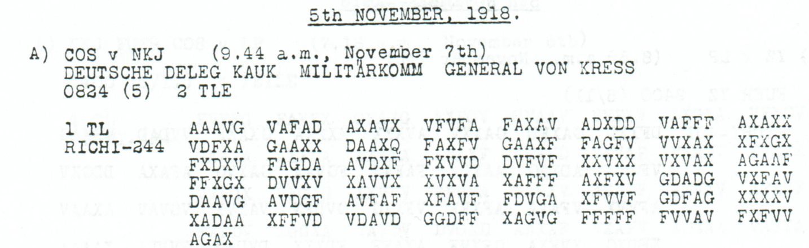
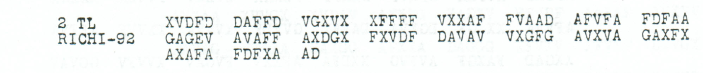

# Gokieloff sent back to Georgia; instruction not to transmit money

[Case index](../README.md) · [ADFGVX Cipher](../../README.md) · [Reading conventions](../../docs/reading-conventions.md)

## p136 A1

**Status:** 121/122 native raw positions fixed; 4 coordinate substitutions and 1 source-mask fill. No frame change.

**Source and dates:** Page heading: 5th NOVEMBER, 1918; A) COS v NKJ (9.44 a.m., November 7th); DEUTSCHE DELEG KAUK MILITAERKOMM GENERAL VON KRESS; 0824 (5) 2 TLE; 1 TL RICHI-244.



<details>
<summary>Source and cipher evidence</summary>

**Raw output:**

```text
ZUDORTPAT487LEOXGOKIELOFFXGOKIELOFFX9STWEGENKRAIKHEITVOMMILXGOUVXCZENNTOCHAUMITDDRCHREISESCHEINNAC?GEORGIENZURUECKGESANDTE
```

**Edited output — counted proposal:**

```text
ZUDORTPAT487LEOXGOKIELOFFXGOKIELOFFXISTWEGENKRANKHEITVOMMILXGOUVXCZENNTOCHAUMITDURCHREISESCHEINNACHGEORGIENZURUECKGESANDTX
```

</details>

**Readable German — the same candidate labels with spacing and punctuation:**

> Zu dort PAT487 Leo. Gokieloff, Gokieloff, ist wegen Krankheit vom Mil. Gouv. CZENNTOCHAU mit Durchreiseschein nach Georgien zurueckgesandt.

**Meaning:** The proposed body says the person written Gokieloff was sent back to Georgia because of illness, with a transit permit from the military governor at the literal place CZENNTOCHAU. Both occurrences of the surname are already directly read. The corrected opening reads Zu dort PAT487 Leo; PAT487 remains an opaque reference, and the place spelling is not normalized or mapped to a modern location.

**Conditional interpretation and source details:** The source prints DAAXQ, with a genuine noncoordinate Q at 54. One source-mask fill completes NACH. A separate enlargement resolves XFVVF with a final F, not the initial low-resolution T reading, so it is not counted as an erasure. Four observed-coordinate substitutions separately repair 9ST, KRAIKHEIT and DDRCH, and propose separator X for the final E after GESANDT. 487 and the literal opening and place fields are unchanged.

**Source transcription correction:** The original image reads `XAFFF` at row4/group5, not the earlier `XAFFX` transcription. Correcting source index144 changes raw `ZUPORT` to `ZUDORT` at plaintext position2. This is a correction to the repository transcription, with zero additional historical substitution cost. [Exact previous edition and audit](../../experiments/p136_source_glyph_correction/README.md).

### Explicit source changes

All indices are zero-based.

| Source index | Printed | Proposed | Cost |
|---:|---|---|---|
| 32 | `F` | `V` | Observed-coordinate substitution |
| 80 | `F` | `V` | Observed-coordinate substitution |
| 158 | `A` | `D` | Observed-coordinate substitution |
| 178 | `V` | `X` | Observed-coordinate substitution |
| 54 | `Q` | `G` | Source-mask fill |

## p136 A2

**Status:** 45/46 native raw positions fixed; 0 coordinate substitutions and 1 source-mask fill. No frame change.

**Source and dates:** Same A header and page as p136 A1; 2 TL RICHI-92.



<details>
<summary>Source and cipher evidence</summary>

**Raw output:**

```text
KEING?LDUEBERMITTELNXHEERESGRXKIEWX1CXHRW8536X
```

**Edited output — counted proposal:**

```text
KEINGELDUEBERMITTELNXHEERESGRXKIEWX1CXHRW8536X
```

</details>

**Readable German — the same candidate labels with spacing and punctuation:**

> Kein Geld uebermitteln. Heeresgr. Kiew. 1C. HRW8536.

**Meaning:** The second part instructs that no money be transmitted. The closing reads Heeresgr. Kiew, with the literal labels 1C and HRW8536. Those labels are not changed to a presumed staff branch or number prefix.

**Conditional interpretation and source details:** The printed GAGEV contains a clear out-of-alphabet E at source 43. One counted mask fill supplies E in GELD. The result uses the native 92-coordinate frame and no observed-coordinate substitution.

### Explicit source changes

All indices are zero-based.

| Source index | Printed | Proposed | Cost |
|---:|---|---|---|
| 43 | `E` | `A` | Source-mask fill |

### Reproducibility and attribution

The [input](../../experiments/gokieloff_return_payment_stop/inputs.json) binds each literal source to exact PDF crops. The [certificate](../../experiments/gokieloff_return_payment_stop/certificates.json) contains the raw paired-coordinate domains, each source change and the forward checks. The [verifier](../../experiments/gokieloff_return_payment_stop/verify.py) checks the unchanged published keys and the live German quotations, retaining all numerical and letter labels.

Source edition and verification: icekylinx and GPT-6 Astra Pro (2026). Childs supplies the historical collection; published reconstruction and key provenance credit Lasry, Niebel, Kopal and Wacker. Earlier repository OCR and body readings are retained in the [attribution record](../../experiments/gokieloff_return_payment_stop/prior_candidates.json).
