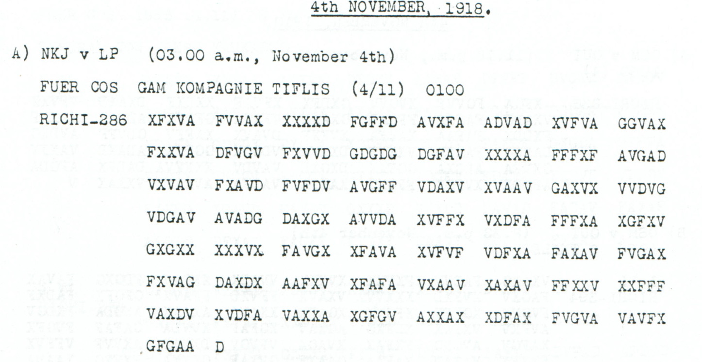

# Steiling asks for additional leave pending a decision

**Reading layers:** [Raw output · Edited output · Readable German · Conditional interpretation](../../docs/reading-conventions.md). In decoded streams, `?` marks one unresolved position; `X` and numeral/letter labels remain literal.

[Case index](../README.md) · [ADFGVX Cipher](../../README.md)

## p119 A

**Status:** 143/143 native raw positions fixed; 0 observed-coordinate substitutions and 0 source-mask fills in the proposal. No frame change. Key: Nov4-6.

**Source and dates:** Page heading: 4th NOVEMBER, 1918; A) NKJ v LP (03.00 a.m., November 4th); FUER COS GAM KOMPAGNIE TIFLIS (4/ 11) 0100; RICHI-286.



**Raw output:**

```text
DRINGENDESREKLAMATIONSGESUCHBRUDERSOBERJAEGERSXSTEILINGXUNTERWEGSXERBITTEDRAHTLICHNACHURLAUBBISENTSCHEIDUNGXXHPTMXSTEILINGXKRIEGSBEKLEIDUNGSAMT
```

**Edited output — counted proposal (identical to raw output):**

```text
DRINGENDESREKLAMATIONSGESUCHBRUDERSOBERJAEGERSXSTEILINGXUNTERWEGSXERBITTEDRAHTLICHNACHURLAUBBISENTSCHEIDUNGXXHPTMXSTEILINGXKRIEGSBEKLEIDUNGSAMT
```

**Readable German — the same candidate labels with spacing and punctuation:**

> Dringendes Reklamationsgesuch Bruders Oberjaegers Steiling unterwegs. Erbitte drahtlich Nachurlaub bis Entscheidung. Hptm Steiling, Kriegsbekleidungsamt.

**Meaning:** An urgent application concerning the brother identified as Oberjaeger Steiling is on its way. Hptm Steiling of the military clothing office requests additional leave by telegram until a decision is made. This is a request, not evidence that leave was granted; no personal identity is assigned.

**Conditional interpretation and source details:** All 286 received positions are observed ADFGVX coordinates and the complete 143-position plaintext re-encrypts exactly with no change. A high-resolution crop confirms the G in FVGVA; an initial low-resolution ambiguity is not treated as a source erasure.

### Explicit source changes

No observed-coordinate substitution or source-mask fill is used.

### Reproducibility and attribution

The [input](../../experiments/early_radio_and_leave_records/inputs.json) binds each literal source to exact PDF crops. The [certificate](../../experiments/early_radio_and_leave_records/certificates.json) records each raw paired-coordinate domain and every proposed source change. The [verifier](../../experiments/early_radio_and_leave_records/verify.py) checks the live German quotation against the same candidate labels, preserving every digit and unknown position.

This source edition is by icekylinx and GPT-6 Astra Pro (2026). Childs supplies the historical collection. The published reconstruction and unchanged key provenance credit Lasry, Niebel, Kopal and Wacker, with Lasry's published period-key list. Earlier repository OCR input is frozen in the [attribution record](../../experiments/early_radio_and_leave_records/prior_candidates.json); no first-decipherment priority is claimed.
