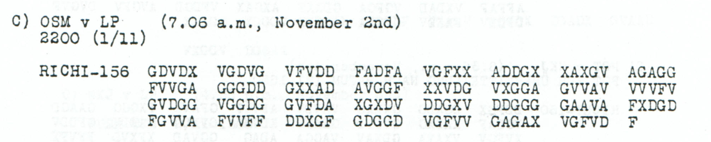

# Conditional consent to send a transmitter to Bucharest

The sender agrees to dispatch the device written 10TK SENDER to Bucharest if transport is possible. OSM and Nachchef 4B remain literal routing and signature labels.

**Complete edition by printed page:** [p. 103](../pages/103.md)

<!-- CASE-EDITION:START -->
<details>
<summary>Full source edition and evidence</summary>


[Case index](../README.md) · [ADFGVX Cipher](../../README.md) · [Reading conventions](../../docs/reading-conventions.md)

## p103 C

**Status:** 78/78 native raw positions fixed; 0 coordinate substitutions and 0 source-mask fills. No frame change.

**Source and dates:** Page heading: 1st NOVEMBER, 1918; C) OSM v LP (7.06 a.m., November 2nd); 2200 (1/11); RICHI-156.



<details>
<summary>Raw decoded text</summary>

**Raw output:**

```text
FUNKAOSMXMITENTSENDGX10TKSENDERSNACHBUKARESTWENNTRANSPMOEGLEINVERSTXNACHCHEF4B
```

</details>

**Readable German — the same candidate labels with spacing and punctuation:**

> Funka OSM. Mit Entsendg. 10TK Senders nach Bukarest, wenn Transp. moegl., einverst. Nachchef 4B.

**Meaning:** The sender agrees to dispatch the device written 10TK SENDER to Bucharest if transport is possible. OSM and Nachchef 4B remain literal routing and signature labels. No conversion of 10TK into a power rating is made, and this consent does not establish that the transmitter was shipped.

**Conditional interpretation and source details:** All 156 source coordinates and 78 plaintext positions are direct. Enlarged source groups are GGGDD and AVGGF, both with clear G glyphs; low-resolution C readings are resolved visual uncertainties, not printed erasures or historical edits. The technical label 10TK is kept exactly.

### Explicit source changes

No source-coordinate substitution or source-mask fill is used.

### Reproducibility and attribution

The [input](../../experiments/nov1_nov2_native_dispatches/inputs.json) binds each literal source to exact PDF crops. The [certificate](../../experiments/nov1_nov2_native_dispatches/certificates.json) contains the raw paired-coordinate domains, each source change and the forward checks. The [verifier](../../experiments/nov1_nov2_native_dispatches/verify.py) checks the unchanged published keys and the live German quotations, retaining all numerical and letter labels.

Source edition and verification: icekylinx and GPT-6 Astra Pro (2026). Childs supplies the historical collection; published reconstruction and key provenance credit Lasry, Niebel, Kopal and Wacker. Earlier repository OCR and body readings are retained in the [attribution record](../../experiments/nov1_nov2_native_dispatches/prior_candidates.json).

</details>
<!-- CASE-EDITION:END -->
