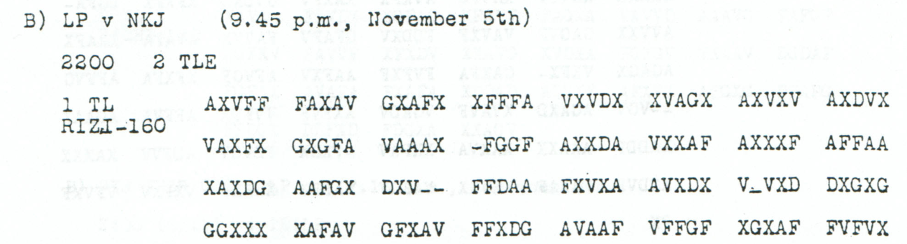

# Existing personnel and agreed radio transmissions

**Reading layers:** [Raw output · Edited output · Readable German · Conditional interpretation](../../docs/reading-conventions.md). In decoded streams, `?` marks one unresolved position; `X` and numeral/letter labels remain literal.

[Case index](../README.md) · [ADFGVX Cipher](../../README.md)

## p127 B1

**Status:** 76/80 native raw positions fixed; 1 observed-coordinate substitution and 3 source-mask fills in the proposal. No frame change. Key: Nov4-6.

**Source and dates:** Page heading: 4th NOVEMBER, 1918; B) LP v NKJ (9.45 p.m., November 5th); 2200 2 TLE; 1 TL RIZI-160.



**Raw output:**

```text
?I?RNOCHALTESPERSONAFXWIRSENDENWIEVERABREDETXWENNNICTMEHRDANNISTOS?AUSGESCHIE?EN
```

**Edited output — counted proposal:**

```text
HIERNOCHALTESPERSONALXWIRSENDENWIEVERABREDETXWENNNICTMEHRDANNISTOS?AUSGESCHIEDEN
```

**Readable German — the same candidate labels with spacing and punctuation:**

> Hier noch altes Personal. Wir senden wie verabredet. Wenn NICT mehr, dann ist OS? ausgeschieden.

**Meaning:** The sender says the previous personnel are still present and transmissions continue as agreed. The final sentence contains the literal defect NICT and an unresolved OS? label. If NICT is intended as NICHT, it conditionally links ceased transmissions with the departure of OS?; that missing H is not inserted into the cryptographic reading.

**Conditional interpretation and source details:** The first source group is AXVFF; ALTES is already present in the complete raw reading. The later group VFFGF contains a clear F, not an out-of-alphabet T; neither visual correction is a historical ciphertext edit. The proposal changes one observed coordinate and fills three printed masks. The fourth mask leaves OS? unresolved. NICT is retained without adding H. Only the first of two announced parts is included.

### Explicit source changes

All indices are zero-based. Printed masks retain their original slots.

| Source index | Printed | Proposed | Cost |
|---:|---|---|---|
| 2 | `V` | `X` | Observed-coordinate substitution |
| 55 | `-` | `A` | Source-mask fill |
| 93 | `-` | `D` | Source-mask fill |
| 94 | `-` | `A` | Source-mask fill |

### Reproducibility and attribution

The [input](../../experiments/early_radio_and_leave_records/inputs.json) binds each literal source to exact PDF crops. The [certificate](../../experiments/early_radio_and_leave_records/certificates.json) records each raw paired-coordinate domain and every proposed source change. The [verifier](../../experiments/early_radio_and_leave_records/verify.py) checks the live German quotation against the same candidate labels, preserving every digit and unknown position.

This source edition is by icekylinx and GPT-6 Astra Pro (2026). Childs supplies the historical collection. The published reconstruction and unchanged key provenance credit Lasry, Niebel, Kopal and Wacker, with Lasry's published period-key list. Earlier repository OCR input is frozen in the [attribution record](../../experiments/early_radio_and_leave_records/prior_candidates.json); no first-decipherment priority is claimed.
