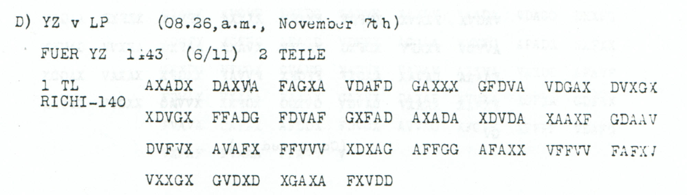

# Pera embassy address for Monsignore Dolci, reference 1882

**Reading layers:** [Raw output · Edited output · Readable German · Conditional interpretation](../../docs/reading-conventions.md). In decoded streams, `?` marks one unresolved position; `X` and numeral/letter labels remain literal.

[Case index](../README.md) · [ADFGVX Cipher](../../README.md)

## p147 D1

**Status:** 69/70 native raw positions fixed; 3 coordinate substitutions and 1 source-mask fill. No frame or key change.

**Source and dates:** Page heading: 6th NOVEMBER, 1918; D) YZ v LP (08.26 a.m., November 7th); FUER YZ 1[unclear]43 (6/11) 2 TEILE; 1 TL RICHI-140.



**Raw output:**

```text
DEUTSCHEBO1SCHAFTXPERAXNRX1882X?UERMONSIGNOREXDOLCIXUNTERSCHRIVTXSTUMM
```

**Edited output — primary counted proposal:**

```text
DEUTSCHEBOTSCHAFTXPERAXNRX1882XFUERMONSIGNOREXDOLCIXUNTERSCHRIFTXSTUMM
```

**Readable German — the same candidate labels with spacing and punctuation:**

> Deutsche Botschaft Pera. Nr. 1882. Fuer Monsignore Dolci. Unterschrift Stumm.

**Meaning:** The surviving first part gives the German Embassy at Pera, reference 1882, for the person named Monsignore Dolci, with a Stumm signature field. Neither name is identified beyond the literal text. The reading does not supply a second part or infer its substantive instructions.

**Conditional interpretation and source details:** The final glyph of the printed group FAFXJ at source 119 is J-like and outside the coordinate alphabet; that one position is masked. Filling it with V supplies the missing F in FUER. Three observed-coordinate substitutions separately repair BO1SCHAFT and UNTERSCHRIVT. The raw 1 inside BO1SCHAFT is not a numerical label silently relabeled: its change to T is paid for through actual source-coordinate substitutions. Reference1882 is untouched. The clear header time has an uncertain interior mark and is not normalized.

### Explicit source changes

All indices are zero-based.

| Source index | Printed | Proposed | Cost |
|---:|---|---|---|
| 90 | `F` | `A` | Observed-coordinate substitution |
| 108 | `A` | `X` | Observed-coordinate substitution |
| 131 | `G` | `V` | Observed-coordinate substitution |
| 119 | `J` | `V` | Source-mask fill |

### Reproducibility and attribution

The [input](../../experiments/nov6_evening_and_embassy_records/inputs.json) binds literal source rows to exact PDF crops. The [certificate](../../experiments/nov6_evening_and_embassy_records/certificates.json) records raw paired-coordinate domains, all proposed changes and the separately priced optional reading. The [verifier](../../experiments/nov6_evening_and_embassy_records/verify.py) checks the unchanged Nov4–6 key and all live German quotations, including every unknown position and digit.

Source edition and verification: icekylinx and GPT-6 Astra Pro (2026). Childs supplies the historical collection; published reconstruction and key provenance credit Lasry, Niebel, Kopal and Wacker. Earlier repository OCR input is frozen in the [attribution record](../../experiments/nov6_evening_and_embassy_records/prior_candidates.json). No first-decipherment priority is claimed.
