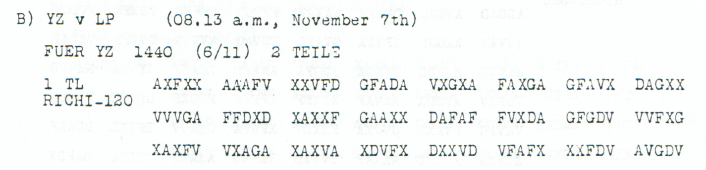

# German Embassy address and Auswaertig signature label

**Reading layers:** [Raw output · Edited output · Readable German · Conditional interpretation](../../docs/reading-conventions.md). In decoded streams, `?` marks one unresolved position; `X` and numeral/letter labels remain literal.

[Case index](../README.md) · [ADFGVX Cipher](../../README.md)

## p147 B1

**Status:** 60/60 native raw positions fixed; 1 coordinate substitution and 0 source-mask fills. No frame or key change.

**Source and dates:** Page heading: 6th NOVEMBER, 1918; B) YZ v LP (08.13 a.m., November 7th); FUER YZ 1440 (6/11) 2 TEILE; 1 TL RICHI-120.



**Raw output:**

```text
ANDEUTSCHEBOTSCHAFTXKONSTANTINOPEIXXUNTERSCHRIFTXAUSWAERTIGX
```

**Edited output — primary counted proposal:**

```text
ANDEUTSCHEBOTSCHAFTXKONSTANTINOPELXXUNTERSCHRIFTXAUSWAERTIGX
```

**Readable German — the same candidate labels with spacing and punctuation:**

> An deutsche Botschaft Konstantinopel. Unterschrift Auswaertig.

**Meaning:** The first of two announced parts gives an address to the German Embassy in Constantinople and an Unterschrift field reading Auswaertig. The proposal repairs the final city-name letter only. The next part and any substantive message body are not supplied here.

**Conditional interpretation and source details:** The native stream reads KONSTANTINOPEI. Changing source 116 V→A proposes KONSTANTINOPEL at a cost of one observed-coordinate substitution. All other words and the complete 120-slot frame remain unchanged. Auswaertig is not expanded by adding Amt.

### Explicit source changes

All indices are zero-based.

| Source index | Printed | Proposed | Cost |
|---:|---|---|---|
| 116 | `V` | `A` | Observed-coordinate substitution |

### Reproducibility and attribution

The [input](../../experiments/nov6_evening_and_embassy_records/inputs.json) binds literal source rows to exact PDF crops. The [certificate](../../experiments/nov6_evening_and_embassy_records/certificates.json) records raw paired-coordinate domains, all proposed changes and the separately priced optional reading. The [verifier](../../experiments/nov6_evening_and_embassy_records/verify.py) checks the unchanged Nov4–6 key and all live German quotations, including every unknown position and digit.

Source edition and verification: icekylinx and GPT-6 Astra Pro (2026). Childs supplies the historical collection; published reconstruction and key provenance credit Lasry, Niebel, Kopal and Wacker. Earlier repository OCR input is frozen in the [attribution record](../../experiments/nov6_evening_and_embassy_records/prior_candidates.json). No first-decipherment priority is claimed.
