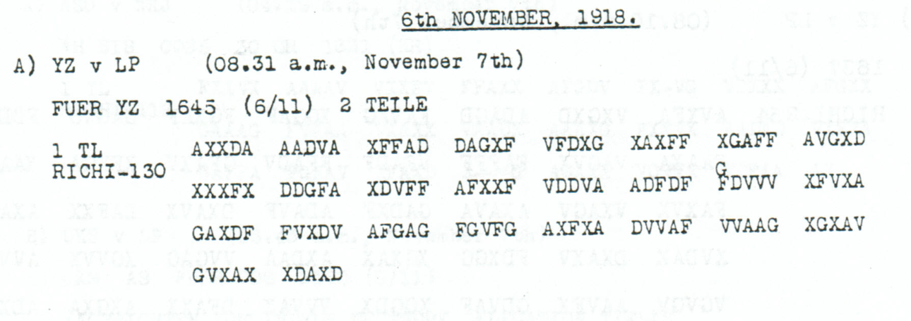

# German embassy address and abbreviated signature label, reference RM3D8956

[Case index](../README.md) · [ADFGVX Cipher](../../README.md) · [Reading conventions](../../docs/reading-conventions.md)

## p148 A1

**Status:** 65/65 native raw positions fixed; 5 coordinate substitutions and 0 source-mask fills. No frame change.

**Source and dates:** Page heading: 6th NOVEMBER, 1918; A) YZ v LP (08.31 a.m., November 7th); FUER YZ 1645 (6/11) 2 TEILE; 1 TL RICHI-130.



<details>
<summary>Source and cipher evidence</summary>

**Raw output:**

```text
DEUTSCHEBETSCHAFTXKONSTANTINOPEFXD4TERSC1RXAUSWAERTIGXRMX3XDX8956
```

**Edited output — counted proposal:**

```text
DEUTSCHEBOTSCHAFTXKONSTANTINOPELXUNTERSCHRXAUSWAERTIGXRMX3XDX8956
```

</details>

**Readable German — the same candidate labels with spacing and punctuation:**

> Deutsche Botschaft, Konstantinopel. Unterschr. Auswaertig. RM. 3. D. 8956.

**Meaning:** The first part addresses the German embassy in Constantinople and includes the abbreviated signature label UNTERSCHR followed by AUSWAERTIG. The closing retains RM, 3, D and 8956. This address and signature fragment does not establish the content of the second part, which is outside this edition.

**Conditional interpretation and source details:** The source has 130 coordinate slots and all 65 raw plaintext positions are fixed. The earlier OCR input has only 120 positions because it omits two complete five-coordinate groups, VDDVA and FDVVV. The baseline transcribes the printed F at source index 70; a G annotation stands directly above it. Adopting that annotated correction is explicitly charged as one of the five substitutions, and its isolated effect is shown below. The other four substitutions are linguistic proposals; no extra coordinate, source-mask fill or key change is used. The raw word-internal digits in D4TERSC1R are changed only by the explicit coordinate ledger. RM3D8956 is retained exactly. UNTERSCHR is not expanded by adding IFT, and AUSWAERTIG is not expanded by adding AMT.

### Explicit source changes

All indices are zero-based.

| Source index | Printed | Proposed | Cost |
|---:|---|---|---|
| 11 | `F` | `V` | Observed-coordinate substitution |
| 35 | `A` | `G` | Observed-coordinate substitution |
| 70 | `F` | `G` | Observed-coordinate substitution |
| 73 | `V` | `X` | Observed-coordinate substitution |
| 111 | `V` | `X` | Observed-coordinate substitution |

### Source annotation considered on its own

The above-line **G** at source index 70 is retained separately from the printed baseline **F**. Applying only this visible annotation costs one observed-coordinate substitution. It changes **BETSCHAFT** to **BOTSCHAFT**, while the other garbles remain:

<details>
<summary>Proposed text and exact labels</summary>

**Edited output — annotation-only branch, applying just source 70 F→G:**

```text
DEUTSCHEBOTSCHAFTXKONSTANTINOPEFXD4TERSC1RXAUSWAERTIGXRMX3XDX8956
```

</details>

The complete reading above costs five substitutions in total: this annotated F→G correction plus four further linguistic proposals. The 130-slot source frame is already present in the scan; restoring the two groups omitted by OCR does not insert anything into the original ciphertext.

### Reproducibility and attribution

The [input](../../experiments/nov6_embassy_8956_annotation/inputs.json) binds each literal source to exact PDF crops. The [certificate](../../experiments/nov6_embassy_8956_annotation/certificates.json) contains the raw paired-coordinate domains, each source change and the forward checks. The [verifier](../../experiments/nov6_embassy_8956_annotation/verify.py) checks the unchanged published keys and the live German quotations, retaining all numerical and letter labels.

Source edition and verification: icekylinx and GPT-6 Astra Pro (2026). Childs supplies the historical collection; published reconstruction and key provenance credit Lasry, Niebel, Kopal and Wacker. Earlier repository OCR and body readings are retained in the [attribution record](../../experiments/nov6_embassy_8956_annotation/prior_candidates.json).
