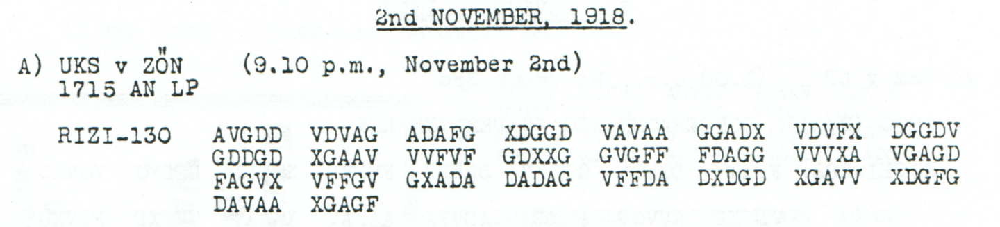

# Ringbahn call arrangement: 0345 after the other station's traffic

**Reading layers:** [Raw output · Edited output · Readable German · Conditional interpretation](../../docs/reading-conventions.md). In decoded streams, `?` marks one unresolved position; `X` and numeral/letter labels remain literal.

[Case index](../README.md) · [ADFGVX Cipher](../../README.md)

## p107 A

**Status:** 65/65 native raw positions fixed; 1 coordinate substitution and 0 source-mask fills. No frame change.

**Source and dates:** Page heading: 2nd NOVEMBER, 1918; A) UKS v ZON (9.10 p.m., November 2nd); 1715 AN LP; RIZI-130.



**Raw output:**

```text
WIRXRUFENXSIEXJEDEXRIN7BAHNPERIODEX0345NACHIHREMVERKEHRXWELLE1200
```

**Edited output — counted proposal:**

```text
WIRXRUFENXSIEXJEDEXRINGBAHNPERIODEX0345NACHIHREMVERKEHRXWELLE1200
```

**Readable German — the same candidate labels with spacing and punctuation:**

> Wir rufen Sie jede Ringbahnperiode 0345 nach Ihrem Verkehr, Welle 1200.

**Meaning:** The sender announces calls in each Ringbahn period, with the time label 0345 after the recipient's traffic and wavelength 1200. The single word proposal changes RIN7BAHN to RINGBAHN through a counted source-coordinate substitution. It leaves 0345 and 1200 unchanged.

**Conditional interpretation and source details:** The source has exactly the advertised 130 coordinates. One coordinate substitution repairs the ordinary Ringbahn word; the published square and every other label remain unchanged. No unit is added to WELLE 1200.

### Explicit source changes

All indices are zero-based.

| Source index | Printed | Proposed | Cost |
|---:|---|---|---|
| 36 | `G` | `F` | Observed-coordinate substitution |

### Reproducibility and attribution

The [input](../../experiments/nov1_nov2_native_dispatches/inputs.json) binds each literal source to exact PDF crops. The [certificate](../../experiments/nov1_nov2_native_dispatches/certificates.json) contains the raw paired-coordinate domains, each source change and the forward checks. The [verifier](../../experiments/nov1_nov2_native_dispatches/verify.py) checks the unchanged published keys and the live German quotations, retaining all numerical and letter labels.

Source edition and verification: icekylinx and GPT-6 Astra Pro (2026). Childs supplies the historical collection; published reconstruction and key provenance credit Lasry, Niebel, Kopal and Wacker. Earlier repository OCR and body readings are retained in the [attribution record](../../experiments/nov1_nov2_native_dispatches/prior_candidates.json). No first-decipherment priority is claimed.
