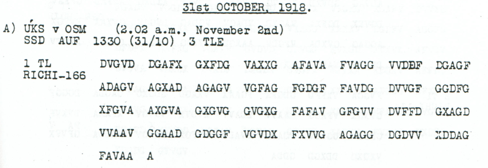

# Transmitter dispatch and a 220-volt converter motor

[Case index](../README.md) · [ADFGVX Cipher](../../README.md) · [Reading conventions](../../docs/reading-conventions.md)

## p87 A1

**Status:** 82/83 native raw positions fixed; 0 observed-coordinate substitutions and 0 source-mask fills in the proposal. No frame change. Key: Nov1-3.

**Source and dates:** Page heading: 31st OCTOBER, 1918; A) UKS v OSM (2.02 a.m., November 2nd); SSD AUF 1330 (31/10) 3 TLE; 1 TL RICHI-166.



<details>
<summary>Raw decoded text</summary>

**Raw output:**

```text
AKONACH18?ROEHRENSENDERANTAFUNKABGEGANGENXHIER10KWQOFSENDERUMFORMERMOTORFUER220VOLT
```

</details>

**Readable German — the same candidate labels with spacing and punctuation:**

> Akonach 18? Roehrensender an TAFUNK abgegangen. Hier 10 kW QOF-Sender Umformermotor fuer 220 Volt.

**Meaning:** A tube transmitter is reported dispatched to the designation TAFUNK. The remaining text lists a 10 kW QOF transmitter and a converter motor for 220 volts. QOF and TAFUNK are kept as literal technical or routing labels; the incomplete opening label 18? remains unresolved.

**Conditional interpretation and source details:** The clear printed E in EGAGF is outside the coordinate alphabet. Its single slot is retained as a source mask; it is not replaced to complete the opening label 18?. The 10 kW, 220 Volt, QOF and TAFUNK labels are preserved. The published Nov1–3 key decrypts this physical source, while the 31 October heading and 2 November reception date remain separate facts. No historical rekeying sequence is inferred.

### Explicit source changes

No observed-coordinate substitution or source-mask fill is used.

### Reproducibility and attribution

The [input](../../experiments/early_radio_and_leave_records/inputs.json) binds each literal source to exact PDF crops. The [certificate](../../experiments/early_radio_and_leave_records/certificates.json) records each raw paired-coordinate domain and every proposed source change. The [verifier](../../experiments/early_radio_and_leave_records/verify.py) checks the live German quotation against the same candidate labels, preserving every digit and unknown position.

This source edition is by icekylinx and GPT-6 Astra Pro (2026). Childs supplies the historical collection. The published reconstruction and unchanged key provenance credit Lasry, Niebel, Kopal and Wacker, with Lasry's published period-key list. Earlier repository OCR input is frozen in the [attribution record](../../experiments/early_radio_and_leave_records/prior_candidates.json).
