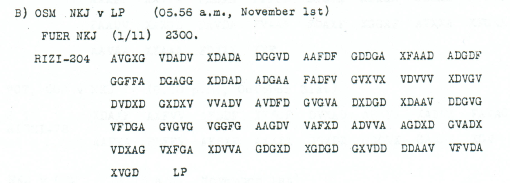

# Expected heavier traffic: direct UKS connection or OSM relay

Heavier traffic is expected. The sender asks whether a reliable direct connection to UKS exists or whether OSM must relay it.

**Complete edition by printed page:** [p. 88](../pages/088.md)

<!-- CASE-EDITION:START -->
<details>
<summary>Full source edition and evidence</summary>


[Case index](../README.md) · [ADFGVX Cipher](../../README.md) · [Reading conventions](../../docs/reading-conventions.md)

## p88 B

**Status:** 102/102 native raw positions fixed; 0 coordinate substitutions and 0 source-mask fills. No frame change.

**Source and dates:** Page heading: 1st NOVEMBER, 1918; B) OSM NKJ v LP (05.56 a.m., November 1st); FUER NKJ (1/11) 2300; RIZI-204; separate LP after the final ciphertext group.



<details>
<summary>Raw decoded text</summary>

**Raw output:**

```text
FUERXUKSXGROESSERERXVERKEHRXZUXERWARTENXHABENXSIEXSICHEREXVERBINDUNGMITXUKSXODERXMUSSXOSMXVERMITTELNXX
```

</details>

**Readable German — the same candidate labels with spacing and punctuation:**

> Fuer UKS. Groesserer Verkehr zu erwarten. Haben Sie sichere Verbindung mit UKS, oder muss OSM vermitteln?

**Meaning:** Heavier traffic is expected. The sender asks whether a reliable direct connection to UKS exists or whether OSM must relay it. The question does not establish that either link is functioning.

**Conditional interpretation and source details:** All 204 coordinate positions and 102 plaintext labels are directly observed. The separate LP following the final XVGD is retained as a visible source footer outside the advertised 204-coordinate body; it is not deleted from an encrypted stream. The question mark ending the German quotation is editorial punctuation, not an unresolved plaintext position.

### Explicit source changes

No source-coordinate substitution or source-mask fill is used.

### Reproducibility and attribution

The [input](../../experiments/radio_relay_and_march_notice/inputs.json) binds each literal source to exact PDF crops. The [certificate](../../experiments/radio_relay_and_march_notice/certificates.json) contains the raw paired-coordinate domains, each source change and the forward checks. The [verifier](../../experiments/radio_relay_and_march_notice/verify.py) checks the unchanged published keys and the live German quotations, retaining all numerical and letter labels.

Source edition and verification: icekylinx and GPT-6 Astra Pro (2026). Childs supplies the historical collection; published reconstruction and key provenance credit Lasry, Niebel, Kopal and Wacker. Earlier repository OCR and body readings are retained in the [attribution record](../../experiments/radio_relay_and_march_notice/prior_candidates.json).

</details>
<!-- CASE-EDITION:END -->
