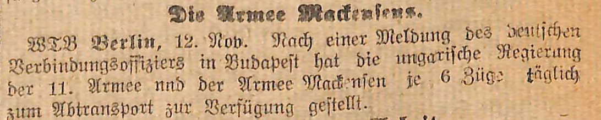
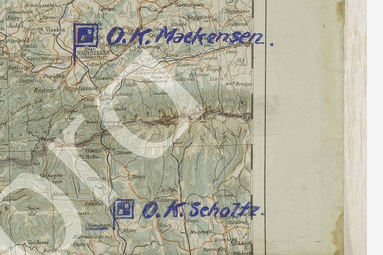

# An army trying to get home

[Historical studies](README.md) · [Selected discoveries](../historical-showcase.md) · [All readings](../../cases/README.md)

**Eighty thousand men and thirty thousand animals needed provisions.** A radio report received on 9 November 1918 asks for supply trains to Arad and for an approach to the Hungarian government. Those figures make the retreat tangible: an army could be ordered home, but it still needed food, fodder, railway access and permission to cross other people's territory. Our identification of a second intercepted copy restores the report's damaged quantity from surviving ciphertext, giving this history a firmer numerical anchor. [Read the Arad witnesses](../../cases/military/danube_arad_witnesses.md#p168-e).

## The size of the problem

The Arad message is terse even by the standards of military telegraphy:

> Verpflegung noch 14 Tage. 10 Tage. Verpfleg. Zuege nach Arad. Arad bei ungar. Regierung erwirken. STAEKE 80000 Mann, 30000 Tiere.

The spelling `STAEKE` is what the edited source retains; the sentence reports the force's strength. Its two duration fields, fourteen days and ten days, remain separate. The telegram does not explain their relationship clearly enough to assign one to men and the other to animals. The quantity **80000**, however, is directly fixed by the second copy's unchanged, fully observed coordinate pairs. It is not an estimate imported from a campaign history. The [earlier p159 reconstruction](../../cases/military/arad_provisions_partial.md) had left the leading quantity uncertain; the p168 E witness supplies the missing evidence and, reciprocally, receives three coordinate values from p159.

This recovery changes what can responsibly be written about the message. We can describe the reported scale, name the requested provisioning point, and see the dependence on a Hungarian political decision. We still cannot infer that the trains arrived or that every person and animal in the stated strength reached Arad. A request records a need and an intended remedy.

The same source family contains reports of movement across the Danube near Belgrade and the place written `SEMUM`. A completed crossing for one formation and busy crossing traffic appear alongside the provisioning problem. These are the two recurring rhythms of the withdrawal: getting across an obstacle, then finding enough supplies to continue. [Danube report and parallel witness](../../cases/military/danube_arad_witnesses.md#p164-c1).

## Permission to move

The political landscape changed while these orders were being transmitted. The armistice with Austria-Hungary, signed on 3 November, required German troops to leave Austro-Hungarian territory within fifteen days and provided for their internment if they remained. The Belgrade convention of 13 November regulated their passage through Hungary and placed communications and railways under Allied control. These clauses explain why a military route could no longer be treated as merely an internal marching order. [Contemporary armistice texts, military clause 5 and Belgrade clauses 11 and 14](https://history.state.gov/historicaldocuments/frus1919Parisv02/d110).

An intercepted [Hungarian armistice exchange](../../cases/military/hungarian_armistice_instructions.md) brings that predicament down to the level of staff work. It concerns German departure from Hungarian and South Slav territory, sends two general-staff officers to negotiations, and asks for instructions for both AOK 11 and the sender. Our reconstruction joins the second and third parts correctly and restores printed ciphertext omitted from the machine transcription. The historical result is a connected exchange about who was to negotiate and what guidance they needed.

A separate [Transylvania situation report](../../cases/military/transylvania_situation_report.md) begins with the phrase **“VOELLIGE DEROUTE IN SIEBENBUERGEN”**—complete rout in Transylvania—and links the military position to Hungary's armistice. Later surviving parts discuss security measures, the removal of material, and political circumstances not fully known at the reporting end. Two parts are still unlocated and the headers do not agree neatly. Even without forcing them into a single hour-by-hour narrative, the surviving text shows military planning being overtaken by political decisions and incomplete information.

## Six trains a day—for each army

The practical importance of Hungarian cooperation also appears in a contemporary public report. Under the heading **“Die Armee Mackensen,”** the *Central-Volksblatt* of 14 November carries a WTB dispatch from Berlin dated 12 November. Citing the German liaison officer in Budapest, it reports that the Hungarian government had made **six trains daily available to each of the Eleventh Army and Mackensen's army** for their removal. The crucial word is **je**: the six trains are stated for each army. [Original front page, Stadtarchiv Werl](https://www.werl.de/fileadmin/user_upload/Stadtarchiv/Titelseiten_aus_dem_Central-Volksblatt/14._November_1918.pdf).

*Central-Volksblatt, no. 265, 63rd year, Arnsberg and Werl, 14 November 1918, front page, lower right column. The dispatch is dated 12 November; the newspaper appeared two days later. [Source record, date strip and exact crop provenance](../../data/reviews/mackensen_railway_press.json).*

Read beside the Arad provisioning request and the negotiations over passage, this report supplies a concrete measure of the transport capacity said to have been promised. The tasks were connected: food and fodder had to be available at the route's staging points, while another government controlled the trains needed to leave. The newspaper records an announced allocation. It does not establish that six trains ran each day, how much they carried, or whether they were the supply trains requested for Arad. Its 12 November dispatch also precedes the Belgrade convention of 13 November, so it should not be described as that convention's implementation.

## Headquarters on the move

*A contemporary AOK 11 map for the withdrawal interval 13–18 November places O.K. Mackensen at Nagyszeben (Hermannstadt) and O.K. Scholtz at Calimanesti. Source: CAMO/TsAMO 500-12519-274, map no. 9, German-Russian archival digitization project. [Archive record and exact crop provenance](../../experiments/p163_headquarters_map_context/README.md). The symbols carry no individual dates.*

The map offers an independent view of the geography in the radio orders. The [long p163 instruction](../../cases/military/p163_A.md), received on 9 November, proposes a move of Scholtz's headquarters to Calimanesti. The map places his headquarters there during a later interval. It supports the reading of the place name; it does not certify the order's whole schedule. This is a useful meeting of two different kinds of evidence: an intercepted intention and a separately preserved operational map.

The terrain between the two headquarters also gives physical substance to the words “withdrawal” and “transport.” The orders had to be implemented through towns, valleys and mountain routes. The map belongs beside the telegrams because it makes their place names legible as a working landscape, without pretending that a line on a map proves a completed journey.

## From an ultimatum to a plea

The restored [p180 D1 evening report](../../cases/military/nov11_romanian_ultimatum_report.md), received on 11 November, states:

> Rumaen. Ultimatum forderte Raeumung 24 Stunden vor der Waffenstreckung. Nicht beantwortet.

It reports a Romanian evacuation ultimatum and says it was not answered. The damaged source required a specific duplicated-group and missing-group reconstruction. The time phrase is preserved literally; converting it into an exact calendar deadline would add information the message does not securely provide. The significant fact for this sequence is the reported ultimatum and the negative response field, **“Nicht beantwortet.”**

By 25 November, Mackensen's headquarters was appealing over the terms under which the army might return. In [the six-part appeal](../../cases/military/mackensen_armistice_appeal.md), it reports that Berthelot had conveyed Foch's refusal to apply the Western armistice conditions to the German southeastern front, together with a demand for disarmament and internment. The appeal asks, if compliance is unavoidable, for disarmament by Hungary and for internment to be waived. Provisioning appears again as a constraint on what could be done.

The German source edition also sharpens a consequential distinction: pending OHL's decision, headquarters would **merely acknowledge receipt** of the note. That is different from accepting its demands. The wording crosses a part boundary which earlier OCR had obscured. Restoring the source lines lets the administrative action be read more precisely than a broad paraphrase.

This appeal was already known to Childs and discussed by Lasry and his collaborators. Our contribution is its source-linked German edition, restoration of omitted source rows, and explicit treatment of the damaged fifth part. Its final warning remains striking: the proposed conditions could lead to **“Massenflucht,” “unsäglichem Elend”** and **“offener Auflehnung”**—mass flight, unspeakable misery and open resistance. These are the fears expressed by the sender, not a claim that all three outcomes followed.

## A promise of return, postponed

The sequence closes with a different voice. A letter originating on 29 November and intercepted on 2 December addresses the soldiers' council of Mackensen's army. Its sender, the executive council of the workers' and soldiers' councils of Greater Berlin, says that attempts to avoid internment have failed and urges calm and order. In its reconstructed third part it promises to seek conditions under which the men would suffer neither want nor deprivation and could return home healthy after peace was concluded. [Internment letter, p226–227](../../cases/military/mackensen_internment.md).

This letter, too, belongs to the previously published historical core. Read beside the newly strengthened Arad report, it reveals the distance between an army's immediate needs and its diminishing freedom to act. On 9 November the problem is how to feed men and animals at a transit point. By the end of the month, returning home has become a promise dependent on internment arrangements and a future peace.

### Evidence and contribution

The major new contribution in this dossier is the **two-copy restoration of the Arad report**, including its source-observed 80,000 figure. Other contributions are connected source editions, recovered part boundaries, local frame repairs and the independently documented map and press comparisons. The newspaper adds contemporary transport context; it supplies no ciphertext or additional deciphered letters. The Romanian ultimatum and the damaged fifth part of the Mackensen appeal remain explicitly reconstructed readings. Their linked case pages preserve the alternatives and exact costs. Childs and Lasry, Niebel, Kopal and Wacker retain credit for the previously published withdrawal, appeal and internment narratives; the [review of prior work](README.md#what-this-edition-contributes) defines our claims.

**Research and historical synthesis: icekylinx and GPT-6 Astra Pro, 4 November 2026.**
