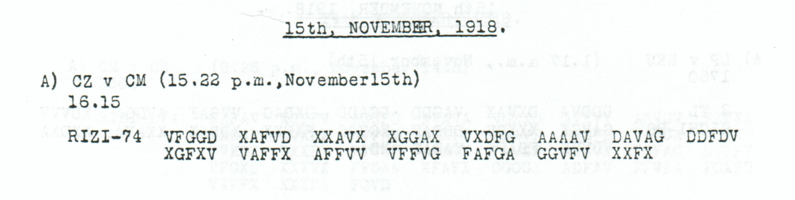

# Voices on the wireless

[Historical studies](README.md) · [Selected discoveries](../historical-showcase.md) · [All readings](../../cases/README.md)

Military wireless carried service enquiries and personal greetings alongside command orders. In November 1918 the operators' messages concerned council supervision, the custody of keys, colleagues' whereabouts and arrangements for departure. Their short forms and repeated names offer evidence of routine work during a change of political authority. The present edition places these records beside the previously published Kiel and Seifert messages and extends several readings through parallel receptions.

## Authority at the radio station

The order concerning Kiel demands that every station be placed firmly under an officer's immediate control. It directs that messages from Kiel be prevented from circulating and that texts already received be confiscated and destroyed. **“Größte Eile geboten”**—the greatest urgency is required. Childs and Lasry, Niebel, Kopal and Wacker had already discussed the order and its repeated first part; our [edition of p140 A and p146 A](../../cases/radio/kiel_radio_control.md) brings the physical copies together.

The order treats reception and circulation as matters of political control. The Kiel soldiers' council's own published demands provide a contemporary comparison. They called for freedom of speech and the press, an end to mail censorship, and council consent for future measures; they also called for order and accepted officers willing to support the council. [The fourteen points, published in the Schleswig-Holsteinische Volkszeitung, 5 November 1918](https://germanhistorydocs.org/en/weimar-germany-1918-1933/ghdi%3Adocument-3939).

A [message signed Seifert](../../cases/radio/seifert.md) reports soldiers' council supervision from 22:00 while asserting that the station and personnel remain in his hands. Its closing, **“Betrieb unverändert. Seifert,”** claims continuity of operation under the new supervision. This p168 A report was also part of the earlier historical literature. The source's spelling `SOLATENRATS` is retained in the exact edition.

Another [service message, p172 A](../../cases/radio/seifert.md#p172-a--136-slots--68-positions), reports that records have been destroyed while the keys remain in personal custody. Read together, the messages distinguish authority over the station, the survival of its records and control of its cryptographic material. Those responsibilities could change separately even while the station continued transmitting.

## Arrival, delay and supper

Several short telegrams concern the whereabouts and immediate needs of personnel:

| Source | Readable wording | Subject |
|---|---|---|
| [12 November arrival report](../../cases/radio/nov12_arrival_departure_and_car.md) | “Gut angekommen. Ist dort was los. SEIF.” | A safe arrival and an enquiry about activity at the other end. |
| [Car enquiry](../../cases/radio/nov12_arrival_departure_and_car.md) | “Wo bleibt Auto. KRAMM.” | The whereabouts of a car. |
| [14 November postponement, p193 C](../../cases/radio/nov14_15_departure_and_supper.md#p193-c) | “Abmarsch verschoben. Kein Grund zur Beunruhigung. Abm. erfolgt spaeter in vereinbarter Weise.” | A postponed departure, with reassurance that the agreed arrangements remain in force. |
| [Supper enquiry, p193 D](../../cases/radio/nov14_15_departure_and_supper.md#p193-d) | “Wollen warmes Abendbr. bereiten. Wiev. Koepfe.” | A proposed warm evening meal and a request for the number of people. |

The arrival and car messages decipher without repair; the postponement and supper readings require local corrections detailed in their editions. `SEIF`, `KRAMM` and the other shortened closings retain their transmitted forms. The supper enquiry was received five minutes before the neighbouring postponement record, but the source establishes no reply relationship between them.

A separate enquiry asks to be informed when Seifert has arrived. Two complementary receptions now support every plaintext pair: what is damaged in one copy survives in the other. Our [arrival-enquiry comparison](../../cases/radio/nov12_arrival_departure_and_car.md#p183-b) replaces the earlier completion of a damaged letter with physical evidence. Such repetition preserves information about a message's transmission as well as its content.

## Thirty-seven characters of farewell

*Childs, printed p196 A: a complete 74-coordinate body. [Source and decipherment](../../cases/radio/nov14_15_departure_and_supper.md#p196-a).*

The thirty-seven-character reading is **“ABFAHR. Wiedersehen. Gruesse, Kramm. Opitz.”** It requires no source correction. The shortened `ABFAHR` and the two closing names are retained; their full identities and precise roles are unknown. The message is a brief departure-related farewell carried over the same system used for operational orders.

Short service messages can rarely sustain a biography, but they document forms of interaction otherwise easily lost in a collection organized around military events. Here the record includes reassurance, practical assistance and greetings as well as instructions. Their brevity is part of the evidence: the participants could rely on circumstances and relationships already understood at the receiving end.

## People for whom “home” was an open question

A [30 October message about medical formations in Palestine](../../cases/military/palestine_medical_dissolution.md) reports the loss of specified field hospitals and medical companies except for parts of their personnel. It requests the formations' dissolution and orders the remaining personnel toward replacement units at home. Our comparison connects the repeated second part at p83 with the complete sequence at p79, restoring the medical antecedent of the administrative order. The numbered labels identify units; the message gives no casualty total or individual fates.

By late November the Foreign Office was seeking information about German civilians reported to have left Constantinople, principally women and children. The [four-part enquiry](../../cases/people/constantinople_civilians.md) asks whether the reports are correct, when and where the people went, and what is known of their whereabouts. It calls for verification through the Swedish legation. The headcount remains the unresolved numerical labels `0YY`.

The enquiry belongs to a documented dispute over the position of civilians after Mudros. Clause XIX required Germans and Austrians, civilian as well as military, to leave Ottoman territory within one month, with an allowance for remote districts. An independently preserved German appeal of 15 November requested permission for civilians to remain and cited the effects on hospitals and institutions caring for blind people and orphans. [Mudros, clause XIX](https://history.state.gov/historicaldocuments/frus1918Supp01v01/d368); [Lansing to House, 16 November, transmitting the appeal](https://history.state.gov/historicaldocuments/frus1919Parisv02/d5).

The intercepted message reports that the request had gone before the Allies and the Supreme War Council in Paris. Lansing's [15 November communication through the Swiss minister](https://history.state.gov/historicaldocuments/frus1919Parisv02/d4) independently documents that channel for German armistice appeals. The diplomatic records corroborate the subject and route of the enquiry; its damaged numerical and source-frame fields remain unresolved.

The service enquiries and civilian correspondence differ greatly in scale, yet both concern the administration of return: locating people, arranging reception and establishing permission to move or remain. The new medical and arrival-enquiry witness connections improve particular readings within that larger documentary sequence. Earlier interpretation of the Kiel and Seifert political messages remains credited to Childs and Lasry's team. [Research and attribution](README.md#what-this-edition-contributes).
