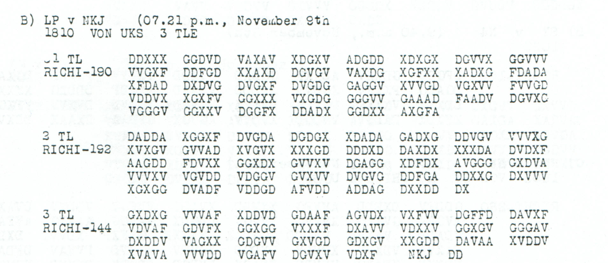

# What retreat cost

[Historical studies](README.md) · [Selected discoveries](../historical-showcase.md) · [All readings](../../cases/README.md)

**The retreat had a cash problem as well as a transport problem.** On 9 November 1918, Mackensen's headquarters asked for thirty million crowns to be flown to Brasso by giant aircraft. The money was needed for pay and purchases in Hungary, in a suitable mixture of large and small banknotes. A day later another message requested one million crowns each day by ordinary aircraft. A subsequent financial reply reported that a thirty-million request could only be met in instalments because notes were scarce. These texts expose the practical machinery of bringing an army home: someone still had to pay, buy, load, carry and confirm receipt.

## Thirty million crowns by air

The [three-part p167 B request](../../cases/finance/nov9_crown_airlift_and_embassy.md) joins directly across its first two parts:

> … um schleunige Sendung von dreissig Millionen Kronen mittels Riesenflugzeug nach Brasso …

Its next requirement is just as revealing:

> Angemessene Verteilung in grossen und kleinen Noten …

The amount is written out, **DREISSIG MILLIONEN**, so it does not depend on an interpretation of an uncertain numerical code. The second part—including **RIESENFLUGZEUG**, Brasso and the mixed-denomination request—deciphers without a repair. The whole three-part edition needs only one change to an observed coordinate and one fill of an invalid printed glyph. The message asks for an airlift; it does not report that one took place.

*Childs, printed p167 B. The second part begins with the giant-aircraft request and ends by asking for large and small notes. Its final `DX`, visible at the end of the last line, was omitted by earlier OCR. Restoring that printed pair repairs the transcription, not the historical ciphertext. [Source and pixel-verification record](../../experiments/nov9_crown_airlift_and_embassy/README.md).*

The distinction between a monetary total and spendable notes runs through this correspondence. An entry in a ledger would not, by itself, pay men or make purchases at the destination. The telegram explicitly asks for physical delivery and a useful mixture of denominations. Its final part says the local crown stock is limited and the exchange rate high. This is evidence of the sender's immediate cash circumstances, rather than a measure of currency conditions throughout the former monarchy.

## A daily million—and small notes

The [10 November p174 A request](../../cases/finance/crown_airlift.md) starts more abruptly:

> An OHL, Op. Kronenbedarf sehr dringend. Bitte täglich mit gewöhnlichem Flugzeug …

The continuation specifies **one million crowns**, alternately to Kronstadt and Hermannstadt. Here the sender proposes a regular flow in smaller consignments. The contrast with the previous day's giant-aircraft request shows two ways in which the communications traffic tried to turn a financial need into a transportable load. The surviving references do not establish that one plan formally superseded the other.

The last part breaks off in the source, followed by **“Did not finish.”** Its likely opening asked for the money in the smallest possible notes. We subsequently found a [complete later witness at p195 A2](../../cases/finance/crown_banknote_completion.md), which supplies the nineteen absent tail coordinates and independently selects the source-end gap from three earlier word-based possibilities. It reads, with one separately priced word repair:

> IN MOEGLICHST KLEINEN SCHEINEN SENDEN

This is one of the edition's most useful restorations. A complete copy changes the status of an interrupted instruction: the missing tail is now observed material. It also corrects the earlier conjecture at one position. Eighteen of the nineteen tail values in the readable common text are supplied literally by the new witness; the last remains an explicit correction. Finding another copy strengthened the reading and showed exactly where the first reconstruction had been wrong.

## A bank transfer enters the story

The [four-part financial reply on p205 A](../../cases/finance/p205_A.md), received on 17 November with an internal time/date of 16 November, explains that a shipment of thirty million crowns is possible only in instalments because of a severe shortage of banknotes. It reports that the Wiener Bankverein in Vienna is telegraphically transferring an initial **five million in mixed denominations** to the Austro-Hungarian Bank at Kronstadt, for the German rear-area administration.

The instruction then asks the recipient to report whether payment went smoothly and whether the amount was sufficient for the time being. If more was needed, another sum should be requested from the General War Treasury's Berlin branch. The reply thus exposes an institutional chain: the military request, a Vienna bank, a receiving bank in Kronstadt, the rear-area administration, and a possible further request to Berlin. The thirty-million amount closely connects the subject matter to the earlier traffic; the edition does not force the surviving references into a proven single correspondence chain.

There is a difference between a lack of usable notes at a particular place and a lack of currency in circulation. A later Allied currency commission reported that the Austro-Hungarian Bank continued issuing crowns after the monarchy's dissolution and expressed concern about their movement into successor territories. That later evidence helps frame the longer monetary dislocation; it does not independently verify the November transfer or the local shortage reported in p205. [Contemporary currency-commission recommendation, Appendix 91](https://history.state.gov/historicaldocuments/frus1919Parisv10/d12).

The financial messages are unusually revealing because they preserve both scale and texture: millions of crowns, but also the inconvenience of the wrong denominations and the need for a confirmation that cash had actually been paid out.

## A blocked line and a consignment of horseshoes

Money could secure a purchase without securing its delivery. A [7 November morning report](../../cases/military/nov7_derailment_and_trains.md) says that a goods train had derailed on the Gomel–Bachmatsch line and that both tracks were blocked. The number of wrecked wagons remains `2?`. The blockage is the report's clear operational point; selecting a plausible second digit would add no legitimate historical detail.

A later [Breslau dispatch](../../cases/military/p215_breslau_dispatch.md), with origin date 22 November, brings the transport problem down to individual pieces of equipment. Its reconstructed word layer names **Hufeisen**, **Hufnaegel** and **Schraubnaegel**—horseshoes, hoof nails and screw nails—and reports their dispatch from Breslau via Oderberg in wagonloads with accompanying personnel. Its quantities and formation labels are still unresolved. The route and equipment matter even without a numerical total: an army reporting thirty thousand animals in the [Arad provisions message](an-army-trying-to-get-home.md) also appears in this wider traffic as a consumer of shoes and nails. The records do not establish that this consignment was intended for those same animals.

The Breslau reading is conditional on a stated reconstruction of the damaged source frame. It deserves a place in the historical account because it recovers a coherent material subject and route, while keeping the uncertain quantities visible. It should not become a precise inventory merely because such an inventory would make a better story.

Cash, fodder, shoes, rails and telegrams belonged to the same practical problem. The great political decisions did not remove it. These requests show how much continued to depend on mundane acts—changing notes, keeping a line open, finding wagons, obtaining acknowledgment—after the intention to withdraw had become clear.

### Evidence and contribution

The new source work makes the crown requests readable as complete multipart messages and restores the interrupted small-note instruction through a physical second copy. The financial reply uses the published key and retains unresolved reference characters; the Breslau equipment dispatch remains a conditional frame reconstruction. The records establish requests and reports, not a completed airlift or audited payment. The project's claim is the **documented recovery, comparison and connected edition of these sources**, with prior key and body credits preserved in each case. [Prior-work review](README.md#what-this-edition-contributes).

**Research and historical synthesis: icekylinx and GPT-6 Astra Pro, 4 November 2026.**
