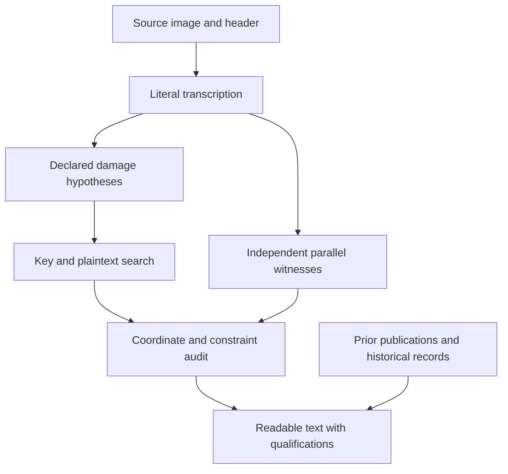

# How the readings are established

[ADFGVX Cipher](../README.md) · [Read the cases](../cases/README.md) · [Experiment index](../experiments/README.md)

**Research and editorial work: icekylinx and GPT-6 Astra Pro.**

This edition aims to make each proposed reading inspectable. A readable German
sentence is the beginning of a case page; the source, key, repairs and remaining
alternatives determine how much of that sentence is established.

## Start with the question you want to answer

| Your question | Where to look |
| --- | --- |
| What does a message most likely say? | The **Most likely reading** and explanation at the beginning of its [case page](../cases/README.md). |
| Which characters are actually determined? | The raw, unspaced text and character domains in that case's linked certificate. |
| How much was changed to obtain a readable sentence? | The explicit insertion, deletion, erasure-fill and known-coordinate substitution counts. |
| Who first published the reading or correction? | The case's attribution and [prior-reading registry](../data/prior_readings.json). |
| Can I check the arithmetic? | Run `python3 -m adfgvx.verify`; use the focused command in the case or experiment page for later additions. |
| What has already been tried on an open case? | The [experiment index](../experiments/README.md), including controls, input layers and completed search bounds. |

## What an ADFGVX key does

The implementation uses the coordinate alphabet `ADFGVX` and a 36-cell square
containing letters and digits. A plaintext character becomes two coordinates:
its row followed by its column. The resulting coordinate stream is written
across a rectangle, and its columns are transmitted in the order specified by
the transposition key. Decryption reverses these two operations.

In [the independent implementation](../adfgvx/cipher.py), `ranks[c]` is the
**one-based transmission rank of physical column `c`**. For example, ranks
`[3, 1, 4, 2]` transmit physical columns `1, 3, 0, 2`, using zero-based column
indices. This convention matters: a list of ranks and a list of columns in
readout order are inverse representations of the same permutation.

If the coordinate length is not divisible by the width, the leftmost physical
columns are one symbol longer. The library computes these lengths explicitly.
An odd coordinate count cannot represent an ordinary complete sequence of
two-coordinate characters, so decryption rejects it unless an unpaired-coordinate
model is requested explicitly. It never silently discards the final symbol.

A partial square retains unknown cells. A missing half-coordinate leaves a row
or column of possible characters; two missing coordinates can leave all 36.
These are **domains**, not independent choices: every occurrence must use one
globally consistent, injective square. Repeated cells therefore link dates,
serial numbers and words across messages that share a key.

## Keep the evidence layers visible

| Layer | What it establishes | Example |
| --- | --- | --- |
| Source transcription | What is printed in the inspected witness, including damaged or invalid glyphs. | [p198 D](../cases/p198.md) has 165 valid coordinates although its header says `CHI-170`. |
| Source-preserving calculation | What follows under a declared key and structural repair, preserving every known coordinate retained by that explicit hypothesis. | [p146](../cases/p146.md) fixes 117/122 positions after the documented duplicate deletion and missing-group insertion. |
| Explicit editorial repair | What becomes readable after specified fills or substitutions. | [p153b](../cases/p153b.md) has 33/54 raw positions; its 50/54 conditional template also needs the recorded repairs and separator interpretation. |
| Parallel transmission | What another independently inspected witness contributes to a damaged text. | [p152](../cases/p152.md) is linked to the fuller p136 transmission; [p109](../cases/p109.md) has a same-page near-parallel. |
| Historical interpretation | Why a name, abbreviation or event is plausible in context. | [p215](../cases/p215.md) costs `KORPSXKOSCH` explicitly and links contemporary command records. |
| Language ranking | Which permitted candidate a specified statistical model prefers. | The [p109 decoder](../experiments/parallel_decoder/README.md) ranks texts at exact source-edit budgets. |

These layers answer different questions. A historical record can support a name
without determining a damaged coordinate. A source-preserving result can remain
unreadable. An editorial sentence can be useful while several characters remain
conjectural. Case pages keep the readable interpretation alongside those limits.

Spaces and punctuation are editorial unless the raw text explicitly encodes
them. `X` is a decoded character that often serves as a separator. A question
mark in a raw string occupies one position; an ellipsis in readable prose does
not specify a number of missing characters. See the [notation guide](../cases/README.md#how-to-read-a-case).

## Follow a candidate back to its source



The [message catalog](../data/messages.json) keeps the literal source, earlier
online transcriptions and conservative analysis layers separate. Certificates
record which original coordinate supplies each plaintext position and which
coordinates were inserted, deleted, filled or changed. A source index and an
index after repair can differ, so the maps retain both. Machine-readable audit
indices are zero-based unless an individual record states otherwise.

The reverse check is re-encryption: does the proposed text, key and repair model
reproduce the stated reconstructed ciphertext? This catches inconsistent
squares, shifted indices and unreported edits. It proves arithmetic consistency
with that reconstruction. The historical plausibility of the reconstruction
still depends on the source and its alternatives.

## Two useful exact searches

### Compare disagreeing witnesses at a declared edit cost

For [p109](../experiments/parallel_decoder/README.md), two repaired/aligned
witnesses have 42 disagreeing known coordinates. At their minimum combined
coordinate cost, the choices already permit `2^42` full plaintexts under the
fixed complete key. Agreement alone cannot select a single message.

The decoder uses dynamic programming. For a four-gram objective, a prefix only
needs its last three characters and accumulated edit cost to determine every
possible future score increment. For a six-gram objective, it keeps five.
Keeping the best prefixes at each such state therefore gives an exact ranking
under the stated objective and budget, without a beam or a plaintext crib.

The report retains 280 candidates across two objectives, full/body-only scopes
and seven budgets. All 28 first-ranked strings share a 47-character interval
about a march toward Belgrade and no further events. **Thirty-three of those
positions were already unique at minimum source cost; fourteen are selected by
the models.** The distinction prevents model agreement from being counted as
new source evidence. `SAVE` and `SAVA` have equal combined coordinate cost, so
the readable case retains both river-name spellings.

### Locate scattered missing coordinates

Under the hypothesis that [p198 D](../cases/p198.md) lost exactly five symbols
from a 170-coordinate transmission, there are

\[
\binom{170}{5}=1,115,034,284
\]

possible loss masks. Restricting the damage to one contiguous five-symbol group
would cover only 166 placements. The scattered-loss hypothesis is substantially
broader, while still assuming no substitution, extra symbol or changed key.

For a fixed 16-column transposition, distribute the five losses among its
columns first. There are only

\[
\binom{16+5-1}{5}=15,504
\]

such allocations. Each allocation determines how to partition the received
stream into shortened columns. A dynamic program can then restore the
coordinates in plaintext order while remembering how many losses each column
has used and the short suffix needed by its scoring rule.

The [exact marginal experiment](../experiments/p198_exact_sparse/README.md)
uses this decomposition to cover every mask. Its four-gram score averages over
each uncertain character domain separately in each window. The recorded runs
need at most 243 active states per layer. Each domain-log value is rounded once
to float32 and summed exactly as an integer multiple of `2^-24`; the global
guarantee applies to **that quantized table**, with rounding bounds reported
separately. This is an exact optimum for each frozen complete key, not a search over all
possible keys or a proof that the damage hypothesis is correct.

The control is as useful as the speedup: one planted message with its **true
key supplied** still receives an incorrect optimal loss mask. The objective
prefers a wrong letter in the closing word. A complete search exposes this
scoring failure; a larger budget for the same objective cannot remove it.
The experiment records the planted text, winning mask, score margin and
rounding bound so that the failure can be reproduced.

The [joint decoder](../experiments/p198_joint_exact/README.md) goes further:
it chooses one concrete value for every inserted coordinate and uses that value
consistently in all overlapping windows. Its space has
`1,115,034,284 × 6^5 = 8,670,506,592,384` loss-and-fill witnesses per fixed key.
Witnesses can be aliases of the same plaintext. Exact merging keeps at most
`7^5 = 16,807` active states per layer in the recorded 16-column runs.

This removes the separate-window marginalization issue, but both true-key
controls still have wrong four-gram optima: four letters differ in one and two
in the other. Each wrong winner reproduces its synthetic received ciphertext
exactly. The independent [joint review](../data/reviews/p198_joint_exact_independent.json)
checks full re-encryption, exact model scores, all small exhaustive controls,
allocation counts and canonical tie handling. Exact computation and a correct
language preference are distinct requirements.

## What a completed search can justify

A positive control uses a known text and key with declared damage. Recovering
it demonstrates that the implementation can handle that particular regime.
A failed control reduces what can be concluded from an unsuccessful historical
run. The [p153 recovered-square follow-up](../experiments/p153_anchored_followup/README.md),
for example, preserves its failed matched control and does not exclude square
reuse.

An exhaustive result is always scoped to its inputs and assumptions. The
[p153 width checks](../experiments/p153_even_widths/README.md), together with the
[odd-width solver](../experiments/p153_odd_widths/README.md), cover every integer
width from 14 through 26 **for the declared sixty-letter crib and input model**.
They do not establish a universal exclusion of other messages or corruption
models. A completed enumeration of column lengths likewise does not imply that
every column permutation or substitution square was searched.

Source retrieval has a similar boundary. The [OCR similarity search](../experiments/source_similarity/README.md)
compares all 788 extracted blocks and recovers established parallels as
controls. Inspection of its best open-case hits finds no new parallel. That
finding applies to the retrieved corpus and checked candidates; OCR omissions
and unavailable sources remain possible.

## Reproduce at the appropriate level

Start with the standard-library certificate check:

```sh
python3 -m adfgvx.verify
```

The [CI workflow](../.github/workflows/verify.yml) also runs focused checks for
later research packages. Their READMEs explain which commands recompute a
compact certificate, independently verify an existing result, or rerun a full
search. Models and large corpora are rebuilt from the recorded provenance and
hashes; generated executables and model binaries are not repository evidence.

For a new proposed reading, preserve the source layer, report every repair,
re-encrypt the candidate, retain credible alternatives and credit earlier
contributors. The [contribution guide](../CONTRIBUTING.md) gives the repository
conventions. A coherent partial result with explicit limits is a useful outcome.
