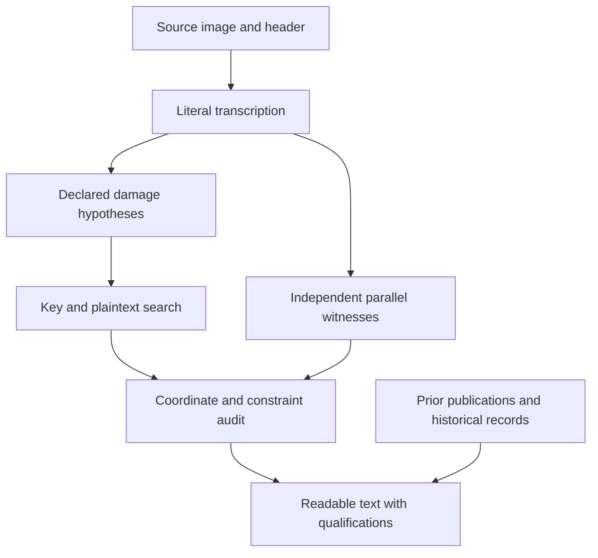

# Decipherment and source criticism

<a id="how-the-readings-are-established"></a>

[ADFGVX Cipher](../README.md) · [Browse the sources](../topics/README.md) · [Experiment index](../experiments/README.md)

**Research and editorial work: icekylinx and GPT-6 Astra Pro.**

Each reading is documented by its source transcription, key, reconstruction
costs and unresolved alternatives. The page edition presents the German text
and its English interpretation alongside that evidence.

## Reading and research resources

<a id="start-with-the-question-you-want-to-answer"></a>

| Research task | Resource |
| --- | --- |
| Interpretation | The **Readable German** text and English interpretation in its [page edition](../cases/pages/README.md). |
| Determined characters | The raw, unspaced text and character domains in the source's linked certificate. |
| Reconstruction costs | The explicit insertion, deletion, erasure-fill and known-coordinate substitution counts. |
| Attribution | The source edition's attribution and [prior-reading registry](../data/prior_readings.json). |
| Reproduction | Run `python3 -m adfgvx.verify`; use the focused command in the source edition or experiment report for later additions. |
| Completed searches | The [experiment index](../experiments/README.md), including controls, input layers and completed search bounds. |

## Substitution and columnar transposition

<a id="what-an-adfgvx-key-does"></a>

The implementation uses the coordinate alphabet `ADFGVX` and a 36-cell square
containing letters and digits. A plaintext character becomes two coordinates:
its row followed by its column. The resulting coordinate stream is written
across a rectangle, and its columns are transmitted in the order specified by
the transposition key. Decryption reverses these two operations.

In [the independent implementation](../adfgvx/cipher.py), `ranks[c]` is the
**one-based transmission rank of physical column `c`**. For example, ranks
`[3, 1, 4, 2]` transmit physical columns `1, 3, 0, 2`, using zero-based column
indices. This convention matters: a list of ranks and a list of columns in
readout order are inverse representations of the same permutation.

If the coordinate length is not divisible by the width, the leftmost physical
columns are one symbol longer. The library computes these lengths explicitly.
An odd coordinate count requires an explicit unpaired-coordinate model;
ordinary decryption accepts complete two-coordinate characters.

A partial square retains unknown cells. A missing half-coordinate leaves a row
or column of possible characters; two missing coordinates can leave all 36.
These are **domains**, not independent choices: every occurrence must use one
globally consistent, injective square. Repeated cells therefore link dates,
serial numbers and words across messages that share a key.

## Evidence layers

<a id="keep-the-evidence-layers-visible"></a>

| Layer | Evidentiary role | Example |
| --- | --- | --- |
| Source transcription | Literal observations in the inspected witness, including damaged or invalid glyphs. | [p198 D](../cases/pages/198.md#edition-cases-p198) has 165 valid coordinates although its header says `CHI-170`. |
| Source-preserving calculation | Character domains under a declared key and structural repair, preserving every known coordinate retained by the hypothesis. | [p146](../cases/pages/146.md#edition-cases-p146) fixes 117/122 positions after the documented duplicate deletion and missing-group insertion. |
| Explicit editorial repair | A proposed text after specified fills or substitutions. | [p153b](../cases/pages/153.md#edition-cases-p153b) has 33/54 raw positions; its 50/54 conditional template also needs the recorded repairs and separator interpretation. |
| Parallel transmission | Independent observations supplied by another inspected witness. | [p152](../cases/pages/152.md#edition-cases-p152) is linked to the fuller p136 transmission; [p109](../cases/pages/109.md#edition-cases-p109) has a same-page near-parallel. |
| Historical interpretation | Contextual support for a name, abbreviation or event. | [p215](../cases/pages/215.md#edition-cases-p215) costs `KORPSXKOSCH` explicitly and links contemporary command records. |
| Language ranking | Candidate ranking under a specified statistical model. | The [p109 decoder](../experiments/parallel_decoder/README.md) ranks texts at exact source-edit budgets. |

Historical identification can support a name without determining a damaged
coordinate. A source-preserving calculation may remain unreadable, while an
editorial interpretation may retain conjectural letters. The source editions
state these assumptions and unresolved fields beside each reading.

Spaces and punctuation are editorial unless the raw text explicitly encodes
them. `X` is a decoded character that often serves as a separator. A question
mark in a raw string occupies one position; an ellipsis in readable prose does
not specify a number of missing characters. See the [notation guide](reading-conventions.md#source-editions).

## Source tracing and re-encryption

<a id="follow-a-candidate-back-to-its-source"></a>



The [message catalogue](../data/messages.json) keeps the literal source, earlier
online transcriptions and conservative analysis layers separate. Certificates
record which original coordinate supplies each plaintext position and which
coordinates were inserted, deleted, filled or changed. A source index and an
index after repair can differ, so the maps retain both. Machine-readable audit
indices are zero-based unless an individual record states otherwise.

The reverse check is re-encryption: does the proposed text, key and repair model
reproduce the stated reconstructed ciphertext? This catches inconsistent
squares, shifted indices and unreported edits. It proves arithmetic consistency
with that reconstruction. The historical plausibility of the reconstruction
still depends on the source and its alternatives.

## Source geometry and parallel receptions

<a id="recover-text-from-source-geometry-and-independent-copies"></a>

Local group lengths and repeated receptions can reveal a useful repair even
when a message's total coordinate count appears correct. The new editions
apply three different source models:

| Source | Structural hypothesis | Result and word-repair cost |
| --- | --- | --- |
| [p154 A2](../experiments/p154_weisskirchen_fragment/README.md) | Exclude one observed D from a six-character group and prepend 45 unknown slots, matching the advertised 162. | 36/81 raw positions; the Weisskirchen and security phrases give 56/81 with two substitutions and 20 inserted-slot fills. |
| [p228 B2](../experiments/p228_demobilization_fragment/README.md) | Relocate five printed masks while retaining every source slot and the order of all observed coordinates. | 90/132 raw positions; the demobilization proposal gives 121/132 with five substitutions and 32 printed-mask fills. |
| [p168 C](../experiments/p168_munich_routing_witness/README.md) | Exclude one repeated D and insert one unknown in the separate short group; compare against original p159 observations. | 139/140 raw positions; a V observed in p159 fills the last slot without changing the 279 retained p168 coordinates. |

Each certificate separates the structural hypothesis from later word repairs.
For p168, the matching score uses only original p159 observations: previously
inferred coordinates cannot become independent evidence. Its optional joint
reading records every donor coordinate, including the p158 V that supports
`KABEL`; the remaining `DOWPELT` is kept literal.

## Exact searches for damaged texts

### Disagreeing witnesses and edit cost

<a id="compare-disagreeing-witnesses-at-a-declared-edit-cost"></a>

For [p109](../experiments/parallel_decoder/README.md), two repaired/aligned
witnesses have 42 disagreeing known coordinates. At their minimum combined
coordinate cost, the choices already permit `2^42` full plaintexts under the
fixed complete key. Agreement alone cannot select a single message.

Dynamic programming keeps the best prefix for each relevant state: its edit
cost and the last three characters for a four-gram score, or five for a
six-gram score. This gives an exact ranking under the chosen objective and
budget. All 28 recorded leaders share a 47-character interval about a march
toward Belgrade. Of those positions, **33 are unique at minimum source cost
and 14 are model-selected**. The equal-cost `SAVE` / `SAVA` river-name
alternatives remain in the readable edition.

### Scattered coordinate loss

<a id="locate-scattered-missing-coordinates"></a>

Under the hypothesis that [p198 D](../cases/pages/198.md#edition-cases-p198) lost exactly five symbols
from a 170-coordinate transmission, there are

\[
\binom{170}{5}=1,115,034,284
\]

possible loss masks. Restricting the damage to one contiguous five-symbol group
would cover only 166 placements. The scattered-loss hypothesis is substantially
broader, while still assuming no substitution, extra symbol or changed key.

For a fixed 16-column transposition, distribute the five losses among its
columns first. There are

\[
\binom{16+5-1}{5}=15,504
\]

such allocations. Each determines a partition into shortened columns.
Dynamic programming restores coordinates in plaintext order, retaining each
column's loss count and the suffix needed by the scoring rule.

| Decoder | Exact scope for each fixed complete key |
| --- | --- |
| [Marginal four-gram decoder](../experiments/p198_exact_sparse/README.md) | Every five-loss mask, scored by averaging each uncertain domain separately in each window. The optimum uses the frozen float32 table, summed exactly in units of `2^-24`; the package reports rounding bounds. |
| [Joint loss-and-fill decoder](../experiments/p198_joint_exact/README.md) | `1,115,034,284 × 6^5 = 8,670,506,592,384` witnesses, with each inserted coordinate shared consistently across overlapping windows. Exact merging retains at most `7^5 = 16,807` active states per layer in the recorded runs. |

Both methods expose a scoring limitation: even with the true key supplied,
some planted controls have incorrect optimal readings. The joint controls
differ from truth in four and two letters, while still reproducing their
received ciphertexts exactly. The [independent review](../data/reviews/p198_joint_exact_independent.json)
checks these outcomes, full re-encryption, exact scores and exhaustive small
controls. Search completeness establishes the optimum for the stated model;
it does not make that optimum the historical text.

## Search scope and control results

<a id="what-a-completed-search-can-justify"></a>

A positive control tests a known text and key with declared damage. Failed
matched controls limit the conclusions of an unsuccessful historical search.
Each package records its inputs, completed scope and control outcomes.

The
[p153 width checks](../experiments/p153_even_widths/README.md), together with the
[odd-width solver](../experiments/p153_odd_widths/README.md), cover every integer
width from 14 through 26 **for the declared sixty-letter crib and input model**.
Only width 18 fits that crib. Other corruption models and unsearched keys
remain separate questions. Source retrieval likewise covers the recorded
corpus and inspected candidates; the [experiment guide](../experiments/README.md)
links those completed searches.

## Reproduction

<a id="reproduce-at-the-appropriate-level"></a>

Start with the standard-library certificate check:

```sh
python3 -m adfgvx.verify
```

The [CI workflow](../.github/workflows/verify.yml) also runs focused checks for
later research packages. Their READMEs explain which commands recompute a
compact certificate, independently verify an existing result, or rerun a full
search. Models and large corpora are rebuilt from the recorded provenance and
hashes; generated executables and model binaries are not repository evidence.

For a new proposed reading, preserve the source layer, report every repair,
re-encrypt the candidate, retain credible alternatives and credit earlier
contributors. The [contribution guide](../CONTRIBUTING.md) gives the repository
conventions.
