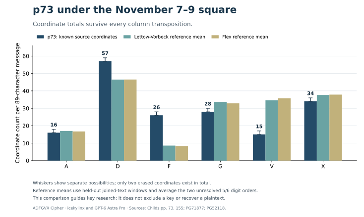

# p73: a coordinate-count check independent of column order

**ADFGVX Cipher · icekylinx and GPT-6 Astra Pro (2026)**

The published **Nov7–9** square is a poor empirical match for p73 under the tested ordinary-German prose assumptions. This is a way to prioritize research without relying on a transposition optimizer. It **does not exclude the key**, identify a replacement, prove the 26 October origin date, or recover plaintext.



## What the coordinates establish

A columnar transposition changes positions but preserves the total number of each coordinate. The source-audited counts are:

| Source | A | D | F | G | V | X | Unknown slots |
| --- | ---: | ---: | ---: | ---: | ---: | ---: | ---: |
| p73 | 16 | 57 | 26 | 28 | 15 | 34 | 2 |
| p155 A1, readable historical control | 21 | 33 | 10 | 38 | 28 | 39 | 1 |

Under the published Nov7–9 square, every `F` belongs to a pair encoding one of **C, J, M, O, Q, Z, or a digit**. Only `7 = FF` contributes two `F` coordinates. Consequently p73 needs **at least 13 of its 89 plaintext positions** from that set. If its body contains no digits, it needs at least **26 positions from CJMOQZ**. More generally, with at most *d* digits it needs at least `max(0, 26 − 2d)` of those six ordinary letters.

Those are exact conditional count bounds. They do not assume a column order or a language model, and the two unreceived coordinates can only increase the observed count of 26 `F`s. The bounds alone do not make a German plaintext impossible.

### The small V budget gives a second exact constraint

p73 contains only **15 observed `V` coordinates**. Filling both erased source positions with `V` would raise that total to at most **17**. In the Nov7–9 square, the ordinary letters `D E H K Q T U` each use one `V`, and `X = VV` uses two. Every other cell containing `V` is a digit, including one of the still-unassigned 5/6 cells. Therefore, for plaintext character counts \(n_c\),

\[
n_D+n_E+n_H+n_K+n_Q+n_T+n_U+2n_X\leq17.
\]

The unknown 5/6 assignment cannot weaken this inequality. A digit that uses `V` consumes part of the same budget.

Consequently there can be **at most eight encoded `X` characters**. If a proposed reading contains **five `X` characters**, at most **seven characters from DEHKQTU combined** remain possible. More generally, with *r* encoded `X`s, that seven-letter total is at most `17 − 2r`, with `0 ≤ r ≤ 8`.

This supplies a direct feasibility check for future proposed readings, even before a column-order search. It does not assign a number of separators: `X` can also be an ordinary letter, and its function must be read from context. Both the F and V bounds are conditional on this square and preservation of all 176 observed coordinates. They do not exclude an atypical body or select an encryption date.

## Held-out reference texts

The comparison uses two primary German war texts that were **absent from the repository's language-model training sources**:

- Paul Emil von Lettow-Vorbeck, [*Meine Erinnerungen aus Ostafrika*](https://www.gutenberg.org/ebooks/71877), 1920: a military commander's memoir.
- Walter Flex, [*Der Wanderer zwischen beiden Welten*](https://www.gutenberg.org/ebooks/52118), the 1918 edition: a literary account of a war experience.

[Source URLs and byte hashes](heldout_sources.json) pin the downloaded editions. The full books are not distributed in this repository.

For each book, the script removes the Gutenberg wrapper, expands German umlauts, retains A–Z and digits, and forms non-overlapping blocks of **89 characters for p73** or **85 for p155 A1**. It repeats the analysis with sentence punctuation represented by `X`. Each convention is reported separately. Windows never cross book boundaries.

Every block is converted to coordinate counts under Nov7–9. The mean and covariance come only from those reference blocks. The diagnostic is squared Mahalanobis distance using five counts; the sixth follows from the fixed total. No normal-distribution assumption is made.

The square's only unknown symbols are digits **5 and 6**. Both assignments are evaluated separately as reference encodings. For the historical target, the score chooses the most favorable completion of its missing coordinate counts: all 21 distributions of the two missing p73 coordinates, or all six choices for the p155 erasure. This changes no source transcription and makes no new digit assignment.

## Empirical results and the positive control

For p73, even the most favorable completion lies beyond every reference block under both digit assignments:

| Reference book | Convention | p73 reference blocks | Blocks at least as distant as p73 | Fraction at least as distant as readable p155 A1 |
| --- | --- | ---: | ---: | ---: |
| Lettow-Vorbeck | Joined letters/digits | 6,826 | 0 | 16.50% of 7,147 blocks |
| Lettow-Vorbeck | Sentence `X` | 7,003 | 0 | 7.02% of 7,332 blocks |
| Flex | Joined letters/digits | 1,348 | 0 | 7.72% of 1,412 blocks |
| Flex | Sentence `X` | 1,388 | 0 | 2.54% of 1,454 blocks |

The p155 fractions use the more favorable of the two reference digit assignments. p155 A1 is a useful independent control: it is the readable `POT v NKJ` shipping message intercepted five minutes before p73, under the published Nov7–9 key. Its [source and interpretation](../../cases/pages/155.md#edition-cases-context-p155) remain separate from this diagnostic.

These are **descriptive reference fractions, not p-values or probabilities of a key being correct**. Blocks within a book are not treated as independent random telegrams. War prose has different name, digit, abbreviation, and code-group distributions from operational radio traffic. The transformed conventions reuse the same text and are not pooled as separate evidence.

### A convention that fails the historical control

Putting `X` between **every word** makes the known p155 A1 body more distant than every reference block in both books. That failed control is retained in the [complete result](p73_histogram_result.json). It demonstrates why an unsuitable spacing convention cannot be used to reject a historical key. The main comparison above uses only joined and sentence-boundary conventions, for which p155 falls within the observed reference range.

## Consequence for further work

The diagnostic supports lowering the priority of **Nov7–9 square reuse** for p73 under ordinary German prose assumptions. The unresolved 26 October heading and origin marker still deserve separate archival investigation. Atypical names, extensive digits or code groups, another language, or different source damage remain possible. Reception on 8 November alone does not establish the enciphering key's date.

## Reproduce

NumPy and the two pinned public books are required. No quadgram or six-gram model is used.

```sh
python experiments/open_targets/p73_histogram.py \
  --cache /path/to/heldout-books --download

python experiments/open_targets/p73_histogram.py \
  --cache /path/to/heldout-books \
  --verify experiments/open_targets/p73_histogram_result.json \
  --output /path/to/reproduced_histogram.json
```

The [complete result](p73_histogram_result.json) includes literal source inputs, all count-completion choices that minimize distance, reference sample counts, count-matrix hashes, means, covariances, distance quantiles, both digit assignments, and the unsuccessful word-boundary convention.
