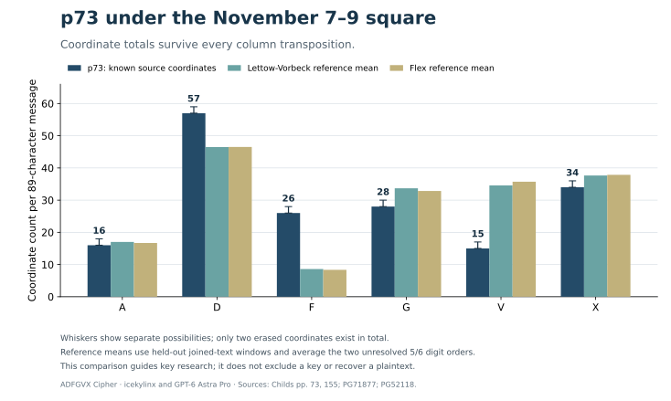

# Open-target follow-up

**ADFGVX Cipher · icekylinx and GPT-6 Astra Pro (2026)**

This package continues the investigation of **p73, p170, and p198 section D**. It contributes transposition-independent constraints for p73 and p170, calibrated new search coverage, explicit failed controls, and reproducible source-preserving candidates. **None of these three target bodies is deciphered by this package.** A language model's highest-scoring string is not presented as their most likely plaintext.

The source investigation also found useful near-parallel traffic on pp197–198. Those results have their own [transport follow-up](../transport_followup/README.md) and [certificate](../../data/certificates/p197_p198_transport.json). The readable neighboring sections B and E do not solve the target section D.

## Results that change the next research step

### p73: test the square before searching its column order

Under the published **Nov7–9** square, p73's 26 observed `F` coordinates require at least **13 of its 89 plaintext positions** to be from **CJMOQZ or digits**. If its body has no digits, at least **26 positions must be CJMOQZ**. These are exact conditional bounds: transposition cannot change coordinate totals, and only `7 = FF` contributes two `F`s.

Two held-out German war books put p73 beyond every reference window under both remaining 5/6 assignments and both joined-text and sentence-`X` conventions. The independently readable p155 A1 message falls inside those same reference ranges. A word-`X` convention fails that positive control and is explicitly retained as a failed sensitivity check.

This evidence lowers the priority of Nov7–9 reuse under the tested ordinary-German prose assumptions. It does not identify a replacement key or exclude names, digits, code groups, a different language, or additional source damage. See the [full coordinate-count report](p73-histogram.md), including source URLs, assumptions, and descriptive reference fractions.



### p170: seven D coordinates constrain every complete-body reading

The source's seven Ds impose exact weighted ordinary-letter count bounds under
the adjacent Nov7–9 and Nov10–12 squares, if all 106 received coordinates form
one complete 53-character body. These bounds are independent of width, rank,
column direction and unresolved digit assignments. No 53-character window in
either pinned German reference book meets them under joined or sentence-X
normalization; two unrestored operational references also exceed them.

The [case explanation](../../pages/170.md#edition-cases-p170-coordinate-count-constraint-for-a-complete-body)
gives the equations and limits. The compact [evidence record](p170_coordinate_budget.json)
is reproduced by `python experiments/open_targets/p170_coordinate_budget.py`;
add `--cache /path/to/heldout-books` to recompute all reference windows.
This is a necessary check on future candidates, not a key exclusion or proof
of truncation.

### p198 D: a concrete neighboring-group hypothesis was tested

The neighboring section E contains two adjacent literal `XAXVV` groups. Deleting either copy improves that section's agreement with p197 D. One possible explanation is a displaced five-coordinate group, because the target p198 D has 165 coordinates beneath a `CHI-170` header. The alternatives include independent duplication in E and independent loss or a different length interpretation in D.

We inserted **exactly `XAXVV` at every one of D's 166 boundaries**, preserving all 165 observed D coordinates, under all 24 informative fixed published key hypotheses: **3,984 exact cases**. A further search allowed arbitrary column orders at widths 14–22 under six anchored squares. All three fresh planted transfer controls recover the complete 85-character body, but no historical candidate supports a coherent reading. The transfer remains a tested hypothesis, not an established repair.

### Calibration separates optimizer failures from objective failures

The five-separate-loss experiment finds a wrong CHI13 control geometry that scores above the planted one. The [independent exact sparse decoder](../p198_exact_sparse/README.md) subsequently certifies the same failure under a frozen true square. That distinguishes a deficient ranking objective from merely insufficient search.

Two further controls remove every square anchor. They fail despite substantial configured budgets. One component method even receives the correct long/short column segmentation. Its planted text scores better than its returned text, so those trials demonstrate optimizer failure. They were not scaled into a historical campaign or used to exclude a historical key.

Held-out rescoring adds another warning: the wrong Nov13b joint-quad optimum outranks the planted text under **both independent reference books**, for quadgrams, six-grams, and their 30/70 mixture, with every tested separator convention. The CHI13 wrong incumbent is rejected by both mixed held-out models. See [the diagnostic](held-out-controls.md). Stronger n-grams or a changed training book alone do not supply an acceptance rule.

## Completed search coverage

Counts below describe distinct computational units. A configured annealing proposal slot is not a distinct key; an exact parameter enumeration may contain equivalent transformations; a geometry class can contain many column orders. Their totals should not be added together as a count of decipherments or unique keys.

| Branch | Historical scope | Completed work | Frozen result |
| --- | --- | ---: | --- |
| Anchored squares, arbitrary column order | p73 and p170; five squares, widths 16–22 | 70 cases; 7,000,000,000 configured proposal slots | [anchored snapshot](anchored_snapshot.json) |
| One unknown five-coordinate gap, arbitrary order | p198 D; six squares, widths 14–22 | 54 pilot cases plus 9 stronger CHI13 repeats; 1,170,000,000 configured slots | [gap results](gap_results.json) |
| Five separately located losses | p198 D; 24 fixed published rank orders, anchored square completion | 24 cases; 120,000,000 configured slots | [sparse results](sparse_results.json) |
| Literal neighboring `XAXVV`, fixed keys | p198 D; 24 key hypotheses × 166 boundaries | 3,984 exhaustive insertions | [direct transfer](direct_transfer_result.json) |
| Literal neighboring `XAXVV`, arbitrary order | p198 D; six anchored squares, widths 14–22 | 54 cases; 5,400,000,000 configured slots | [transfer results](transfer_results.json) |
| Separate row and column relabeling | p73, p170, p198 D; 24 fixed key hypotheses | 72 cases; 4,180,377,600 parameter evaluations | [relabel results](relabel_results.json) |
| Gap/length segmentation and monogram matching | p198 D; six squares, even widths 14, 16, 18, 20 | 235,666,548 exact geometry classes, then bounded refinement | [structure results](structure_results.json) |

The six variable-width square anchors are `CHI-Nov13`, `Nov13-15a`, `Nov13-15b`, `Nov16-18`, `Nov10-12`, and `CHI-Nov8-2026-recovery`. Fixed-key families use the 24 published entries with at least 19 known cells. Their exact frozen squares, rank orders, target ciphertexts, random seeds, budgets, and source/model hashes are embedded in each result record.

The 70-case anchored snapshot completes the planned campaign from [anchored_search](../anchored_search/README.md). It retains that experiment's model and scope; it does not relabel earlier unsuccessful work as a new solution.

### Exact enumeration and bounded refinement

<a id="what-is-exact-in-the-two-large-enumerations"></a>

The relabeling branch independently permutes row and column coordinate labels and tests both pair orientations: `6! × 6! × 2 = 1,036,800` transformations per fixed-key geometry. p73 and p170 each retain their literal length. p198 D tests every one of the 166 contiguous five-loss boundaries. This extends the earlier common-permutation convention screen. The published top 20 candidates per case retain exact partial-square arithmetic, even though ranking treats an unknown decoded letter as a whole-letter wildcard.

The structural branch considers all 166 gap boundaries and all assignments of long/short readout segments. At width *k*, it enumerates `166 × C(k, 170 mod k)` geometry classes. Within each class, a maximum-weight matching exactly optimizes its monogram relaxation and pair orientations. It then retains **1,024** best geometries with one selected matching apiece, searches their height-compatible pair orders, and allows two rounds of single-pair flips among 20 leaders. Keeping a finite seed set and one matching per class makes the language refinement a bounded procedure. It is not an exhaustive language search over every column order.

The matching implementation was independently checked against all **46,080** width-six key/gap combinations, covering **960** geometry classes. The [small-instance verification](structural_small_verification.json) records that calibration; the lightweight checker validates its counts without repeating the exhaustive run.

## Controls, including failures

The new controls use a freshly written 85-character German radio-style body that was absent from model training. Their evaluation-only plaintext and true key never enter the search process. The shorter/longer controls use the same body truncated or extended, so these are related mechanism checks rather than an independent estimate of recovery probability.

| Experiment | Control outcome | Evidence provided |
| --- | --- | --- |
| Contiguous unknown gap, widths 16/19/20 | Exact ranks and all 80 singleton letters correct in each; truth is in every erased-position domain | The implementation can recover these three planted geometries; the width-20 gap has a genuine source-equivalent alias |
| Literal-group transfer, widths 16/19/20 | Exact ranks and complete 85/85 plaintext in all three | The concrete-group search passes these positive controls |
| Separate row/column relabeling | p73-shaped 87/87, p170-shaped 53/53, p198-shaped 80/80 singleton letters; exact transformations | The convention enumeration handles all three tested shapes; p198 gap positions 70/71/72 are source-equivalent |
| Five separate losses, anchored square | Nov13a succeeds; Nov13b recovers a valid alias; CHI13 gets 79/80 singleton letters with a higher-scoring wrong loss position | A useful ranking failure; not evidence that additional random restarts would fix the objective |
| Structural matching and refinement | Width 16 recovers a compatible truth; width 20 selects the correct ranks but a wrong gap | The width-20 complete planted body is globally impossible under that returned geometry; D and W have empty cell domains |
| Unknown square, correct length segmentation supplied | Quad search: 11/87 correct singleton letters; mixed quad/six: 8/87 | Both planted texts score above the returned incumbents under the same objective; optimizer failure |
| Unknown square, fixed ranks, five separate losses | 49/80 singleton letters; wrong body scores above planted | More square freedom can overfit the language score; no historical campaign was launched from this failed control |

For loss hypotheses, preserving all known coordinates and placing the true letter in every positionwise domain do not automatically establish one globally consistent unknown square. [source_fit.py](source_fit.py) intersects every occurrence's allowed cells and checks injective assignment. Reported global witnesses re-encrypt to all observed coordinates; failed controls retain their empty-character or matching obstruction.

The gap and sparse objectives average each quadgram's probability over its allowed letter domains before taking a logarithm. Adjacent windows share letters, so this is a **composite score**, not a joint probability of an entire missing-text filling. The separate exact joint decoder makes the missing-coordinate choices consistent across all windows. Even that objective can prefer a wrong control text.

## Verify the published package

From the repository root:

```sh
python experiments/open_targets/verify_light.py
```

This standard-library check needs no binary language model, compiler, downloaded book, network, or search run. It independently reconstructs the cipher arithmetic, checks frozen input identities and square anchors, verifies source-preserving candidate witnesses, recomputes combinatorial scope, enumerates the 3,984 direct-transfer arithmetic cases, checks gap aliases and the exact p73 count bound, and recomputes held-out control scores from their published relevant n-gram counts. [Its saved report](light_verification.json) states the limits.

It **does not** rerun the searches, certify their C execution histories, rebuild all book counts, recompute covariance matrices, or re-evaluate binary-model language scores. The stronger checks below cover the published scores and corpus-derived statistics.

### Rebuild models and verify scores

The model specification and source hashes live in [joint_search/models/provenance.json](../joint_search/models/provenance.json). No challenge plaintext or these new controls enter training. The three binaries used here have the following SHA-256 identities:

| Binary | SHA-256 |
| --- | --- |
| `german_military36_quad.bin` | `fc450633e557d477d009fd9f682a0d6c96629d48a532c1dd2fbc42af0c73b46d` |
| `german_military37_quad_marginal.bin` | `2ccbde739f8b5b50ef81970c1c0bb7d1fd40a3a5a6b9914156bd947a90fcef8e` |
| `german_military36_sixgram.bin` | `79e1474e78afa0d208ffe4306b31ed3531786c2fc6a0c7efb4d2f3a7fd5e4b5a` |

Build into a separate work directory, then point score verification at those files:

```sh
python experiments/joint_search/tools/build_models.py \
  --cache /path/to/training-books --output /path/to/models

python experiments/open_targets/collect_results.py --kind gap \
  --model /path/to/models/german_military36_quad.bin \
  --verify experiments/open_targets/gap_results.json

python experiments/open_targets/collect_results.py --kind sparse \
  --model /path/to/models/german_military36_quad.bin \
  --verify experiments/open_targets/sparse_results.json

python experiments/open_targets/collect_results.py --kind transfer \
  --model /path/to/models/german_military36_quad.bin \
  --verify experiments/open_targets/transfer_results.json

python experiments/open_targets/collect_results.py --kind relabel \
  --model /path/to/models/german_military37_quad_marginal.bin \
  --verify experiments/open_targets/relabel_results.json

python experiments/open_targets/run_structure.py \
  --model /path/to/models/german_military37_quad_marginal.bin \
  --verify experiments/open_targets/structure_results.json

python experiments/open_targets/direct_transfer.py \
  --model /path/to/models/german_military37_quad_marginal.bin \
  --replay experiments/open_targets/direct_transfer_result.json \
  --output /path/to/reproduced_direct_transfer.json

python experiments/open_targets/audit_component_controls.py \
  --quad /path/to/models/german_military37_quad_marginal.bin \
  --six /path/to/models/german_military36_sixgram.bin \
  --output /path/to/reproduced_component_verification.json

python experiments/open_targets/run_sparse.py \
  --model /path/to/models/german_military36_quad.bin \
  --verify experiments/open_targets/unknown_square_control.json
```

The [histogram report](p73-histogram.md) and [held-out-control diagnostic](held-out-controls.md) give their independent source rebuild commands. Binary language models and full books are not committed here.

### Replay a search

`make -C experiments/open_targets` builds the seven C engines. The wrappers accept explicit `--model`, `--output`, and `--engine` paths. For example:

```sh
make -C experiments/open_targets

python experiments/open_targets/run_transfer.py \
  --model /path/to/models/german_military36_quad.bin \
  --output /path/to/transfer-controls --controls \
  --restarts 1000 --iterations 100000

python experiments/open_targets/run_transfer.py \
  --model /path/to/models/german_military36_quad.bin \
  --output /path/to/transfer-historical \
  --restarts 1000 --iterations 100000 --workers 3
```

Frozen recipes use 1,000 × 100,000 slots for gap controls, transfer controls/historical runs, the stronger nine CHI13 gap runs, and the unknown-square controls. The 54 gap pilots and 24 sparse historical runs use 100 × 50,000; anchored sparse controls use 100 × 20,000. Deterministic case-derived seeds are recorded in every run. The structural wrapper's `--run` option rebuilds missing seed/refinement traces; `verify_structural.py` repeats the small exhaustive calibration. Component controls have an explicit `--replay` option in their audit script.

Runtime and binary identity can vary by compiler or platform. Frozen record input hashes refer to the original pretty-printed records, including runtime metadata; they establish provenance, not an expectation that replayed wall-clock measurements are identical.

## Files and scope

- `*_results.json`, `anchored_snapshot.json`, and `*_control*.json` retain immutable search inputs, candidates, budgets, and calibration outcomes.
- `verify_light.py` supplies a model-free arithmetic and scope check; the individual wrappers and `collect_results.py` perform full score verification.
- `p73-histogram.md`, its result and SVG document the coordinate invariant and its independent references.
- `held-out-controls.md`, `joint_control_inputs.json`, and `heldout_control_scores.json` document post-hoc objective diagnostics without optimizing against the new books.
- [MANIFEST.json](MANIFEST.json) lists the package's committed source/data artifacts and their byte hashes; generated binaries, cache directories, and the manifest itself are excluded.

All source additions in this package retain the project's Apache-2.0 license and the joint credit **icekylinx and GPT-6 Astra Pro**. Historical/source authorship remains attributed to its original sources. No exact search bound or failed control is used to claim that p73, p170, or p198 D has no solution under a broader untested model.
